# Swimlane Diagram — Pharmacy Management System

## Mermaid Code

```mermaid
flowchart LR
    Start(["Start: Customer Presents Prescription"])

    subgraph Lane1["Customer / Patient"]
        C1["Present E-Prescription Code or Paper Rx"]
        C2["Review Medication & Dosage Guidance"]
        C3["Select Payment Method Cash or Card or QR"]
        C4["Receive Dispensed Medicine & Invoice"]
    end

    subgraph Lane2["Pharmacist"]
        P1["Input Prescription Code into POS"]
        P2["Review Prescription & Patient History"]
        P3{"Clinical Interaction Conflict?"}
        P4["Consult Physician or Apply Alternative Drug"]
        P5["Pick FEFO Inventory Batch & Scan Barcode"]
        P6["Attach Dosage Instruction Label to Package"]
    end

    subgraph Lane3["Pharmacy Management System"]
        S1["Fetch E-Rx Data & Verify Doctor License"]
        S2["Execute Drug-Drug & Allergy Check Engine"]
        S3["Recommend Optimal FEFO Inventory Lot"]
        S4{"Barcode Match Verified?"}
        S5["Deduct Batch Inventory & Update Stock Ledger"]
        S6["Generate Fiscal Sales Invoice"]
    end

    subgraph Lane4["Payment & Insurance Gateway"]
        G1{"Insurance Co-Pay Applicable?"}
        G2["Authorize Insurance Claim & Co-Pay Rate"]
        G3["Process Card / QR Cashless Payment"]
    end

    Finish(["End: Prescription Fulfillment Completed"])

    Start --> C1 --> P1 --> S1 --> S2 --> P2 --> P3
    P3 -->|"Yes: Alert Triggered"| P4 --> S2
    P3 -->|"No: Safe"| S3 --> P5 --> S4
    S4 -->|"No: Mismatch"| P5
    S4 -->|"Yes: Verified"| P6 --> G1
    G1 -->|"Yes"| G2 --> C3
    G1 -->|"No"| C3
    C3 --> G3 --> S5 --> S6 --> C2 --> C4 --> Finish
```

## Flow Description | Mô tả luồng

| Lane | Actor | Role in Flow |
|------|-------|-------------|
| 1 | Customer / Patient | Initiates the fulfillment flow by presenting prescription details, confirms medication dosage explanations, selects preferred payment method (cash, card, QR), and receives final packaged medicines with fiscal invoice. |
| 2 | Pharmacist | Captures prescription ID into system, evaluates clinical safety alerts, handles prescription modifications or physician consultations if interactions occur, picks medicine packages using FEFO lot suggestions, scans package barcodes, and prints/attaches dosage labels. |
| 3 | Pharmacy Management System | Automatically fetches e-prescription payloads, runs clinical decision rules engine for drug interactions and allergies, recommends target inventory batches via FEFO rules, validates barcode matches, updates batch inventory stock ledgers, and generates fiscal sales invoices. |
| 4 | Payment & Insurance Gateway | Handles external verification for insurance co-pay claims (Health Insurance Gateway) and processes card/QR electronic payment transactions (Payment Gateway). |
