# Action Tree — Pharmacy Management System

## Mermaid Code

```mermaid
graph TD
    Root["Pharmacy Management System"]

    Root --> M1["1. Prescription & Dispensing"]
    Root --> M2["2. Point of Sale & Billing"]
    Root --> M3["3. Inventory & Batch Management"]
    Root --> M4["4. Purchasing & Supplier Procurement"]
    Root --> M5["5. Customer & Loyalty Management"]
    Root --> M6["6. Narcotics & Compliance Tracking"]
    Root --> M7["7. Analytics & Reports"]
    Root --> M8["8. System Administration"]

    M1 --> A11["Verify E-Prescription"]
    M1 --> A12["Check Drug Interactions"]
    M1 --> A13["Select FEFO Inventory Lot"]
    M1 --> A14["Substitute Generic Drug"]
    M1 --> A15["Print Dosage Instruction Label"]

    M2 --> A21["Scan Product Barcode"]
    M2 --> A22["Apply Item & Tier Discount"]
    M2 --> A23["Process Insurance Co-Pay"]
    M2 --> A24["Process Cash / Card / QR Payment"]
    M2 --> A25["Generate Fiscal Invoice"]

    M3 --> A31["Maintain Master Drug Catalog"]
    M3 --> A32["Track Batch Expiration Dates"]
    M3 --> A33["Set Minimum Reorder Levels"]
    M3 --> A34["Perform Physical Stock Count"]
    M3 --> A35["Process Expired Drug Segregation"]

    M4 --> A41["Generate Purchase Requisitions"]
    M4 --> A42["Issue Supplier Purchase Orders"]
    M4 --> A43["Receive Goods Receipt Notes"]
    M4 --> A44["Perform Invoice Matching"]
    M4 --> A45["Maintain Vendor Performance Log"]

    M5 --> A51["Create Patient Profile"]
    M5 --> A52["Record Known Drug Allergies"]
    M5 --> A53["Manage Loyalty Rewards Points"]
    M5 --> A54["Send Automated Refill Reminders"]

    M6 --> A61["Log Narcotics Inward Register"]
    M6 --> A62["Log Controlled Dispensing Entries"]
    M6 --> A63["Reconcile Physical Narcotics Vault"]
    M6 --> A64["Export Regulatory Compliance Report"]

    M7 --> A71["Generate Daily Sales Summary"]
    M7 --> A72["Analyze Gross Margin per Item"]
    M7 --> A73["Monitor Fast-Moving vs Dead Stock"]
    M7 --> A74["Track Stockout Risk Index"]

    M8 --> A81["Manage User Accounts & Roles"]
    M8 --> A82["Configure POS Terminal Settings"]
    M8 --> A83["Configure Insurance API Credentials"]
    M8 --> A84["Audit System Security Logs"]
```

## Module Description | Mô tả Module

| # | Module | Description | Actions |
|---|--------|-------------|---------|
| 1 | Prescription & Dispensing | Handles the clinical validation, safety checking, batch selection, dosage labeling, and generic substitution of prescriptions. | Verify E-Prescription, Check Drug Interactions, Select FEFO Inventory Lot, Substitute Generic Drug, Print Dosage Instruction Label. |
| 2 | Point of Sale & Billing | Manages retail counter sales, barcode scanning, itemized pricing, discount application, insurance co-pay calculation, payment collection, and fiscal receipt printing. | Scan Product Barcode, Apply Item & Tier Discount, Process Insurance Co-Pay, Process Cash / Card / QR Payment, Generate Fiscal Invoice. |
| 3 | Inventory & Batch Management | Tracks master drug metadata, multi-batch shelf stock, manufacturing and expiry dates, automatic reorder alerts, physical inventory stock counts, and expired item disposal. | Maintain Master Drug Catalog, Track Batch Expiration Dates, Set Minimum Reorder Levels, Perform Physical Stock Count, Process Expired Drug Segregation. |
| 4 | Purchasing & Supplier Procurement | Manages procurement workflow, purchase requisitions, supplier purchase order dispatch, goods receipt matching (GRN), and vendor performance evaluations. | Generate Purchase Requisitions, Issue Supplier Purchase Orders, Receive Goods Receipt Notes, Perform Invoice Matching, Maintain Vendor Performance Log. |
| 5 | Customer & Loyalty Management | Stores patient demographic profiles, chronic disease and drug allergy histories, loyalty rewards program balances, and automated notification reminders. | Create Patient Profile, Record Known Drug Allergies, Manage Loyalty Rewards Points, Send Automated Refill Reminders. |
| 6 | Narcotics & Compliance Tracking | Maintains mandatory legally required ledgers for controlled substances, psychotropics, vault reconciliation, and automated Ministry of Health regulatory exports. | Log Narcotics Inward Register, Log Controlled Dispensing Entries, Reconcile Physical Narcotics Vault, Export Regulatory Compliance Report. |
| 7 | Analytics & Reports | Delivers business intelligence dashboards detailing sales performance, product profit margins, inventory turnover, fast/slow-moving drug analysis, and stockout projections. | Generate Daily Sales Summary, Analyze Gross Margin per Item, Monitor Fast-Moving vs Dead Stock, Track Stockout Risk Index. |
| 8 | System Administration | Controls platform configuration, user account management, role-based permissions (RBAC), POS device configuration, gateway API settings, and security audit logs. | Manage User Accounts & Roles, Configure POS Terminal Settings, Configure Insurance API Credentials, Audit System Security Logs. |
