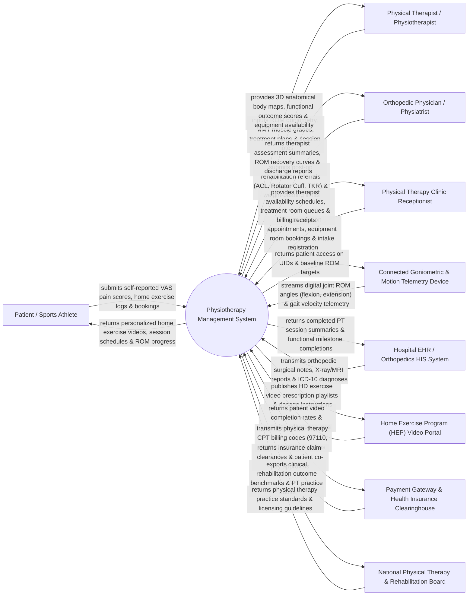

# Context Diagram — Physiotherapy Management System

## Mermaid Code

## Actor & Interaction Table | Bảng Actor & Tương tác

| # | Actor | Actor Type | Data Sent TO System | Data Received FROM System | Notes |
|---|-------|------------|---------------------|---------------------------|-------|
| 1 | Patient / Sports Athlete | Primary | Self-reported VAS pain scores (0-10), home exercise compliance logs, appointment bookings. | Personalized home exercise video guides, treatment session schedules, ROM recovery graphs. | Patient recovering from musculoskeletal injury, orthopedic surgery, or sports performance conditioning. |
| 2 | Physical Therapist / Physiotherapist | Primary | Joint ROM goniometry angles, Manual Muscle Testing (MMT 0-5 grades), treatment plans, session notes. | Interactive 3D anatomical body maps, functional outcome scores (Oswestry, DASH), room schedules. | Licensed physical therapist administering electrotherapy, manual therapy, and exercise rehabilitation. |
| 3 | Orthopedic Physician / Physiatrist | Primary | Post-operative rehabilitation referral orders, surgical protocols (e.g., ACL reconstruction), weight-bearing limits. | Therapist initial assessment summaries, ROM recovery curves, functional discharge clearance. | Orthopedic surgeon or physical medicine specialist referring patients for physical therapy. |
| 4 | Physical Therapy Clinic Receptionist | Primary | Appointment bookings, treatment room reservations, patient check-in registration, fee collections. | Therapist daily shift schedules, treatment room occupancy queues, billing invoices. | Clinic front-desk staff scheduling appointments, managing equipment rooms, and cashiering. |
| 5 | Connected Goniometric & Motion Telemetry Device | Supporting System | Digital joint angle telemetry (Knee/Shoulder ROM degrees), gait velocity, balance force plate metrics. | Patient session accession tokens, baseline ROM target benchmarks, calibration data. | Smart digital goniometer or wearable IMU motion sensor streaming joint angle telemetry. |
| 6 | Hospital EHR / Orthopedics HIS System | Supporting System | Surgical operation notes, X-ray/MRI imaging report links, primary ICD-10 diagnostic codes. | Completed PT session logs, functional outcome score trends, physical therapy discharge summaries. | Enterprise hospital information system linking orthopedic surgical units with rehabilitation clinics. |
| 7 | Home Exercise Program (HEP) Video Portal | Supporting System | Patient video streaming logs, exercise repetition completion tracking, patient feedback ratings. | HD exercise video prescription playlists, rep/set dosage instructions, therapist voiceovers. | External digital exercise video library portal delivering prescribed home exercise programs. |
| 8 | Payment Gateway & Health Insurance Clearinghouse | Supporting System | Health insurance clearance tokens, PT CPT code pre-authorizations, bank payment confirmations. | Physical therapy CPT billing claim batches (97110, 97112, 97140), itemized fee receipts. | Financial clearinghouse processing insurance claims for physical therapy modalities. |
| 9 | National Physical Therapy & Rehabilitation Board | Regulatory | Physical therapy clinical practice standards, mandatory safety guidelines, CEU accreditation rules. | Anonymized rehabilitation outcome benchmarks, PT clinic quality audit logs. | Professional licensing body governing physical therapy clinical standards and practice guidelines. |

## System Boundary Description | Mô tả Phạm vi Hệ thống

The **Physiotherapy Management System (PTMS)** is a specialized clinical software solution engineered for physical therapy clinics, outpatient rehabilitation centers, sports medicine institutes, and hospital physical therapy departments. It manages musculoskeletal initial assessments, Range of Motion (ROM) goniometry, Manual Muscle Testing (MMT), customized treatment plan formulation, Home Exercise Program (HEP) video prescriptions, electrotherapy/ultrasound modality logging, interactive 3D anatomical pain mapping, and functional outcome scoring (Oswestry, DASH, Lysholm).

**Inside System Scope:**
- Initial musculoskeletal physical assessment, posture analysis, gait analysis, and 3D body pain mapping.
- Range of Motion (ROM) goniometric angle logging (Active/Passive ROM) and MMT muscle strength grading (0-5 scale).
- Formulation of multi-week physical therapy treatment plans and daily treatment session charting.
- Home Exercise Program (HEP) builder with customized HD video playlists, set/rep dosage, and mobile tracking.
- Physical therapy modality execution logging (Ultrasound, TENS, Traction, Hydrotherapy, Dry Needling).
- Functional Outcome Score calculations (Oswestry Disability Index, DASH, Lysholm Knee Score, LEFS).
- Physical therapy equipment and treatment room scheduling (Traction tables, Hydrotherapy pools, Gym areas).
- Physical therapy CPT billing code generation (97110 Therapeutic Exercise, 97140 Manual Therapy, 97112 Neuromuscular).

**Outside System Scope:**
- Physical execution of joint mobilization or dry needling (performed by therapist hands).
- Physical manufacturing and maintenance of ultrasound/TENS hardware machines (handled by equipment vendor).
- Curative orthopedic surgical procedures in operating rooms (handled by Surgical System).
- Commercial corporate financial general ledger accounting (handled by enterprise ERP).
