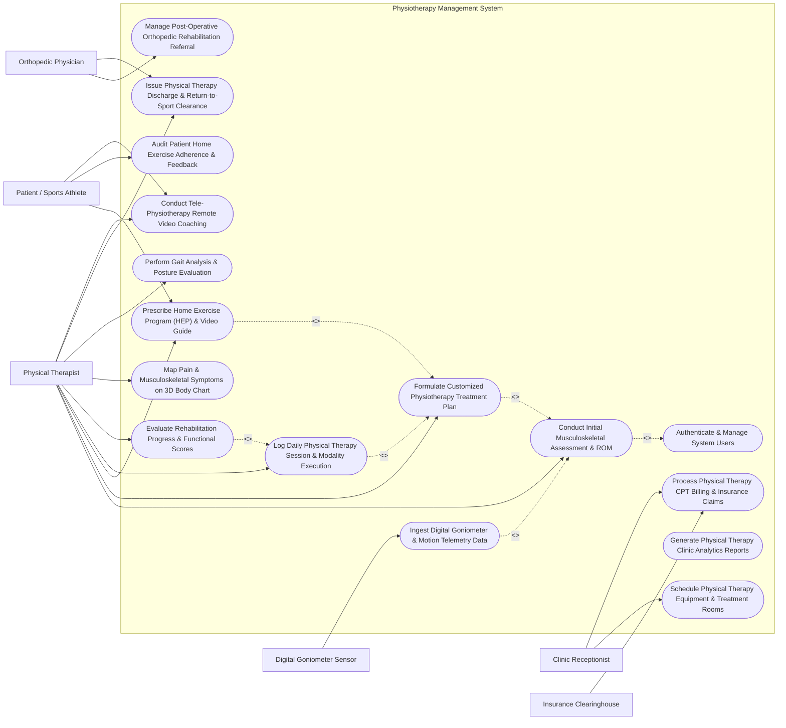

# Use Case Diagram — Physiotherapy Management System

## Mermaid Code

## Actor Table | Bảng Actor

| # | Actor | Actor Type | Role Description | Related Use Cases |
|---|-------|------------|------------------|-------------------|
| 1 | Patient / Sports Athlete | Primary | Individual receiving physical therapy, performing prescribed home exercises, logging pain levels, and attending sessions. | UC03, UC12, UC14 |
| 2 | Physical Therapist | Primary | Licensed clinician conducting musculoskeletal assessments, measuring ROM/MMT, designing treatment plans, and executing modalities. | UC01, UC02, UC03, UC04, UC05, UC06, UC11, UC13, UC14 |
| 3 | Orthopedic Physician | Primary | Referring surgeon or physiatrist issuing post-op rehabilitation orders and reviewing return-to-sport clearance summaries. | UC09, UC13 |
| 4 | Clinic Receptionist | Primary | Front-desk staff managing treatment room/equipment bookings, scheduling appointments, and handling CPT insurance billing. | UC07, UC10 |
| 5 | Digital Goniometer Sensor | Secondary / System | Connected goniometer or motion sensor streaming joint angle degrees directly into patient assessment records. | UC08 |
| 6 | Insurance Clearinghouse | Secondary / System | Financial clearinghouse validating physical therapy CPT codes (97110, 97140) and processing insurance claim reimbursements. | UC10 |

## Use Case Table | Bảng Use Case

| # | UC ID | Use Case Name | Primary Actor | Secondary Actor | Description | Priority |
|---|-------|---------------|---------------|-----------------|-------------|----------|
| 1 | UC01 | Conduct Initial Musculoskeletal Assessment & ROM | Physical Therapist | Digital Goniometer Sensor | Measure active/passive joint Range of Motion (ROM in degrees), Manual Muscle Testing (MMT 0-5 scale), and posture. | High |
| 2 | UC02 | Formulate Customized Physiotherapy Treatment Plan | Physical Therapist | None | Design a multi-week physical therapy rehabilitation plan setting short/long-term functional goals, modalities, and session counts. | High |
| 3 | UC03 | Prescribe Home Exercise Program (HEP) & Video Guide | Physical Therapist | Patient / Sports Athlete | Assign HD exercise video playlists (stretches, strengthening), sets/reps dosage, and push to patient mobile app. | High |
| 4 | UC04 | Log Daily Physical Therapy Session & Modality Execution | Physical Therapist | None | Document treatment session execution: manual therapy (CPT 97140), therapeutic exercise (CPT 97110), TENS, ultrasound, pre/post VAS pain. | High |
| 5 | UC05 | Evaluate Rehabilitation Progress & Functional Scores | Physical Therapist | None | Calculate standardized functional outcome scores (Oswestry, DASH, Lysholm), plot ROM recovery curves, and adjust treatment intensity. | High |
| 6 | UC06 | Map Pain & Musculoskeletal Symptoms on 3D Body Chart | Physical Therapist | None | Chart pain location, depth, radiating patterns, and VAS severity (0-10) on an interactive 3D anatomical body map. | Medium |
| 7 | UC07 | Schedule Physical Therapy Equipment & Treatment Rooms | Clinic Receptionist | None | Book specialized therapy rooms (Hydrotherapy pool, Traction suite, Electrotherapy bay) and equipment to prevent scheduling conflicts. | High |
| 8 | UC08 | Ingest Digital Goniometer & Motion Telemetry Data | Physical Therapist | Digital Goniometer Sensor | Wirelessly stream joint angle measurements (Knee flexion/extension degrees) from Bluetooth goniometers into assessment fields. | Medium |
| 9 | UC09 | Manage Post-Operative Orthopedic Rehabilitation Referral | Orthopedic Physician | Physical Therapist | Ingest post-op surgical protocols (e.g., ACL Reconstruction 12-Week Protocol) setting weight-bearing restrictions and ROM caps. | High |
| 10 | UC10 | Process Physical Therapy CPT Billing & Insurance Claims | Clinic Receptionist | Insurance Clearinghouse | Generate itemized physical therapy billing claims based on CPT codes (97110, 97112, 97140, 97010) and submit to insurance. | High |
| 11 | UC11 | Perform Gait Analysis & Posture Evaluation | Physical Therapist | None | Analyze walking/running gait parameters (cadence, stride length, stance phase) and postural alignment (scoliosis, head tilt). | Medium |
| 12 | UC12 | Audit Patient Home Exercise Adherence & Feedback | Patient / Sports Athlete | Physical Therapist | Track patient home exercise video completion rates, self-reported pain after exercise, and therapist adherence review. | Medium |
| 13 | UC13 | Issue Physical Therapy Discharge & Return-to-Sport Clearance | Physical Therapist | Orthopedic Physician | Issue final rehabilitation discharge summary, evaluating goal achievement, final ROM/MMT grades, and return-to-sport clearance. | High |
| 14 | UC14 | Conduct Tele-Physiotherapy Remote Video Coaching | Physical Therapist | Patient / Sports Athlete | Perform live video coaching session, correcting home exercise form, reviewing joint ROM visually, and adjusting exercise difficulty. | Medium |
| 15 | UC15 | Generate Physical Therapy Clinic Analytics Reports | Physical Therapist | None | Produce clinic metrics: average ROM recovery days, patient satisfaction ratings, therapist utilization %, and CPT revenue. | Medium |
| 16 | UC16 | Authenticate & Manage System Users | All Users | None | Enforce multi-factor authentication, role-based access control (Therapist, Receptionist, Doctor), and HIPAA data privacy. | High |

## Use Case Specification | Đặc tả Use Case

---

### UC01 — Conduct Initial Musculoskeletal Assessment & ROM

| Field | Detail |
|-------|--------|
| **UC ID** | UC01 |
| **Use Case Name** | Conduct Initial Musculoskeletal Assessment & ROM |
| **Actor(s)** | Primary: Physical Therapist   Secondary: Digital Goniometer Sensor |
| **Description** | Conducts a comprehensive initial physical therapy assessment of the patient's musculoskeletal condition, measuring joint Range of Motion (ROM) in degrees using a goniometer, evaluating Manual Muscle Testing (MMT 0-5 scale), assessing posture and gait, and charting baseline VAS pain scores (0-10). |
| **Precondition** | 1. The patient is registered in PTMS and present in the assessment room.   2. The Physical Therapist is authenticated with clinical assessment privileges. |
| **Main Flow** | 1. The Therapist opens "New Initial Musculoskeletal Assessment" for the patient.   2. The Therapist records Chief Complaint (e.g., "Right Knee Pain & Stiffness Post-ACL Reconstruction 4 weeks ago").   3. The Therapist charts **Visual Analog Scale (VAS) Pain Score**: 6 / 10 at rest; 8 / 10 during weight bearing.   4. The Therapist conducts **Range of Motion (ROM) Goniometry**:   &nbsp;&nbsp;&nbsp;&nbsp;- **Right Knee Flexion**: Active ROM = 85° / Passive ROM = 90° (Normal Target = 135° -> Deficit: -45°)   &nbsp;&nbsp;&nbsp;&nbsp;- **Right Knee Extension**: Active ROM = -5° extension lag (Normal Target = 0°).   5. The Therapist performs **Manual Muscle Testing (MMT 0-5 Scale)**:   &nbsp;&nbsp;&nbsp;&nbsp;- Right Quadriceps: Grade 3+ / 5 (Fair+ — Moves against gravity with minimal resistance)   &nbsp;&nbsp;&nbsp;&nbsp;- Right Hamstrings: Grade 4 / 5 (Good — Moves against moderate resistance).   6. The Therapist performs Special Orthopedic Tests (e.g., Lachman Test: Mild laxity 1+; Anterior Drawer Test: Negative).   7. The System aggregates measurements, compares them against normal age-gender baseline ROM charts, and saves the assessment to feed Treatment Planning (UC02). |
| **Alternative Flow** | **AF1** — Bluetooth Goniometer Telemetry Ingestion: The Therapist connects a Bluetooth Digital Goniometer sensor (UC08); as the joint flexes, the sensor streams real-time angle degrees directly into the ROM active/passive fields.   **AF2** — Upper Extremity Shoulder Assessment: For a rotator cuff injury, the Therapist measures Shoulder Abduction, External Rotation, Internal Rotation, and performs Neer / Hawkins-Kennedy impingement tests. |
| **Exception Flow** | **EX1** — Acute Severe Pain / Spasm Interruption (VAS = 10/10): If joint movement causes acute severe pain (VAS 10/10), the System prompts "Assessment Paused — Gentle Passive Assessment Only".   **EX2** — Post-Op Weight-Bearing Limit Breach Warning: If the Therapist attempts to test full weight-bearing MMT on a patient with strict "Non-Weight Bearing (NWB)" surgeon orders, the System flashes a red "POST-OP NWB RESTRICTION WARNING". |
| **Postcondition** | ROM joint angles, MMT muscle grades, VAS pain scores, and special test results are saved in the patient chart, forming the baseline for treatment planning. |
| **Business Rule** | **BR1**: Range of Motion (ROM) measurements MUST record both Active ROM (patient moved) and Passive ROM (therapist moved) in degrees.   **BR2**: Post-operative physical therapy assessments MUST strictly verify surgeon weight-bearing orders (NWB, PWB, FWB) before initiating physical testing. |

---

### UC02 — Formulate Customized Physiotherapy Treatment Plan

| Field | Detail |
|-------|--------|
| **UC ID** | UC02 |
| **Use Case Name** | Formulate Customized Physiotherapy Treatment Plan |
| **Actor(s)** | Primary: Physical Therapist |
| **Description** | Establishes a customized, goal-oriented physical therapy rehabilitation plan based on initial assessment findings, setting short-term and long-term SMART functional goals, specifying session frequency and total duration, and assigning physical therapy treatment modalities and therapeutic exercise protocols. |
| **Precondition** | 1. Initial musculoskeletal assessment (UC01) is completed.   2. Surgeon post-op protocol (if applicable) is attached. |
| **Main Flow** | 1. The Therapist opens "Formulate Treatment Plan" linked to Assessment ID `AST-2026-0819`.   2. The Therapist defines **SMART Rehabilitation Goals**:   &nbsp;&nbsp;&nbsp;&nbsp;- **Short-Term Goal (2 Weeks)**: Increase Right Knee Flexion ROM from 85° to 110°; reduce VAS pain from 6/10 to 3/10.   &nbsp;&nbsp;&nbsp;&nbsp;- **Long-Term Goal (8 Weeks)**: Achieve full Right Knee Flexion (135°), Quad MMT Grade 5/5, and return to independent jogging.   3. The Therapist configures **Plan Schedule & Duration**:   &nbsp;&nbsp;&nbsp;&nbsp;- Frequency: 3 Sessions per Week   &nbsp;&nbsp;&nbsp;&nbsp;- Total Duration: 6 Weeks (Total 18 Prescribed Sessions).   4. The Therapist prescribes **Treatment Modalities & Interventions**:   &nbsp;&nbsp;&nbsp;&nbsp;- **Phase 1 (Weeks 1-2)**: Cryotherapy (15 mins), TENS Electrotherapy (20 mins), Patellar Mobilization (Grade II), Stationary Biking (10 mins).   &nbsp;&nbsp;&nbsp;&nbsp;- **Phase 2 (Weeks 3-4)**: Progressive Quad Resistance (Straight Leg Raises, Leg Press), Proprioceptive Balance Board.   5. The Therapist links the Home Exercise Program (HEP) prescription (UC03).   6. The Therapist signs the Treatment Plan, and the System queues 18 clinic appointments for scheduling (UC07). |
| **Alternative Flow** | **AF1** — Sports Performance Return-to-Sport Plan: For an elite soccer player, the Plan incorporates high-speed agility drills, plyometrics, and Y-Balance functional testing in Phase 3.   **AF2** — Neurological Physical Therapy Plan: For stroke hemiplegia, the Plan incorporates Bobath neuro-developmental treatment (NDT), gait retraining, and spasticity management. |
| **Exception Flow** | **EX1** — Goal Target Exceeds Anatomical Norms Error: If the Therapist enters a goal of 180° Knee Flexion (normal max 135°), the System flags an out-of-range validation error.   **EX2** — Insurance Prescribed Session Cap Warning: If the plan requests 24 sessions but patient insurance pre-authorization caps coverage at 12 sessions, the System alerts "Insurance Limit Exceeded — Pre-Auth Extension Required". |
| **Postcondition** | Multi-week treatment plan with SMART goals, modality protocols, and session counts is active, signed, and ready for treatment execution. |
| **Business Rule** | **BR1**: All physical therapy treatment plans MUST contain at least one quantifiable Short-Term Goal (<= 2 weeks) and one Long-Term Goal (<= 12 weeks).   **BR2**: Modality selections must conform to clinical practice guidelines for the diagnosed condition (e.g., no heat therapy during acute inflammation). |

---

### UC03 — Prescribe Home Exercise Program (HEP) & Video Guide

| Field | Detail |
|-------|--------|
| **UC ID** | UC03 |
| **Use Case Name** | Prescribe Home Exercise Program (HEP) & Video Guide |
| **Actor(s)** | Primary: Physical Therapist   Secondary: Patient / Sports Athlete |
| **Description** | Prescribes a personalized Home Exercise Program (HEP) selecting HD exercise videos from the exercise library, configuring dosage (sets, repetitions, hold time seconds, frequency per day), adding custom voiceover/text instructions, and pushing the interactive HEP guide to the patient's mobile app. |
| **Precondition** | 1. An active PT Treatment Plan (UC02) is established.   2. The patient has downloaded the PTMS Patient Mobile App. |
| **Main Flow** | 1. The Therapist opens the "HEP Prescription Builder" for the target patient.   2. The Therapist searches the HD Exercise Video Library by body region ("Knee") and clinical objective ("Quad Strengthening").   3. The Therapist selects exercise items:   &nbsp;&nbsp;&nbsp;&nbsp;- **Exercise 1**: *Straight Leg Raise (SLR) with Ankle Weight* — 3 Sets x 12 Reps, 5-sec hold, 2x daily   &nbsp;&nbsp;&nbsp;&nbsp;- **Exercise 2**: *Terminal Knee Extension (TKE) with Resistance Band* — 3 Sets x 15 Reps, 3-sec hold, 2x daily   &nbsp;&nbsp;&nbsp;&nbsp;- **Exercise 3**: *Prone Heel Hang Stretch* — 3 Sets x 5 mins hold, 1x daily (evening).   4. The Therapist adds custom audio/text instructions: "Keep knee fully straight during SLR. Stop if sharp anterior pain exceeds 4/10."   5. The System previews the interactive video playlist and calculates total estimated daily exercise duration (18 minutes).   6. The Therapist publishes the HEP prescription.   7. The System dispatches a push notification to the Patient's smartphone, making the HD video guides, rep counters, and reminder alarms accessible on their app. |
| **Alternative Flow** | **AF1** — Printable PDF HEP Booklet Generation: For elderly patients without smartphones, the System generates a high-resolution printable PDF HEP booklet with step-by-step exercise illustration diagrams and large text.   **AF2** — Custom In-Clinic Exercise Video Recording: The Therapist uses the tablet camera to record the patient executing a specialized custom exercise, uploading the video directly into the patient's private HEP portal. |
| **Exception Flow** | **EX1** — Excessive Daily Exercise Duration Warning (> 45 mins): If the combined exercise dosage exceeds 45 minutes daily for a post-op patient, the System warns "High Fatigue Risk — Consider Reducing Sets".   **EX2** — Video Library Asset Missing Error: If a selected exercise video link is broken, the System prompts the Therapist to select an alternative asset before publishing. |
| **Postcondition** | Interactive HEP playlist is published to patient mobile app, exercise dosage and instructions are recorded, and adherence tracking is initiated. |
| **Business Rule** | **BR1**: Home exercise prescriptions MUST specify explicit dosage parameters: Sets, Repetitions (or Hold Duration), Frequency per Day, and Pain Stop Criteria.   **BR2**: Patient home exercise compliance logs must be automatically synced to the therapist dashboard prior to the next scheduled clinic visit. |

---

### UC04 — Log Daily Physical Therapy Session & Modality Execution

| Field | Detail |
|-------|--------|
| **UC ID** | UC04 |
| **Use Case Name** | Log Daily Physical Therapy Session & Modality Execution |
| **Actor(s)** | Primary: Physical Therapist |
| **Description** | Logs execution of a daily physical therapy session in clinic, documenting pre-treatment VAS pain, physical therapy modalities applied (Ultrasound, TENS, Traction, Manual Therapy), therapeutic exercise performance, post-treatment VAS pain, and generating physical therapy CPT billing codes (97110, 97140). |
| **Precondition** | 1. The patient is present for a scheduled PT session under an active Treatment Plan (UC02).   2. Treatment equipment and rooms are reserved (UC07). |
| **Main Flow** | 1. The Therapist opens Session #4 for Patient (Plan ID `PLN-2026-0412`).   2. The Therapist logs **Pre-Treatment Status**: Pre-Session VAS Pain = 5 / 10; Joint Stiffness = Moderate.   3. The Therapist logs **Executed Physical Therapy Modalities**:   &nbsp;&nbsp;&nbsp;&nbsp;- **Modality 1**: Therapeutic Ultrasound (1.0 MHz, 1.5 W/cm², Continuous, 8 Mins to Right Infrapatellar region)   &nbsp;&nbsp;&nbsp;&nbsp;- **Modality 2**: TENS Electrotherapy (Gate Control Mode, 100 Hz, 20 Mins, 4 Electrodes around knee joint)   &nbsp;&nbsp;&nbsp;&nbsp;- **Modality 3 (CPT 97140)**: Manual Joint Mobilization (Grade II Tibiofemoral Glides, 15 Mins)   &nbsp;&nbsp;&nbsp;&nbsp;- **Modality 4 (CPT 97110)**: Therapeutic Exercise (Stationary Biking 15 mins, Leg Press 3x12 @ 20kg).   4. The Therapist measures and logs **Post-Treatment Status**: Post-Session VAS Pain = 2 / 10 (Immediate pain reduction); Post-Session Active Knee Flexion = 95° (+5° gain).   5. The Therapist enters daily SOAP progress notes: "Patient tolerated manual glides well. Flexion improved to 95° post-session."   6. The System auto-generates Physical Therapy CPT Billing Units: `CPT 97140 (Manual Therapy - 1 Unit)` + `CPT 97110 (Therapeutic Exercise - 1 Unit)` + `CPT 97035 (Ultrasound - 1 Unit)`.   7. The Therapist signs the session chart, and the System decrements remaining prescribed sessions count (14 sessions remaining). |
| **Alternative Flow** | **AF1** — Mechanical Lumbar Traction Modality Logging: For spinal disc herniation, the Therapist logs Lumbar Traction (Pounds of Pull = 45 lbs, Intermittent 15 sec pull / 10 sec rest, 20 Mins duration).   **AF2** — Dry Needling / Trigger Point Therapy: The Therapist logs Dry Needling (4 Filiform Needles inserted into Right Gastrocnemius trigger points for 15 mins with electrical stimulation). |
| **Exception Flow** | **EX1** — Post-Treatment Pain Spike Emergency (`VAS Pain > 8/10`): If post-session pain spikes to 9/10, the System prompts "Adverse Event Logged — Apply Ice Pack & Notify Physician".   **EX2** — 8-Minute Rule CPT Unit Calculation Violation: If a timed modality is logged for only 4 minutes, the System flags "8-Minute Rule Violation — Minimum 8 Minutes Required for 1 Unit CPT Billing". |
| **Postcondition** | Daily session modalities, pre/post VAS pain, ROM gains, and SOAP notes are saved, CPT billing codes are generated, and remaining session balance is updated. |
| **Business Rule** | **BR1**: Timed physical therapy CPT codes (97110, 97140, 97112) MUST comply with CMS 8-Minute Rule guidelines for unit calculation.   **BR2**: Pre-treatment and post-treatment VAS pain scores MUST be recorded for every physical therapy treatment session to measure immediate session efficacy. |

---

### UC05 — Evaluate Rehabilitation Progress & Functional Outcome Scores

| Field | Detail |
|-------|--------|
| **UC ID** | UC05 |
| **Use Case Name** | Evaluate Rehabilitation Progress & Functional Outcome Scores |
| **Actor(s)** | Primary: Physical Therapist |
| **Description** | Evaluates overall rehabilitation progress at designated milestone intervals (e.g., Session 6, 12, 18), re-measuring joint ROM and MMT muscle strength, administering standardized Patient-Reported Outcome Measures (PROMs: Oswestry, DASH, Lysholm, LEFS), and generating graphical recovery trend curves. |
| **Precondition** | 1. The patient has completed a minimum threshold of treatment sessions (e.g., 6 sessions).   2. Baseline assessment data (UC01) is archived in system. |
| **Main Flow** | 1. The Therapist opens "Rehabilitation Progress Re-Evaluation" at Session #6.   2. The System fetches Baseline Data vs Current Measurements:   &nbsp;&nbsp;&nbsp;&nbsp;- **Right Knee Flexion ROM**: Baseline = 85° -> Current = 115° (Gained +30°, 85% of Short-Term Goal achieved)   &nbsp;&nbsp;&nbsp;&nbsp;- **Right Quad MMT**: Baseline = Grade 3+ -> Current = Grade 4+ (Strength Gain)   &nbsp;&nbsp;&nbsp;&nbsp;- **Average VAS Pain**: Baseline = 6/10 -> Current = 2/10 (66% pain reduction).   3. The Therapist administers the standardized **Lower Extremity Functional Scale (LEFS)** Questionnaire (20 items, 0-80 scale):   &nbsp;&nbsp;&nbsp;&nbsp;- Patient score = 62 / 80 (Calculating 77.5% functional capacity; Minimal Detectable Change met).   4. The System renders the **Rehabilitation Recovery Trend Line** displaying ROM, MMT, and LEFS curves over 6 weeks.   5. The Therapist compares progress against Short-Term Goal #1 ("Achieved ahead of schedule").   6. The Therapist updates the Treatment Plan (UC02): Advances patient to Phase 2 (Heavy Resistance & Agility Training) and issues a Progress Report to the Referring Orthopedic Surgeon (UC09). |
| **Alternative Flow** | **AF1** — Upper Extremity DASH Score Evaluation: For shoulder/wrist injuries, the System administers the QuickDASH questionnaire (Disabilities of the Arm, Shoulder, and Hand), computing percentage disability score.   **AF2** — Spine Oswestry Disability Index (ODI) Calculation: For lumbar spine rehabilitation, the System calculates ODI percentage (0-20% Minimal Disability; 20-40% Moderate Disability). |
| **Exception Flow** | **EX1** — Rehabilitation Plateau / Lack of Progress Alert: If joint ROM has not improved by > 5° across 6 consecutive sessions, the System flags "Rehabilitation Plateau — Specialist Consultation Recommended".   **EX2** — Incomplete PROM Survey Error: If patient skips 3 questions on the LEFS questionnaire, the System prompts completion before calculating final outcome score. |
| **Postcondition** | Re-evaluation measurements (ROM, MMT, PROMs) are saved, recovery trend curves are updated, treatment goals are revised, and progress report is dispatched to referring physician. |
| **Business Rule** | **BR1**: Formal progress re-evaluations using standardized PROM functional outcome instruments MUST be conducted every 30 days or every 6-8 sessions.   **BR2**: Lack of measurable functional progress over 6 consecutive sessions MUST trigger a formal clinical plan revision or physician referral re-evaluation. |
