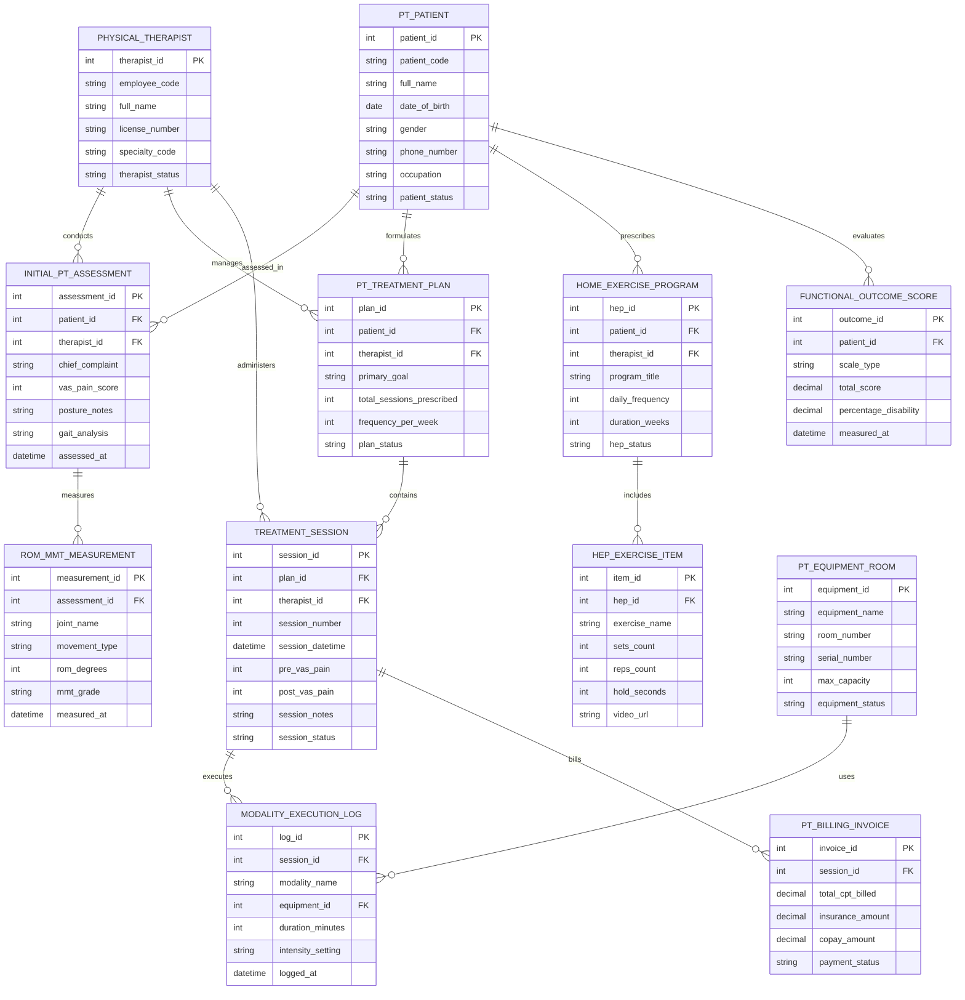

# Conceptual ERD — Physiotherapy Management System

## Mermaid Code

## Entity Description Table | Bảng mô tả Entity

| # | Entity Name | Vietnamese Name | Description | Key Attributes | Main Relationships |
|---|-------------|-----------------|-------------|----------------|-------------------|
| 1 | PT_PATIENT | Bệnh nhân Vật lý trị liệu | Master physical therapy patient profile storing patient code, full name, DOB, gender, phone, occupation, and status. | patient_id, patient_code, full_name, dob, gender, phone_number, occupation, patient_status | Has INITIAL_PT_ASSESSMENT, PT_TREATMENT_PLAN, HOME_EXERCISE_PROGRAM, FUNCTIONAL_OUTCOME_SCORE. |
| 2 | PHYSICAL_THERAPIST | Kỹ thuật viên / Bác sĩ VLTL | Certified physical therapist profile storing employee code, full name, license number, specialty code, and status. | therapist_id, employee_code, full_name, license_number, specialty_code, therapist_status | Has INITIAL_PT_ASSESSMENT, PT_TREATMENT_PLAN, TREATMENT_SESSION. |
| 3 | INITIAL_PT_ASSESSMENT | Đánh giá Ban đầu VLTL | Initial physical therapy assessment record storing chief complaint, VAS pain score (0-10), posture notes, and gait analysis. | assessment_id, patient_id, therapist_id, chief_complaint, vas_pain_score, posture_notes, gait_analysis | Belongs to PT_PATIENT and PHYSICAL_THERAPIST; Has ROM_MMT_MEASUREMENT. |
| 4 | ROM_MMT_MEASUREMENT | Đo Biên độ Khớp & Sức cơ | Range of Motion (ROM) and Manual Muscle Testing (MMT) log tracking joint name, movement type, ROM degrees, and MMT grade (0-5). | measurement_id, assessment_id, joint_name, movement_type, rom_degrees, mmt_grade | Belongs to INITIAL_PT_ASSESSMENT. |
| 5 | PT_TREATMENT_PLAN | Phác đồ Phục hồi Chức năng | Multi-week physical therapy treatment plan master tracking primary goals, total sessions, weekly frequency, and status. | plan_id, patient_id, therapist_id, primary_goal, total_sessions_prescribed, frequency_per_week, plan_status | Belongs to PT_PATIENT and PHYSICAL_THERAPIST; Has TREATMENT_SESSION. |
| 6 | TREATMENT_SESSION | Buổi Điều trị VLTL (Session) | Individual physical therapy treatment session record logging session number, datetime, pre/post VAS pain scores, and session notes. | session_id, plan_id, therapist_id, session_number, session_datetime, pre_vas_pain, post_vas_pain | Belongs to PT_TREATMENT_PLAN and PHYSICAL_THERAPIST; Has MODALITY_EXECUTION_LOG and PT_BILLING_INVOICE. |
| 7 | MODALITY_EXECUTION_LOG | Nhật ký Phương pháp Điều trị | Treatment modality execution log recording modality name (Ultrasound, TENS, Traction, Manual), equipment ID, duration, and intensity. | log_id, session_id, modality_name, equipment_id, duration_minutes, intensity_setting | Belongs to TREATMENT_SESSION and PT_EQUIPMENT_ROOM. |
| 8 | HOME_EXERCISE_PROGRAM | Bài tập Tại nhà (HEP Master) | Home Exercise Program (HEP) prescription master recording program title, daily frequency, duration weeks, and status. | hep_id, patient_id, therapist_id, program_title, daily_frequency, duration_weeks, hep_status | Belongs to PT_PATIENT and PHYSICAL_THERAPIST; Has HEP_EXERCISE_ITEM. |
| 9 | HEP_EXERCISE_ITEM | Chi tiết Bài tập Video HEP | Individual home exercise item detailing exercise name, sets count, reps count, hold time seconds, and HD video URL. | item_id, hep_id, exercise_name, sets_count, reps_count, hold_seconds, video_url | Belongs to HOME_EXERCISE_PROGRAM. |
| 10 | FUNCTIONAL_OUTCOME_SCORE | Chỉ số Đánh giá Chức năng | Standardized functional outcome measure record tracking scale type (Oswestry, DASH, Lysholm, LEFS), total score, and % disability. | outcome_id, patient_id, scale_type, total_score, percentage_disability, measured_at | Belongs to PT_PATIENT. |
| 11 | PT_EQUIPMENT_ROOM | Thiết bị & Phòng Điều trị | Physical therapy equipment and room master inventory tracking equipment name, room number, serial number, capacity, and status. | equipment_id, equipment_name, room_number, serial_number, max_capacity, equipment_status | Has MODALITY_EXECUTION_LOG. |
| 12 | PT_BILLING_INVOICE | Hóa đơn CPT Viện phí VLTL | Physical therapy billing invoice record tracking CPT codes billed (97110, 97140), insurance coverage, patient copay, and status. | invoice_id, session_id, total_cpt_billed, insurance_amount, copay_amount, payment_status | Belongs to TREATMENT_SESSION. |

## Relationship Description | Mô tả Quan hệ

| # | From Entity | Cardinality | To Entity | Relationship Label | Business Explanation |
|---|-------------|-------------|-----------|-------------------|----------------------|
| 1 | PT_PATIENT | one-to-many | INITIAL_PT_ASSESSMENT | assessed_in | One patient undergoes initial musculoskeletal physical therapy assessments. |
| 2 | PT_PATIENT | one-to-many | PT_TREATMENT_PLAN | formulates | One patient has multi-week physical therapy treatment plans formulated. |
| 3 | PT_PATIENT | one-to-many | HOME_EXERCISE_PROGRAM | prescribes | One patient receives prescribed Home Exercise Programs (HEP) with HD videos. |
| 4 | PT_PATIENT | one-to-many | FUNCTIONAL_OUTCOME_SCORE | evaluates | One patient is evaluated by standardized functional outcome scores (Oswestry, DASH). |
| 5 | PHYSICAL_THERAPIST | one-to-many | INITIAL_PT_ASSESSMENT | conducts | One physical therapist conducts initial assessments and joint goniometry. |
| 6 | PHYSICAL_THERAPIST | one-to-many | PT_TREATMENT_PLAN | manages | One physical therapist manages multi-week rehabilitation treatment plans. |
| 7 | PHYSICAL_THERAPIST | one-to-many | TREATMENT_SESSION | administers | One physical therapist administers daily clinical treatment sessions. |
| 8 | INITIAL_PT_ASSESSMENT | one-to-many | ROM_MMT_MEASUREMENT | measures | One assessment measures multiple joint Range of Motion (ROM) and MMT muscle strength grades. |
| 9 | PT_TREATMENT_PLAN | one-to-many | TREATMENT_SESSION | contains | One treatment plan contains multiple prescribed physical therapy treatment sessions. |
| 10 | TREATMENT_SESSION | one-to-many | MODALITY_EXECUTION_LOG | executes | One treatment session executes multiple physical therapy modalities (Ultrasound, TENS). |
| 11 | TREATMENT_SESSION | one-to-one | PT_BILLING_INVOICE | bills | One treatment session bills itemized physical therapy CPT billing codes. |
| 12 | PT_EQUIPMENT_ROOM | one-to-many | MODALITY_EXECUTION_LOG | uses | One physical therapy equipment item or room is used in treatment modality logs. |
| 13 | HOME_EXERCISE_PROGRAM | one-to-many | HEP_EXERCISE_ITEM | includes | One Home Exercise Program includes multiple individual video exercise items. |
