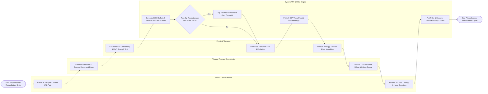

# Swimlane Diagram — Physiotherapy Management System

## Mermaid Code

## Flow Description | Mô tả luồng

| Lane | Actor / Subsystem | Role in Flow |
|------|-------------------|--------------|
| 1 | Patient / Sports Athlete | Checks in at reception, reports current VAS pain levels, performs in-clinic exercises and modalities under therapist supervision, and completes assigned home exercise videos. |
| 2 | Physical Therapy Receptionist | Schedules treatment sessions, reserves specialized treatment rooms and equipment (Hydrotherapy, Traction), processes CPT billing claims, and collects copays. |
| 3 | System / PT & ROM Engine | Calculates joint Range of Motion (ROM) deficits, scores functional outcome scales (Oswestry, DASH), screens post-op weight-bearing restrictions, publishes HEP video playlists, and plots recovery graphs. |
| 4 | Physical Therapist | Conducts initial musculoskeletal assessments, measures goniometer ROM angles and MMT muscle strength, formulates multi-week treatment plans, and executes modalities (Ultrasound, TENS, Manual Therapy). |
