# Action Tree — Physiotherapy Management System

## Mermaid Code

```mermaid
graph TD
    Root["Physiotherapy Management System"]

    Root --> M1["Assessment & ROM Goniometry"]
    Root --> M2["Treatment Plan Formulation"]
    Root --> M3["Home Exercise Program HEP"]
    Root --> M4["Daily Session & Modalities"]
    Root --> M5["Outcome Scoring & Progress"]
    Root --> M6["Equipment & Room Scheduling"]
    Root --> M7["3D Pain & Gait Analysis"]
    Root --> M8["PT Billing & Clinic Analytics"]

    M1 --> A11["Measure Active & Passive ROM Degrees"]
    M1 --> A12["Grade Manual Muscle Testing MMT 0 to 5"]
    M1 --> A13["Perform Special Orthopedic Joint Tests"]
    M1 --> A14["Ingest Bluetooth Goniometer Telemetry"]

    M2 --> A21["Define Short & Long-Term SMART Goals"]
    M2 --> A22["Assign Modality Protocols & Phases"]
    M2 --> A23["Incorporate Post-Op Surgeon Restrictions"]
    M2 --> A24["Set Weekly Session Frequency & Duration"]

    M3 --> A31["Select HD Exercise Library Videos"]
    M3 --> A32["Configure Sets Reps Hold Time Dosage"]
    M3 --> A33["Push Interactive HEP to Patient App"]
    M3 --> A34["Audit Patient Home Compliance Logs"]

    M4 --> A41["Log Ultrasound TENS & Traction Modalities"]
    M4 --> A42["Chart Manual Joint Mobilization CPT 97140"]
    M4 --> A43["Record Therapeutic Exercise CPT 97110"]
    M4 --> A44["Track Pre & Post-Session VAS Pain"]

    M5 --> A51["Calculate Oswestry Disability Index ODI"]
    M5 --> A52["Compute DASH & Lysholm Outcome Scores"]
    M5 --> A53["Render Longitudinal ROM Recovery Curves"]
    M5 --> A54["Issue Return-to-Sport Discharge Clearance"]

    M6 --> A61["Book Traction Tables & Hydrotherapy Pools"]
    M6 --> A62["Manage Electrotherapy Bay Capacity"]
    M6 --> A63["Prevent Equipment Overbooking Conflicts"]
    M6 --> A64["Track Modality Hardware Maintenance"]

    M7 --> A71["Map Pain Locations on 3D Body Model"]
    M7 --> A72["Evaluate Postural Alignment & Scoliosis"]
    M7 --> A73["Analyze Gait Cadence & Stride Length"]
    M7 --> A74["Track Radiating Pain Severity Patterns"]

    M8 --> A81["Generate CPT Billing Units 8-Minute Rule"]
    M8 --> A82["Submit Physical Therapy Insurance Claims"]
    M8 --> A83["Calculate Patient Copay & Self-Pay Amounts"]
    M8 --> A84["Export Therapist Utilization & ROM Metrics"]
```

## Module Description | Mô tả Module

| # | Module | Description | Actions |
|---|--------|-------------|---------|
| 1 | Assessment & ROM Goniometry | Measures active/passive Range of Motion in degrees, grades MMT muscle strength (0-5), performs special tests, and ingests goniometer telemetry. | Measure Active & Passive ROM Degrees, Grade Manual Muscle Testing MMT 0 to 5, Perform Special Orthopedic Joint Tests, Ingest Bluetooth Goniometer Telemetry |
| 2 | Treatment Plan Formulation | Establishes SMART rehabilitation goals, configures multi-phase modality protocols, incorporates post-op protocols, and sets weekly frequency. | Define Short & Long-Term SMART Goals, Assign Modality Protocols & Phases, Incorporate Post-Op Surgeon Restrictions, Set Weekly Session Frequency & Duration |
| 3 | Home Exercise Program HEP | Prescribes HD exercise video playlists, configures set/rep dosage, pushes guides to patient app, and audits patient home adherence. | Select HD Exercise Library Videos, Configure Sets Reps Hold Time Dosage, Push Interactive HEP to Patient App, Audit Patient Home Compliance Logs |
| 4 | Daily Session & Modalities | Logs ultrasound, TENS, traction, manual therapy (CPT 97140), therapeutic exercises (CPT 97110), and tracks pre/post VAS pain scores. | Log Ultrasound TENS & Traction Modalities, Chart Manual Joint Mobilization CPT 97140, Record Therapeutic Exercise CPT 97110, Track Pre & Post-Session VAS Pain |
| 5 | Outcome Scoring & Progress | Calculates standardized functional outcome scores (Oswestry, DASH, Lysholm), renders ROM recovery curves, and issues return-to-sport clearance. | Calculate Oswestry Disability Index ODI, Compute DASH & Lysholm Outcome Scores, Render Longitudinal ROM Recovery Curves, Issue Return-to-Sport Discharge Clearance |
| 6 | Equipment & Room Scheduling | Reserves specialized treatment rooms (Traction, Hydrotherapy, Electrotherapy bays), prevents overbooking, and tracks equipment maintenance. | Book Traction Tables & Hydrotherapy Pools, Manage Electrotherapy Bay Capacity, Prevent Equipment Overbooking Conflicts, Track Modality Hardware Maintenance |
| 7 | 3D Pain & Gait Analysis | Charts pain locations on interactive 3D body maps, evaluates postural alignment, analyzes walking gait parameters, and tracks radiating pain. | Map Pain Locations on 3D Body Model, Evaluate Postural Alignment & Scoliosis, Analyze Gait Cadence & Stride Length, Track Radiating Pain Severity Patterns |
| 8 | PT Billing & Clinic Analytics | Applies CMS 8-Minute Rule for CPT billing, submits insurance claims, calculates patient copays, and exports therapist utilization metrics. | Generate CPT Billing Units 8-Minute Rule, Submit Physical Therapy Insurance Claims, Calculate Patient Copay & Self-Pay Amounts, Export Therapist Utilization & ROM Metrics |
