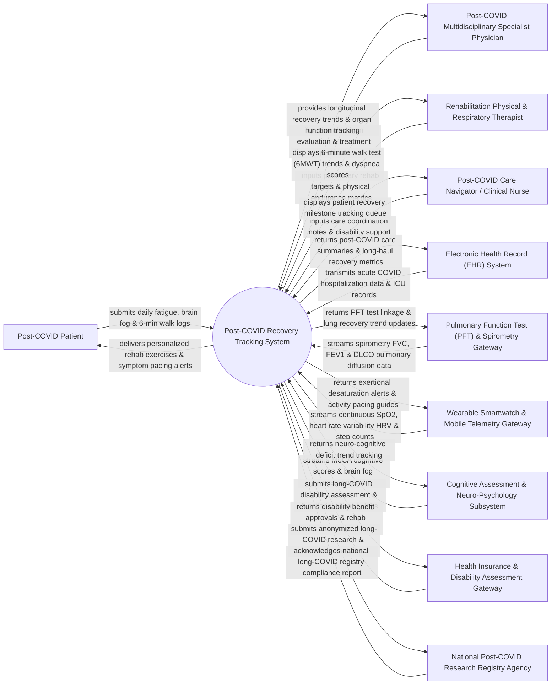

# Context Diagram — Post-COVID Recovery Tracking System

## Mermaid Code

## Actor & Interaction Table | Bảng Actor & Tương tác

| # | Actor | Actor Type | Data Sent TO System | Data Received FROM System | Notes |
|---|-------|------------|---------------------|---------------------------|-------|
| 1 | Post-COVID Patient | Primary | Self-reported fatigue scores (FACIT-F), brain fog assessments, 6-minute walk distance logs, dyspnea scales (mMRC), daily symptom diary. | Personalized pulmonary rehab exercise videos, activity pacing guidance, symptom flare alerts, appointment reminders. | Individual recovering from acute COVID-19 experiencing Long-COVID / Post-Acute Sequelae of SARS-CoV-2 (PASC) symptoms. |
| 2 | Post-COVID Multidisciplinary Specialist Physician | Primary | Multi-organ clinical evaluation notes, pharmacological treatment orders, cardiac MRI reviews, post-COVID referral orders. | Longitudinal recovery trend graphs, multi-system organ stability alerts, functional capacity recovery scores. | Specialist physician (Pulmonologist, Cardiologist, Neurologist) leading multidisciplinary Long-COVID clinical care. |
| 3 | Rehabilitation Physical & Respiratory Therapist | Primary | Pulmonary rehabilitation exercise protocols, 6-minute walk test (6MWT) results, Borg rating of perceived exertion (RPE), incentive spirometry goals. | Longitudinal 6MWT distance graphs, exertional oxygen desaturation logs, physical endurance milestone badges. | Allied health professional guiding physical reconditioning, breathing retraining, and exercise tolerance. |
| 4 | Post-COVID Care Navigator / Clinical Nurse | Primary | Patient outreach notes, back-to-work barrier assessments, disability documentation coordination, support group referrals. | Multi-patient recovery roster, missed exercise alert list, overdue follow-up test queues. | Specialized nurse providing proactive care navigation, disability advocacy, and patient outreach. |
| 5 | Electronic Health Record (EHR) System | Supporting | Acute COVID-19 infection date, ICU hospitalization history, mechanical ventilation duration, chest CT scan findings. | Post-COVID care plan summaries, longitudinal pulmonary function trends, multidisciplinary consult notes. | Main hospital EHR supplying acute infection history and baseline clinical data for post-acute tracking. |
| 6 | Pulmonary Function Test (PFT) & Spirometry Gateway | Supporting | Spirometry measurements (FVC, FEV1, FEV1/FVC ratio), DLCO carbon monoxide diffusion capacity, lung volumes. | PFT order linkage codes, longitudinal lung diffusion trend updates. | Diagnostic pulmonary laboratory system streaming diagnostic lung function test results. |
| 7 | Wearable Smartwatch & Mobile Telemetry Gateway | Supporting | Continuous pulse oximetry ($SpO_2$), resting heart rate, Heart Rate Variability (HRV), daily step counts, sleep architecture. | Exertional $SpO_2$ desaturation alerts ($SpO_2 < 90\%$), heart rate spike warnings, energy envelope pacing prompts. | Consumer or medical smartwatch gateway (Apple Watch, Fitbit, Garmin, Masimo) streaming continuous biometric telemetry. |
| 8 | Cognitive Assessment & Neuro-Psychology Subsystem | Supporting | Montreal Cognitive Assessment (MoCA) scores, Trail Making Test times, mental fatigue index, depression/anxiety scores (PHQ-9 / GAD-7). | Neuro-cognitive deficit trend graphs, brain fog rehabilitation exercise progress reports. | Neuro-psychological testing subsystem measuring cognitive impairment and executive dysfunction ("brain fog"). |
| 9 | Health Insurance & Disability Assessment Gateway | Supporting | Disability evaluation criteria, return-to-work program requirements, rehabilitation coverage authorizations. | Functional Capacity Evaluation (FCE) reports, Long-COVID disability documentation, work accommodation plans. | Insurance payer platform evaluating Long-COVID disability claims and funding multidisciplinary rehab. |
| 10 | National Post-COVID Research Registry Agency | Supporting / Regulatory | Mandated Long-COVID case definitions (PASC criteria), NIH RECOVER research data schemas, compliance receipts. | Anonymized longitudinal recovery cohort data, organ impairment prevalence statistics, treatment efficacy metrics. | Government public health research body tracking long-term post-viral recovery and PASC outcomes. |

## System Boundary Description | Mô tả Phạm vi Hệ thống

The **Post-COVID Recovery Tracking System (PCRTS)** is a specialized multidisciplinary post-acute care and tele-rehabilitation platform designed to track, manage, and rehabilitate patients suffering from Post-Acute Sequelae of SARS-CoV-2 (PASC / Long-COVID).

**Inside System Scope:**
- Longitudinal tracking of multi-system PASC symptoms (chronic fatigue, post-exertional malaise PEM, brain fog, dyspnea, POTS/dysautonomia).
- Ingestion of Continuous Smartwatch Telemetry ($SpO_2$, Heart Rate Variability, activity pacing) and PFT spirometry data.
- Personalized Pulmonary and Physical Tele-Rehabilitation exercise plans with 6-minute walk test (6MWT) distance tracking.
- Neuro-cognitive deficit assessment (MoCA score tracking) and self-management pacing guidance (energy envelope management).
- Multidisciplinary care team coordination, Functional Capacity Evaluation (FCE) for disability claims, and anonymized research registry export.

**Outside System Scope:**
- Acute phase COVID-19 emergency resuscitation or ICU mechanical ventilation (handled by Hospital ICU Systems).
- Physical manufacturing of smartwatches or spirometry diagnostic hardware (handled by hardware manufacturers).
- Direct financial disbursement of government disability pension funds (managed by Social Security Agencies).
