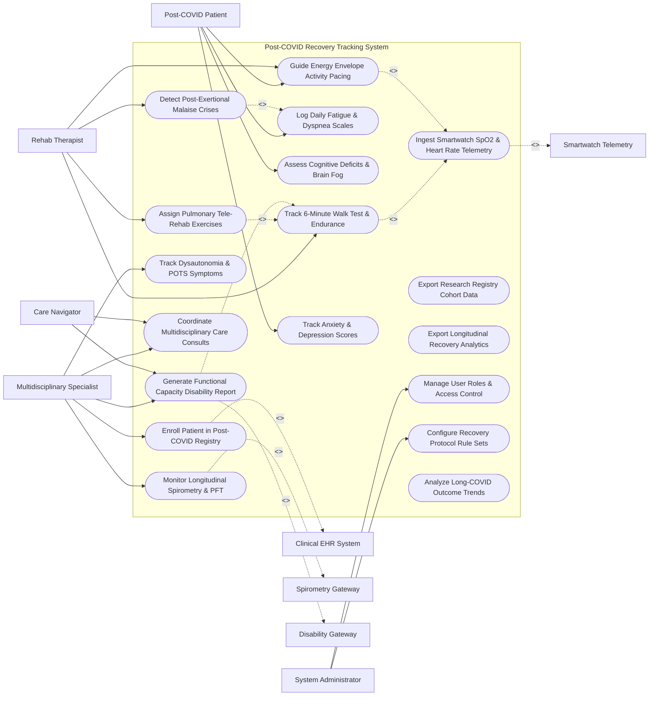

# Use Case Diagram — Post-COVID Recovery Tracking System

## Mermaid Code

## Actor Table | Bảng Actor

| # | Actor | Actor Type | Role Description | Related Use Cases |
|---|-------|------------|------------------|-------------------|
| 1 | Post-COVID Patient | Primary | Foreign or local long-haul patient logging daily fatigue, brain fog tests, dyspnea scores, and pacing exercises. | UC06, UC08, UC09, UC13 |
| 2 | Multidisciplinary Specialist | Primary | Pulmonologist, cardiologist, or neurologist evaluating multi-organ recovery, POTS symptoms, and disability forms. | UC01, UC03, UC07, UC11, UC12 |
| 3 | Rehab Therapist | Primary | Physical or respiratory therapist assigning pulmonary rehab exercises, 6MWT tests, and pacing energy envelopes. | UC02, UC04, UC09, UC10 |
| 4 | Care Navigator | Primary | Specialized nurse coordinating multidisciplinary consults and managing disability documentation tasks. | UC11, UC12 |
| 5 | System Administrator | Primary | IT administrative user managing security access roles, clinical protocol rule sets, and system integration. | UC16, UC17 |
| 6 | Clinical EHR System | System (Secondary) | Hospital EHR supplying acute COVID-19 infection history, ICU stay duration, and baseline CT scans. | UC01 |
| 7 | Spirometry Gateway | System (Secondary) | Diagnostic PFT lab system streaming FVC, FEV1, and DLCO carbon monoxide diffusion test values. | UC03 |
| 8 | Smartwatch Telemetry | System (Secondary) | Wearable smartwatch device streaming continuous pulse oximetry ($SpO_2$), heart rate variability, and steps. | UC05 |
| 9 | Disability Gateway | System (Secondary) | Health insurance payer or social security gateway receiving Functional Capacity Evaluation (FCE) disability reports. | UC12 |

## Use Case Table | Bảng Use Case

| # | UC ID | Use Case Name | Primary Actor | Secondary Actor | Description | Priority |
|---|-------|---------------|---------------|-----------------|-------------|----------|
| 1 | UC01 | Enroll Patient in Post-COVID Registry | Specialist | Clinical EHR | Enrolls patient meeting PASC criteria into longitudinal post-COVID recovery tracking registry. | High |
| 2 | UC02 | Track 6-Minute Walk Test & Endurance | Therapist | Smartwatch | Logs 6-minute walk test (6MWT) distance, exertional $SpO_2$ drop, and Borg RPE exertion scale scores. | High |
| 3 | UC03 | Monitor Longitudinal Spirometry & PFT | Specialist | Spirometry Net | Aggregates and graphs historic spirometry (FVC, FEV1) and DLCO carbon monoxide diffusion capacity over time. | High |
| 4 | UC04 | Assign Pulmonary Tele-Rehab Exercises | Therapist | None | Prescribes video-guided breathing exercises (diaphragmatic breathing, incentive spirometry, gentle reconditioning). | High |
| 5 | UC05 | Ingest Smartwatch SpO2 & Heart Rate Telemetry | System | Smartwatch | Ingests continuous $SpO_2$, resting heart rate, Heart Rate Variability (HRV), and step counts from wearables. | High |
| 6 | UC06 | Log Daily Fatigue & Dyspnea Scales | Patient | None | Captures patient daily self-reported fatigue (FACIT-F scale), mMRC dyspnea scale, and symptom diaries. | High |
| 7 | UC07 | Track Dysautonomia & POTS Symptoms | Specialist | None | Monitors Postural Orthostatic Tachycardia Syndrome (POTS) symptoms (heart rate spike $> 30 \text{ bpm}$ upon standing). | High |
| 8 | UC08 | Assess Cognitive Deficits & Brain Fog | Patient | None | Administers digital Montreal Cognitive Assessment (MoCA) tests and Trail Making tasks to track brain fog. | High |
| 9 | UC09 | Guide Energy Envelope Activity Pacing | Therapist | Patient | Calculates personalized daily "energy envelope" budgets to prevent triggering Post-Exertional Malaise (PEM). | Critical |
| 10 | UC10 | Detect Post-Exertional Malaise Crises | Therapist | None | Analyzes sudden symptom crashes post-activity to detect Post-Exertional Malaise (PEM) flare episodes. | Critical |
| 11 | UC11 | Coordinate Multidisciplinary Care Consults | Specialist | Care Navigator | Coordinates joint consultations between Pulmonology, Cardiology, Neurology, and Physical Therapy. | High |
| 12 | UC12 | Generate Functional Capacity Disability Report | Specialist | Disability Net | Compiles Functional Capacity Evaluation (FCE) reports detailing physical/cognitive work restrictions. | High |
| 13 | UC13 | Track Anxiety & Depression Scores | Patient | None | Monitors mental health impact of Long-COVID using standardized PHQ-9 (depression) and GAD-7 (anxiety) tools. | Medium |
| 14 | UC14 | Export Research Registry Cohort Data | System | None | Generates anonymized longitudinal dataset exports for NIH RECOVER and national PASC research studies. | Medium |
| 15 | UC15 | Export Longitudinal Recovery Analytics | Specialist | None | Renders patient multi-organ recovery trend graphs (pulmonary, cardiac, cognitive) over 6, 12, and 24 months. | Medium |
| 16 | UC16 | Manage User Roles & Access Control | Admin | None | Configures user accounts, RBAC permissions, and care team member patient assignments. | High |
| 17 | UC17 | Configure Recovery Protocol Rule Sets | Admin | Specialist | Configures exertional desaturation alert limits ($SpO_2 < 90\%$), POTS triggers, and survey schedules. | High |
| 18 | UC18 | Analyze Long-COVID Outcome Trends | System | None | Computes population-wide recovery rates, average time to work return, and symptom resolution milestones. | Medium |

## Use Case Specification | Đặc tả Use Case

---

### UC02 — Track 6-Minute Walk Test (6MWT) & Endurance

| Field | Detail |
|-------|--------|
| **UC ID** | UC02 |
| **Use Case Name** | Track 6-Minute Walk Test (6MWT) & Endurance |
| **Actor(s)** | Primary: Rehabilitation Physical & Respiratory Therapist   Secondary: Smartwatch Telemetry |
| **Description** | Conducts or ingests 6-Minute Walk Test (6MWT) functional endurance evaluations, tracking total distance walked (meters), pre/post $SpO_2$ desaturation, peak heart rate, and Borg Perceived Exertion (RPE) scores. |
| **Precondition** | 1. Patient is enrolled in post-COVID tele-rehabilitation program.   2. Smartwatch pulse oximeter is paired or clinical 6MWT protocol is initiated. |
| **Main Flow** | 1. Therapist initiates 6-Minute Walk Test protocol on clinical tablet or smart mobile app.   2. System records Baseline Vitals: Resting Heart Rate 78 bpm, Resting $SpO_2 = 97\%$, Baseline Borg RPE = 0 (Resting).   3. Patient completes 6-minute walk along measured hallway or tracked via GPS smartwatch.   4. System records total distance walked: `385 meters` (Predicted for age/gender: 580 meters -> 66% of predicted value).   5. System ingests end-of-test vitals: Peak Heart Rate 134 bpm, Minimum $SpO_2 = 88\%$ (Exertional Desaturation detected), End Borg RPE = 6 (Severe Exertion).   6. System calculates 1-minute recovery heart rate and $SpO_2$ recovery time (3.5 minutes to return to $95\%$).   7. System saves test results into `SIX_MINUTE_WALK_LOG` and updates longitudinal endurance recovery graph. |
| **Alternative Flow** | **AF1** — Home-Based GPS 6MWT: Patient conducts self-administered 6MWT outdoors using smartphone GPS and smartwatch pulse oximeter; System validates walk distance accuracy via GPS path verification. |
| **Exception Flow** | **EX1** — Severe Exertional Desaturation ($SpO_2 < 85\%$): $SpO_2$ drops below 85% at minute 3; System sounds immediate warning alarm "TEST HALT - SEVERE HYPOXIA DETECTED", instructs patient to sit down immediately, and logs test termination. |
| **Postcondition** | 6MWT distance, $SpO_2$ desaturation, and RPE scores are recorded, and physical endurance recovery trends are updated. |
| **Business Rule** | **BR1**: 6MWT exertional $SpO_2$ desaturation below $88\%$ MUST trigger clinical evaluation for supplemental oxygen prescription. |

---

### UC05 — Ingest Smartwatch SpO2 & Heart Rate Telemetry

| Field | Detail |
|-------|--------|
| **UC ID** | UC05 |
| **Use Case Name** | Ingest Smartwatch SpO2 & Heart Rate Telemetry |
| **Actor(s)** | Primary: Smartwatch Telemetry   Secondary: Post-COVID Patient |
| **Description** | Continuously ingests, filters, and analyzes biometric telemetry streams (continuous pulse oximetry $SpO_2$, resting heart rate, Heart Rate Variability HRV, daily step counts) from patient smartwatches. |
| **Precondition** | 1. Patient wears paired smartwatch (Apple Watch, Fitbit, Garmin, Masimo) registered in system. |
| **Main Flow** | 1. Smartwatch Telemetry Gateway streams encrypted 5-minute biometric data batches.   2. System ingests telemetry payload and extracts parameters:   &nbsp;&nbsp;&nbsp;&nbsp; a. Continuous $SpO_2$ readings (e.g., Average 96%, Drops to 89%).   &nbsp;&nbsp;&nbsp;&nbsp; b. Heart Rate & HRV (e.g., Resting HR 72 bpm, HRV 38 ms).   &nbsp;&nbsp;&nbsp;&nbsp; c. Daily Step Count & Active Energy Burn.   3. System checks values against patient-specific safety thresholds.   4. System calculates 24-hour average $SpO_2$ trends and identifies nocturnal hypoxia episodes ($SpO_2 < 90\%$ during sleep).   5. System logs telemetry into `WEARABLE_TELEMETRY_LOG` linked to patient profile.   6. System updates real-time biometric widgets on Patient App and Therapist Dashboard. |
| **Alternative Flow** | **AF1** — POTS Standing Heart Rate Spike Detection: Wearable accelerometer detects patient transitioning from lying to standing; Heart rate instantly spikes from 72 to 118 bpm (+46 bpm); System flags `POTS_HEART_RATE_SPIKE` event (UC07). |
| **Exception Flow** | **EX1** — Persistent Daytime Hypoxia Alert: Daytime $SpO_2$ remains $< 89\%$ continuously for $> 15$ minutes; System dispatches urgent push notification "Resting Oxygen Low - Please sit and apply prescribed oxygen", and sends SMS to Care Navigator. |
| **Postcondition** | Smartwatch telemetry is stored, $SpO_2$ and HRV trends are updated, and real-time hypoxia alerts are processed. |
| **Business Rule** | **BR1**: Daytime continuous $SpO_2 < 90\%$ for $> 10$ minutes must trigger an automated clinical alert to the care team. |

---

### UC08 — Assess Cognitive Deficits & Brain Fog (MoCA)

| Field | Detail |
|-------|--------|
| **UC ID** | UC08 |
| **Use Case Name** | Assess Cognitive Deficits & Brain Fog (MoCA) |
| **Actor(s)** | Primary: Post-COVID Patient   Secondary: Multidisciplinary Specialist |
| **Description** | Administers digital cognitive screening assessments (Montreal Cognitive Assessment - MoCA, Trail Making Test, Digit Span) to evaluate executive dysfunction, memory loss, and "brain fog" severity. |
| **Precondition** | 1. Patient is scheduled for routine 30-day cognitive screening. |
| **Main Flow** | 1. Patient receives notification on mobile app: "Monthly Cognitive Assessment Ready".   2. Patient opens "Digital Cognitive Screening" module.   3. System presents interactive neuro-cognitive test battery:   &nbsp;&nbsp;&nbsp;&nbsp; a. Executive Function: Digital Trail Making Test (connecting alternating numbers and letters 1-A-2-B).   &nbsp;&nbsp;&nbsp;&nbsp; b. Short-Term Memory: 5-word recall test after 5-minute delay.   &nbsp;&nbsp;&nbsp;&nbsp; c. Attention & Working Memory: Backward Digit Span test.   &nbsp;&nbsp;&nbsp;&nbsp; d. Visuospatial Skills: Digital Clock Drawing task.   4. System measures completion time, error rates, and calculates total MoCA cognitive score (0-30 scale).   5. System evaluates cognitive status:   &nbsp;&nbsp;&nbsp;&nbsp; a. Score 26-30 -> Normal Cognitive Function.   &nbsp;&nbsp;&nbsp;&nbsp; b. Score 18-25 -> Mild Cognitive Impairment ("Brain Fog").   &nbsp;&nbsp;&nbsp;&nbsp; c. Score $< 18$ -> Moderate-to-Severe Cognitive Deficit.   6. System saves score into `COGNITIVE_ASSESSMENT_LOG` and renders longitudinal brain fog recovery trend line.   7. If score is $< 26$, System dispatches cognitive rehabilitation exercise modules and notifies Neuro-Psychologist. |
| **Alternative Flow** | **AF1** — Subjective Mental Fatigue Rating: Patient completes 10-item Subjective Brain Fog Rating (1-10 scale) weekly between formal MoCA testing dates to track acute flare-ups. |
| **Exception Flow** | **EX1** — Sudden Severe Cognitive Drop ($> 4$ Point MoCA Decline): MoCA score drops from 25 down to 19; System flags "Acute Cognitive Decline Alert", prompting evaluation for secondary neurological complications (e.g., TIA, stroke, encephalopathy). |
| **Postcondition** | MoCA cognitive score is recorded, brain fog trends are graphed, and cognitive rehab exercises are assigned. |
| **Business Rule** | **BR1**: Digital MoCA scores $< 26$ must trigger an automated recommendation for formal neuro-psychological consultation. |

---

### UC10 — Detect Post-Exertional Malaise (PEM) Crises

| Field | Detail |
|-------|--------|
| **UC ID** | UC10 |
| **Use Case Name** | Detect Post-Exertional Malaise (PEM) Crises |
| **Actor(s)** | Primary: Rehabilitation Physical & Respiratory Therapist   Secondary: Post-COVID Patient |
| **Description** | Analyzes correlations between physical activity spikes and subsequent 24-48 hour symptom crashes to detect Post-Exertional Malaise (PEM) flare crises and adjust energy pacing envelopes. |
| **Precondition** | 1. Patient daily fatigue scores (UC06) and wearable step counts (UC05) are recorded. |
| **Main Flow** | 1. System background analytics engine evaluates daily patient data over a rolling 7-day window.   2. System identifies an activity spike: On Tuesday, step count reached 8,500 steps (200% above patient's baseline 3,000 steps).   3. System evaluates 24-48 hour lag symptoms: On Wednesday/Thursday, patient self-reported FACIT-F fatigue score dropped severely from 32 to 8, and $SpO_2$ variability increased.   4. System identifies classic Post-Exertional Malaise (PEM) pattern: "Activity Spike -> 24-48 Hr Delayed Systemic Crash".   5. System flags `PEM_CRISIS_DETECTED` on Patient App and Therapist Dashboard.   6. System displays PEM Recovery Protocol on Patient App:   &nbsp;&nbsp;&nbsp;&nbsp; a. Initiate mandatory strict bed rest / low-stimulation rest for 48 hours.   &nbsp;&nbsp;&nbsp;&nbsp; b. Pause active physical tele-rehab exercise assignments (UC04).   &nbsp;&nbsp;&nbsp;&nbsp; c. Recalculate and reduce daily Energy Envelope step cap from 8,000 down to 3,500 steps (UC09).   7. Therapist receives alert and contacts patient to provide supportive pacing coaching. |
| **Alternative Flow** | **AF1** — Predictive PEM Warning: Wearable step count reaches 80% of daily energy envelope budget by 1:00 PM; System sends preventive alert: "Energy Budget Reaching Limit - Rest Now to Prevent Tomorrow's Crash". |
| **Exception Flow** | **EX1** — Prolonged Crash ($> 7$ Days): Patient fatigue score remains severely depressed for $> 7$ consecutive days post-activity; System escalates case to Multidisciplinary Specialist for clinical re-evaluation. |
| **Postcondition** | PEM crash pattern is detected, physical exercises are temporarily paused, and energy envelope step caps are safely reduced. |
| **Business Rule** | **BR1**: When a Post-Exertional Malaise (PEM) crash is detected, physical reconditioning exercises MUST be suspended until symptoms return to baseline for at least 72 hours. |

---

### UC12 — Generate Functional Capacity Disability Report

| Field | Detail |
|-------|--------|
| **UC ID** | UC12 |
| **Use Case Name** | Generate Functional Capacity Disability Report |
| **Actor(s)** | Primary: Multidisciplinary Specialist Physician   Secondary: Health Insurance & Disability Assessment Gateway |
| **Description** | Aggregates objective clinical data (6MWT endurance, PFT lung volumes, MoCA cognitive scores, PEM crash frequency, smartwatch $SpO_2$ desaturation) to compile a comprehensive Functional Capacity Evaluation (FCE) disability report for insurance or social security claims. |
| **Precondition** | 1. Patient has undergone at least 90 days of multidisciplinary post-COVID evaluation and tracking.   2. Objective functional tests (6MWT, PFT, MoCA) are recorded. |
| **Main Flow** | 1. Specialist opens "Disability & Functional Capacity Generator" for target patient.   2. System fetches aggregated longitudinal recovery metrics over past 90-180 days:   &nbsp;&nbsp;&nbsp;&nbsp; a. Physical Endurance: 6MWT Distance = 340 meters (58% of predicted), Exertional $SpO_2$ drop to 87%.   &nbsp;&nbsp;&nbsp;&nbsp; b. Pulmonary Function: DLCO = 54% of predicted (Moderate Gas Transfer Impairment).   &nbsp;&nbsp;&nbsp;&nbsp; c. Cognitive Function: MoCA Score = 21/30 (Mild-to-Moderate Executive Dysfunction).   &nbsp;&nbsp;&nbsp;&nbsp; d. Exertional Limit: Severe PEM triggered by $> 30$ minutes of physical or mental exertion.   3. Specialist completes Functional Work Restrictions:   &nbsp;&nbsp;&nbsp;&nbsp; a. Maximum Lifting Capacity: $< 5 \text{ kg}$.   &nbsp;&nbsp;&nbsp;&nbsp; b. Maximum Standing/Walking: $< 15 \text{ minutes}$ per hour.   &nbsp;&nbsp;&nbsp;&nbsp; c. Cognitive Work Restriction: No complex multi-tasking or high-stress decision-making.   &nbsp;&nbsp;&nbsp;&nbsp; d. Recommended Work Status: Total Disability / Unable to Return to Full-Time Employment.   4. Specialist applies digital signature to official FCE Disability Report.   5. System packages report and dispatches secure PDF/XML file to Health Insurance & Disability Assessment Gateway. |
| **Alternative Flow** | **AF1** — Graduated Return-to-Work (RTW) Authorization: Patient shows 85% functional recovery; Specialist issues "Graduated Part-Time Work Authorization" (15 hours/week with energy pacing accommodations). |
| **Exception Flow** | **EX1** — Incomplete Objective Testing: Patient lacks 6MWT or PFT data; System blocks disability report finalization, displaying error "Incomplete Evidence: Objective 6MWT and PFT Test Records Required for FCE Disability Export". |
| **Postcondition** | Comprehensive Functional Capacity Evaluation disability report is generated, signed, and transmitted to insurance payers. |
| **Business Rule** | **BR1**: Functional Capacity Evaluation disability reports MUST be supported by objective longitudinal testing data (6MWT, PFT, or MoCA scores). |
