# Conceptual ERD — Post-COVID Recovery Tracking System

## Mermaid Code

```mermaid
erDiagram
    USER_ACCOUNT {
        int user_id PK
        string full_name
        string username
        string user_role
        string medical_license_no
        boolean is_active
    }

    POST_COVID_PATIENT_PROFILE {
        int profile_id PK
        string patient_mrn
        string full_name
        date acute_infection_date
        boolean was_icu_admitted
        int acute_hospital_days
        string primary_pasc_phenotype
        datetime registered_at
    }

    SIX_MINUTE_WALK_LOG {
        int walk_log_id PK
        int profile_id FK
        int therapist_user_id FK
        int distance_walked_meters
        int predicted_distance_percent
        int minimum_spo2_percent
        int peak_heart_rate_bpm
        int end_borg_rpe_score
        datetime tested_at
    }

    SPIROMETRY_PFT_RECORD {
        int pft_id PK
        int profile_id FK
        decimal fvc_percent_predicted
        decimal fev1_percent_predicted
        decimal fev1_fvc_ratio
        decimal dlco_percent_predicted
        datetime test_date
    }

    PULMONARY_REHAB_EXERCISE_PLAN {
        int plan_id PK
        int profile_id FK
        int therapist_user_id FK
        string breathing_exercise_type
        int daily_duration_minutes
        string target_rpe_intensity
        date start_date
        string plan_status
    }

    WEARABLE_TELEMETRY_LOG {
        int telemetry_id PK
        int profile_id FK
        decimal average_spo2_percent
        decimal minimum_spo2_percent
        int resting_heart_rate_bpm
        decimal heart_rate_variability_hrv
        int daily_step_count
        datetime recorded_at
    }

    DAILY_SYMPTOM_DIARY {
        int diary_id PK
        int profile_id FK
        int facit_fatigue_score
        int mmrc_dyspnea_score
        int brain_fog_severity_rating
        boolean pots_dizziness_reported
        datetime logged_at
    }

    COGNITIVE_ASSESSMENT_LOG {
        int moca_id PK
        int profile_id FK
        int moca_total_score
        int trail_making_seconds
        int memory_recall_score
        string cognitive_impairment_tier
        datetime assessed_at
    }

    ENERGY_ENVELOPE_PACING_PLAN {
        int pacing_id PK
        int profile_id FK
        int therapist_user_id FK
        int daily_step_cap_limit
        int max_active_minutes_per_session
        text energy_conservation_instructions
        datetime updated_at
    }

    PEM_CRISIS_EVENT {
        int pem_event_id PK
        int profile_id FK
        date triggering_activity_date
        int peak_activity_steps
        date crash_onset_date
        int fatigue_score_drop
        datetime detected_at
    }

    MULTIDISCIPLINARY_CARE_CONSULT {
        int consult_id PK
        int profile_id FK
        int primary_specialist_user_id FK
        string specialties_involved
        text multi_organ_assessment_notes
        datetime consult_date
    }

    FUNCTIONAL_DISABILITY_REPORT {
        int disability_report_id PK
        int profile_id FK
        int physician_user_id FK
        string functional_impairment_tier
        int max_lifting_capacity_kg
        int max_standing_duration_mins
        string recommended_work_status
        datetime issued_at
    }

    POST_COVID_PATIENT_PROFILE ||--o{ SIX_MINUTE_WALK_LOG : "evaluated via"
    POST_COVID_PATIENT_PROFILE ||--o{ SPIROMETRY_PFT_RECORD : "monitored via"
    POST_COVID_PATIENT_PROFILE ||--o{ PULMONARY_REHAB_EXERCISE_PLAN : "assigned"
    POST_COVID_PATIENT_PROFILE ||--o{ WEARABLE_TELEMETRY_LOG : "streamed from"
    POST_COVID_PATIENT_PROFILE ||--o{ DAILY_SYMPTOM_DIARY : "logs"
    POST_COVID_PATIENT_PROFILE ||--o{ COGNITIVE_ASSESSMENT_LOG : "assessed via"
    POST_COVID_PATIENT_PROFILE ||--o| ENERGY_ENVELOPE_PACING_PLAN : "paced via"
    POST_COVID_PATIENT_PROFILE ||--o{ PEM_CRISIS_EVENT : "experiences"
    POST_COVID_PATIENT_PROFILE ||--o{ MULTIDISCIPLINARY_CARE_CONSULT : "evaluated in"
    POST_COVID_PATIENT_PROFILE ||--o| FUNCTIONAL_DISABILITY_REPORT : "documented in"
    USER_ACCOUNT ||--o{ SIX_MINUTE_WALK_LOG : "conducts"
    USER_ACCOUNT ||--o{ PULMONARY_REHAB_EXERCISE_PLAN : "prescribes"
    USER_ACCOUNT ||--o{ MULTIDISCIPLINARY_CARE_CONSULT : "leads"
    USER_ACCOUNT ||--o{ FUNCTIONAL_DISABILITY_REPORT : "authors and signs"
```

## Entity Description Table | Bảng mô tả Entity

| # | Entity Name | Vietnamese Name | Description | Key Attributes | Main Relationships |
|---|-------------|-----------------|-------------|----------------|-------------------|
| 1 | USER_ACCOUNT | Tài khoản Nguời dùng | Credentials and access roles for specialists, pulmonologists, physical therapists, and navigators. | `user_id`, `username`, `user_role`, `medical_license_no` | Conducts `SIX_MINUTE_WALK_LOG`, prescribes `PULMONARY_REHAB_EXERCISE_PLAN`, authors `FUNCTIONAL_DISABILITY_REPORT`. |
| 2 | POST_COVID_PATIENT_PROFILE | Hồ sơ Bệnh nhân Hậu COVID | Acute COVID-19 infection history, ICU stay duration, primary Long-COVID PASC phenotype, and baseline data. | `profile_id`, `patient_mrn`, `full_name`, `acute_infection_date`, `primary_pasc_phenotype` | Evaluated via `SIX_MINUTE_WALK_LOG`, assigned `PULMONARY_REHAB_EXERCISE_PLAN`, documented in `FUNCTIONAL_DISABILITY_REPORT`. |
| 3 | SIX_MINUTE_WALK_LOG | Nhật ký Đi bộ 6 Phút (6MWT) | 6-Minute Walk Test functional endurance logs capturing distance walked, exertional $SpO_2$ drop, and Borg RPE. | `walk_log_id`, `profile_id`, `therapist_user_id`, `distance_walked_meters`, `minimum_spo2_percent`, `end_borg_rpe_score` | Belongs to `POST_COVID_PATIENT_PROFILE`, conducted by `USER_ACCOUNT`. |
| 4 | SPIROMETRY_PFT_RECORD | Hồ sơ Thăm dò Chức năng Phổi | Diagnostic pulmonary function test values (FVC %, FEV1 %, FEV1/FVC ratio, DLCO carbon monoxide diffusion %). | `pft_id`, `profile_id`, `fvc_percent_predicted`, `fev1_percent_predicted`, `dlco_percent_predicted` | Belongs to `POST_COVID_PATIENT_PROFILE`. |
| 5 | PULMONARY_REHAB_EXERCISE_PLAN | Kế hoạch Phục hồi Chức năng Phổi | Video-guided pulmonary tele-rehabilitation exercise plans, breathing retraining, and target RPE exertion limits. | `plan_id`, `profile_id`, `therapist_user_id`, `breathing_exercise_type`, `daily_duration_minutes` | Belongs to `POST_COVID_PATIENT_PROFILE`, prescribed by `USER_ACCOUNT`. |
| 6 | WEARABLE_TELEMETRY_LOG | Nhật ký Sinh tồn Thiết bị Đeo | Continuous smartwatch telemetry logs ingesting pulse oximetry ($SpO_2$), resting HR, HRV, and daily steps. | `telemetry_id`, `profile_id`, `average_spo2_percent`, `minimum_spo2_percent`, `heart_rate_variability_hrv` | Belongs to `POST_COVID_PATIENT_PROFILE`. |
| 7 | DAILY_SYMPTOM_DIARY | Nhật ký Triệu chứng Hàng ngày | Daily self-reported FACIT-F fatigue scores, mMRC dyspnea ratings, brain fog ratings, and POTS dizziness logs. | `diary_id`, `profile_id`, `facit_fatigue_score`, `mmrc_dyspnea_score`, `brain_fog_severity_rating` | Belongs to `POST_COVID_PATIENT_PROFILE`. |
| 8 | COGNITIVE_ASSESSMENT_LOG | Nhật ký Đánh giá Nhận thức (MoCA) | Digital Montreal Cognitive Assessment (MoCA) total scores, Trail Making Test completion times, and cognitive impairment tiers. | `moca_id`, `profile_id`, `moca_total_score`, `trail_making_seconds`, `cognitive_impairment_tier` | Belongs to `POST_COVID_PATIENT_PROFILE`. |
| 9 | ENERGY_ENVELOPE_PACING_PLAN | Kế hoạch Phân bổ Năng lượng Pacing | Daily "energy envelope" activity pacing budgets detailing daily step caps and active minute limits to prevent PEM. | `pacing_id`, `profile_id`, `therapist_user_id`, `daily_step_cap_limit`, `max_active_minutes_per_session` | Belongs to `POST_COVID_PATIENT_PROFILE`. |
| 10 | PEM_CRISIS_EVENT | Sự kiện Kiệt sức Post-Exertional | Incident logs detecting Post-Exertional Malaise (PEM) flare crises following physical/cognitive activity spikes. | `pem_event_id`, `profile_id`, `triggering_activity_date`, `peak_activity_steps`, `fatigue_score_drop` | Belongs to `POST_COVID_PATIENT_PROFILE`. |
| 11 | MULTIDISCIPLINARY_CARE_CONSULT | Hội chẩn Đa chuyên khoa | Joint multidisciplinary consult logs involving Pulmonology, Cardiology, Neurology, and Physical Therapy. | `consult_id`, `profile_id`, `primary_specialist_user_id`, `specialties_involved`, `multi_organ_assessment_notes` | Belongs to `POST_COVID_PATIENT_PROFILE`, led by `USER_ACCOUNT`. |
| 12 | FUNCTIONAL_DISABILITY_REPORT | Báo cáo Đánh giá Khả năng Lao động | Comprehensive Functional Capacity Evaluation (FCE) disability reports detailing physical/cognitive work restrictions. | `disability_report_id`, `profile_id`, `physician_user_id`, `functional_impairment_tier`, `recommended_work_status` | Belongs to `POST_COVID_PATIENT_PROFILE`, authored by `USER_ACCOUNT`. |

## Relationship Description | Mô tả Quan hệ

| # | From Entity | Cardinality | To Entity | Label | Business Explanation |
|---|-------------|-------------|-----------|-------|----------------------|
| 1 | POST_COVID_PATIENT_PROFILE | 1 to 0..N | SIX_MINUTE_WALK_LOG | evaluated via | A post-COVID patient profile is evaluated via 6-minute walk tests (6MWT). |
| 2 | POST_COVID_PATIENT_PROFILE | 1 to 0..N | SPIROMETRY_PFT_RECORD | monitored via | A post-COVID patient profile is monitored via longitudinal spirometry records. |
| 3 | POST_COVID_PATIENT_PROFILE | 1 to 0..N | PULMONARY_REHAB_EXERCISE_PLAN | assigned | A post-COVID patient profile is assigned pulmonary tele-rehabilitation exercise plans. |
| 4 | POST_COVID_PATIENT_PROFILE | 1 to 0..N | WEARABLE_TELEMETRY_LOG | streamed from | A post-COVID patient profile has continuous smartwatch telemetry logs streamed. |
| 5 | POST_COVID_PATIENT_PROFILE | 1 to 0..N | DAILY_SYMPTOM_DIARY | logs | A post-COVID patient profile logs daily self-reported symptom diaries. |
| 6 | POST_COVID_PATIENT_PROFILE | 1 to 0..N | COGNITIVE_ASSESSMENT_LOG | assessed via | A post-COVID patient profile is assessed via digital MoCA cognitive tests. |
| 7 | POST_COVID_PATIENT_PROFILE | 1 to 0..1 | ENERGY_ENVELOPE_PACING_PLAN | paced via | A post-COVID patient profile is paced via an energy envelope plan. |
| 8 | POST_COVID_PATIENT_PROFILE | 1 to 0..N | PEM_CRISIS_EVENT | experiences | A post-COVID patient profile experiences Post-Exertional Malaise (PEM) crisis events. |
| 9 | POST_COVID_PATIENT_PROFILE | 1 to 0..N | MULTIDISCIPLINARY_CARE_CONSULT | evaluated in | A post-COVID patient profile is evaluated in multidisciplinary care consults. |
| 10 | POST_COVID_PATIENT_PROFILE | 1 to 0..1 | FUNCTIONAL_DISABILITY_REPORT | documented in | A post-COVID patient profile is documented in a functional disability report. |
| 11 | USER_ACCOUNT | 1 to 0..N | SIX_MINUTE_WALK_LOG | conducts | A therapist user account conducts 6-minute walk tests (6MWT). |
| 12 | USER_ACCOUNT | 1 to 0..N | PULMONARY_REHAB_EXERCISE_PLAN | prescribes | A therapist user account prescribes pulmonary tele-rehab plans. |
| 13 | USER_ACCOUNT | 1 to 0..N | MULTIDISCIPLINARY_CARE_CONSULT | leads | A specialist user account leads multidisciplinary care consults. |
| 14 | USER_ACCOUNT | 1 to 0..N | FUNCTIONAL_DISABILITY_REPORT | authors and signs | A physician user account authors and signs functional disability reports. |
