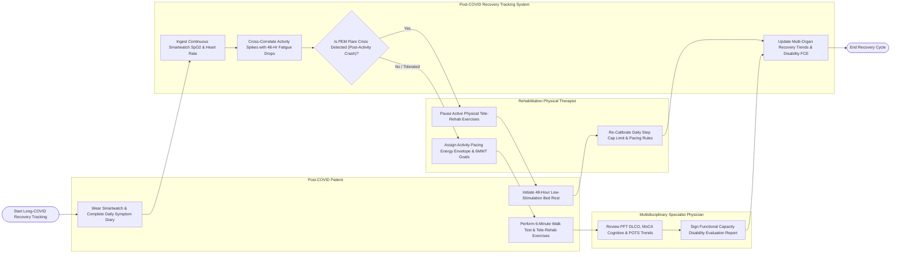

# Swimlane Diagram — Post-COVID Recovery Tracking System

## Mermaid Code

## Flow Description | Mô tả luồng

| Lane | Actor | Role in Flow |
|------|-------|-------------|
| 1 | Post-COVID Patient | Wears smartwatch telemetry devices, completes daily symptom diaries (fatigue, brain fog, dyspnea), performs 6-minute walk tests, executes tele-rehab exercises, and follows rest pacing. |
| 2 | Rehabilitation Physical Therapist | Establishes activity pacing energy envelopes, sets 6MWT endurance targets, pauses active exercises during Post-Exertional Malaise (PEM) crashes, and re-calibrates step caps. |
| 3 | Post-COVID Recovery Tracking System | Ingests smartwatch $SpO_2$ and heart rate data, cross-correlates physical activity spikes with 48-hour fatigue crashes to detect PEM crises, and updates longitudinal multi-organ recovery trends. |
| 4 | Multidisciplinary Specialist Physician | Reviews longitudinal PFT lung diffusion, MoCA cognitive scores, and POTS dysautonomia trends, authorizing Functional Capacity Evaluation disability reports. |
