# Action Tree — Post-COVID Recovery Tracking System

## Mermaid Code

```mermaid
graph TD
    Root["Post-COVID Recovery Tracking System"]

    Root --> M1["Long-COVID Registry & Enrollment"]
    Root --> M2["Smartwatch Telemetry & Vital Surveillance"]
    Root --> M3["Pulmonary Tele-Rehab & 6MWT Tracking"]
    Root --> M4["Neuro-Cognitive & Brain Fog Assessment"]
    Root --> M5["Energy Pacing & PEM Crisis Detection"]
    Root --> M6["Disability Evaluation & Research Analytics"]

    M1 --> A11["Enroll PASC Patients in Long-COVID Registry"]
    M1 --> A12["Ingest Acute Hospitalization & ICU EHR History"]
    M1 --> A13["Classify Primary Long-COVID Phenotypes"]
    M1 --> A14["Coordinate Multidisciplinary Care Team Consults"]

    M2 --> A21["Ingest Continuous Smartwatch SpO2 & Heart Rate"]
    M2 --> A22["Monitor Nocturnal & Exertional Hypoxia Drops"]
    M2 --> A23["Track Heart Rate Variability (HRV) Recovery"]
    M2 --> A24["Detect POTS Standing Heart Rate Spikes (> 30 bpm)"]

    M3 --> A31["Log 6-Minute Walk Test (6MWT) Distance & Borg RPE"]
    M3 --> A32["Monitor Spirometry FVC, FEV1 & DLCO Lung Diffusion"]
    M3 --> A33["Assign Video Diaphragmatic Breathing Retraining"]
    M3 --> A34["Track Exertional Oxygen Desaturation Milestones"]

    M4 --> A41["Administer Digital Montreal Cognitive (MoCA) Tests"]
    M4 --> A42["Measure Trail Making Test Executive Function Times"]
    M4 --> A43["Track Subjective Brain Fog & Mental Fatigue Scores"]
    M4 --> A44["Assign Neuro-Cognitive Memory Rehab Exercises"]

    M5 --> A51["Calculate Daily Energy Envelope Step Cap Budgets"]
    M5 --> A52["Correlate Activity Spikes with 48-Hour Symptom Drops"]
    M5 --> A53["Detect Post-Exertional Malaise (PEM) Flare Crises"]
    M5 --> A54["Enforce Temporary Tele-Rehab Exercise Suspensions"]

    M6 --> A61["Compile Functional Capacity Disability (FCE) Reports"]
    M6 --> A62["Export Anonymized NIH RECOVER Research Cohort Data"]
    M6 --> A63["Render Longitudinal Multi-Organ Recovery Trends"]
    M6 --> A64["Analyze Return-to-Work Rates & Disability Outcomes"]
```

## Module Description | Mô tả Module

| # | Module | Description | Actions |
|---|--------|-------------|---------|
| 1 | Long-COVID Registry & Enrollment | Enrolls patients meeting PASC criteria, ingests acute COVID EHR data, classifies phenotypes, and coordinates multidisciplinary consults. | Enroll PASC Patients, Ingest Acute EHR History, Classify PASC Phenotypes, Coordinate Multidisciplinary Consults. |
| 2 | Smartwatch Telemetry & Vital Surveillance | Ingests continuous smartwatch $SpO_2$, resting HR, Heart Rate Variability (HRV), and flags POTS standing heart rate spikes ($> 30 \text{ bpm}$). | Ingest Smartwatch $SpO_2$/HR, Monitor Hypoxia Drops, Track HRV Recovery, Detect POTS Standing Spikes. |
| 3 | Pulmonary Tele-Rehab & 6MWT Tracking | Logs 6-minute walk test (6MWT) distance, monitors PFT spirometry/DLCO diffusion, assigns breathing retraining, and tracks oxygen milestones. | Log 6MWT Distance & Borg RPE, Monitor Spirometry & DLCO, Assign Breathing Retraining, Track Desaturation Milestones. |
| 4 | Neuro-Cognitive & Brain Fog Assessment | Administers digital MoCA tests, measures Trail Making completion times, tracks subjective brain fog, and assigns cognitive rehab exercises. | Administer Digital MoCA Tests, Measure Trail Making Times, Track Brain Fog Scores, Assign Cognitive Rehab Exercises. |
| 5 | Energy Pacing & PEM Crisis Detection | Calculates energy envelope step caps, correlates activity spikes with 48-hour symptom drops, detects PEM crises, and pauses active exercises. | Calculate Energy Envelope Step Caps, Correlate Activity & Symptom Drops, Detect PEM Flare Crises, Enforce Exercise Suspensions. |
| 6 | Disability Evaluation & Research Analytics | Compiles Functional Capacity Evaluation (FCE) disability reports, exports NIH RECOVER research data, and renders multi-organ recovery trends. | Compile FCE Disability Reports, Export NIH RECOVER Research Data, Render Multi-Organ Trends, Analyze Return-to-Work Rates. |
