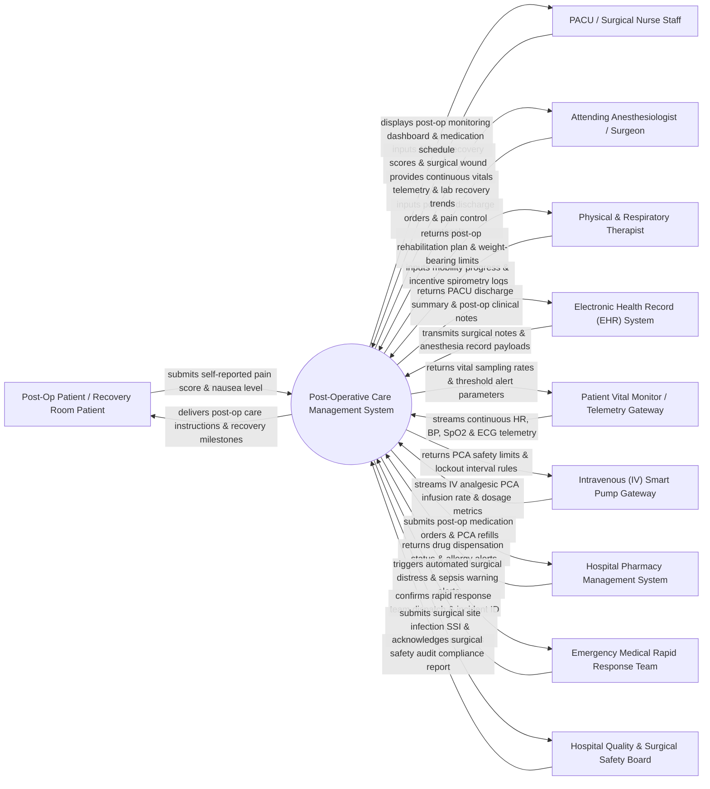

# Context Diagram — Post-Operative Care Management System

## Mermaid Code

## Actor & Interaction Table | Bảng Actor & Tương tác

| # | Actor | Actor Type | Data Sent TO System | Data Received FROM System | Notes |
|---|-------|------------|---------------------|---------------------------|-------|
| 1 | Post-Op Patient / Recovery Room Patient | Primary | Self-reported visual analog pain scores (0-10), nausea levels, mobility feedback, discharge readiness questions. | Post-op care instructions, recovery goal milestones, patient-controlled analgesia (PCA) education notes. | Surgical patient recovering in Post-Anesthesia Care Unit (PACU) or post-op surgical ward. |
| 2 | PACU / Surgical Nurse Staff | Primary | Aldrete recovery scores, wound dressing checks, surgical drain output volumes, fluid intake/output (I/O), IV line checks. | PACU recovery monitoring dashboard, vital trend graphs, medication due alarms, blood transfusion protocols. | Specialist nurses overseeing immediate post-anesthesia recovery and post-op ward care. |
| 3 | Attending Anesthesiologist / Surgeon | Primary | Post-op care plans, pain management orders, PACU discharge authorization, surgical drain removal orders, antibiotics regimens. | Real-time recovery telemetry, post-op complication alerts, lab trend results (hemoglobin, WBC), wound photo logs. | Operating surgeon and anesthesiologist responsible for surgical recovery and discharge clearance. |
| 4 | Physical & Respiratory Therapist | Primary | Post-op ambulation logs, incentive spirometry volume performance, chest physical therapy notes, weight-bearing progress. | Post-surgical activity restrictions, rehabilitation care plans, respiratory support parameters. | Allied health professionals facilitating post-op pulmonary care and early patient mobility. |
| 5 | Electronic Health Record (EHR) System | Supporting | Intra-operative anesthesia records, surgical procedure details, ASA physical status codes, baseline vitals, pre-op medical history. | PACU discharge summaries, post-op progress notes, surgical wound status, post-op complication flags. | Central hospital EHR integrated via HL7 clinical document architecture (CDA) interfaces. |
| 6 | Patient Vital Monitor / Telemetry Gateway | Supporting | Continuous heart rate, non-invasive blood pressure (NIBP), SpO2, respiratory rate, body temperature, continuous ECG waveforms. | Telemetry sample rates, patient alarm threshold limits, baseline calibration parameters. | PACU bedside monitors streaming continuous vital sign telemetry to the central care system. |
| 7 | Intravenous (IV) Smart Pump Gateway | Supporting | Patient-controlled analgesia (PCA) bolus requests, total opioid infusion volume, IV fluid flow rates, pump error logs. | PCA safety lockout windows, maximum hourly dose limits, drug concentration infusion profiles. | Smart IV infusion pumps delivering post-op pain management and IV fluid resuscitation. |
| 8 | Hospital Pharmacy Management System | Supporting | Drug dispensation status, post-op pain medication availability, antibiotic dose verification, patient allergy alerts. | Post-op e-prescriptions, PCA drug cassette refill orders, multimodal pain regimen requests. | Enterprise pharmacy software managing post-op pharmaceutical supply and safety verification. |
| 9 | Emergency Medical Rapid Response Team | Supporting | Team dispatch confirmation, emergency responder IDs, bedside arrival timestamps, emergency stabilization notes. | Automated critical distress alerts, sudden hemodynamic crash notifications, early warning sepsis scores (NEWS2). | Hospital ICU rapid response team dispatched automatically when post-op patient vitals breach safe limits. |
| 10 | Hospital Quality & Surgical Safety Board | Supporting / Regulatory | Surgical safety audit benchmarks, Surgical Site Infection (SSI) surveillance criteria, compliance receipts. | Post-op complication rates, 30-day surgical readmission metrics, SSI tracking summaries, PACU length-of-stay metrics. | Hospital quality committee tracking surgical safety guidelines and national quality metrics. |

## System Boundary Description | Mô tả Phạm vi Hệ thống

The **Post-Operative Care Management System (POCMS)** is a specialized clinical monitoring platform designed to track patient recovery following surgical procedures, automate PACU (Post-Anesthesia Care Unit) workflows, manage multimodal pain protocols, and prevent post-op surgical complications.

**Inside System Scope:**
- Real-time PACU bedside vitals telemetry ingestion and automated Aldrete recovery scoring for anesthesia emergence.
- Surgical wound assessment, drain output logging, fluid intake/output (I/O) balancing, and post-op pain score tracking.
- Integration with IV Smart Pumps for Patient-Controlled Analgesia (PCA) monitoring and safety lockout enforcement.
- Automated early warning sepsis scoring (NEWS2/qSOFA) and rapid response team dispatch triggers for clinical deterioration.
- Post-op rehabilitation tracking, incentive spirometry logging, surgical discharge readiness checklists, and EHR summary export.

**Outside System Scope:**
- Direct physical administration of surgical wound debridement or surgical re-exploration (performed in OR).
- Direct hardware control of mechanical ventilators or IV pump fluid displacement mechanisms (handled by medical hardware firmware).
- Direct billing calculation of surgical operating room fees (delegated to Patient Billing Systems).
