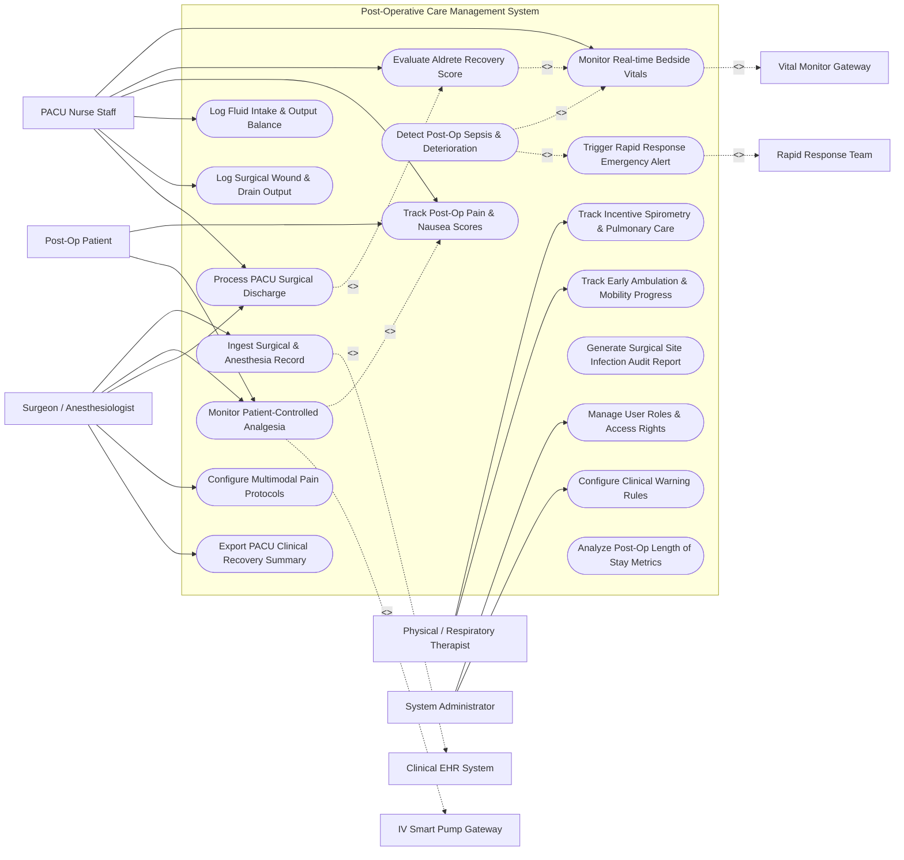

# Use Case Diagram — Post-Operative Care Management System

## Mermaid Code

## Actor Table | Bảng Actor

| # | Actor | Actor Type | Role Description | Related Use Cases |
|---|-------|------------|------------------|-------------------|
| 1 | Post-Op Patient | Primary | Patient recovering from surgery self-reporting pain levels and operating PCA infusion devices. | UC04, UC05 |
| 2 | PACU Nurse Staff | Primary | Specialized recovery nurse recording Aldrete scores, managing IV fluids, logging wound drains, and preparing discharge. | UC02, UC03, UC04, UC06, UC10, UC12 |
| 3 | Surgeon / Anesthesiologist | Primary | Operating surgeon and anesthesiologist authorizing post-op care plans, pain management, and PACU discharge. | UC01, UC05, UC12, UC13, UC15 |
| 4 | Physical / Respiratory Therapist | Primary | Allied care professional managing incentive spirometry, chest therapy, and early post-op ambulation. | UC07, UC11 |
| 5 | System Administrator | Primary | IT administrator configuring user roles, clinical warning rules, and system parameters. | UC16, UC17 |
| 6 | Clinical EHR System | System (Secondary) | Hospital EHR transferring intra-operative anesthesia records and receiving post-op recovery notes. | UC01 |
| 7 | Vital Monitor Gateway | System (Secondary) | Bedside monitor streaming continuous post-op vitals (HR, SpO2, NIBP, ECG). | UC02 |
| 8 | IV Smart Pump Gateway | System (Secondary) | Smart infusion pump providing PCA dosage metrics and receiving safety lockout windows. | UC05 |
| 9 | Rapid Response Team | System (Secondary) | ICU rapid response team receiving automated distress and sepsis deterioration alerts. | UC09 |

## Use Case Table | Bảng Use Case

| # | UC ID | Use Case Name | Primary Actor | Secondary Actor | Description | Priority |
|---|-------|---------------|---------------|-----------------|-------------|----------|
| 1 | UC01 | Ingest Surgical & Anesthesia Record | Surgeon | Clinical EHR | Loads intra-operative surgical notes, anesthesia duration, ASA physical score, and baseline vitals. | High |
| 2 | UC02 | Monitor Real-time Bedside Vitals | PACU Nurse | Vital Monitor Gateway | Streams and displays continuous PACU bedside vitals (HR, SpO2, BP, Temp, Respiration). | High |
| 3 | UC03 | Evaluate Aldrete Recovery Score | PACU Nurse | None | Assesses motor activity, respiration, circulation, consciousness, and O2 saturation to compute Aldrete emergence score. | High |
| 4 | UC04 | Track Post-Op Pain & Nausea Scores | Patient | PACU Nurse | Captures numerical pain scores (0-10), pain location, and PONV (post-operative nausea/vomiting) scale. | High |
| 5 | UC05 | Monitor Patient-Controlled Analgesia | Patient | IV Smart Pump Gateway | Tracks PCA IV opioid bolus attempts, delivered doses, hourly limits, and enforces safety lockout intervals. | High |
| 6 | UC06 | Log Fluid Intake & Output Balance | PACU Nurse | None | Ingests IV fluid infusion totals, blood product transfusions, urine output (Foley), and drain volumes. | High |
| 7 | UC07 | Track Incentive Spirometry & Pulmonary Care | Therapist | None | Logs patient incentive spirometry breath volume achievements (mL) and deep breathing exercises. | Medium |
| 8 | UC08 | Detect Post-Op Sepsis & Deterioration | System | PACU Nurse | Evaluates vital trends and WBC/temperature metrics using NEWS2 risk algorithms to detect early sepsis. | Critical |
| 9 | UC09 | Trigger Rapid Response Emergency Alert | System | Rapid Response Team | Dispatches automated alarm sirens and emergency notifications to rapid response team when vitals crash. | Critical |
| 10 | UC10 | Log Surgical Wound & Drain Output | PACU Nurse | None | Records surgical incision dressing condition (dry/intact/bleeding), drain type (Jackson-Pratt, Hemovac), and fluid output. | High |
| 11 | UC11 | Track Early Ambulation & Mobility Progress | Therapist | None | Records post-op weight-bearing status, sitting up at bedside, standing, and distance walked (feet/meters). | Medium |
| 12 | UC12 | Process PACU Surgical Discharge | PACU Nurse | Surgeon | Verifies discharge criteria (Aldrete score >= 9, stable vitals, pain controlled) and releases patient to ward or home. | High |
| 13 | UC13 | Configure Multimodal Pain Protocols | Surgeon | None | Defines standardized post-op pain management orders combining opioids, NSAIDs, nerve blocks, and acetaminophen. | Medium |
| 14 | UC14 | Generate Surgical Site Infection Audit Report | System | None | Aggregates 30-day wound infection indicators, fever spikes, and culture results for surgical safety review. | Medium |
| 15 | UC15 | Export PACU Clinical Recovery Summary | Surgeon | Clinical EHR | Compiles complete PACU recovery timeline into HL7 CDA document exported to central patient EHR file. | High |
| 16 | UC16 | Manage User Roles & Access Rights | Admin | None | Manages user accounts, nurse/physician permissions, and electronic signature authorizations. | High |
| 17 | UC17 | Configure Clinical Warning Rules | Admin | Surgeon | Configures vital sign alert thresholds, Aldrete pass benchmarks, and early warning scoring parameters. | High |
| 18 | UC18 | Analyze Post-Op Length of Stay Metrics | System | None | Computes PACU length-of-stay (LOS) durations, recovery delays, and bed throughput bottlenecks. | Medium |

## Use Case Specification | Đặc tả Use Case

---

### UC03 — Evaluate Aldrete Recovery Score

| Field | Detail |
|-------|--------|
| **UC ID** | UC03 |
| **Use Case Name** | Evaluate Aldrete Recovery Score |
| **Actor(s)** | Primary: PACU Nurse Staff   Secondary: None |
| **Description** | Evaluates 5 physical recovery criteria (Activity, Respiration, Circulation, Consciousness, Oxygen Saturation) every 15 minutes to compute the Modified Aldrete Score for anesthesia emergence. |
| **Precondition** | 1. Patient is admitted into PACU recovery bay.   2. Bedside vitals monitor is active (UC02). |
| **Main Flow** | 1. PACU Nurse opens "Aldrete Recovery Assessment" screen for target patient.   2. Nurse evaluates Activity (0=Able to move 0 limbs, 1=Able to move 2 limbs, 2=Able to move 4 limbs voluntarily).   3. Nurse evaluates Respiration (0=Apneic, 1=Shallow/dyspneic, 2=Deep breathing/coughing).   4. Nurse evaluates Circulation (0=BP +/- 50% of pre-op level, 1=BP +/- 20-50% of pre-op, 2=BP +/- 20% of pre-op).   5. Nurse evaluates Consciousness (0=Non-responsive, 1=Arousable on calling, 2=Fully awake).   6. Nurse evaluates Oxygen Saturation (0=SpO2 < 90% with O2, 1=Needs O2 to maintain SpO2 > 90%, 2=SpO2 > 92% on room air).   7. System sums criteria scores to compute total Aldrete score (0-10 scale).   8. System records timestamped score and displays visual recovery trend bar. |
| **Alternative Flow** | **AF1** — Automated Vital Import: System auto-populates Circulation (BP) and Oxygen Saturation (SpO2) scores directly from connected telemetry monitor, requiring nurse to score only physical activity, respiration, and consciousness. |
| **Exception Flow** | **EX1** — Aldrete Score Regression: Score drops by > 2 points (e.g., from 8 to 5 due to airway obstruction); System flags immediate alert "PACU Emergency: Emergence Regression" and prompts nurse to evaluate airway and call Anesthesiologist. |
| **Postcondition** | Aldrete score is saved in PACU log, recovery trend is updated, and discharge readiness flag is evaluated (Score >= 9 required for discharge). |
| **Business Rule** | **BR1**: Modified Aldrete score must be evaluated and recorded at least every 15 minutes during PACU stay.   **BR2**: Total Aldrete score must reach >= 9 out of 10 for at least 30 consecutive minutes prior to PACU discharge. |

---

### UC05 — Monitor Patient-Controlled Analgesia (PCA)

| Field | Detail |
|-------|--------|
| **UC ID** | UC05 |
| **Use Case Name** | Monitor Patient-Controlled Analgesia (PCA) |
| **Actor(s)** | Primary: Post-Op Patient, PACU Nurse Staff   Secondary: IV Smart Pump Gateway |
| **Description** | Tracks patient-administered IV opioid boluses via smart PCA pump, monitors total hourly dosage, enforces safety lockout intervals, and prevents opioid-induced respiratory depression. |
| **Precondition** | 1. Physician post-op PCA order (Morphine, Hydromorphone, or Fentanyl) is active.   2. Smart IV pump is connected and programmed with authorized PCA profile. |
| **Main Flow** | 1. Patient experiences post-op pain and presses hand-held PCA pendant button.   2. Smart IV Pump Gateway checks if request is within safety lockout window (e.g., 6-minute lockout).   3. Smart IV Pump delivers prescribed bolus dose (e.g., Morphine 1mg IV) and transmits dose telemetry to system.   4. System updates cumulative 1-hour and 4-hour opioid dosage metrics.   5. System correlates PCA dose history against patient continuous SpO2 and respiratory rate telemetry.   6. System displays PCA compliance and pain control dashboard on nurse station monitor. |
| **Alternative Flow** | **AF1** — Continuous Basal + PCA Bolus Mode: Pump delivers a continuous background basal infusion rate (e.g., 0.5mg/hr) in addition to demand boluses; System tracks basal and demand metrics separately. |
| **Exception Flow** | **EX1** — Excessive Demand During Lockout: Patient presses button 10 times during 6-minute lockout window; System logs "High Unmet Pain Demand", alerts nurse to assess pain control effectiveness, and blocks pump from delivering unprescribed medication.   **EX2** — Opioid-Induced Respiratory Depression: Patient SpO2 drops < 90% or Respiration < 8 breaths/min; System triggers critical alarm, commands Smart Pump to temporarily suspend continuous basal PCA, and dispatches nurse alert. |
| **Postcondition** | PCA dose event is logged, cumulative drug totals are updated, and respiratory safety monitoring continues. |
| **Business Rule** | **BR1**: PCA safety lockout intervals (6-10 minutes) must be strictly enforced by pump hardware and software rules.   **BR2**: Cumulative 4-hour Morphine-equivalent dose must not exceed maximum physician order cap. |

---

### UC08 — Detect Post-Op Sepsis & Deterioration

| Field | Detail |
|-------|--------|
| **UC ID** | UC08 |
| **Use Case Name** | Detect Post-Op Sepsis & Deterioration |
| **Actor(s)** | Primary: System   Secondary: PACU Nurse Staff, Rapid Response Team |
| **Description** | Continuously analyzes post-operative vital sign trends, temperature spikes, white blood cell counts, and urine output to calculate NEWS2 early warning scores and flag early surgical sepsis. |
| **Precondition** | 1. Patient is admitted into post-op care unit with active telemetry feed. |
| **Main Flow** | 1. System background engine evaluates incoming vital signs (HR, NIBP, SpO2, Respiration, Temp) and lab feeds every 60 seconds.   2. System applies National Early Warning Score 2 (NEWS2) algorithm to assign sub-scores for each parameter deviation.   3. System computes composite NEWS2 score (scale 0-20).   4. System identifies a rising trend or high score (e.g., NEWS2 score >= 7, indicating high risk of clinical deterioration or surgical sepsis).   5. System flags patient record as `HIGH_DETERIORATION_RISK`.   6. System highlights patient bed card in red on central nurse dashboard and sends high-priority push alert to attending PACU nurse.   7. System presents clinical escalation protocol guidance on nurse screen. |
| **Alternative Flow** | **AF1** — Moderate Warning Trend: NEWS2 score is 5-6 (Medium Risk); System prompts nurse to increase vital sampling frequency to every 15 minutes and notify attending surgical resident. |
| **Exception Flow** | **EX1** — Hemodynamic Sudden Collapse: Systolic BP drops below 70 mmHg or Heart Rate exceeds 150 bpm; System immediately triggers UC09 (Trigger Rapid Response Emergency Alert) without waiting for next processing cycle. |
| **Postcondition** | Early warning score is logged, alert notifications are sent, and emergency intervention workflow is initiated. |
| **Business Rule** | **BR1**: NEWS2 composite scores >= 7 must trigger mandatory clinical escalation and rapid response team notification. |

---

### UC10 — Log Surgical Wound & Drain Output

| Field | Detail |
|-------|--------|
| **UC ID** | UC10 |
| **Use Case Name** | Log Surgical Wound & Drain Output |
| **Actor(s)** | Primary: PACU Nurse Staff   Secondary: None |
| **Description** | Ingests detailed assessment notes on surgical incision sites, dressing status, surgical drain fluid volumes (JP, Hemovac, Penrose), and fluid characteristics. |
| **Precondition** | 1. Patient has completed surgical procedure with closed incision and/or surgical drains. |
| **Main Flow** | 1. PACU Nurse opens "Surgical Site & Drain Assessment" screen for patient.   2. Nurse selects incision anatomical location (e.g., Right Lower Quadrant Abdominal Incision).   3. Nurse records dressing appearance (Dry & Intact, Sanguineous Staining, Saturated, Reinforced).   4. Nurse selects surgical drain ID (e.g., Drain #1 - Jackson-Pratt Bulb).   5. Nurse enters measured drain fluid volume (e.g., 45 mL) and selects fluid appearance (Serous, Serosanguineous, Sanguineous, Purulent).   6. System validates entries, logs timestamped record into database, and updates cumulative 24-hour drain output summary. |
| **Alternative Flow** | **AF1** — Photo Attachment: Nurse uses encrypted clinical tablet camera to take photo of surgical wound or unusual drain fluid; System compresses and securely attaches photo to post-op record for surgeon review. |
| **Exception Flow** | **EX1** — Excessive Active Bleeding / Hemorrhage: Drain output exceeds 200 mL in 1 hour of bright red sanguineous blood; System flags critical alert "Excessive Post-Op Surgical Bleeding", triggers high-priority alarm, and prompts immediate surgeon notification. |
| **Postcondition** | Wound and drain data are saved, cumulative fluid loss totals are updated, and surgical site trends are graphed. |
| **Business Rule** | **BR1**: Surgical drain output volumes must be included in overall patient 24-hour Fluid Intake & Output (I/O) balance calculations. |

---

### UC12 — Process PACU Surgical Discharge

| Field | Detail |
|-------|--------|
| **UC ID** | UC12 |
| **Use Case Name** | Process PACU Surgical Discharge |
| **Actor(s)** | Primary: PACU Nurse Staff, Surgeon / Anesthesiologist   Secondary: Clinical EHR System |
| **Description** | Verifies all PACU discharge readiness criteria (Aldrete score >= 9, stable vitals, controlled pain, active physician discharge order) and executes patient transfer to inpatient ward or home. |
| **Precondition** | 1. Patient is admitted to PACU following surgery.   2. Attending Anesthesiologist has signed electronic post-op discharge orders. |
| **Main Flow** | 1. PACU Nurse initiates "Process PACU Discharge" workflow on patient card.   2. System automatically checks mandatory discharge criteria:   &nbsp;&nbsp;&nbsp;&nbsp; a. Aldrete score >= 9 for last 30 minutes (UC03).   &nbsp;&nbsp;&nbsp;&nbsp; b. Vitals within safe baseline range (UC02).   &nbsp;&nbsp;&nbsp;&nbsp; c. Pain score <= 4/10 (UC04).   &nbsp;&nbsp;&nbsp;&nbsp; d. Surgical wound dressing dry and intact (UC10).   &nbsp;&nbsp;&nbsp;&nbsp; e. Anesthesiologist post-op discharge order signed in system.   3. System confirms all criteria are satisfied and displays green "Discharge Ready" checkmark.   4. Nurse selects target destination (Inpatient Surgical Ward 3A or Outpatient Home Discharge).   5. Nurse confirms transport readiness and clicks "Execute PACU Discharge".   6. System updates PACU bed status to `Vacant - Pending Cleaning`, generates PACU Clinical Recovery Summary (UC15), and transmits HL7 discharge payload to central EHR. |
| **Alternative Flow** | **AF1** — Outpatient Discharge Verification: Patient is ambulatory surgery case discharging home; Nurse completes adult escort verification, reviews oral medication instructions, confirms voiding milestone, and hands over printed discharge packet. |
| **Exception Flow** | **EX1** — Discharge Blocked by Unstable Vitals: Patient SpO2 drops to 88% on room air; System blocks discharge, displays alert "Discharge Blocked: O2 Saturation Below Target", and halts transfer until re-evaluated by Anesthesiologist. |
| **Postcondition** | Patient is discharged from PACU, recovery summary is exported to EHR, and PACU bed is released. |
| **Business Rule** | **BR1**: Patients must not be discharged from PACU without a verified Aldrete score >= 9 and explicit Anesthesiologist sign-off. |
