# Conceptual ERD — Post-Operative Care Management System

## Mermaid Code

```mermaid
erDiagram
    USER_ACCOUNT {
        int user_id PK
        string full_name
        string username
        string user_role
        string medical_license_no
        boolean is_active
    }

    PATIENT_SURGICAL_RECORD {
        int surgical_id PK
        string patient_mrn
        string patient_full_name
        string surgical_procedure_name
        string surgeon_name
        string anesthesiologist_name
        string asa_physical_status
        datetime surgery_end_time
    }

    PACU_ADMISSION {
        int pacu_id PK
        int surgical_id FK
        string pacu_bed_number
        datetime admission_time
        datetime discharge_time
        string pacu_status
    }

    VITAL_TELEMETRY_LOG {
        int vital_id PK
        int pacu_id FK
        int heart_rate
        int systolic_bp
        int diastolic_bp
        decimal spo2_percent
        int respiration_rate
        decimal temperature_celsius
        datetime recorded_at
    }

    ALDRETE_ASSESSMENT {
        int aldrete_id PK
        int pacu_id FK
        int assessed_by_user_id FK
        int activity_score
        int respiration_score
        int circulation_score
        int consciousness_score
        int oxygenation_score
        int total_aldrete_score
        datetime assessed_at
    }

    PAIN_ASSESSMENT {
        int pain_id PK
        int pacu_id FK
        int pain_score_numeric
        string pain_location
        string nausea_severity
        datetime assessed_at
    }

    PCA_INFUSION_LOG {
        int pca_id PK
        int pacu_id FK
        string drug_name
        decimal basal_rate_mg_hr
        decimal demand_dose_mg
        int lockout_interval_minutes
        int total_boluses_delivered
        int total_boluses_attempted
        datetime logged_at
    }

    FLUID_BALANCE_RECORD {
        int fluid_id PK
        int pacu_id FK
        decimal iv_fluid_intake_ml
        decimal blood_product_intake_ml
        decimal urine_output_ml
        decimal drain_output_ml
        decimal net_fluid_balance_ml
        datetime recorded_at
    }

    SURGICAL_WOUND_DRAIN_LOG {
        int wound_id PK
        int pacu_id FK
        string incision_site
        string dressing_condition
        string drain_type
        decimal drain_output_volume_ml
        string fluid_appearance
        datetime logged_at
    }

    POSTOP_SEPSIS_WARNING {
        int warning_id PK
        int pacu_id FK
        int news2_score
        string risk_level
        string triggered_alert_type
        datetime alert_timestamp
        boolean rapid_response_dispatched
    }

    REHABILITATION_PROGRESS {
        int rehab_id PK
        int pacu_id FK
        int assessed_by_user_id FK
        int incentive_spirometry_ml
        string ambulation_status
        int distance_walked_feet
        datetime logged_at
    }

    PACU_DISCHARGE_SUMMARY {
        int summary_id PK
        int pacu_id FK
        int authorized_by_user_id FK
        int final_aldrete_score
        string discharge_destination
        text postop_instructions
        datetime discharged_at
    }

    PATIENT_SURGICAL_RECORD ||--o{ PACU_ADMISSION : "undergoes"
    PACU_ADMISSION ||--o{ VITAL_TELEMETRY_LOG : "monitored via"
    PACU_ADMISSION ||--o{ ALDRETE_ASSESSMENT : "evaluated with"
    PACU_ADMISSION ||--o{ PAIN_ASSESSMENT : "assessed for"
    PACU_ADMISSION ||--o{ PCA_INFUSION_LOG : "receives analgesia from"
    PACU_ADMISSION ||--o{ FLUID_BALANCE_RECORD : "tracks"
    PACU_ADMISSION ||--o{ SURGICAL_WOUND_DRAIN_LOG : "monitors"
    PACU_ADMISSION ||--o{ POSTOP_SEPSIS_WARNING : "flags"
    PACU_ADMISSION ||--o{ REHABILITATION_PROGRESS : "records"
    PACU_ADMISSION ||--o| PACU_DISCHARGE_SUMMARY : "concludes in"
    USER_ACCOUNT ||--o{ ALDRETE_ASSESSMENT : "assesses"
    USER_ACCOUNT ||--o{ REHABILITATION_PROGRESS : "evaluates"
    USER_ACCOUNT ||--o{ PACU_DISCHARGE_SUMMARY : "authorizes"
```

## Entity Description Table | Bảng mô tả Entity

| # | Entity Name | Vietnamese Name | Description | Key Attributes | Main Relationships |
|---|-------------|-----------------|-------------|----------------|-------------------|
| 1 | USER_ACCOUNT | Tài khoản Nguời dùng | Credentials and access permissions for PACU nurses, anesthesiologists, surgeons, and therapists. | `user_id`, `username`, `user_role`, `medical_license_no` | Assesses `ALDRETE_ASSESSMENT`, evaluates `REHABILITATION_PROGRESS`, authorizes `PACU_DISCHARGE_SUMMARY`. |
| 2 | PATIENT_SURGICAL_RECORD | Hồ sơ Phẫu thuật Bệnh nhân | Master intra-operative record detailing surgery type, operating surgeon, anesthesiologist, and baseline vitals. | `surgical_id`, `patient_mrn`, `surgical_procedure_name`, `surgeon_name`, `surgery_end_time` | Undergoes `PACU_ADMISSION`. |
| 3 | PACU_ADMISSION | Nhập phòng Hồi sức Hau phau | PACU stay record capturing recovery room bed assignment, admission time, and discharge status. | `pacu_id`, `surgical_id`, `pacu_bed_number`, `admission_time`, `pacu_status` | Belongs to `PATIENT_SURGICAL_RECORD`, monitors `VITAL_TELEMETRY_LOG`, concludes in `PACU_DISCHARGE_SUMMARY`. |
| 4 | VITAL_TELEMETRY_LOG | Nhật ký Thống kê Sinh tồn | High-frequency continuous post-op vital signs (HR, NIBP, SpO2, Temp, Respiration) streamed from bedside monitors. | `vital_id`, `pacu_id`, `heart_rate`, `systolic_bp`, `spo2_percent`, `recorded_at` | Belongs to `PACU_ADMISSION`. |
| 5 | ALDRETE_ASSESSMENT | Đánh giá Chỉ số Aldrete | Modified Aldrete emergence scores evaluating 5 physical recovery criteria (scale 0-10) every 15 minutes. | `aldrete_id`, `pacu_id`, `activity_score`, `respiration_score`, `total_aldrete_score` | Belongs to `PACU_ADMISSION`, assessed by `USER_ACCOUNT`. |
| 6 | PAIN_ASSESSMENT | Đánh giá Cơn đau Hau phau | Patient-reported numerical pain scores (0-10), pain location, and post-op nausea severity ratings. | `pain_id`, `pacu_id`, `pain_score_numeric`, `pain_location`, `nausea_severity` | Belongs to `PACU_ADMISSION`. |
| 7 | PCA_INFUSION_LOG | Nhật ký Bơm Giảm đau PCA | Telemetry record tracking IV patient-controlled analgesia pump bolus requests, doses delivered, and lockout windows. | `pca_id`, `pacu_id`, `drug_name`, `basal_rate_mg_hr`, `demand_dose_mg`, `total_boluses_delivered` | Belongs to `PACU_ADMISSION`. |
| 8 | FLUID_BALANCE_RECORD | Nhật ký Cân bằng Dịch | Intake and output balance calculations aggregating IV fluids, blood transfusions, urine output, and drain volumes. | `fluid_id`, `pacu_id`, `iv_fluid_intake_ml`, `urine_output_ml`, `net_fluid_balance_ml` | Belongs to `PACU_ADMISSION`. |
| 9 | SURGICAL_WOUND_DRAIN_LOG | Nhật ký Vết mổ & Dẫn lưu | Incision dressing assessment, drain type (JP/Hemovac), fluid output volume, and fluid appearance notes. | `wound_id`, `pacu_id`, `incision_site`, `dressing_condition`, `drain_output_volume_ml` | Belongs to `PACU_ADMISSION`. |
| 10 | POSTOP_SEPSIS_WARNING | Cảnh báo Cảnh giác Sốc Nhiễm trùng | Automated early warning risk scores (NEWS2) flagging post-op sepsis or acute clinical deterioration. | `warning_id`, `pacu_id`, `news2_score`, `risk_level`, `rapid_response_dispatched` | Belongs to `PACU_ADMISSION`. |
| 11 | REHABILITATION_PROGRESS | Tiến trình Phục hồi Chức năng | Post-op respiratory incentive spirometry volume logs and physical therapy ambulation distances. | `rehab_id`, `pacu_id`, `incentive_spirometry_ml`, `ambulation_status`, `distance_walked_feet` | Belongs to `PACU_ADMISSION`, evaluated by `USER_ACCOUNT`. |
| 12 | PACU_DISCHARGE_SUMMARY | Tóm tắt Xuất viện PACU | Final PACU discharge record certifying recovery criteria, final Aldrete score, and post-op care instructions. | `summary_id`, `pacu_id`, `final_aldrete_score`, `discharge_destination`, `discharged_at` | Belongs to `PACU_ADMISSION`, authorized by `USER_ACCOUNT`. |

## Relationship Description | Mô tả Quan hệ

| # | From Entity | Cardinality | To Entity | Label | Business Explanation |
|---|-------------|-------------|-----------|-------|----------------------|
| 1 | PATIENT_SURGICAL_RECORD | 1 to 0..N | PACU_ADMISSION | undergoes | A surgical record undergoes a PACU recovery room admission stay. |
| 2 | PACU_ADMISSION | 1 to 0..N | VITAL_TELEMETRY_LOG | monitored via | A PACU admission is continuously monitored via vital telemetry logs. |
| 3 | PACU_ADMISSION | 1 to 0..N | ALDRETE_ASSESSMENT | evaluated with | A PACU admission is evaluated with periodic Aldrete emergence assessments. |
| 4 | PACU_ADMISSION | 1 to 0..N | PAIN_ASSESSMENT | assessed for | A PACU admission is assessed for post-op pain and nausea levels. |
| 5 | PACU_ADMISSION | 1 to 0..N | PCA_INFUSION_LOG | receives analgesia from | A PACU admission receives IV analgesia tracked via PCA infusion logs. |
| 6 | PACU_ADMISSION | 1 to 0..N | FLUID_BALANCE_RECORD | tracks | A PACU admission tracks cumulative fluid intake and output records. |
| 7 | PACU_ADMISSION | 1 to 0..N | SURGICAL_WOUND_DRAIN_LOG | monitors | A PACU admission monitors surgical wound dressings and drain output. |
| 8 | PACU_ADMISSION | 1 to 0..N | POSTOP_SEPSIS_WARNING | flags | A PACU admission flags automated sepsis and deterioration warnings. |
| 9 | PACU_ADMISSION | 1 to 0..N | REHABILITATION_PROGRESS | records | A PACU admission records post-op physical and respiratory therapy progress. |
| 10 | PACU_ADMISSION | 1 to 0..1 | PACU_DISCHARGE_SUMMARY | concludes in | A PACU admission concludes in a PACU discharge summary. |
| 11 | USER_ACCOUNT | 1 to 0..N | ALDRETE_ASSESSMENT | assesses | A nurse user account assesses Aldrete recovery scores. |
| 12 | USER_ACCOUNT | 1 to 0..N | REHABILITATION_PROGRESS | evaluates | A therapist user account evaluates rehabilitation progress. |
| 13 | USER_ACCOUNT | 1 to 0..N | PACU_DISCHARGE_SUMMARY | authorizes | An anesthesiologist/surgeon user account authorizes PACU discharge summaries. |
