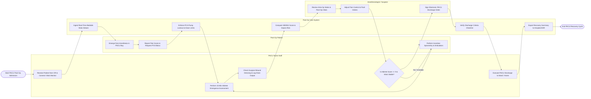

# Swimlane Diagram — Post-Operative Care Management System

## Mermaid Code

## Flow Description | Mô tả luồng

| Lane | Actor | Role in Flow |
|------|-------|-------------|
| 1 | PACU Nurse Staff | Connects patient to monitors upon OR arrival, performs 15-minute Aldrete assessments, monitors wound dressings and drain output, and executes final PACU discharge. |
| 2 | Post-Op Patient | Emerges from anesthesia, self-reports pain/nausea scores, operates PCA IV pump pendant for pain relief, and completes respiratory/physical therapy exercises. |
| 3 | Post-Op Care System | Streams continuous bedside vitals telemetry, enforces PCA pump safety lockout windows, calculates early warning NEWS2 sepsis scores, validates discharge criteria, and exports HL7 recovery summaries to EHR. |
| 4 | Anesthesiologist / Surgeon | Reviews post-op recovery telemetry, adjusts multimodal pain orders and IV fluids, and signs electronic PACU discharge orders when criteria are met. |
