# Action Tree — Post-Operative Care Management System

## Mermaid Code

```mermaid
graph TD
    Root["Post-Operative Care Management System"]

    Root --> M1["Anesthesia Emergence & Vital Monitoring"]
    Root --> M2["Pain & PCA Infusion Management"]
    Root --> M3["Fluid Balance & Wound Drain Tracking"]
    Root --> M4["Post-Op Sepsis & Deterioration Early Warning"]
    Root --> M5["Rehabilitation & Pulmonary Care"]
    Root --> M6["PACU Discharge & Safety Analytics"]

    M1 --> A11["Ingest Bedside Vitals Telemetry Stream"]
    M1 --> A12["Evaluate 15-Minute Aldrete Emergence Scores"]
    M1 --> A13["Monitor Oxygen Saturation & Airway Status"]
    M1 --> A14["Track PACU Bedside Recovery Timeline"]

    M2 --> A21["Capture Patient Numerical Pain & Nausea Scores"]
    M2 --> A22["Monitor IV PCA Opioid Infusion Rates"]
    M2 --> A23["Enforce PCA Safety Lockout Windows"]
    M2 --> A24["Configure Multimodal Analgesic Protocols"]

    M3 --> A31["Log Intravenous Fluid & Blood Transfusions"]
    M3 --> A32["Record Urinary Output & Foley Balances"]
    M3 --> A33["Track Surgical Drain Output & Fluid Color"]
    M3 --> A34["Attach Surgical Site Dressing Photos"]

    M4 --> A41["Calculate Automated NEWS2 Early Warning Scores"]
    M4 --> A42["Detect Post-Op Surgical Sepsis Risk"]
    M4 --> A43["Trigger Rapid Response Team Emergency Alerts"]
    M4 --> A44["Flag Hemodynamic & Respiratory Collapses"]

    M5 --> A51["Track Incentive Spirometry Volume Performance"]
    M5 --> A52["Log Post-Op Deep Breathing Exercises"]
    M5 --> A53["Record Early Post-Op Ambulation Distance"]
    M5 --> A54["Set Weight-Bearing Mobility Restrictions"]

    M6 --> A61["Verify PACU Discharge Readiness Criteria"]
    M6 --> A62["Export PACU Recovery Summary to EHR"]
    M6 --> A63["Analyze Surgical Site Infection (SSI) Audits"]
    M6 --> A64["Track PACU Length-of-Stay & Bottlenecks"]
```

## Module Description | Mô tả Module

| # | Module | Description | Actions |
|---|--------|-------------|---------|
| 1 | Anesthesia Emergence & Vital Monitoring | Monitors PACU bedside vital telemetry, assesses 15-minute Aldrete emergence scores, tracks airway stability, and logs PACU recovery timelines. | Ingest Vitals Telemetry, Evaluate Aldrete Scores, Monitor Airway Status, Track Recovery Timeline. |
| 2 | Pain & PCA Infusion Management | Captures patient pain and nausea scores, tracks IV smart pump PCA opioid deliveries, enforces safety lockout windows, and sets multimodal pain orders. | Capture Pain & Nausea Scores, Monitor PCA Infusions, Enforce PCA Lockouts, Configure Analgesic Protocols. |
| 3 | Fluid Balance & Wound Drain Tracking | Manages IV fluid and blood product intake, urinary catheter output, surgical drain volume/appearance, and surgical wound dressing assessments. | Log IV & Blood Intake, Record Urine Output, Track Drain Output, Attach Wound Photos. |
| 4 | Post-Op Sepsis & Deterioration Early Warning | Computes automated NEWS2 risk scores, flags early post-op surgical sepsis, triggers rapid response team alarms, and alerts on hemodynamic collapses. | Calculate NEWS2 Scores, Detect Sepsis Risk, Trigger Rapid Response Alerts, Flag Hemodynamic Collapses. |
| 5 | Rehabilitation & Pulmonary Care | Oversees post-op respiratory incentive spirometry, deep breathing exercises, early ambulation distance tracking, and physical therapy mobility rules. | Track Incentive Spirometry, Log Breathing Exercises, Record Ambulation Distance, Set Mobility Restrictions. |
| 6 | PACU Discharge & Safety Analytics | Validates PACU discharge readiness criteria (Aldrete >= 9), exports HL7 recovery notes to EHR, audits surgical site infections (SSI), and tracks PACU length-of-stay metrics. | Verify Discharge Criteria, Export Recovery Summary to EHR, Analyze SSI Audits, Track Length-of-Stay Metrics. |
