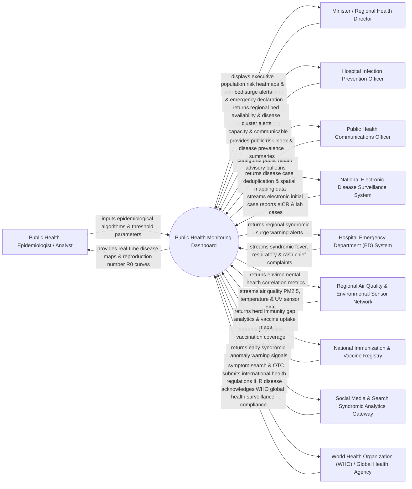

# Context Diagram — Public Health Monitoring Dashboard

## Mermaid Code

## Actor & Interaction Table | Bảng Actor & Tương tác

| # | Actor | Actor Type | Data Sent TO System | Data Received FROM System | Notes |
|---|-------|------------|---------------------|---------------------------|-------|
| 1 | Public Health Epidemiologist / Analyst | Primary | Outbreak alert thresholds, spatial-temporal cluster parameters, effective reproduction number ($R_e$) model rules. | Geographic GIS disease maps, epidemic curve projections, age/gender demographic risk breakdowns, cluster anomaly alerts. | Specialized public health scientist monitoring disease transmission patterns and analyzing population health data. |
| 2 | Minister / Regional Health Director | Primary | Emergency health policy decisions, public quarantine orders, healthcare resource allocation commands. | Executive summary dashboards, hospital ICU capacity utilization heatmaps, regional disease prevalence index, policy impact projections. | High-level government official making policy decisions based on population health analytics. |
| 3 | Hospital Infection Prevention Officer | Primary | Hospital ICU bed occupancy counts, ventilator availability, daily communicable disease admission counts. | Regional hospital capacity benchmarks, disease cluster alerts in adjacent facilities, outbreak containment status. | Hospital quality lead coordinating regional hospital surge capacity during public health crises. |
| 4 | Public Health Communications Officer | Primary | Public health warning bulletin drafts, vaccine campaign announcements, public risk communications. | Public risk level indicators, disease hot-spot maps, population vaccination coverage metrics. | Official spokesperson issuing public health advisories, media press releases, and citizen risk guidance. |
| 5 | National Electronic Disease Surveillance System | Supporting | Electronic Initial Case Reports (eICR), lab-confirmed infectious disease cases, death registry certificates. | Deduplicated national case counts, geo-coded disease mapping coordinates, disease classification updates. | Central government database collecting mandatory disease notification reports from hospitals and labs. |
| 6 | Hospital Emergency Department (ED) System | Supporting | Real-time syndromic chief complaint feeds (fever, influenza-like illness, acute respiratory distress, rash). | Regional ED syndromic surge warnings, local epidemic spike alerts, triage guidelines. | Hospital ED systems streaming raw chief complaint text for early syndromic surveillance. |
| 7 | Regional Air Quality & Environmental Sensor Network | Supporting | Continuous air quality index (AQI), PM2.5/PM10 particulate levels, ambient temperature, humidity, rainfall. | Environmental health hazard correlation metrics, respiratory illness risk overlays. | IoT environmental sensor network tracking environmental factors linked to respiratory and vector-borne diseases. |
| 8 | National Immunization & Vaccine Registry | Supporting | Vaccine doses administered, vaccine type (Influenza, COVID-19, Measles), target group demographic coverage. | Herd immunity threshold gap maps, under-vaccinated geographic cluster alerts, vaccine booster uptake rates. | Centralized database tracking population vaccination status and immunization coverage. |
| 9 | Syndromic Analytics Gateway | Supporting | Anonymized web symptom search query volumes, OTC pharmacy fever medication sales indices, absenteeism counts. | Early syndromic anomaly signals, 7-day predictive disease surge warnings. | External data aggregator tracking non-clinical digital signals to detect early outbreak signals before hospital admission. |
| 10 | World Health Organization (WHO) / Global Health Agency | Supporting / Regulatory | International Health Regulations (IHR) reporting protocols, global disease outbreak alerts, international benchmarks. | Mandatory IHR event notifications, country-level disease prevalence summaries, pandemic surveillance data. | International public health agency monitoring global health threats and enforcing International Health Regulations (IHR 2005). |

## System Boundary Description | Mô tả Phạm vi Hệ thống

The **Public Health Monitoring Dashboard (PHMD)** is an executive and epidemiological decision-support platform designed to monitor population health metrics, detect communicable disease outbreaks in real time, track environmental risks, and visualize healthcare system capacity.

**Inside System Scope:**
- Ingestion and spatial GIS visualization of real-time disease case feeds, hospital syndromic ED complaints, and lab test results.
- Automated epidemic curve modeling, effective reproduction number ($R_e$) calculation, and spatial cluster detection.
- Monitoring regional healthcare system capacity (ICU beds, ventilators, isolation units, PPE stockpiles).
- Syndromic surveillance integrating OTC medication sales, environmental air quality sensors, and search query trends.
- Executive decision-support dashboards, public health bulletin publishing, and International Health Regulations (IHR) reporting to WHO.

**Outside System Scope:**
- Direct clinical patient diagnosis or bedside medical care delivery (handled by Hospital EHR Systems).
- Direct physical operation of air quality sensing hardware or weather stations (managed by Environmental Agencies).
- Direct enforcement of municipal quarantine or police checkpoints (managed by Civil Defense and Law Enforcement).
