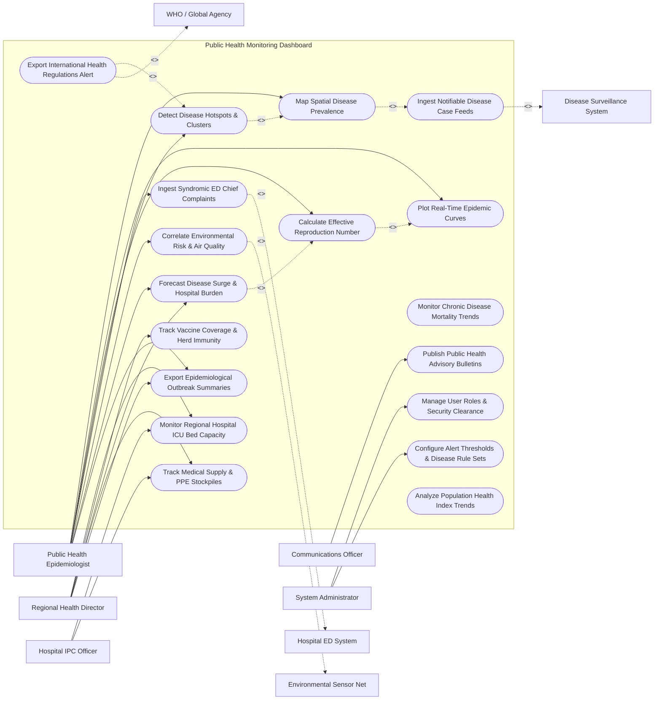

# Use Case Diagram — Public Health Monitoring Dashboard

## Mermaid Code

## Actor Table | Bảng Actor

| # | Actor | Actor Type | Role Description | Related Use Cases |
|---|-------|------------|------------------|-------------------|
| 1 | Public Health Epidemiologist | Primary | Specialist analyzing disease trends, mapping GIS hotspots, calculating $R_e$, and building forecast models. | UC02, UC03, UC04, UC05, UC09, UC10, UC13, UC15 |
| 2 | Regional Health Director | Primary | Senior decision-maker evaluating hospital capacity, vaccine coverage, surge forecasts, and policy interventions. | UC06, UC07, UC13, UC14, UC15 |
| 3 | Communications Officer | Primary | Public health spokesperson publishing risk bulletins and media advisories for citizens. | UC12 |
| 4 | Hospital IPC Officer | Primary | Hospital representative reporting ICU bed capacity, ventilator availability, and PPE stockpile status. | UC06, UC14 |
| 5 | System Administrator | Primary | IT administrator configuring system security clearance, alert rule thresholds, and data feeds. | UC16, UC17 |
| 6 | Disease Surveillance System | System (Secondary) | Government surveillance database streaming electronic case reports (eCR) and lab data. | UC01 |
| 7 | Hospital ED System | System (Secondary) | Emergency department system streaming real-time syndromic chief complaints. | UC09 |
| 8 | Environmental Sensor Net | System (Secondary) | IoT sensor network providing air quality (AQI), PM2.5, and temperature data. | UC10 |
| 9 | WHO / Global Agency | System (Secondary) | International health agency receiving mandatory International Health Regulations (IHR 2005) alerts. | UC11 |

## Use Case Table | Bảng Use Case

| # | UC ID | Use Case Name | Primary Actor | Secondary Actor | Description | Priority |
|---|-------|---------------|---------------|-----------------|-------------|----------|
| 1 | UC01 | Ingest Notifiable Disease Case Feeds | Epidemiologist | Surveillance | Ingests electronic case reports (eCR), lab confirmations, and death records for mandatory reportable conditions. | High |
| 2 | UC02 | Map Spatial Disease Prevalence | Epidemiologist | Surveillance | Renders interactive GIS heatmaps displaying disease incidence, prevalence rates, and choropleth regional maps. | High |
| 3 | UC03 | Plot Real-Time Epidemic Curves | Epidemiologist | None | Plots daily disease case counts by symptom onset date (Epi curves), moving averages, and log-scale trends. | High |
| 4 | UC04 | Calculate Effective Reproduction Number | Epidemiologist | None | Computes dynamic Effective Reproduction Number ($R_e$) to determine whether an outbreak is expanding ($R_e > 1$). | Critical |
| 5 | UC05 | Detect Disease Hotspots & Clusters | Epidemiologist | None | Uses spatial scan statistics (SaTScan) to detect statistical disease hotspots and geographic outbreak clusters. | Critical |
| 6 | UC06 | Monitor Regional Hospital ICU Bed Capacity | Health Director | IPC Officer | Tracks real-time regional hospital ICU bed occupancy, ventilator usage, and negative-pressure room capacity. | High |
| 7 | UC07 | Track Vaccine Coverage & Herd Immunity | Health Director | None | Monitors population vaccination coverage rates by region, age group, and assesses herd immunity gaps. | High |
| 8 | UC08 | Monitor Chronic Disease Mortality Trends | Epidemiologist | None | Analyzes cardiovascular disease, cancer, and diabetes mortality trends to evaluate long-term population health. | Medium |
| 9 | UC09 | Ingest Syndromic ED Chief Complaints | Epidemiologist | ED System | Analyzes ED chief complaint text (fever, respiratory distress) using NLP to detect early syndromic spikes. | High |
| 10 | UC10 | Correlate Environmental Risk & Air Quality | Epidemiologist | Environment | Overlays air quality index (AQI), PM2.5, and temperature data over respiratory and vector-borne disease incidence. | Medium |
| 11 | UC11 | Export International Health Regulations Alert | Health Director | WHO Agency | Generates and transmits mandatory International Health Regulations (IHR 2005) event notifications to the WHO. | Critical |
| 12 | UC12 | Publish Public Health Advisory Bulletins | Comms Officer | None | Drafts and publishes public health advisories, risk level notices, and prevention guidance to public portals. | Medium |
| 13 | UC13 | Forecast Disease Surge & Hospital Burden | Epidemiologist | Health Director | Runs SEIR epidemiological simulation models to forecast peak infection dates, ICU bed demand, and ventilator needs. | Critical |
| 14 | UC14 | Track Medical Supply & PPE Stockpiles | Health Director | IPC Officer | Monitors regional medical supply stockpiles (N95 masks, test kits, antiviral drugs, oxygen tanks) and burn rates. | High |
| 15 | UC15 | Export Epidemiological Outbreak Summaries | Epidemiologist | Health Director | Generates automated weekly epidemiological situation reports (SitReps) for ministry leadership. | High |
| 16 | UC16 | Manage User Roles & Security Clearance | Admin | None | Configures user accounts, RBAC access levels, and security clearance for sensitive health data. | High |
| 17 | UC17 | Configure Alert Thresholds & Disease Rule Sets | Admin | Epidemiologist | Configures disease surveillance alert limits (e.g., $R_e > 1.2$ or 3-sigma case spike) and notification channels. | High |
| 18 | UC18 | Analyze Population Health Index Trends | Epidemiologist | None | Tracks composite regional health index scores, disability-adjusted life years (DALYs), and health disparity gaps. | Medium |

## Use Case Specification | Đặc tả Use Case

---

### UC02 — Map Spatial Disease Prevalence (GIS)

| Field | Detail |
|-------|--------|
| **UC ID** | UC02 |
| **Use Case Name** | Map Spatial Disease Prevalence (GIS) |
| **Actor(s)** | Primary: Public Health Epidemiologist   Secondary: Disease Surveillance System |
| **Description** | Renders interactive, multi-layered Geographic Information System (GIS) maps visualizing disease incidence rates, active cases, and regional prevalence across municipal and provincial boundaries. |
| **Precondition** | 1. Disease case records are ingested with valid geocoded coordinates or postal codes (UC01). |
| **Main Flow** | 1. Epidemiologist opens "GIS Spatial Mapping" module and selects target disease (e.g., Dengue Fever) and date range.   2. System retrieves geocoded case data and aggregates cases by administrative boundaries (District, Ward, Province).   3. System renders interactive choropleth map color-coding regions by incidence rate per 100,000 population.   4. Epidemiologist applies layer filters:   &nbsp;&nbsp;&nbsp;&nbsp; a. Active Cases vs. Recovered.   &nbsp;&nbsp;&nbsp;&nbsp; b. Vector Breeding Sites / Mosquito Traps.   &nbsp;&nbsp;&nbsp;&nbsp; c. Population Density Overlays.   5. System displays popup detail card when clicking a district, showing total cases, 7-day change %, and localized $R_e$.   6. Epidemiologist exports high-resolution GIS map image for inclusion in executive situation report. |
| **Alternative Flow** | **AF1** — Dot Density Point Mapping: Epidemiologist switches map view to Dot Density; System displays individual anonymized case dots randomized within 500-meter grid squares to visualize exact spatial clustering while preserving privacy. |
| **Exception Flow** | **EX1** — Geocoding Failure: Ingested case address cannot be resolved to coordinates; System places case in "Unmapped Queue", attempts postal code fallback, and notifies data entry clerk. |
| **Postcondition** | Interactive GIS disease map is rendered, spatial patterns are visualized, and map layers are exported. |
| **Business Rule** | **BR1**: Publicly viewable spatial maps must obscure exact patient home coordinates to a minimum grid radius of 500 meters for HIPAA/privacy compliance. |

---

### UC04 — Calculate Effective Reproduction Number (Re)

| Field | Detail |
|-------|--------|
| **UC ID** | UC04 |
| **Use Case Name** | Calculate Effective Reproduction Number (Re) |
| **Actor(s)** | Primary: Public Health Epidemiologist   Secondary: None |
| **Description** | Evaluates daily infection serial intervals and case incidence curves using Bayesian statistical models to compute the dynamic Effective Reproduction Number ($R_e$) for tracking epidemic expansion or contraction. |
| **Precondition** | 1. Daily epidemic curve case data by symptom onset date is available (UC03).   2. Disease-specific serial interval distribution parameters (mean, SD) are configured in system. |
| **Main Flow** | 1. System automatically executes $R_e$ estimation engine (e.g., EpiEstim Bayesian framework) daily at midnight.   2. System ingests 14-day rolling window of daily incident cases adjusted for reporting delays.   3. System calculates $R_e$ point estimate alongside 95% credible intervals (e.g., $R_e = 1.34$, 95% CI: 1.18 - 1.52).   4. System plots longitudinal $R_e$ trend graph over time with a reference baseline line at $R_e = 1.0$.   5. System evaluates epidemic status:   &nbsp;&nbsp;&nbsp;&nbsp; a. $R_e > 1.0$ -> Epidemic Expanding (Red Indicator).   &nbsp;&nbsp;&nbsp;&nbsp; b. $R_e < 1.0$ -> Epidemic Contracting / Under Control (Green Indicator).   6. System highlights $R_e$ status on Epidemiologist and Health Director dashboards. |
| **Alternative Flow** | **AF1** — Regional Sub-Group $R_e$: System computes separate $R_e$ values for individual provinces or age groups (e.g., School-age $R_e$ vs Elderly $R_e$) to pinpoint specific transmission drivers. |
| **Exception Flow** | **EX1** — Sudden Reporting Lag Spike: Weekend testing slowdown causes artificial drop in reported cases; System applies reporting delay correction smoothing algorithm to prevent false dip in $R_e$ calculations. |
| **Postcondition** | Dynamic $R_e$ point estimate and credible intervals are computed, trend graphs are updated, and epidemic status indicators are refreshed. |
| **Business Rule** | **BR1**: $R_e > 1.2$ sustained over 3 consecutive days must trigger automated high-priority outbreak escalation warnings to health leadership. |

---

### UC06 — Monitor Regional Hospital ICU Bed Capacity

| Field | Detail |
|-------|--------|
| **UC ID** | UC06 |
| **Use Case Name** | Monitor Regional Hospital ICU Bed Capacity |
| **Actor(s)** | Primary: Regional Health Director, Hospital IPC Officer   Secondary: None |
| **Description** | Tracks real-time regional hospital capacity including total ICU beds, occupied ICU beds, available mechanical ventilators, negative-pressure isolation rooms, and emergency department surge status. |
| **Precondition** | 1. Regional hospitals submit automated or manual daily capacity feeds. |
| **Main Flow** | 1. System ingests real-time bed capacity updates from all regional hospitals across the province.   2. System aggregates regional healthcare resource metrics:   &nbsp;&nbsp;&nbsp;&nbsp; a. Total Adult ICU Beds: 450 | Occupied: 380 | Available: 70 (84.4% Occupancy).   &nbsp;&nbsp;&nbsp;&nbsp; b. Total Mechanical Ventilators: 300 | In Use: 210 | Available: 90.   &nbsp;&nbsp;&nbsp;&nbsp; c. Negative-Pressure Airborne Isolation Rooms: 120 | Occupied: 108 | Available: 12 (90.0% Occupancy).   3. System renders regional hospital network map color-coding facilities by capacity stress:   &nbsp;&nbsp;&nbsp;&nbsp; Green = < 75% Occupancy, Yellow = 75-89% Occupancy, Red = >= 90% Critical Occupancy.   4. Health Director views hospital capacity heatmap and identifies critical bottlenecks in Central City Hospital.   5. Health Director uses system to issue inter-hospital patient load-balancing transfer recommendations. |
| **Alternative Flow** | **AF1** — Emergency Surge Capacity Activation: Hospital capacity exceeds 90%; System calculates overflow bed activation requirements and displays designated surge hospital conversion plans. |
| **Exception Flow** | **EX1** — Stale Hospital Capacity Data: Hospital fails to update capacity data for 24 hours; System displays warning icon "Data Stale (> 24 hrs)", triggers SMS ping to hospital IPC officer, and uses last known values with disclaimer. |
| **Postcondition** | Regional hospital capacity metrics are updated, facility heatmaps are displayed, and load-balancing alerts are queued. |
| **Business Rule** | **BR1**: Regional ICU occupancy >= 85% must trigger automated health system capacity stress alerts to health ministry leadership. |

---

### UC09 — Ingest Syndromic ED Chief Complaints

| Field | Detail |
|-------|--------|
| **UC ID** | UC09 |
| **Use Case Name** | Ingest Syndromic ED Chief Complaints |
| **Actor(s)** | Primary: Public Health Epidemiologist   Secondary: Hospital ED System |
| **Description** | Ingests real-time emergency department chief complaint text feeds, parses free-text symptoms using Natural Language Processing (NLP), and categorizes encounters into syndromic disease clusters for early outbreak detection. |
| **Precondition** | 1. Hospital ED systems stream HL7 ADT A08 / A04 chief complaint messages in real time. |
| **Main Flow** | 1. Hospital ED System transmits HL7 chief complaint message when patient registers at ED triage.   2. System ingests message and extracts free-text chief complaint field (e.g., "3-day high fever, dry cough, muscle aches, difficulty breathing").   3. System NLP engine parses text, removes noise, and maps free-text keywords to standardized Syndromic Categories:   &nbsp;&nbsp;&nbsp;&nbsp; a. Respiratory Syndrome (Fever, Cough, Dyspnea).   &nbsp;&nbsp;&nbsp;&nbsp; b. Gastrointestinal Syndrome (Vomiting, Diarrhea, Abdominal Pain).   &nbsp;&nbsp;&nbsp;&nbsp; c. Rash / Febrile Syndrome (Fever, Maculopapular Rash).   &nbsp;&nbsp;&nbsp;&nbsp; d. Neurological Syndrome (Seizure, Altered Mental Status).   4. System aggregates daily syndromic counts by postal code and compares against historical 3-year baseline.   5. System identifies a statistically significant surge in Respiratory Syndrome (e.g., 3.5-sigma spike above baseline in Sector 4).   6. System flags "Syndromic Early Warning Alert" on Epidemiologist dashboard 5 days before lab confirmation testing. |
| **Alternative Flow** | **AF1** — Pediatric Syndromic Tracking: System filters syndromic categories by age group (< 5 years) to detect early pediatric hand-foot-mouth disease or RSV outbreaks. |
| **Exception Flow** | **EX1** — Unmapped Free-Text Complaint: Chief complaint contains rare slang or misspelling ("bad fluish hot feeling"); System NLP flags text as unclassified, queues for dictionary training, and routes to nearest matching category. |
| **Postcondition** | Chief complaints are categorized, syndromic baselines are updated, and early anomaly warnings are generated. |
| **Business Rule** | **BR1**: Syndromic surveillance alerts must process incoming ED chief complaint text within <= 5 minutes of patient registration. |

---

### UC11 — Export International Health Regulations Alert

| Field | Detail |
|-------|--------|
| **UC ID** | UC11 |
| **Use Case Name** | Export International Health Regulations Alert |
| **Actor(s)** | Primary: Regional Health Director   Secondary: WHO / Global Health Agency |
| **Description** | Evaluates high-consequence public health events against International Health Regulations (IHR 2005) decision instruments and generates mandatory event notifications for transmission to the World Health Organization (WHO). |
| **Precondition** | 1. Confirmed outbreak of a high-consequence pathogen (e.g., Novel Avian Influenza, Ebola, Cholera, MERS, or unexpected disease cluster) is detected.   2. Regional Health Director has authorized WHO notification clearance. |
| **Main Flow** | 1. Health Director opens "IHR International Reporting" module.   2. System applies IHR Annex 2 Decision Instrument algorithm:   &nbsp;&nbsp;&nbsp;&nbsp; a. Is the public health impact serious? -> Yes.   &nbsp;&nbsp;&nbsp;&nbsp; b. Is the event unusual or unexpected? -> Yes.   &nbsp;&nbsp;&nbsp;&nbsp; c. Is there a significant risk of international spread? -> Yes.   &nbsp;&nbsp;&nbsp;&nbsp; d. Is there a significant risk of international travel/trade restrictions? -> Yes.   3. System confirms event meets IHR criteria for notification as a potential Public Health Emergency of International Concern (PHEIC).   4. System auto-populates IHR Event Notification Form: Disease type, case counts, deaths, spatial distribution, laboratory confirmation methods, and control measures implemented.   5. Health Director reviews form, applies digital authorization signature, and clicks "Submit IHR Notification to WHO".   6. System dispatches encrypted e-IHR payload via secure API gateway to WHO National Focal Point (NFP) portal.   7. WHO Portal returns electronic receipt confirmation (`WHO_IHR_ACK_RECEIVED`), which System logs into official international audit registry. |
| **Alternative Flow** | **AF1** — Periodic IHR Follow-up Update: Health Director uses module to send 48-hour follow-up epidemiological updates to WHO during ongoing international health event. |
| **Exception Flow** | **EX1** — Transmission Gateway Offline: WHO NFP portal connection is unavailable; System falls back to encrypted diplomatic email transmission and alerts IHR Focal Point officer to verify receipt by phone. |
| **Postcondition** | Official IHR notification is transmitted to WHO, receipt confirmation is logged, and international surveillance compliance is satisfied. |
| **Business Rule** | **BR1**: Events meeting IHR Annex 2 criteria MUST be notified to WHO National Focal Point within 24 hours of assessment. |
