# Conceptual ERD — Public Health Monitoring Dashboard

## Mermaid Code

```mermaid
erDiagram
    GEOGRAPHIC_REGION {
        int region_id PK
        string region_code
        string region_name
        string province_district_level
        int population_count
        decimal area_sq_km
    }

    SURVEILLANCE_DISEASE_CASE {
        int case_id PK
        int region_id FK
        string disease_code
        string disease_name
        date symptom_onset_date
        date report_date
        string case_classification
        decimal latitude
        decimal longitude
    }

    EPIDEMIC_CURVE_DATA {
        int curve_id PK
        int region_id FK
        string disease_code
        date snapshot_date
        int daily_new_cases
        int rolling_7day_avg_cases
        int cumulative_cases
    }

    REPRODUCTION_NUMBER_LOG {
        int re_id PK
        int region_id FK
        string disease_code
        decimal re_point_estimate
        decimal re_confidence_lower
        decimal re_confidence_upper
        date calculated_date
    }

    DISEASE_CLUSTER_HOTSPOT {
        int cluster_id PK
        int region_id FK
        string disease_code
        int cluster_case_count
        decimal p_value_significance
        decimal center_latitude
        decimal center_longitude
        datetime detected_at
    }

    HOSPITAL_CAPACITY_METRIC {
        int capacity_id PK
        int region_id FK
        string hospital_name
        int total_icu_beds
        int occupied_icu_beds
        int total_ventilators
        int in_use_ventilators
        int negative_pressure_rooms_occupied
        datetime reported_at
    }

    VACCINE_COVERAGE_RECORD {
        int vaccine_rec_id PK
        int region_id FK
        string vaccine_type
        string target_age_group
        int total_doses_administered
        decimal population_coverage_percent
        date evaluation_date
    }

    SYNDROMIC_CHIEF_COMPLAINT {
        int syndromic_id PK
        int region_id FK
        string hospital_ed_code
        string chief_complaint_raw_text
        string mapped_syndromic_category
        datetime registered_at
    }

    ENVIRONMENTAL_RISK_SENSOR {
        int sensor_id PK
        int region_id FK
        string sensor_code
        decimal aqi_index
        decimal pm25_microg_m3
        decimal temperature_celsius
        decimal humidity_percent
        datetime recorded_at
    }

    POLICY_INTERVENTION_ORDER {
        int policy_id PK
        int region_id FK
        string policy_title
        string intervention_type
        date effective_start_date
        date effective_end_date
        string issuance_status
    }

    PUBLIC_HEALTH_BULLETIN {
        int bulletin_id PK
        string title
        string risk_level_rating
        text advisory_text
        datetime published_at
    }

    IHR_WHO_NOTIFICATION {
        int ihr_id PK
        int cluster_id FK
        string disease_name
        string ihr_control_number
        string pheic_criteria_met
        datetime submitted_at
        string who_ack_code
    }

    GEOGRAPHIC_REGION ||--o{ SURVEILLANCE_DISEASE_CASE : "contains"
    GEOGRAPHIC_REGION ||--o{ EPIDEMIC_CURVE_DATA : "tracks"
    GEOGRAPHIC_REGION ||--o{ REPRODUCTION_NUMBER_LOG : "evaluates"
    GEOGRAPHIC_REGION ||--o{ DISEASE_CLUSTER_HOTSPOT : "locates"
    GEOGRAPHIC_REGION ||--o{ HOSPITAL_CAPACITY_METRIC : "houses"
    GEOGRAPHIC_REGION ||--o{ VACCINE_COVERAGE_RECORD : "measures"
    GEOGRAPHIC_REGION ||--o{ SYNDROMIC_CHIEF_COMPLAINT : "originates"
    GEOGRAPHIC_REGION ||--o{ ENVIRONMENTAL_RISK_SENSOR : "monitored by"
    GEOGRAPHIC_REGION ||--o{ POLICY_INTERVENTION_ORDER : "enforces"
    DISEASE_CLUSTER_HOTSPOT ||--o| IHR_WHO_NOTIFICATION : "escalated to"
```

## Entity Description Table | Bảng mô tả Entity

| # | Entity Name | Vietnamese Name | Description | Key Attributes | Main Relationships |
|---|-------------|-----------------|-------------|----------------|-------------------|
| 1 | GEOGRAPHIC_REGION | Vùng Địa lý Hành chính | Administrative spatial region (Province, District, Ward) storing GIS boundaries and population counts. | `region_id`, `region_code`, `region_name`, `population_count`, `area_sq_km` | Contains `SURVEILLANCE_DISEASE_CASE`, houses `HOSPITAL_CAPACITY_METRIC`, monitored by `ENVIRONMENTAL_RISK_SENSOR`. |
| 2 | SURVEILLANCE_DISEASE_CASE | Ca Bệnh Giám sát Dịch | Individual geocoded disease case records ingested from electronic surveillance systems. | `case_id`, `region_id`, `disease_code`, `symptom_onset_date`, `case_classification` | Belongs to `GEOGRAPHIC_REGION`. |
| 3 | EPIDEMIC_CURVE_DATA | Dữ liệu Đường cong Dịch | Aggregated daily incident case counts and 7-day rolling averages used for Epi curve rendering. | `curve_id`, `region_id`, `disease_code`, `snapshot_date`, `daily_new_cases`, `rolling_7day_avg_cases` | Belongs to `GEOGRAPHIC_REGION`. |
| 4 | REPRODUCTION_NUMBER_LOG | Nhật ký Hệ số Lây nhiễm (Re) | Calculated dynamic Effective Reproduction Number ($R_e$) and 95% Bayesian confidence intervals. | `re_id`, `region_id`, `disease_code`, `re_point_estimate`, `re_confidence_lower`, `calculated_date` | Belongs to `GEOGRAPHIC_REGION`. |
| 5 | DISEASE_CLUSTER_HOTSPOT | Cụm Dịch bệnh Hotspot | Spatial scan statistics cluster records identifying statistically significant disease hotspots. | `cluster_id`, `region_id`, `disease_code`, `cluster_case_count`, `p_value_significance`, `center_latitude` | Belongs to `GEOGRAPHIC_REGION`, escalated to `IHR_WHO_NOTIFICATION`. |
| 6 | HOSPITAL_CAPACITY_METRIC | Chỉ số Năng lực Bệnh viện | Daily regional hospital ICU bed occupancy, ventilator utilization, and isolation capacity records. | `capacity_id`, `region_id`, `hospital_name`, `total_icu_beds`, `occupied_icu_beds`, `in_use_ventilators` | Belongs to `GEOGRAPHIC_REGION`. |
| 7 | VACCINE_COVERAGE_RECORD | Hồ sơ Độ bao phủ Tiem chủng | Regional population immunization coverage percentages categorized by vaccine type and target age group. | `vaccine_rec_id`, `region_id`, `vaccine_type`, `target_age_group`, `population_coverage_percent` | Belongs to `GEOGRAPHIC_REGION`. |
| 8 | SYNDROMIC_CHIEF_COMPLAINT | Triệu chứng Hội chứng ED | Real-time emergency department chief complaint text logs parsed into syndromic categories by NLP. | `syndromic_id`, `region_id`, `hospital_ed_code`, `chief_complaint_raw_text`, `mapped_syndromic_category` | Belongs to `GEOGRAPHIC_REGION`. |
| 9 | ENVIRONMENTAL_RISK_SENSOR | Cảm biến Rủi ro Môi trường | Continuous environmental IoT sensor metrics tracking Air Quality Index (AQI), PM2.5, and temperature. | `sensor_id`, `region_id`, `sensor_code`, `aqi_index`, `pm25_microg_m3`, `temperature_celsius` | Belongs to `GEOGRAPHIC_REGION`. |
| 10 | POLICY_INTERVENTION_ORDER | Lệnh Can thiệp Chính sách | Public health emergency policy orders (quarantine, school closures, mask mandates, gathering limits). | `policy_id`, `region_id`, `policy_title`, `intervention_type`, `effective_start_date` | Belongs to `GEOGRAPHIC_REGION`. |
| 11 | PUBLIC_HEALTH_BULLETIN | Bản tin Cảnh báo Y tế | Public risk advisories, alert level ratings, and citizen prevention guidelines published to portals. | `bulletin_id`, `title`, `risk_level_rating`, `advisory_text`, `published_at` | Standalone public communication entity. |
| 12 | IHR_WHO_NOTIFICATION | Báo cáo Điều lệ Y tế Quốc tế | Mandatory International Health Regulations (IHR 2005) event notifications submitted to WHO. | `ihr_id`, `cluster_id`, `disease_name`, `ihr_control_number`, `submitted_at`, `who_ack_code` | Belongs to `DISEASE_CLUSTER_HOTSPOT`. |

## Relationship Description | Mô tả Quan hệ

| # | From Entity | Cardinality | To Entity | Label | Business Explanation |
|---|-------------|-------------|-----------|-------|----------------------|
| 1 | GEOGRAPHIC_REGION | 1 to 0..N | SURVEILLANCE_DISEASE_CASE | contains | A geographic region contains multiple reported disease cases. |
| 2 | GEOGRAPHIC_REGION | 1 to 0..N | EPIDEMIC_CURVE_DATA | tracks | A geographic region tracks daily epidemic curve case snapshots. |
| 3 | GEOGRAPHIC_REGION | 1 to 0..N | REPRODUCTION_NUMBER_LOG | evaluates | A geographic region evaluates dynamic Effective Reproduction Number ($R_e$) metrics. |
| 4 | GEOGRAPHIC_REGION | 1 to 0..N | DISEASE_CLUSTER_HOTSPOT | locates | A geographic region locates spatial disease cluster hotspots. |
| 5 | GEOGRAPHIC_REGION | 1 to 0..N | HOSPITAL_CAPACITY_METRIC | houses | A geographic region houses hospitals reporting capacity metrics. |
| 6 | GEOGRAPHIC_REGION | 1 to 0..N | VACCINE_COVERAGE_RECORD | measures | A geographic region measures population vaccine coverage percentages. |
| 7 | GEOGRAPHIC_REGION | 1 to 0..N | SYNDROMIC_CHIEF_COMPLAINT | originates | A geographic region originates emergency department syndromic chief complaints. |
| 8 | GEOGRAPHIC_REGION | 1 to 0..N | ENVIRONMENTAL_RISK_SENSOR | monitored by | A geographic region is monitored by environmental air quality sensors. |
| 9 | GEOGRAPHIC_REGION | 1 to 0..N | POLICY_INTERVENTION_ORDER | enforces | A geographic region enforces public health policy intervention orders. |
| 10 | DISEASE_CLUSTER_HOTSPOT | 1 to 0..1 | IHR_WHO_NOTIFICATION | escalated to | A high-consequence disease cluster is escalated to an international WHO IHR notification. |
