# Swimlane Diagram — Public Health Monitoring Dashboard

## Mermaid Code

```mermaid
flowchart LR
    Start(["Start Public Health Surveillance"])

    subgraph Lane_Hospital["Hospital ED & Lab System"]
        H1["Transmit Electronic Case Reports eICR & Lab Data"]
        H2["Stream Emergency Department Chief Complaints"]
        H3["Update Hospital ICU Bed & Ventilator Capacity"]
    end

    subgraph Lane_Epidemiologist["Public Health Epidemiologist"]
        E1["Monitor Real-Time GIS Spatial Maps & Epi Curves"]
        E2{"Is Effective Reproduction Number Re > 1.2?"}
        E3["Execute SEIR Disease Surge Forecast Models"]
        E4["Issue Outbreak Alert & Situation Report"]
    end

    subgraph Lane_System["Public Health Monitoring Dashboard"]
        S1["Ingest & Deduplicate Surveillance Data Feeds"]
        S2["Process NLP Syndromic Complaint Categorization"]
        S3["Compute Dynamic Re & Spatial Cluster Hotspots"]
        S4["Render Executive Capacity & Hospital Strain Maps"]
        S5["Dispatch WHO IHR Notification & Public Advisory"]
    end

    subgraph Lane_Director["Regional Health Director"]
        D1["Review Executive Capacity & Epidemic Risk Maps"]
        D2["Declare Public Health Emergency & Resource Plan"]
        D3["Authorize Mandatory WHO IHR Event Notification"]
    end

    Finish(["End Surveillance Cycle"])

    Start --> H1 --> H2 --> H3 --> S1 --> S2 --> S3 --> E1 --> E2
    E2 -->|"Yes"| E3 --> E4 --> D1 --> D2 --> D3 --> S5 --> Finish
    E2 -->|"No / Stable"| S4 --> D1
```

## Flow Description | Mô tả luồng

| Lane | Actor | Role in Flow |
|------|-------|-------------|
| 1 | Hospital ED & Lab System | Transmits electronic initial case reports (eICR), lab confirmations, streams real-time ED chief complaints, and updates daily ICU bed capacity. |
| 2 | Public Health Epidemiologist | Monitors GIS disease maps and Epi curves, calculates dynamic Effective Reproduction Numbers ($R_e$), runs SEIR forecast models, and issues outbreak alerts. |
| 3 | Public Health Monitoring Dashboard | Ingests surveillance data, executes NLP syndromic categorization, computes $R_e$ and spatial cluster hotspots, renders executive capacity heatmaps, and dispatches WHO IHR notifications. |
| 4 | Regional Health Director | Reviews executive risk dashboards, declares public health emergencies, directs resource load-balancing, and authorizes mandatory WHO IHR international event notifications. |
