# Action Tree — Public Health Monitoring Dashboard

## Mermaid Code

```mermaid
graph TD
    Root["Public Health Monitoring Dashboard"]

    Root --> M1["Surveillance Data Ingestion & Deduplication"]
    Root --> M2["GIS Spatial Mapping & Hotspot Detection"]
    Root --> M3["Epidemiological Modeling & Re Analytics"]
    Root --> M4["Regional Healthcare System Capacity"]
    Root --> M5["Syndromic & Environmental Risk Surveillance"]
    Root --> M6["Executive Policy & International Reporting"]

    M1 --> A11["Ingest Electronic Case Reports (eICR)"]
    M1 --> A12["Process Laboratory PCR & Culture Confirmations"]
    M1 --> A13["Deduplicate Patient Disease Case Files"]
    M1 --> A14["Geocode Patient Addresses to Spatial Coordinates"]

    M2 --> A21["Render Interactive Choropleth Disease Maps"]
    M2 --> A22["Execute SaTScan Spatial-Temporal Hotspot Scans"]
    M2 --> A23["Overlay Population Density & Demographic Layers"]
    M2 --> A24["Export High-Resolution GIS Outbreak Maps"]

    M3 --> A31["Plot Daily Epidemic Curves (Epi Curves)"]
    M3 --> A32["Calculate Dynamic Effective Reproduction Number (Re)"]
    M3 --> A33["Run SEIR Epidemic Surge & Peak Forecast Models"]
    M3 --> A34["Analyze 14-Day Rolling Case Trend Slopes"]

    M4 --> A41["Monitor Regional Hospital ICU Bed Occupancy"]
    M4 --> A42["Track Available Mechanical Ventilator Counts"]
    M4 --> A43["Monitor Negative-Pressure Isolation Capacity"]
    M4 --> A44["Track Regional PPE & Antiviral Stockpile Burn Rates"]

    M5 --> A51["Ingest ED Chief Complaints via NLP Parsing"]
    M5 --> A52["Detect Respiratory & Gastrointestinal Syndromic Spikes"]
    M5 --> A53["Correlate Air Quality Index (AQI) & PM2.5 Sensors"]
    M5 --> A54["Monitor Population Vaccine Coverage & Herd Immunity"]

    M6 --> A61["Export Mandatory WHO IHR 2005 Event Alerts"]
    M6 --> A62["Publish Public Risk Bulletins & Advisories"]
    M6 --> A63["Draft Emergency Policy & Quarantine Orders"]
    M6 --> A64["Generate Executive Situation Reports (SitReps)"]
```

## Module Description | Mô tả Module

| # | Module | Description | Actions |
|---|--------|-------------|---------|
| 1 | Surveillance Data Ingestion & Deduplication | Ingests electronic case reports (eICR), laboratory diagnostic confirmations, deduplicates cases, and geocodes patient addresses. | Ingest eICR Reports, Process Lab Confirmations, Deduplicate Case Files, Geocode Addresses. |
| 2 | GIS Spatial Mapping & Hotspot Detection | Renders interactive choropleth GIS maps, executes SaTScan spatial-temporal hotspot scans, and overlays population density. | Render Choropleth Maps, Execute SaTScan Hotspot Scans, Overlay Population Density, Export GIS Maps. |
| 3 | Epidemiological Modeling & Re Analytics | Plots daily epidemic curves, calculates dynamic Effective Reproduction Numbers ($R_e$), and executes SEIR forecasting models. | Plot Epidemic Curves, Calculate Dynamic $R_e$, Run SEIR Forecast Models, Analyze 14-Day Case Slopes. |
| 4 | Regional Healthcare System Capacity | Tracks regional hospital ICU bed occupancy, ventilator usage, negative-pressure room availability, and PPE stockpile burn rates. | Monitor ICU Bed Occupancy, Track Ventilator Counts, Monitor Isolation Capacity, Track Stockpile Burn Rates. |
| 5 | Syndromic & Environmental Risk Surveillance | Parses ED chief complaints using NLP, detects syndromic spikes, correlates air quality (AQI)/PM2.5, and monitors vaccine coverage. | Ingest ED Complaints via NLP, Detect Syndromic Spikes, Correlate Air Quality Sensors, Monitor Vaccine Coverage. |
| 6 | Executive Policy & International Reporting | Exports mandatory WHO International Health Regulations (IHR 2005) alerts, publishes advisories, and generates executive Situation Reports. | Export WHO IHR Alerts, Publish Public Advisories, Draft Emergency Policy Orders, Generate Executive SitReps. |
