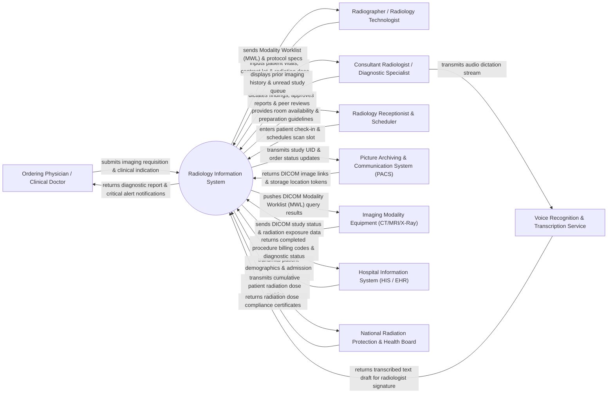

# Context Diagram — Radiology Information System

## Mermaid Code

## Actor & Interaction Table | Bảng Actor & Tương tác

| # | Actor | Actor Type | Data Sent TO System | Data Received FROM System | Notes |
|---|-------|------------|---------------------|---------------------------|-------|
| 1 | Ordering Physician / Clinical Doctor | Primary | Radiology examination requisitions, clinical history, diagnostic queries, priority flags. | Diagnostic radiology reports, critical finding alert notices, image view links. | Inpatient or outpatient doctor requesting X-ray, CT, MRI, Ultrasound, or PET scans. |
| 2 | Radiology Receptionist & Scheduler | Primary | Patient check-in confirmation, appointment scheduling choices, payment clearance data. | Modality room availability, patient preparation instructions, appointment tokens. | Front-desk staff managing patient intake, check-in, and radiology exam scheduling. |
| 3 | Radiographer / Radiology Technologist | Primary | Scan start/completion status, contrast media dosage, patient positioning notes, radiation exposure parameters. | DICOM Modality Worklist (MWL), examination protocols, patient allergy warnings. | Allied health professional operating X-ray, CT, or MRI scanners and positioning patients. |
| 4 | Consultant Radiologist / Diagnostic Specialist | Primary | Dictated report findings, diagnostic impressions, report sign-offs, peer review scores, critical result alerts. | Unread diagnostic study queue, PACS image links, patient historical radiology records. | Medical doctor specialized in interpreting diagnostic medical images and authoring formal reports. |
| 5 | Picture Archiving & Communication System (PACS) | Supporting System | DICOM image study availability status, image storage UIDs, thumbnail preview metadata. | Study accession numbers, patient demographics, order UIDs, modality study mapping. | Enterprise DICOM server archiving high-resolution medical imaging files (DICOM files). |
| 6 | Imaging Modality Equipment (CT/MRI/X-Ray) | Supporting System | DICOM Modality Performed Procedure Step (MPPS), exposure dose metrics (CTDIvol, DLP), acquisition logs. | DICOM Modality Worklist (MWL) entries, scheduled patient attributes, accession numbers. | Medical imaging machines (Siemens, GE, Philips, Canon) querying worklists via DICOM protocol. |
| 7 | Hospital Information System (HIS / EHR) | Supporting System | Master Patient Index (MPI) data, inpatient admission details, clinical encounters, coverage eligibility. | Completed imaging procedure billing codes (CPT/ICD), diagnostic report summaries, order fulfillment status. | Main enterprise hospital software holding master patient records and financial billing. |
| 8 | Voice Recognition & Transcription Service | Supporting System | Transcribed text streams, speech-to-text accuracy metrics, dictation template tokens. | Audio dictation streams, radiologist voice profile IDs, medical vocabulary custom lexicons. | AI/cloud speech recognition system (e.g., Nuance PowerScribe) converting radiologist speech to text. |
| 9 | National Radiation Protection & Health Board | Regulatory | Radiation dose exposure limits, diagnostic reference levels (DRL), regulatory audit directives. | Cumulative patient dose registry reports, high-radiation alert logs, compliance metrics. | Government radiation safety oversight agency monitoring medical ionising radiation safety. |

## System Boundary Description | Mô tả Phạm vi Hệ thống

The **Radiology Information System (RIS)** is a core clinical information system designed to manage the administrative, operational, and diagnostic workflows of a hospital radiology department. It handles order entry, appointment scheduling, DICOM Modality Worklist (MWL) integration, technologist workflow tracking, contrast media logging, radiologist report authoring, speech recognition integration, critical result alerting, cumulative radiation dose monitoring, peer review quality assurance, and DICOM PACS image link synchronization.

**Inside System Scope:**
- Radiology exam scheduling, room management, and patient preparation workflow.
- DICOM Modality Worklist (MWL) generation and Performed Procedure Step (MPPS) tracking.
- Radiologist worklist management sorted by subspecialty, exam priority, and turnaround time (TAT).
- Voice recognition transcription integration, diagnostic report creation, co-signing, and electronic signature.
- Urgent critical finding alert dispatch and closed-loop physician acknowledgment tracking.
- Cumulative patient radiation exposure logging (CTDIvol, DLP, fluoroscopy time).
- Quality assurance peer review workflows and double-reading compliance.

**Outside System Scope:**
- Long-term binary storage and rendering of raw DICOM image pixel files (delegated to PACS).
- Mechanical calibration, tube voltage settings, and hardware maintenance of imaging scanners (handled by biomedical engineers).
- Hospital financial billing, insurance claims clearance, and cashiering (delegated to HIS / Medical Billing System).
- Clinical patient treatment planning and surgical execution (handled by EHR and surgical systems).
