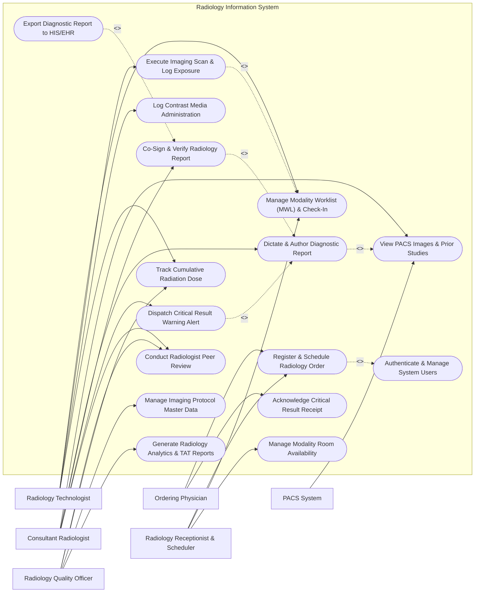

# Use Case Diagram — Radiology Information System

## Mermaid Code

## Actor Table | Bảng Actor

| # | Actor | Actor Type | Role Description | Related Use Cases |
|---|-------|------------|------------------|-------------------|
| 1 | Ordering Physician | Primary | Clinical doctor submitting imaging requisitions and receiving critical diagnostic report notifications. | UC01, UC09 |
| 2 | Radiology Receptionist & Scheduler | Primary | Administrative staff registering patient walk-ins, scheduling modality appointments, and checking in patients. | UC01, UC02, UC13 |
| 3 | Radiology Technologist | Primary | Certified imaging technologist selecting MWL entries, performing scans, logging radiation exposure, and documenting contrast media. | UC02, UC03, UC04, UC11 |
| 4 | Consultant Radiologist | Primary | Specialized physician reviewing PACS images, dictating diagnostic reports, signing final interpretations, and alerting critical findings. | UC05, UC06, UC07, UC08, UC10 |
| 5 | Radiology Quality Officer | Primary | Department supervisor monitoring turnaround times, radiation safety compliance, peer reviews, and protocol definitions. | UC10, UC11, UC12, UC15 |
| 6 | PACS System | Secondary / System | External DICOM archive supplying high-resolution image study links and thumbnail metadata to RIS worklists. | UC05 |

## Use Case Table | Bảng Use Case

| # | UC ID | Use Case Name | Primary Actor | Secondary Actor | Description | Priority |
|---|-------|---------------|---------------|-----------------|-------------|----------|
| 1 | UC01 | Register & Schedule Radiology Order | Radiology Receptionist & Scheduler | Ordering Physician | Capture clinical radiology requests, select modality procedures, and schedule appointment time slots. | High |
| 2 | UC02 | Manage Modality Worklist (MWL) & Check-In | Radiology Receptionist & Scheduler | Radiology Technologist | Process patient arrival, populate DICOM Modality Worklists (MWL), and assign exam rooms. | High |
| 3 | UC03 | Execute Imaging Scan & Log Exposure | Radiology Technologist | None | Mark scan start/end times, record technical exposure parameters, and confirm procedure completion. | High |
| 4 | UC04 | Log Contrast Media Administration | Radiology Technologist | None | Record contrast media brand, volume, batch lot number, and injection time for contrast-enhanced scans. | High |
| 5 | UC05 | View PACS Images & Prior Studies | Consultant Radiologist | PACS System | Retrieve DICOM image thumbnails, launchPACS web viewer, and compare with historical radiology studies. | High |
| 6 | UC06 | Dictate & Author Diagnostic Report | Consultant Radiologist | None | Dictate findings using speech recognition, edit transcription drafts, and compose formal diagnostic impressions. | High |
| 7 | UC07 | Co-Sign & Verify Radiology Report | Consultant Radiologist | None | Apply electronic signature to final diagnostic report, locking the document against unauthorized changes. | High |
| 8 | UC08 | Dispatch Critical Result Warning Alert | Consultant Radiologist | Ordering Physician | Flag life-threatening findings (e.g., stroke, pneumothorax) and transmit multi-channel urgent alerts. | High |
| 9 | UC09 | Acknowledge Critical Result Receipt | Ordering Physician | None | Log closed-loop acknowledgment of critical radiology findings by the responsible clinical physician. | High |
| 10 | UC10 | Conduct Radiologist Peer Review | Consultant Radiologist | Radiology Quality Officer | Perform double-blind quality reviews on selected reports, scoring diagnostic agreement and accuracy. | Medium |
| 11 | UC11 | Track Cumulative Radiation Dose | Radiology Technologist | Radiology Quality Officer | Record CTDIvol, DLP, and fluoroscopy exposure metrics to monitor lifetime patient radiation safety limits. | High |
| 12 | UC12 | Manage Imaging Protocol Master Data | Radiology Quality Officer | None | Maintain standard operating procedure protocols, CPT codes, contrast guidelines, and preparation instructions. | Medium |
| 13 | UC13 | Manage Modality Room Availability | Radiology Receptionist & Scheduler | None | Configure room operating hours, maintenance blackout periods, and modality emergency slots. | Medium |
| 14 | UC14 | Export Diagnostic Report to HIS/EHR | Consultant Radiologist | None | Transmit signed radiology reports and diagnostic summaries to the main hospital EHR via HL7 ORU. | High |
| 15 | UC15 | Generate Radiology Analytics & TAT Reports | Radiology Quality Officer | None | Track exam volumes, report turnaround times (TAT), technologist productivity, and room utilization. | Medium |
| 16 | UC16 | Authenticate & Manage System Users | All Users | None | Enforce secure authentication, role-based access control, and electronic signature audit logging. | High |

## Use Case Specification | Đặc tả Use Case

---

### UC01 — Register & Schedule Radiology Order

| Field | Detail |
|-------|--------|
| **UC ID** | UC01 |
| **Use Case Name** | Register & Schedule Radiology Order |
| **Actor(s)** | Primary: Radiology Receptionist & Scheduler   Secondary: Ordering Physician |
| **Description** | Processes incoming electronic or paper radiology requests from clinical physicians, verifies patient medical history (e.g., pregnancy, renal function, allergies), checks modality room availability, and schedules an imaging appointment. |
| **Precondition** | 1. The Receptionist is authenticated into RIS with scheduling privileges.   2. The patient profile exists in the Master Patient Index (MPI). |
| **Main Flow** | 1. The Receptionist searches for the patient by MRN or full name and opens the "New Radiology Order" screen.   2. The System loads patient demographics, pregnancy status, serum creatinine levels, and documented contrast allergies.   3. The Receptionist inputs the ordering physician ID, clinical indication, priority level (Routine / Urgent / STAT), and selects the requested imaging CPT procedure (e.g., CT Chest with Contrast).   4. The System prompts for contrast safety verification if the procedure involves contrast media.   5. The System searches available modality rooms (e.g., CT Scanner 02) and displays open time slots.   6. The Receptionist selects an optimal time slot, and the System reserves the room, assigns an Accession Number (e.g., ACC-2026-9812), and generates patient preparation instructions (e.g., NPO for 6 hours).   7. The System sets the order status to "Scheduled" and transmits confirmation notifications to the patient and ordering doctor. |
| **Alternative Flow** | **AF1** — Emergency STAT Walk-In: If the order is marked "STAT Emergency", the System bypasses future calendar scheduling, assigns the immediate emergency slot in the active modality room, and sends an urgent notification to the technologist on duty.   **AF2** — HIS HL7 Order Integration: If the order is transmitted electronically from HIS via HL7 ORM message, the System automatically populates order fields and places the appointment into the pending scheduling queue. |
| **Exception Flow** | **EX1** — Contrast Media Allergy Warning: If the patient has a documented severe contrast allergy, the System displays an amber alert and requires the Receptionist to confirm premedication approval from the Radiologist before finalizing the order.   **EX2** — Impaired Renal Function Alert: If the patient's eGFR is below 30 mL/min for a contrast-enhanced scan, the System blocks scheduling until a modified protocol or hydration plan is attached. |
| **Postcondition** | A unique Accession Number is generated, the appointment slot is locked, preparation guidelines are printed/sent, and the order is queued for DICOM Modality Worklist generation. |
| **Business Rule** | **BR1**: All STAT emergency imaging orders must be assigned an accession number and scheduled within 5 minutes of receipt.   **BR2**: Contrast-enhanced procedure scheduling requires a documented eGFR test result performed within the last 30 days. |

---

### UC02 — Manage Modality Worklist (MWL) & Check-In

| Field | Detail |
|-------|--------|
| **UC ID** | UC02 |
| **Use Case Name** | Manage Modality Worklist (MWL) & Check-In |
| **Actor(s)** | Primary: Radiology Receptionist & Scheduler   Secondary: Radiology Technologist |
| **Description** | Handles patient arrival check-in at the radiology department, generates DICOM Modality Worklist (MWL) entries, and pushes DICOM headers to imaging scanners (CT, MRI, X-Ray) for error-free patient demographic synchronization. |
| **Precondition** | 1. The patient has a valid scheduled Radiology Order with an assigned Accession Number.   2. The modality machine is connected to the RIS DICOM MWL service via AE Title. |
| **Main Flow** | 1. The patient arrives at the radiology department front desk. The Receptionist scans the appointment barcode or searches by MRN.   2. The System updates the order status from "Scheduled" to "Arrived / Checked-In".   3. The System automatically formats a DICOM C-FIND response payload containing Patient Name, MRN, Accession Number, Study Instance UID, Requested Procedure Description, and Modality Type.   4. The System pushes the entry to the designated modality room's active DICOM Modality Worklist queue.   5. The Radiology Technologist calls the patient into the examination room and selects the patient's entry directly on the CT/MRI scanner console interface via DICOM MWL query.   6. The scanner console populates patient metadata automatically, ensuring 100% data fidelity without manual typing.   7. The Technologist updates the RIS status to "In Progress" as scan positioning begins. |
| **Alternative Flow** | **AF1** — Unscheduled Trauma Arrival: For acute trauma patients with unknown identity, the Technologist creates an "Emergency Unknown (Trauma John Doe)" worklist entry directly in RIS, assigning temporary UIDs.   **AF2** — Modality Transfer: If CT Scanner 01 experiences a technical breakdown, the Technologist reassigns the worklist item to CT Scanner 02, and the System automatically updates the destination AE Title. |
| **Exception Flow** | **EX1** — DICOM MWL Gateway Offline: If the network connection to the scanner console drops, the System alerts the Technologist and generates an emergency offline barcode label for manual scanning.   **EX2** — Duplicate Check-In Attempt: If check-in is attempted for an already completed scan, the System blocks check-in and alerts the Receptionist. |
| **Postcondition** | The patient status changes to "Arrived", the DICOM MWL is updated on the scanner console, and the technologist queue reflects active exam status. |
| **Business Rule** | **BR1**: Manual typing of patient demographics on imaging scanner consoles is strictly prohibited; all exams must use DICOM MWL auto-population.   **BR2**: Patient check-in automatically expires if the patient fails to arrive within 45 minutes of the scheduled time. |

---

### UC06 — Dictate & Author Diagnostic Report

| Field | Detail |
|-------|--------|
| **UC ID** | UC06 |
| **Use Case Name** | Dictate & Author Diagnostic Report |
| **Actor(s)** | Primary: Consultant Radiologist |
| **Description** | Enables the radiologist to review captured PACS imaging studies, dictate clinical observations using integrated voice recognition software, format findings, apply structured reporting templates, and author the preliminary or final diagnostic report. |
| **Precondition** | 1. The imaging procedure status is "Completed", and DICOM images are available in PACS.   2. The Radiologist is logged into RIS with diagnostic reporting privileges and a speech recognition microphone connected. |
| **Main Flow** | 1. The Radiologist selects an unread study from the RIS reporting queue (sorted by priority and exam age).   2. The System launches the integrated web PACS viewer displaying current DICOM series along with relevant prior historical studies side-by-side.   3. The Radiologist clicks "Start Dictation", activates the speech microphone, and speaks findings using structured headings (Clinical History, Technique, Comparison, Findings, Impression).   4. The integrated speech-to-text service transcribes spoken audio in real-time, placing text into the active report editor window.   5. The Radiologist reviews the transcribed text, makes voice or manual corrections, and selects standardized diagnostic coding tags (e.g., BIRADS for Mammography, RECIST for Oncology).   6. The Radiologist reviews the "Impression" section summarizing major findings and clicks "Save Draft" or "Proceed to Verification".   7. The System updates the report status to "Drafted / Pending Signature". |
| **Alternative Flow** | **AF1** — Structured Template Auto-Population: The Radiologist selects a pre-configured template (e.g., "Normal Non-Contrast Head CT"), and the System populates default normal findings text, allowing quick customization.   **AF2** — Resident Preliminary Report Review: An attending radiologist opens a preliminary draft created by a radiology resident, edits findings, and approves the report for final co-signature. |
| **Exception Flow** | **EX1** — PACS Image Transfer Incomplete: If DICOM image series are missing or corrupted in PACS, the System prevents report authoring and sends a "Missing Images" alert to the PACS administrator.   **EX2** — Speech Recognition Service Disconnection: If the speech service loses network connection, the System switches to manual keyboard entry mode and auto-saves the draft locally. |
| **Postcondition** | The diagnostic text is saved, structured impressions are logged, report status changes to "Drafted", and the study moves to the signature verification queue. |
| **Business Rule** | **BR1**: All STAT emergency diagnostic reports must be authored within 30 minutes of image completion.   **BR2**: Reports containing oncological measurements must use standardized macro templates compliant with national reporting guidelines. |

---

### UC08 — Dispatch Critical Result Warning Alert

| Field | Detail |
|-------|--------|
| **UC ID** | UC08 |
| **Use Case Name** | Dispatch Critical Result Warning Alert |
| **Actor(s)** | Primary: Consultant Radiologist   Secondary: Ordering Physician |
| **Description** | Automatically detects or manually flags unexpected, life-threatening radiology findings (e.g., acute intracranial hemorrhage, tension pneumothorax, pulmonary embolism) and dispatches mandatory multi-channel urgent alerts to the ordering physician. |
| **Precondition** | 1. The Radiologist is authoring or reviewing an imaging study in RIS.   2. Ordering physician contact channels (SMS, mobile app push, desktop pop-up) are configured in the system. |
| **Main Flow** | 1. During report authoring, the Radiologist identifies a critical life-threatening pathology and clicks the "Flag Critical Finding" button.   2. The System opens the Critical Alert modal and prompts the Radiologist to select a severity tier: Tier 1 (Red - Immediate life threat, < 15 min response) or Tier 2 (Orange - Urgent, < 60 min response).   3. The Radiologist selects the finding category (e.g., Acute Intracranial Hemorrhage) and types a brief 1-sentence synopsis.   4. The System instantly dispatches an automated high-priority alert via desktop pop-up notification, mobile app push alert, and SMS to the Ordering Physician.   5. The System starts an automated acknowledgment countdown timer based on the severity tier.   6. When the Ordering Physician opens the notification and clicks "Acknowledge Critical Result", the System logs the physician's digital signature, user ID, and exact timestamp.   7. The System attaches a closed-loop Critical Alert Verification Certificate to the official radiology report. |
| **Alternative Flow** | **AF1** — Verbal Phone Call Backup Logging: If the Radiologist calls the ordering physician directly by telephone, the Radiologist enters the call timestamp, phone number, and physician staff name into RIS, fulfilling compliance requirements.   **AF2** — Escalation to On-Call Department Head: If the ordering physician does not acknowledge a Tier 1 alert within 15 minutes, the System automatically escalates the alert to the department head on-call physician. |
| **Exception Flow** | **EX1** — Unreachable Ordering Physician: If all notification channels fail to deliver, the System flags the case on the Radiology Charge Nurse dashboard for manual telephone escalation.   **EX2** — Incorrect Doctor Contact Info: If the SMS bounces due to an invalid phone number, the System alerts the Radiologist to select an alternate covering physician. |
| **Postcondition** | Critical alerts are dispatched across multiple channels, acknowledgment countdown timers are initiated, and closed-loop audit trails are appended to the report. |
| **Business Rule** | **BR1**: Tier 1 critical findings require documented closed-loop communication within 15 minutes of discovery.   **BR2**: Critical alert audit trails must record the exact time of discovery, time of alert dispatch, time of receipt, and name of acknowledging clinician. |

---

### UC10 — Conduct Radiologist Peer Review

| Field | Detail |
|-------|--------|
| **UC ID** | UC10 |
| **Use Case Name** | Conduct Radiologist Peer Review |
| **Actor(s)** | Primary: Consultant Radiologist   Secondary: Radiology Quality Officer |
| **Description** | Implements a continuous quality assurance process where radiologists evaluate a randomized selection of signed diagnostic reports created by peers to score diagnostic concordance, agreement, and reporting quality. |
| **Precondition** | 1. The reviewing Radiologist is authorized as a Quality Peer Reviewer.   2. The system's automated peer review engine has selected randomized signed cases. |
| **Main Flow** | 1. The Radiologist accesses the "Peer Review Worklist" module.   2. The System presents a randomized, anonymized (or open, depending on hospital policy) completed radiology study.   3. The Radiologist reviews the PACS imaging study independently without looking at the original report text first ("Double-Blind" mode option).   4. The Radiologist opens the original report and evaluates the findings against a standardized RADPEER scoring grid: Score 1 (Concurrence), Score 2 (Understandable disagreement - minor), Score 3 (Disagreement - major clinical impact), Score 4 (Unclear interpretation).   5. The Radiologist selects the appropriate score and enters brief constructive feedback notes if a disagreement is logged.   6. The Radiologist submits the peer review assessment.   7. The System logs the score, updates the authoring radiologist's cumulative quality metric profile, and routes any major discrepancy (Score 3) to the Quality Officer for review committee evaluation. |
| **Alternative Flow** | **AF1** — Subspecialty Targeted Peer Review: The Quality Officer configures the system to route 100% of complex Pediatric MRI or Neuro Interventional scans to subspecialists for mandatory peer audit.   **AF2** — Arbitrated Consensus Review: For cases with Score 3 major disagreement, a 3-member radiologist panel conducts a joint review session and submits a consensus consensus score. |
| **Exception Flow** | **EX1** — Self-Review Conflict Block: If the automated algorithm accidentally assigns a radiologist's own past study to themselves, the System blocks access and reassigns the case.   **EX2** — Peer Review Deadline Expired: If a assigned peer review remains pending after 14 days, the System auto-reassigns the study to another radiologist. |
| **Postcondition** | RADPEER scores are registered, quality assurance analytics are updated, and discrepancy alerts are routed to the Radiology Quality Committee. |
| **Business Rule** | **BR1**: Every practicing radiologist must have a minimum of 3% of their total signed reports peer-reviewed every calendar quarter.   **BR2**: Peer review scores resulting in major clinical disagreement (Score 3) must be reviewed by the Department Quality Committee within 7 days. |
