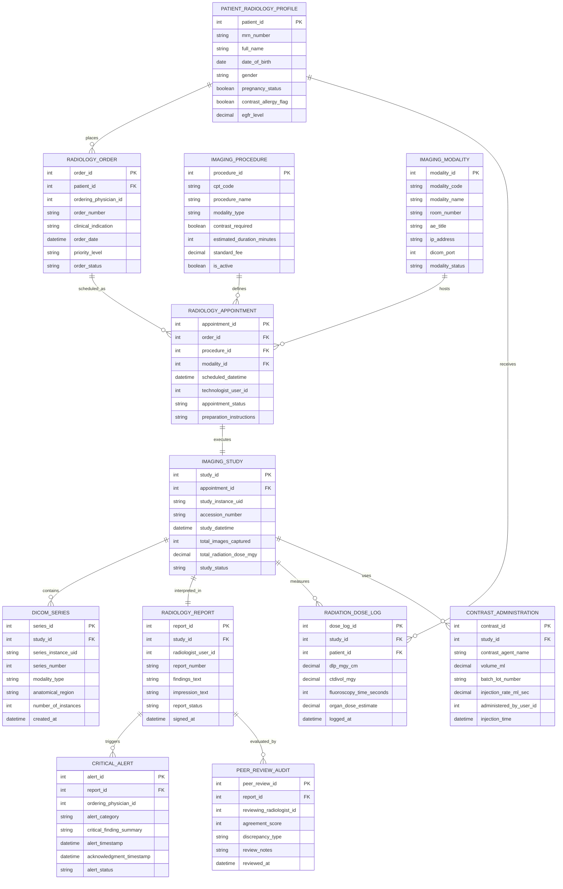

# Conceptual ERD — Radiology Information System

## Mermaid Code

## Entity Description Table | Bảng mô tả Entity

| # | Entity Name | Vietnamese Name | Description | Key Attributes | Main Relationships |
|---|-------------|-----------------|-------------|----------------|-------------------|
| 1 | PATIENT_RADIOLOGY_PROFILE | Hồ sơ Chẩn đoán Hóa bệnh | Radiology patient record storing MRN, renal eGFR function, pregnancy flags, and contrast allergy history. | patient_id, mrn_number, full_name, egfr_level, contrast_allergy_flag | Has many RADIOLOGY_ORDER and RADIATION_DOSE_LOG entities. |
| 2 | RADIOLOGY_ORDER | Yêu cầu Chụp Hình ảnh | Clinical order submitted by ordering doctors specifying clinical indication, urgency priority, and requested procedure. | order_id, patient_id, ordering_physician_id, order_number, priority_level, order_status | Belongs to PATIENT_RADIOLOGY_PROFILE; Has many RADIOLOGY_APPOINTMENT entities. |
| 3 | IMAGING_PROCEDURE | Quy trình Chụp Master | Catalog master entity defining CPT codes, procedure names, modality types (CT/MRI/X-Ray), and contrast rules. | procedure_id, cpt_code, procedure_name, modality_type, contrast_required, standard_fee | Has many RADIOLOGY_APPOINTMENT entities. |
| 4 | IMAGING_MODALITY | Thiết bị Chẩn đoán | Imaging machine scanner room definition containing DICOM Application Entity (AE) Titles, IP addresses, and ports. | modality_id, modality_code, modality_name, room_number, ae_title, ip_address, dicom_port | Has many RADIOLOGY_APPOINTMENT entities. |
| 5 | RADIOLOGY_APPOINTMENT | Lịch hẹn Chụp | Scheduled appointment slot tying an order, procedure, and modality room with technologist assignment. | appointment_id, order_id, procedure_id, modality_id, scheduled_datetime, appointment_status | Belongs to RADIOLOGY_ORDER, IMAGING_PROCEDURE, and IMAGING_MODALITY; Has one IMAGING_STUDY entity. |
| 6 | IMAGING_STUDY | Ca chụp DICOM Study | Specific executed imaging exam session identified by global Study Instance UID and local Accession Number. | study_id, appointment_id, study_instance_uid, accession_number, study_datetime, study_status | Belongs to RADIOLOGY_APPOINTMENT; Has many DICOM_SERIES, RADIATION_DOSE_LOG, and CONTRAST_ADMINISTRATION; Has one RADIOLOGY_REPORT. |
| 7 | DICOM_SERIES | Chuỗi ảnh DICOM | Individual series of DICOM image slices captured during an imaging study session (e.g., Axial, Sagittal). | series_id, study_id, series_instance_uid, series_number, anatomical_region, number_of_instances | Belongs to IMAGING_STUDY. |
| 8 | RADIOLOGY_REPORT | Báo cáo Chẩn đoán | Official diagnostic radiology report authored by a radiologist containing findings, impressions, and signature timestamps. | report_id, study_id, radiologist_user_id, report_number, findings_text, impression_text, report_status | Belongs to IMAGING_STUDY; Has many CRITICAL_ALERT and PEER_REVIEW_AUDIT entities. |
| 9 | CRITICAL_ALERT | Cảnh báo Khẩn cấp | Urgent alert notification triggered for life-threatening findings requiring closed-loop clinician acknowledgment. | alert_id, report_id, ordering_physician_id, alert_category, critical_finding_summary, acknowledgment_timestamp | Belongs to RADIOLOGY_REPORT. |
| 10 | RADIATION_DOSE_LOG | Nhật ký Liều Bức xạ | Exposure log recording radiation metrics (CTDIvol, DLP, fluoroscopy seconds) for patient radiation safety tracking. | dose_log_id, study_id, patient_id, dlp_mgy_cm, ctdivol_mgy, fluoroscopy_time_seconds, logged_at | Belongs to IMAGING_STUDY and PATIENT_RADIOLOGY_PROFILE. |
| 11 | PEER_REVIEW_AUDIT | Đánh giá Đồng nghiệp | Quality assurance record tracking RADPEER concordance scoring between reviewing and authoring radiologists. | peer_review_id, report_id, reviewing_radiologist_id, agreement_score, discrepancy_type, review_notes | Belongs to RADIOLOGY_REPORT. |
| 12 | CONTRAST_ADMINISTRATION | Nhật ký Thuốc Cản quang | Record of intravenous contrast media brand, injected volume, lot number, and injection rate during contrast scans. | contrast_id, study_id, contrast_agent_name, volume_ml, batch_lot_number, injection_rate_ml_sec | Belongs to IMAGING_STUDY. |

## Relationship Description | Mô tả Quan hệ

| # | From Entity | Cardinality | To Entity | Relationship Label | Business Explanation |
|---|-------------|-------------|-----------|-------------------|----------------------|
| 1 | PATIENT_RADIOLOGY_PROFILE | one-to-many | RADIOLOGY_ORDER | places | One patient profile can have multiple radiology orders over time. |
| 2 | PATIENT_RADIOLOGY_PROFILE | one-to-many | RADIATION_DOSE_LOG | receives | One patient accumulates multiple radiation exposure dose logs across imaging studies. |
| 3 | RADIOLOGY_ORDER | one-to-many | RADIOLOGY_APPOINTMENT | scheduled_as | One radiology order can be scheduled into one or more appointment slots. |
| 4 | IMAGING_PROCEDURE | one-to-many | RADIOLOGY_APPOINTMENT | defines | One master imaging procedure defines multiple scheduled appointments. |
| 5 | IMAGING_MODALITY | one-to-many | RADIOLOGY_APPOINTMENT | hosts | One imaging scanner machine room hosts multiple scheduled appointments daily. |
| 6 | RADIOLOGY_APPOINTMENT | one-to-one | IMAGING_STUDY | executes | One appointment slot executes exactly one DICOM imaging study session. |
| 7 | IMAGING_STUDY | one-to-many | DICOM_SERIES | contains | One imaging study contains multiple DICOM image series. |
| 8 | IMAGING_STUDY | one-to-one | RADIOLOGY_REPORT | interpreted_in | One completed imaging study is interpreted in exactly one official diagnostic report. |
| 9 | IMAGING_STUDY | one-to-many | RADIATION_DOSE_LOG | measures | One ionising imaging study measures one or more radiation dose metrics. |
| 10 | IMAGING_STUDY | one-to-many | CONTRAST_ADMINISTRATION | uses | One contrast-enhanced imaging study can use one or more contrast injections. |
| 11 | RADIOLOGY_REPORT | one-to-many | CRITICAL_ALERT | triggers | One radiology report containing urgent findings can trigger one or more critical alerts. |
| 12 | RADIOLOGY_REPORT | one-to-many | PEER_REVIEW_AUDIT | evaluated_by | One signed radiology report can be evaluated in one or more peer review audits. |
