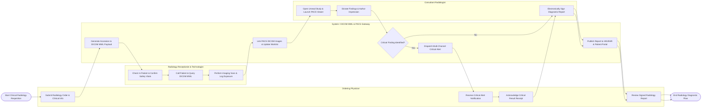

# Swimlane Diagram — Radiology Information System

## Mermaid Code

## Flow Description | Mô tả luồng

| Lane | Actor / Subsystem | Role in Flow |
|------|-------------------|--------------|
| 1 | Ordering Physician | Submits imaging requisition with clinical indications, receives urgent notifications for critical findings, acknowledges critical alerts, and accesses final signed radiology reports. |
| 2 | Radiology Receptionist & Technologist | Performs patient check-in, verifies pregnancy/contrast safety, queries scanner console via DICOM MWL, performs the imaging scan, and logs radiation exposure parameters. |
| 3 | System / DICOM MWL & PACS Gateway | Generates unique Accession Numbers, populates DICOM Modality Worklists, links incoming DICOM study images from PACS, evaluates critical alert flags, and transmits signed reports to HIS/EHR. |
| 4 | Consultant Radiologist | Opens unread exams from worklist, inspects PACS DICOM images, dictates findings via voice recognition, flags critical findings if present, and applies electronic signature to finalize the report. |
