# Action Tree — Radiology Information System

## Mermaid Code

```mermaid
graph TD
    Root["Radiology Information System"]

    Root --> M1["Order Entry & Scheduling"]
    Root --> M2["Modality Worklist & Check-In"]
    Root --> M3["Exam Execution & Dose Logging"]
    Root --> M4["PACS Integration & Image Viewing"]
    Root --> M5["Dictation & Report Authoring"]
    Root --> M6["Critical Result & Alert Management"]
    Root --> M7["Quality Assurance & Peer Review"]
    Root --> M8["Analytics & Regulatory Reporting"]

    M1 --> A11["Register Clinical Imaging Requisition"]
    M1 --> A12["Check Contrast Safety & eGFR Vitals"]
    M1 --> A13["Schedule Modality Room Time Slot"]
    M1 --> A14["Generate Accession Number Token"]

    M2 --> A21["Process Patient Reception Check-In"]
    M2 --> A22["Generate DICOM Modality Worklist"]
    M2 --> A23["Push C-FIND Payload to Scanner"]
    M2 --> A24["Track Room Queue & Patient Status"]

    M3 --> A31["Record Scan Start & End Timestamps"]
    M3 --> A32["Log Contrast Agent Lot & Volume"]
    M3 --> A33["Record CTDIvol & DLP Exposure Dose"]
    M3 --> A34["Mark Procedure Execution Complete"]

    M4 --> A41["Query PACS Study Instance UID"]
    M4 --> A42["Launch Integrated Web PACS Viewer"]
    M4 --> A43["Retrieve Historical Prior Exams"]
    M4 --> A44["Display DICOM Thumbnail Preview"]

    M5 --> A51["Capture Voice Recognition Audio"]
    M5 --> A52["Apply Structured Reporting Templates"]
    M5 --> A53["Edit Transcribed Report Draft"]
    M5 --> A54["Apply Final Electronic Signature"]

    M6 --> A61["Flag Life-Threatening Critical Finding"]
    M6 --> A62["Dispatch SMS & App Push Warnings"]
    M6 --> A63["Track Physician Acknowledgment Timer"]
    M6 --> A64["Escalate Unacknowledged Alerts"]

    M7 --> A71["Randomize Completed Studies for Audit"]
    M7 --> A72["Score Diagnostic RADPEER Concordance"]
    M7 --> A73["Log Discrepancy Committee Notes"]
    M7 --> A74["Track Radiologist Performance Index"]

    M8 --> A81["Calculate Report Turnaround Time TAT"]
    M8 --> A82["Export Cumulative Dose to Registry"]
    M8 --> A83["Transmit HL7 ORU Report to HIS/EHR"]
    M8 --> A84["Generate Modality Room Utilization"]
```

## Module Description | Mô tả Module

| # | Module | Description | Actions |
|---|--------|-------------|---------|
| 1 | Order Entry & Scheduling | Handles clinical order intake, patient renal/allergy safety checks, modality room slot scheduling, and accession token generation. | Register Clinical Imaging Requisition, Check Contrast Safety & eGFR Vitals, Schedule Modality Room Time Slot, Generate Accession Number Token |
| 2 | Modality Worklist & Check-In | Manages patient check-in, generates DICOM Modality Worklists (MWL), pushes payloads to scanner consoles, and tracks patient queues. | Process Patient Reception Check-In, Generate DICOM Modality Worklist, Push C-FIND Payload to Scanner, Track Room Queue & Patient Status |
| 3 | Exam Execution & Dose Logging | Tracks scan execution timestamps, logs IV contrast media details, and captures radiation exposure metrics (CTDIvol, DLP). | Record Scan Start & End Timestamps, Log Contrast Agent Lot & Volume, Record CTDIvol & DLP Exposure Dose, Mark Procedure Execution Complete |
| 4 | PACS Integration & Image Viewing | Links DICOM study Instance UIDs, launches web-based PACS viewer, and retrieves historical prior exams for comparison. | Query PACS Study Instance UID, Launch Integrated Web PACS Viewer, Retrieve Historical Prior Exams, Display DICOM Thumbnail Preview |
| 5 | Dictation & Report Authoring | Integrates real-time speech recognition, structured templates, draft report editing, and digital signature authorization. | Capture Voice Recognition Audio, Apply Structured Reporting Templates, Edit Transcribed Report Draft, Apply Final Electronic Signature |
| 6 | Critical Result & Alert Management | Identifies acute findings, dispatches urgent alerts to ordering doctors, and tracks closed-loop acknowledgment timers. | Flag Life-Threatening Critical Finding, Dispatch SMS & App Push Warnings, Track Physician Acknowledgment Timer, Escalate Unacknowledged Alerts |
| 7 | Quality Assurance & Peer Review | Randomizes completed studies for double-blind peer review, records RADPEER scores, and logs quality committee evaluations. | Randomize Completed Studies for Audit, Score Diagnostic RADPEER Concordance, Log Discrepancy Committee Notes, Track Radiologist Performance Index |
| 8 | Analytics & Regulatory Reporting | Monitors report turnaround times (TAT), exports patient cumulative radiation doses to national registries, and syncs HL7 reports with HIS/EHR. | Calculate Report Turnaround Time TAT, Export Cumulative Dose to Registry, Transmit HL7 ORU Report to HIS/EHR, Generate Modality Room Utilization |
