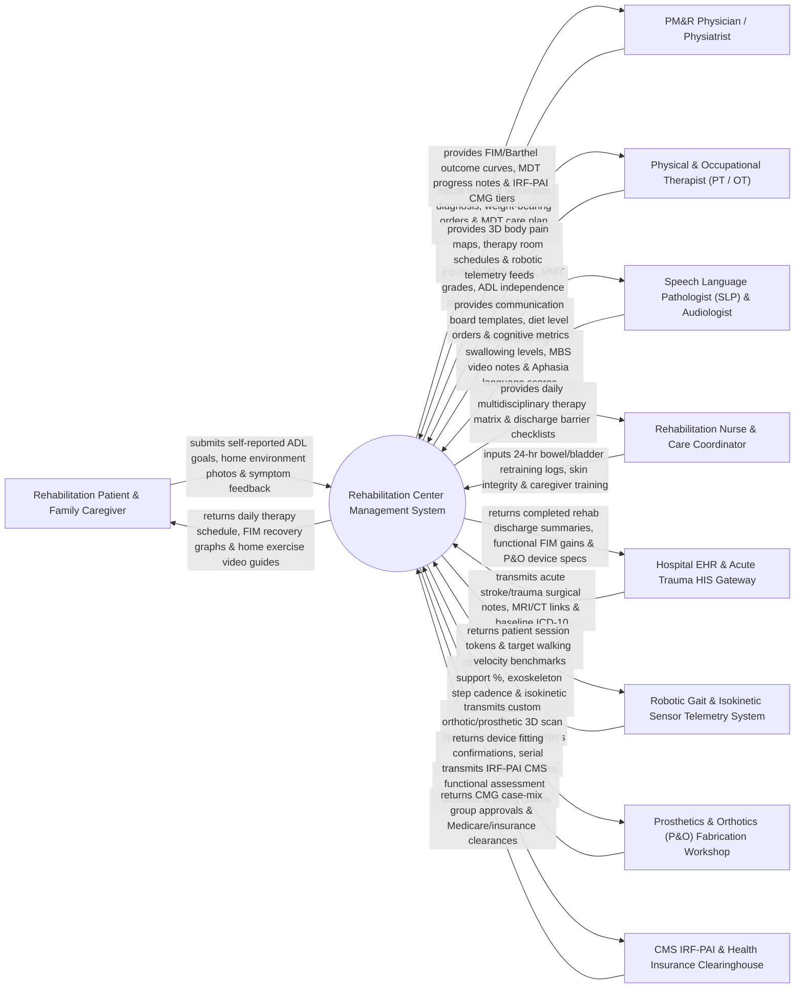

# Context Diagram — Rehabilitation Center Management System

## Mermaid Code

## Actor & Interaction Table | Bảng Actor & Tương tác

| # | Actor | Actor Type | Data Sent TO System | Data Received FROM System | Notes |
|---|-------|------------|---------------------|---------------------------|-------|
| 1 | Rehabilitation Patient & Family Caregiver | Primary | Self-reported Activities of Daily Living (ADL) goals, home environment barrier photos, pain levels. | Daily therapy schedules, FIM functional recovery graphs, personalized home exercise video guides. | Patient recovering from stroke, spinal cord injury (SCI), traumatic brain injury (TBI), or amputation. |
| 2 | PM&R Physician / Physiatrist | Primary | Admission rehabilitation diagnosis, weight-bearing restrictions, medication orders, MDT goals. | FIM / Barthel recovery curves, MDT progress summaries, IRF-PAI Case-Mix Group (CMG) tiers. | Physical Medicine & Rehabilitation (PM&R) specialist directing interdisciplinary rehabilitation care. |
| 3 | Physical & Occupational Therapist (PT / OT) | Primary | Joint ROM degrees, MMT strength grades, ADL independence scores (Dressing, Transfer), splint specs. | Interactive 3D pain maps, therapy room schedules, robotic gait telemetry feeds. | Licensed PTs and OTs evaluating movement, motor function, and daily living skills. |
| 4 | Speech Language Pathologist (SLP) & Audiologist | Primary | Dysphagia swallowing diet levels (IDDSI 0-7), Modified Barium Swallow (MBS) notes, Aphasia scores. | AAC communication board templates, modified diet texture orders, cognitive therapy metrics. | Specialist evaluating swallowing function, speech-language disorders, and cognitive communication. |
| 5 | Rehabilitation Nurse & Care Coordinator | Primary | 24-hour bowel/bladder retraining logs, Braden skin integrity scores, caregiver training sign-offs. | Daily multidisciplinary therapy time matrix, discharge barrier checklists, equipment delivery tags. | Rehabilitation nurse managing 24-hour nursing care, neurogenic bowel/bladder, and discharge coordination. |
| 6 | Hospital EHR & Acute Trauma HIS Gateway | Supporting System | Acute trauma surgical operation notes, brain/spine MRI image links, primary ICD-10 etiology codes. | Completed inpatient rehab discharge summaries, functional FIM gain scores, P&O device specifications. | Enterprise hospital information system linking acute surgical trauma units with rehab centers. |
| 7 | Robotic Gait & Isokinetic Sensor Telemetry System | Supporting System | Body-weight support percentages, Lokomat exoskeleton step cadence, isokinetic joint torque force. | Patient session accession tokens, baseline gait velocity targets, calibration benchmarks. | Robotic gait trainer (e.g., Lokomat) or isokinetic dynamometer streaming motor telemetry. |
| 8 | Prosthetics & Orthotics (P&O) Fabrication Workshop | Supporting System | Device fitting confirmations, custom limb serial numbers, material specifications, delivery dates. | Custom orthotic/prosthetic 3D scanner CAD models, physiatrist device prescription orders. | Specialized orthotics and prosthetics laboratory fabricating custom artificial limbs and AFO braces. |
| 9 | CMS IRF-PAI & Health Insurance Clearinghouse | Supporting System | Medicare IRF-PAI functional guidelines, Case-Mix Group (CMG) tier formulas, billing clearances. | Inpatient Rehabilitation Facility Patient Assessment Instrument (IRF-PAI) datasets, claim batches. | Federal CMS and health insurance clearinghouse processing inpatient rehabilitation billing. |

## System Boundary Description | Mô tả Phạm vi Hệ thống

The **Rehabilitation Center Management System (RCMS)** is an interdisciplinary clinical care software platform designed for inpatient rehabilitation facilities (IRF), outpatient physical therapy centers, spinal cord injury (SCI) centers, stroke recovery units, and pediatric development institutes. It manages multidisciplinary admissions, functional assessments using standardized instruments (FIM, Barthel Index, Berg Balance Scale), Multi-Disciplinary Team (MDT) treatment planning (PT, OT, SLP, Physiatry, Rehab Nursing), Activities of Daily Living (ADL) retraining, Dysphagia swallowing protocols, custom Prosthetics & Orthotics (P&O) device ordering, robotic gait sensor telemetry ingestion, and CMS IRF-PAI statutory billing.

**Inside System Scope:**
- Multidisciplinary functional assessment (Functional Independence Measure - FIM 18 items, Barthel Index, Berg Balance).
- Multi-Disciplinary Team (MDT) rehabilitation care plan formulation and weekly case conference charting.
- Physical Therapy (PT) joint Range of Motion (ROM), Manual Muscle Testing (MMT), and gait retraining logging.
- Occupational Therapy (OT) Activities of Daily Living (ADL) retraining (Dressing, Feeding, Toileting, Hygiene).
- Speech-Language Pathology (SLP) Dysphagia swallowing diet level tracking (IDDSI 0-7) and Aphasia therapy.
- Custom Prosthetics & Orthotics (P&O) prescription, 3D scan CAD file attachment, and device fitting tracking.
- Robotic-assisted gait telemetry ingestion (Lokomat, Armeo) and hydrotherapy pool session scheduling.
- Inpatient Rehabilitation Facility Patient Assessment Instrument (IRF-PAI) CMS dataset compilation.

**Outside System Scope:**
- Acute emergency surgical repair of fractures or organ trauma (handled by Surgical System).
- Physical manufacturing and carving of prosthetic limbs inside P&O workshops (handled by workshop machinery).
- Long-term vocational job placement in commercial companies (handled by external employment agencies).
- Commercial corporate financial general ledger accounting (handled by enterprise ERP).
