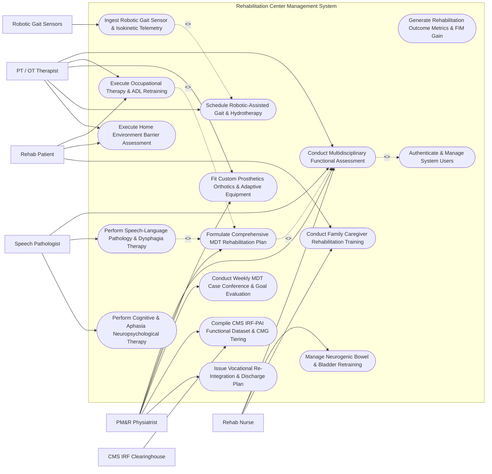

# Use Case Diagram — Rehabilitation Center Management System

## Mermaid Code

## Actor Table | Bảng Actor

| # | Actor | Actor Type | Role Description | Related Use Cases |
|---|-------|------------|------------------|-------------------|
| 1 | Rehab Patient | Primary | Individual undergoing comprehensive physical, occupational, speech, or cognitive rehabilitation care. | UC03, UC11, UC12 |
| 2 | PM&R Physiatrist | Primary | Physical Medicine & Rehabilitation physician directing care, leading MDT conferences, and approving IRF-PAI. | UC01, UC02, UC05, UC08, UC10, UC14 |
| 3 | PT / OT Therapist | Primary | Physical and occupational therapist conducting FIM scoring, ADL retraining, gait training, and home barrier assessments. | UC01, UC03, UC05, UC06, UC11 |
| 4 | Speech Pathologist | Primary | Speech Language Pathologist evaluating swallowing (Dysphagia IDDSI 0-7), Aphasia, and cognitive communication. | UC01, UC04, UC13 |
| 5 | Rehab Nurse | Primary | Registered nurse managing 24-hour nursing care, neurogenic bowel/bladder retraining, skin integrity, and caregiver education. | UC01, UC07, UC12 |
| 6 | Robotic Gait Sensors | Secondary / System | Robotic exoskeleton (Lokomat) or motion sensors streaming gait step cadence and body-weight support metrics. | UC09 |
| 7 | CMS IRF Clearinghouse | Secondary / System | Federal CMS clearinghouse receiving IRF-PAI functional datasets for Medicare Case-Mix Group (CMG) reimbursement. | UC10 |

## Use Case Table | Bảng Use Case

| # | UC ID | Use Case Name | Primary Actor | Secondary Actor | Description | Priority |
|---|-------|---------------|---------------|-----------------|-------------|----------|
| 1 | UC01 | Conduct Multidisciplinary Functional Assessment | PM&R Physiatrist | PT / OT Therapist | Assess patient functional capacity across 18 FIM items (1-7 scale), Barthel Index (0-100), and Berg Balance Scale. | High |
| 2 | UC02 | Formulate Comprehensive MDT Rehabilitation Plan | PM&R Physiatrist | None | Establish an integrated multidisciplinary care plan setting SMART functional goals, weekly therapy hours (min 3 hrs/day), and FIM targets. | High |
| 3 | UC03 | Execute Occupational Therapy & ADL Retraining | PT / OT Therapist | Rehab Patient | Conduct OT retraining sessions for Activities of Daily Living (ADL: Feeding, Dressing, Grooming, Toileting, Transfers). | High |
| 4 | UC04 | Perform Speech-Language Pathology & Dysphagia Therapy | Speech Pathologist | None | Evaluate swallowing function (IDDSI Diet Levels 0-7), perform Dysphagia swallowing therapy, and treat Aphasia speech disorders. | High |
| 5 | UC05 | Fit Custom Prosthetics Orthotics & Adaptive Equipment | PM&R Physiatrist | PT / OT Therapist | Prescribe and fit custom Ankle-Foot Orthoses (AFO), artificial limbs, splints, and custom tilt-in-space wheelchairs. | High |
| 6 | UC06 | Schedule Robotic-Assisted Gait & Hydrotherapy | PT / OT Therapist | None | Book specialized rehabilitation equipment (Lokomat Robotic Gait Trainer, Armeo Spring, Hydrotherapy pools) and therapists. | Medium |
| 7 | UC07 | Manage Neurogenic Bowel & Bladder Retraining | Rehab Nurse | None | Execute 24-hour nursing bowel/bladder retraining protocols for spinal cord injury (SCI) and stroke patients (CIC catheterization). | High |
| 8 | UC08 | Conduct Weekly MDT Case Conference & Goal Evaluation | PM&R Physiatrist | None | Convene weekly interdisciplinary team case conferences (Physiatrist, PT, OT, SLP, Nurse, Social Worker) to review FIM gains. | High |
| 9 | UC09 | Ingest Robotic Gait Sensor & Isokinetic Telemetry | PT / OT Therapist | Robotic Gait Sensors | Stream real-time body-weight support %, walking distance (meters), and joint torque forces from robotic gait trainers. | Medium |
| 10 | UC10 | Compile CMS IRF-PAI Functional Dataset & CMG Tiering | PM&R Physiatrist | CMS IRF Clearinghouse | Compile statutory Inpatient Rehabilitation Facility Patient Assessment Instrument (IRF-PAI) dataset and compute CMG tier. | High |
| 11 | UC11 | Execute Home Environment Barrier Assessment | PT / OT Therapist | Rehab Patient | Evaluate patient home floor plans, doorway widths, bathroom grab bars, and ramp slopes, issuing architectural modification specs. | Medium |
| 12 | UC12 | Conduct Family Caregiver Rehabilitation Training | Rehab Nurse | Rehab Patient | Train family caregivers in safe patient transfer techniques, wheelchair handling, medication management, and skin integrity care. | High |
| 13 | UC13 | Perform Cognitive & Aphasia Neuropsychological Therapy | Speech Pathologist | None | Conduct cognitive-linguistic retraining for traumatic brain injury (TBI) patients (memory, executive function, attention processing). | Medium |
| 14 | UC14 | Issue Vocational Re-Integration & Discharge Plan | PM&R Physiatrist | None | Formulate community discharge plan, arranging outpatient therapy, adaptive driving evaluations, and vocational return-to-work. | High |
| 15 | UC15 | Generate Rehabilitation Outcome Metrics & FIM Gain | PM&R Physiatrist | None | Calculate center outcome analytics: average FIM gain (Admission vs Discharge), Length of Stay (LOS) efficiency, and discharge-to-community %. | Medium |
| 16 | UC16 | Authenticate & Manage System Users | All Users | None | Enforce secure multi-factor authentication, role-based clinical access (Physiatrist, Therapist, Nurse), and HIPAA compliance. | High |

## Use Case Specification | Đặc tả Use Case

---

### UC01 — Conduct Multidisciplinary Functional Assessment

| Field | Detail |
|-------|--------|
| **UC ID** | UC01 |
| **Use Case Name** | Conduct Multidisciplinary Functional Assessment |
| **Actor(s)** | Primary: PM&R Physiatrist   Secondary: PT / OT Therapist, Speech Pathologist, Rehab Nurse |
| **Description** | Conducts a comprehensive multidisciplinary functional assessment of the rehabilitation patient within 72 hours of admission, evaluating independence across 18 Functional Independence Measure (FIM 1-7 rating scale) items, Barthel Index (0-100), and Berg Balance Scale. |
| **Precondition** | 1. The patient is admitted to the Rehabilitation Center with active etiology (e.g., Acute Ischemic Stroke, Spinal Cord Injury).   2. The interdisciplinary clinical team members are authenticated in RCMS. |
| **Main Flow** | 1. The Physiatrist initiates "Inpatient Baseline Functional Assessment" for Patient (ID: `PAT-RHB-2026-0812`).   2. The **Occupational Therapist (OT)** scores **Self-Care & Sphincter Control Subscores** (FIM 1-7 Scale: 1 Total Assist -> 7 Total Independence):   &nbsp;&nbsp;&nbsp;&nbsp;- Eating: Score 4 (Minimal Assist)   &nbsp;&nbsp;&nbsp;&nbsp;- Grooming: Score 3 (Moderate Assist)   &nbsp;&nbsp;&nbsp;&nbsp;- Upper Body Dressing: Score 2 (Maximal Assist)   &nbsp;&nbsp;&nbsp;&nbsp;- Lower Body Dressing: Score 1 (Total Assist).   3. The **Physical Therapist (PT)** scores **Mobility & Locomotion Subscores**:   &nbsp;&nbsp;&nbsp;&nbsp;- Bed to Chair Transfer: Score 2 (Maximal Assist - 2-person helper)   &nbsp;&nbsp;&nbsp;&nbsp;- Locomotion (Walking / Wheelchair): Score 1 (Total Assist)   &nbsp;&nbsp;&nbsp;&nbsp;- Stairs: Score 1 (Total Assist)   &nbsp;&nbsp;&nbsp;&nbsp;- **Berg Balance Scale**: 12 / 56 (High Fall Risk).   4. The **Speech Language Pathologist (SLP)** scores **Communication & Social Cognition**:   &nbsp;&nbsp;&nbsp;&nbsp;- Expression (Speech/Aphasia): Score 3 (Moderate Expressive Aphasia)   &nbsp;&nbsp;&nbsp;&nbsp;- Comprehension: Score 5 (Standby Prompting)   &nbsp;&nbsp;&nbsp;&nbsp;- Memory & Problem Solving: Score 4.   5. The **Rehab Nurse** scores **Bowel & Bladder Control**:   &nbsp;&nbsp;&nbsp;&nbsp;- Bladder Management: Score 2 (Intermittent Catheterization)   &nbsp;&nbsp;&nbsp;&nbsp;- Bowel Management: Score 3 (Prompted Program).   6. The System calculates total baseline scores: **Motor FIM = 24 / 91**, **Cognitive FIM = 16 / 35** (**Total Admission FIM Score = 40 / 126**).   7. The Physiatrist signs off, and the System archives the baseline functional profile to drive Care Planning (UC02) and IRF-PAI CMS Submission (UC10). |
| **Alternative Flow** | **AF1** — Pediatric Functional Assessment (WeFIM): For a 5-year-old cerebral palsy child, the System administers the WeeFIM instrument adapted for pediatric developmental milestones.   **AF2** — Outpatient Musculoskeletal Assessment: For an outpatient rotator cuff patient, the System administers the Barthel Index and DASH functional outcome scales instead of full inpatient FIM. |
| **Exception Flow** | **EX1** — 72-Hour Assessment Window Breach Alert: If baseline FIM scoring is incomplete 70 hours post-admission, the System dispatches urgent alerts to the MDT team lead.   **EX2** — Conflicting Subscore Discrepancy Error: If PT inputs FIM Locomotion = 7 (Independent) while Nurse inputs Transfer = 1 (Total Assist), the System flags a clinical validation conflict. |
| **Postcondition** | Total FIM 18-item baseline score (40/126), Barthel Index, and Berg Balance scores are recorded, forming the benchmark for measuring functional recovery gains. |
| **Business Rule** | **BR1**: Inpatient baseline functional assessments (FIM 18 items) MUST be completed by the multidisciplinary team within 72 hours of admission.   **BR2**: FIM item scoring MUST conform strictly to standard CMS guidelines (Level 7 Complete Independence down to Level 1 Total Assistance < 25% patient effort). |

---

### UC02 — Formulate Comprehensive MDT Rehabilitation Plan

| Field | Detail |
|-------|--------|
| **UC ID** | UC02 |
| **Use Case Name** | Formulate Comprehensive MDT Rehabilitation Plan |
| **Actor(s)** | Primary: PM&R Physiatrist |
| **Description** | Establishes an integrated Multi-Disciplinary Team (MDT) rehabilitation care plan based on baseline functional assessment findings, setting SMART target FIM goals (e.g., FIM 40 -> 85), assigning daily therapy dosage hours (minimum 3 hours/day per CMS 3-Hour Rule), and assigning discipline-specific interventions (PT, OT, SLP, Rehab Nursing). |
| **Precondition** | 1. Multidisciplinary baseline functional assessment (UC01) is completed.   2. Primary etiology and weight-bearing restrictions are verified. |
| **Main Flow** | 1. The Physiatrist opens "Formulate MDT Care Plan" for Patient `PAT-RHB-2026-0812` (Diagnosis: *Left Hemiplegia Post-Right MCA Ischemic Stroke*).   2. The Physiatrist sets **SMART Rehabilitation Target Goals**:   &nbsp;&nbsp;&nbsp;&nbsp;- **Target Discharge FIM Score**: Motor FIM 62 + Cognitive FIM 28 = **Total FIM Target 90 / 126**   &nbsp;&nbsp;&nbsp;&nbsp;- **Target Locomotion**: Independent indoor wheelchair mobility (FIM 6)   &nbsp;&nbsp;&nbsp;&nbsp;- **Target ADL**: Independent feeding and upper body dressing (FIM 6)   &nbsp;&nbsp;&nbsp;&nbsp;- **Estimated Length of Stay (LOS)**: 4 Weeks (28 Days).   3. The Physiatrist configures **Daily Therapy Dosage (CMS 3-Hour Rule Compliance)**:   &nbsp;&nbsp;&nbsp;&nbsp;- **Physical Therapy (PT)**: 90 Mins/Day (Gait training, balance, standing frame)   &nbsp;&nbsp;&nbsp;&nbsp;- **Occupational Therapy (OT)**: 60 Mins/Day (ADL retraining, fine motor, splinting)   &nbsp;&nbsp;&nbsp;&nbsp;- **Speech-Language Pathology (SLP)**: 30 Mins/Day (Dysphagia swallowing, Aphasia)   &nbsp;&nbsp;&nbsp;&nbsp;- **Total Daily Therapy**: **180 Minutes / Day (3.0 Hours)** -> Complies with CMS 3-Hour Rule.   4. The Physiatrist assigns Discipline Interventions: Robotic Lokomat Gait Trainer 3x/week (UC06), IDDSI Soft Diet Level 5 (UC04), Custom AFO Orthosis (UC05).   5. The Physiatrist signs the Care Plan.   6. The System dispatches individual daily therapy schedule matrices to PT, OT, SLP, and Nurse workstations. |
| **Alternative Flow** | **AF1** — Spinal Cord Injury (SCI) Quadriplegia Plan: For C6 complete SCI, the Plan incorporates tilt-in-space power wheelchair control training, environmental control unit (ECU) setup, and neurogenic bowel retraining (UC07).   **AF2** — Outpatient Intensive Day Rehab Plan: Configures a 2-day/week outpatient rehabilitation regimen for a stroke patient living at home. |
| **Exception Flow** | **EX1** — CMS 3-Hour Rule Deficit Alert (< 180 Mins): If total daily scheduled therapy hours equals only 2.5 hours, the System blocks plan saving with error "CMS 3-Hour Rule Violation — Minimum 3.0 Hours Daily Therapy Required for Inpatient Rehab".   **EX2** — Weight-Bearing Order Violation Warning: If PT schedules standing frame exercises for a hip fracture patient designated "Strict Non-Weight Bearing (NWB)", the System flags an orthopedic restriction alert. |
| **Postcondition** | MDT Care Plan with target FIM goals (90/126), 3-hour daily therapy schedule, and discipline interventions is active and dispatched to clinical workstations. |
| **Business Rule** | **BR1**: Inpatient rehabilitation care plans MUST schedule a minimum of 3.0 hours of intensive therapy per day across at least 2 disciplines (PT, OT, SLP) for 5 out of 7 days per week.   **BR2**: Rehabilitation goals MUST be quantifiable using standardized outcome scales (FIM gain, Barthel Index, Berg Balance Score). |

---

### UC03 — Execute Occupational Therapy & ADL Retraining Sessions

| Field | Detail |
|-------|--------|
| **UC03** | **Execute Occupational Therapy & ADL Retraining Sessions** |
| **Actor(s)** | Primary: PT / OT Therapist   Secondary: Rehab Patient |
| **Description** | Conducts daily Occupational Therapy (OT) sessions focused on Activities of Daily Living (ADL) retraining, evaluating and training self-care skills (Feeding, Dressing, Grooming, Toileting, Transfers), fabricating upper-limb resting splints, and prescribing adaptive living equipment (button hooks, long-handled sponges, modified eating utensils). |
| **Precondition** | 1. An active MDT Care Plan (UC02) specifies OT interventions.   2. The ADL Training Suite (Kitchen, Bathroom, Bedroom simulator) is reserved. |
| **Main Flow** | 1. The Occupational Therapist opens OT Session #8 for Patient `PAT-RHB-2026-0812` in the ADL Training Suite.   2. The Therapist conducts **ADL Retraining Interventions**:   &nbsp;&nbsp;&nbsp;&nbsp;- **Upper & Lower Body Dressing**: Trains one-handed dressing techniques for hemiplegic left arm; utilizes adaptive button hook and sock aid   &nbsp;&nbsp;&nbsp;&nbsp;- **Feeding & Swallowing**: Retrains right hand fine-motor control using weighted adaptive spoon   &nbsp;&nbsp;&nbsp;&nbsp;- **Tub / Shower Transfer**: Trains sliding transfer board setup from wheelchair to shower bench.   3. The Therapist logs **Current ADL Independence Ratings**:   &nbsp;&nbsp;&nbsp;&nbsp;- Feeding: Improved from FIM 4 (Min Assist) to **FIM 6 (Modified Independent - with adaptive spoon)**   &nbsp;&nbsp;&nbsp;&nbsp;- Upper Body Dressing: Improved from FIM 2 to **FIM 4 (Minimal Assist)**   &nbsp;&nbsp;&nbsp;&nbsp;- Toilet Transfer: **FIM 3 (Moderate Assist)**.   4. The Therapist fabricates a custom **Left Wrist-Hand Resting Volar Splint** using low-temperature thermoplastic to prevent finger flexor spasticity.   5. The Therapist enters SOAP session notes: "Patient achieved modified independence in feeding using adaptive spoon. Lower body dressing still requires min assist."   6. The System updates the Patient's Longitudinal FIM Recovery Curve and decrements remaining OT session units. |
| **Alternative Flow** | **AF1** — Ergonomic Workstation & Vocational OT Retraining: For an injured worker, OT session focuses on computer keyboard ergonomics, lifting mechanics, and functional capacity evaluation (FCE).   **AF2** — Home Kitchen Cooking ADL Assessment: Therapist conducts simulated meal preparation in the ADL kitchen, evaluating stovetop safety, reach, and bilateral hand coordination. |
| **Exception Flow** | **EX1** — Upper Limb Shoulder Subluxation Pain Spike: During dressing retraining, patient experiences acute left shoulder subluxation pain (VAS 8/10); Therapist pauses session, applies shoulder arm sling, and logs pain alert.   **EX2** — ADL Adaptive Utensil Out of Stock: Required rocker knife is out of stock in therapy supply; System auto-generates a P&O / Adaptive Equipment Requisition. |
| **Postcondition** | ADL subscore progress (FIM gains), custom splint fabrication details, and SOAP session notes are recorded in the patient chart. |
| **Business Rule** | **BR1**: Occupational Therapy ADL evaluations MUST rate independence level using standard FIM 1-7 scale for all 6 self-care domains (Feeding, Grooming, Bathing, Upper Dressing, Lower Dressing, Toileting).   **BR2**: Adaptive equipment prescriptions MUST include patient-caregiver demonstration of safe independent operation before home discharge. |

---

### UC04 — Perform Speech-Language Pathology & Dysphagia Therapy

| Field | Detail |
|-------|--------|
| **UC ID** | UC04 |
| **Use Case Name** | Perform Speech-Language Pathology & Dysphagia Therapy |
| **Actor(s)** | Primary: Speech Pathologist |
| **Description** | Evaluates and treats swallowing disorders (Dysphagia) and speech-language impairment (Aphasia, Dysarthria) post-stroke or brain injury, assigning International Dysphagia Diet Standardisation Initiative (IDDSI) food/fluid levels (0-7), logging Modified Barium Swallow (MBS) video findings, and executing neuromuscular electrical stimulation (VitalStim). |
| **Precondition** | 1. Patient is referred for Speech-Language Pathology & Swallowing evaluation.   2. Bedside swallowing or Modified Barium Swallow (MBS) study results are loaded. |
| **Main Flow** | 1. The Speech Language Pathologist (SLP) opens "Dysphagia & Speech Evaluation" for Patient `PAT-RHB-2026-0812`.   2. The SLP reviews **Modified Barium Swallow (MBS) Videofluoroscopy**:   &nbsp;&nbsp;&nbsp;&nbsp;- **Finding**: Delayed pharyngeal swallow response, mild laryngeal penetration with thin liquids   &nbsp;&nbsp;&nbsp;&nbsp;- **Aspiration Risk**: Moderate risk for thin liquids; Silent aspiration cleared.   3. The SLP prescribes **IDDSI Diet & Fluid Levels**:   &nbsp;&nbsp;&nbsp;&nbsp;- **Food Texture Level**: `IDDSI Level 5 (Minced & Moist)`   &nbsp;&nbsp;&nbsp;&nbsp;- **Drink Thickness Level**: `IDDSI Level 3 (Moderately Thick / Honey-like)`.   4. The SLP conducts **Swallowing Therapy Interventions**:   &nbsp;&nbsp;&nbsp;&nbsp;- Applies **Neuromuscular Electrical Stimulation (VitalStim)** to anterior neck muscles (15 Mins @ 8.0 mA)   &nbsp;&nbsp;&nbsp;&nbsp;- Retrains compensatory maneuvers: *Chin-Tuck posture* and *Mendelsohn Maneuver*.   5. The SLP conducts **Expressive Aphasia Speech Retraining**: Exercises picture naming, auditory comprehension, and AAC communication board setup.   6. The SLP logs FIM Communication Subscores: Expression = FIM 4 (Min Assist), Comprehension = FIM 5 (Standby Prompting).   7. The System updates the Hospital Dietary System with IDDSI Level 5 / Thick Level 3 meal order tags. |
| **Alternative Flow** | **AF1** — Tracheostomy & Passy-Muir Speaking Valve (PMSV) Placement: For a spinal cord injury patient with a tracheostomy tube, SLP evaluates airway patency and fits a Passy-Muir Speaking Valve to restore vocalization.   **AF2** — High-Tech Augmentative & Alternative Communication (AAC) Eye-Gaze Fitting: For severe ALS or Locked-In Syndrome, SLP configures an Eye-Gaze AAC tablet system for non-verbal communication. |
| **Exception Flow** | **EX1** — Acute Coughing / Choking During Swallowing Trial: Patient coughs vigorously during liquid trial; SLP halts thin liquid trial immediately, logs "Aspiration Risk Confirmed", and downgrades fluid to IDDSI Level 4 (Extremely Thick).   **EX2** — Dietary Kitchen Order Mismatch Alert: Kitchen delivers regular thin soup to a patient ordered IDDSI Level 3 Thick Fluids; Nurse scans meal tray barcode, triggering a red "DIET TEXTURE SAFETY MISMATCH" alert. |
| **Postcondition** | IDDSI diet/fluid level orders are updated in dietary system, VitalStim parameters and MBS notes are recorded, and communication FIM subscores are updated. |
| **Business Rule** | **BR1**: Dysphagia diet and fluid texture orders MUST strictly conform to IDDSI 0-7 international standardized terminology.   **BR2**: Patients exhibiting aspiration during swallowing evaluations MUST NOT be advanced to thinner fluid levels without a documented clearance study. |

---

### UC05 — Fit Custom Prosthetics Orthotics & Adaptive Equipment

| Field | Detail |
|-------|--------|
| **UC ID** | UC05 |
| **Use Case Name** | Fit Custom Prosthetics Orthotics & Adaptive Equipment |
| **Actor(s)** | Primary: PM&R Physiatrist   Secondary: PT / OT Therapist |
| **Description** | Prescribes, measures, 3D scans, and fits custom Prosthetics (artificial limbs post-amputation), Orthoses (Ankle-Foot Orthoses - AFO, KAFO, spinal TLSO braces), and custom adaptive equipment (tilt-in-space power wheelchairs with ROHO cushions), verifying gait alignment and pressure relief. |
| **Precondition** | 1. Clinical evaluation identifies need for custom orthotic, prosthetic, or adaptive seating device.   2. P&O Fabrication Workshop connection is active. |
| **Main Flow** | 1. The Physiatrist issues a **Prosthetic & Orthotic (P&O) Prescription** for Patient `PAT-RHB-2026-0812` (Left Hemiplegia with Foot Drop).   2. Device Specifications: **Custom Solid Ankle-Foot Orthosis (AFO)** — Carbon Fiber, Rigid 90° Ankle Position, Plantarflexion Stop.   3. The Physical Therapist uses a 3D Optical Limb Scanner to capture the 3D surface geometry of the patient's left lower leg and foot.   4. The System transmits the 3D CAD mesh file `CAD-AFO-2026-9918.stl` to the P&O Fabrication Workshop (UC01).   5. Five days later, the P&O Workshop delivers the fabricated Carbon Fiber AFO to the rehab clinic.   6. The PT and Certified Orthotist perform **Device Fitting & Alignment**:   &nbsp;&nbsp;&nbsp;&nbsp;- Inspects skin contact points: No hyper-pigmentation or pressure sores over malleolus   &nbsp;&nbsp;&nbsp;&nbsp;- Checks gait alignment: Clears toes during swing phase; eliminates left foot drop.   7. The PT logs **Gait Velocity Gain**: Walking speed increased from 0.25 m/s (without AFO) to **0.65 m/s (with AFO)**.   8. The Physiatrist verifies final device fitting and signs the P&O Certificate of Acceptance. |
| **Alternative Flow** | **AF1** — Trans-Tibial (Below-Knee) Artificial Limb Prosthetic Fitting: For a diabetic amputee, Physiatrist prescribes a Below-Knee Prosthesis with vacuum-assisted suction socket and carbon fiber energy-storing foot.   **AF2** — Custom Tilt-In-Space Power Wheelchair Seating Fitting: For a C5 Quadriplegic patient, OT configures a custom power wheelchair with head-array joystick, ROHO anti-decubitus pressure relief cushion, and lateral trunk supports. |
| **Exception Flow** | **EX1** — Skin Pressure Ulcer / Erythema Over Fibular Head: Fitting reveals red pressure spot (Erythema) over fibular head after 15 mins wear; Orthotist takes device back for heat-gun relief modification before approving wear schedule.   **EX2** — Insurance Pre-Authorization Rejection for Carbon Fiber AFO: Insurance rejects carbon fiber material; System prompts substitution with polypropylene thermoplastic AFO specs. |
| **Postcondition** | Custom P&O device is fitted, 3D CAD scan is archived, gait velocity gain is documented, skin safety is verified, and acceptance certificate is signed. |
| **Business Rule** | **BR1**: All custom prosthetics and orthoses MUST undergo a formal clinical fitting trial verifying skin integrity (no redness > 15 mins post-wear) and functional gait benefit before final sign-off.   **BR2**: Custom wheelchair seating prescriptions for spinal cord injury patients MUST incorporate pressure-mapping analysis to prevent Stage II-IV pressure ulcers. |
