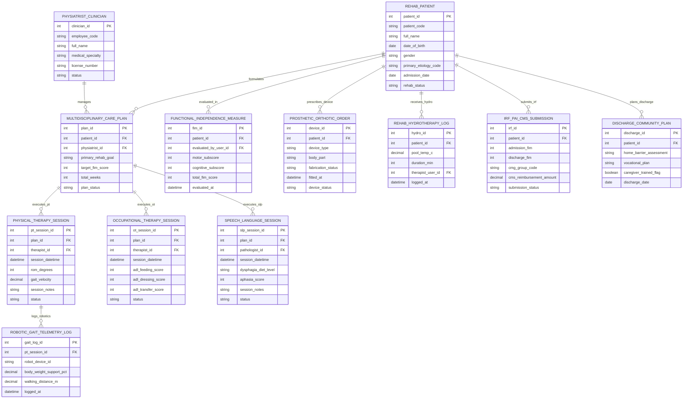

# Conceptual ERD — Rehabilitation Center Management System

## Mermaid Code

## Entity Description Table | Bảng mô tả Entity

| # | Entity Name | Vietnamese Name | Description | Key Attributes | Main Relationships |
|---|-------------|-----------------|-------------|----------------|-------------------|
| 1 | REHAB_PATIENT | Bệnh nhân Phục hồi Chức năng | Master rehabilitation patient record storing patient code, full name, DOB, gender, primary etiology code (Stroke, SCI, TBI, Amputation), admission date, and status. | patient_id, patient_code, full_name, dob, gender, primary_etiology_code, admission_date, rehab_status | Has CARE_PLAN, FIM_EVALUATION, P&O_ORDER, HYDROTHERAPY, IRF_PAI, DISCHARGE_PLAN. |
| 2 | PHYSIATRIST_CLINICIAN | Bác sĩ Chuyên khoa PHCN | PM&R physiatrist clinician profile storing employee code, full name, medical specialty, license number, and status. | clinician_id, employee_code, full_name, medical_specialty, license_number, status | Has MULTIDISCIPLINARY_CARE_PLAN entities. |
| 3 | MULTIDISCIPLINARY_CARE_PLAN | Phác đồ PHCN Liên ngành (MDT) | Integrated multidisciplinary rehabilitation care plan master tracking primary goal, target FIM score, total plan weeks, and status. | plan_id, patient_id, physiatrist_id, primary_rehab_goal, target_fim_score, total_weeks, plan_status | Belongs to REHAB_PATIENT and PHYSIATRIST_CLINICIAN; Has PT, OT, SLP sessions. |
| 4 | FUNCTIONAL_INDEPENDENCE_MEASURE | Đánh giá Độc lập Chức năng (FIM) | Standardized 18-item FIM functional assessment record tracking motor subscore (13 items), cognitive subscore (5 items), total score (18-126), and date. | fim_id, patient_id, evaluated_by_user_id, motor_subscore, cognitive_subscore, total_fim_score, evaluated_at | Belongs to REHAB_PATIENT. |
| 5 | PHYSICAL_THERAPY_SESSION | Buổi Vật lý trị liệu (PT) | Physical therapy session log recording session datetime, ROM degrees gained, gait velocity m/s, session notes, and status. | pt_session_id, plan_id, therapist_id, session_datetime, rom_degrees, gait_velocity, session_notes, status | Belongs to MULTIDISCIPLINARY_CARE_PLAN; Has ROBOTIC_GAIT_TELEMETRY_LOG. |
| 6 | OCCUPATIONAL_THERAPY_SESSION | Buổi Hoạt động trị liệu (OT) | Occupational therapy session log recording ADL self-care subscores (Feeding, Dressing, Transfers), splint specs, session notes, and status. | ot_session_id, plan_id, therapist_id, session_datetime, adl_feeding_score, adl_dressing_score, adl_transfer_score, status | Belongs to MULTIDISCIPLINARY_CARE_PLAN. |
| 7 | SPEECH_LANGUAGE_SESSION | Buổi Ngôn ngữ / Nuốt trị liệu | Speech-Language Pathology session log recording IDDSI dysphagia swallowing diet level (0-7), Aphasia speech score, session notes, and status. | slp_session_id, plan_id, pathologist_id, session_datetime, dysphagia_diet_level, aphasia_score, session_notes, status | Belongs to MULTIDISCIPLINARY_CARE_PLAN. |
| 8 | PROSTHETIC_ORTHOTIC_ORDER | Đơn Dụng cụ Chỉnh hình / Chi giả | Custom prosthetics and orthotics order tracking device type (AFO, Artificial Limb), target body part, fabrication status, fitted timestamp, and device status. | device_id, patient_id, device_type, body_part, fabrication_status, fitted_at, device_status | Belongs to REHAB_PATIENT. |
| 9 | ROBOTIC_GAIT_TELEMETRY_LOG | Nhật ký Robot Tập đi (Lokomat) | Robotic-assisted gait telemetry log recording robot device ID, body-weight support %, walking distance meters, and timestamp. | gait_log_id, pt_session_id, robot_device_id, body_weight_support_pct, walking_distance_m, logged_at | Belongs to PHYSICAL_THERAPY_SESSION. |
| 10 | REHAB_HYDROTHERAPY_LOG | Nhật ký Thủy trị liệu (Pool) | Hydrotherapy pool session log recording pool temperature °C, duration minutes, therapist ID, and logged timestamp. | hydro_id, patient_id, pool_temp_c, duration_min, therapist_user_id, logged_at | Belongs to REHAB_PATIENT. |
| 11 | IRF_PAI_CMS_SUBMISSION | Báo cáo IRF-PAI CMS Mỹ | Statutory Inpatient Rehabilitation Facility Patient Assessment Instrument (IRF-PAI) record tracking admission/discharge FIM, Case-Mix Group (CMG), and status. | irf_id, patient_id, admission_fim, discharge_fim, cmg_group_code, cms_reimbursement_amount, submission_status | Belongs to REHAB_PATIENT. |
| 12 | DISCHARGE_COMMUNITY_PLAN | Kế hoạch Hòa nhập Cộng đồng | Community discharge plan record tracking home environmental barrier assessment, vocational return-to-work plan, caregiver training flag, and date. | discharge_id, patient_id, home_barrier_assessment, vocational_plan, caregiver_trained_flag, discharge_date | Belongs to REHAB_PATIENT. |

## Relationship Description | Mô tả Quan hệ

| # | From Entity | Cardinality | To Entity | Relationship Label | Business Explanation |
|---|-------------|-------------|-----------|-------------------|----------------------|
| 1 | REHAB_PATIENT | one-to-many | MULTIDISCIPLINARY_CARE_PLAN | formulates | One rehab patient has multi-disciplinary care plans formulated. |
| 2 | REHAB_PATIENT | one-to-many | FUNCTIONAL_INDEPENDENCE_MEASURE | evaluated_in | One rehab patient is evaluated in multiple FIM functional assessment milestone entries. |
| 3 | REHAB_PATIENT | one-to-many | PROSTHETIC_ORTHOTIC_ORDER | prescribes_device | One rehab patient is prescribed custom orthotic braces or prosthetic artificial limbs. |
| 4 | REHAB_PATIENT | one-to-many | REHAB_HYDROTHERAPY_LOG | receives_hydro | One rehab patient receives specialized hydrotherapy pool rehabilitation sessions. |
| 5 | REHAB_PATIENT | one-to-one | IRF_PAI_CMS_SUBMISSION | submits_irf | One rehab patient generates an official statutory CMS IRF-PAI assessment submission. |
| 6 | REHAB_PATIENT | one-to-one | DISCHARGE_COMMUNITY_PLAN | plans_discharge | One rehab patient has a community discharge and vocational re-integration plan. |
| 7 | PHYSIATRIST_CLINICIAN | one-to-many | MULTIDISCIPLINARY_CARE_PLAN | manages | One PM&R physiatrist manages interdisciplinary rehabilitation care plans. |
| 8 | MULTIDISCIPLINARY_CARE_PLAN | one-to-many | PHYSICAL_THERAPY_SESSION | executes_pt | One MDT care plan executes multiple physical therapy (PT) sessions. |
| 9 | MULTIDISCIPLINARY_CARE_PLAN | one-to-many | OCCUPATIONAL_THERAPY_SESSION | executes_ot | One MDT care plan executes multiple occupational therapy (OT) ADL sessions. |
| 10 | MULTIDISCIPLINARY_CARE_PLAN | one-to-many | SPEECH_LANGUAGE_SESSION | executes_slp | One MDT care plan executes multiple Speech-Language Pathology (SLP) sessions. |
| 11 | PHYSICAL_THERAPY_SESSION | one-to-many | ROBOTIC_GAIT_TELEMETRY_LOG | logs_robotics | Physical therapy sessions log telemetry from robotic gait trainers (Lokomat). |
