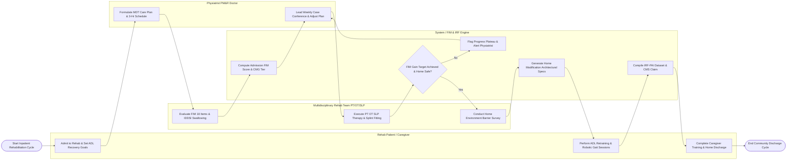

# Swimlane Diagram — Rehabilitation Center Management System

## Mermaid Code

## Flow Description | Mô tả luồng

| Lane | Actor / Subsystem | Role in Flow |
|------|-------------------|--------------|
| 1 | Rehab Patient / Caregiver | Admits to rehabilitation facility, sets personal ADL recovery goals, participates in daily intensive PT/OT/SLP sessions, undergoes caregiver training, and discharges home. |
| 2 | Multidisciplinary Rehab Team PT/OT/SLP | Evaluates 18 FIM functional items, assesses swallowing IDDSI levels, conducts daily ADL retraining, fabricates custom splints/AFO orthoses, and conducts home barrier surveys. |
| 3 | System / FIM & IRF Engine | Calculates total FIM baseline/discharge scores (40 -> 90), computes CMS Case-Mix Group (CMG) tiers, enforces CMS 3-hour daily therapy rules, and generates IRF-PAI datasets. |
| 4 | Physiatrist PM&R Doctor | Formulates multidisciplinary rehabilitation care plans, sets weight-bearing restrictions, leads weekly interdisciplinary team case conferences, and approves IRF-PAI CMS claims. |
