# Action Tree — Rehabilitation Center Management System

## Mermaid Code

```mermaid
graph TD
    Root["Rehabilitation Center Management System"]

    Root --> M1["Functional Assessment & FIM Scoring"]
    Root --> M2["Multidisciplinary MDT Care Planning"]
    Root --> M3["Occupational Therapy & ADL Retraining"]
    Root --> M4["Speech Pathology & Dysphagia Swallowing"]
    Root --> M5["Prosthetics Orthotics & Adaptive Gear"]
    Root --> M6["Robotic Gait & Hydrotherapy Scheduling"]
    Root --> M7["CMS IRF-PAI Dataset & Billing CMG"]
    Root --> M8["Home Environment & Discharge Planning"]

    M1 --> A11["Score 18 Functional Independence Measure Items"]
    M1 --> A12["Evaluate Barthel Index & Berg Balance Scale"]
    M1 --> A13["Assess WeeFIM Pediatric Developmental Milestones"]
    M1 --> A14["Calculate Baseline Motor & Cognitive FIM"]

    M2 --> A21["Formulate Integrated MDT Rehabilitation Plan"]
    M2 --> A22["Set CMS 3-Hour Daily Therapy Dosage Schedule"]
    M2 --> A23["Convene Weekly MDT Interdisciplinary Conference"]
    M2 --> A24["Track SMART Target FIM Recovery Goal Gains"]

    M3 --> A31["Retrain ADL Feeding Dressing Toileting Skills"]
    M3 --> A32["Fabricate Custom Thermoplastic Upper Limb Splints"]
    M3 --> A33["Prescribe Adaptive Eating & Dressing Equipment"]
    M3 --> A34["Execute Simulated Home Kitchen Meal Preparation"]

    M4 --> A41["Evaluate Swallowing Function IDDSI Levels 0 to 7"]
    M4 --> A42["Log Modified Barium Swallow Videofluoroscopy"]
    M4 --> A43["Administer VitalStim Neuromuscular Electrical Stimulation"]
    M4 --> A44["Retrain Expressive Aphasia & AAC Eye-Gaze Board"]

    M5 --> A51["Prescribe Carbon Fiber Ankle-Foot Orthosis AFO"]
    M5 --> A52["Capture 3D Optical Scanner CAD Limb Geometry"]
    M5 --> A53["Fit Trans-Tibial Below-Knee Artificial Limb"]
    M5 --> A54["Configure Tilt-in-Space Power Wheelchair Seating"]

    M6 --> A61["Schedule Lokomat Robotic Gait Trainer Sessions"]
    M6 --> A62["Ingest Body-Weight Support & Step Cadence"]
    M6 --> A63["Book Hydrotherapy Pool Water Exercises"]
    M6 --> A64["Track Isokinetic Dynamometer Torque Force"]

    M7 --> A71["Compile Statutory CMS IRF-PAI Dataset"]
    M7 --> A72["Compute Case-Mix Group CMG Reimbursement Tier"]
    M7 --> A73["Audit Admission vs Discharge FIM Gain Scores"]
    M7 --> A74["Export Inpatient Rehab Facility Billing Claims"]

    M8 --> A81["Survey Home Floor Plan Doorway & Ramp Barriers"]
    M8 --> A82["Conduct Family Caregiver Transfer Skills Training"]
    M8 --> A83["Issue Adaptive Driving & Vocational Work Plans"]
    M8 --> A84["Authorize Community Discharge Summary Package"]
```

## Module Description | Mô tả Module

| # | Module | Description | Actions |
|---|--------|-------------|---------|
| 1 | Functional Assessment & FIM Scoring | Evaluates 18 FIM functional items (1-7 scale), Barthel Index, Berg Balance Scale, and computes baseline motor and cognitive FIM subscores. | Score 18 Functional Independence Measure Items, Evaluate Barthel Index & Berg Balance Scale, Assess WeeFIM Pediatric Developmental Milestones, Calculate Baseline Motor & Cognitive FIM |
| 2 | Multidisciplinary MDT Care Planning | Formulates MDT care plans, enforces CMS 3-hour daily therapy rules, convenes weekly case conferences, and tracks SMART target FIM goals. | Formulate Integrated MDT Rehabilitation Plan, Set CMS 3-Hour Daily Therapy Dosage Schedule, Convene Weekly MDT Interdisciplinary Conference, Track SMART Target FIM Recovery Goal Gains |
| 3 | Occupational Therapy & ADL Retraining | Retrains ADL self-care skills (Feeding, Dressing, Transfers), fabricates upper-limb thermoplastic splints, and prescribes adaptive living equipment. | Retrain ADL Feeding Dressing Toileting Skills, Fabricate Custom Thermoplastic Upper Limb Splints, Prescribe Adaptive Eating & Dressing Equipment, Execute Simulated Home Kitchen Meal Preparation |
| 4 | Speech Pathology & Dysphagia Swallowing | Evaluates swallowing function (IDDSI levels 0-7), logs MBS video studies, administers VitalStim stimulation, and retrains Aphasia speech. | Evaluate Swallowing Function IDDSI Levels 0 to 7, Log Modified Barium Swallow Videofluoroscopy, Administer VitalStim Neuromuscular Electrical Stimulation, Retrain Expressive Aphasia & AAC Eye-Gaze Board |
| 5 | Prosthetics Orthotics & Adaptive Gear | Prescribes custom carbon fiber AFO orthoses, captures 3D CAD limb scans, fits artificial limbs, and configures power wheelchair seating. | Prescribe Carbon Fiber Ankle-Foot Orthosis AFO, Capture 3D Optical Scanner CAD Limb Geometry, Fit Trans-Tibial Below-Knee Artificial Limb, Configure Tilt-in-Space Power Wheelchair Seating |
| 6 | Robotic Gait & Hydrotherapy Scheduling | Books Lokomat robotic gait trainers and hydrotherapy pools, ingesting real-time telemetry (body-weight support %, walking distance). | Schedule Lokomat Robotic Gait Trainer Sessions, Ingest Body-Weight Support & Step Cadence, Book Hydrotherapy Pool Water Exercises, Track Isokinetic Dynamometer Torque Force |
| 7 | CMS IRF-PAI Dataset & Billing CMG | Compiles statutory CMS IRF-PAI datasets, computes Case-Mix Group (CMG) reimbursement tiers, and audits admission vs discharge FIM gains. | Compile Statutory CMS IRF-PAI Dataset, Compute Case-Mix Group CMG Reimbursement Tier, Audit Admission vs Discharge FIM Gain Scores, Export Inpatient Rehab Facility Billing Claims |
| 8 | Home Environment & Discharge Planning | Surveys home architectural barriers, trains family caregivers in transfers, issues adaptive driving/work plans, and authorizes discharge. | Survey Home Floor Plan Doorway & Ramp Barriers, Conduct Family Caregiver Transfer Skills Training, Issue Adaptive Driving & Vocational Work Plans, Authorize Community Discharge Summary Package |
