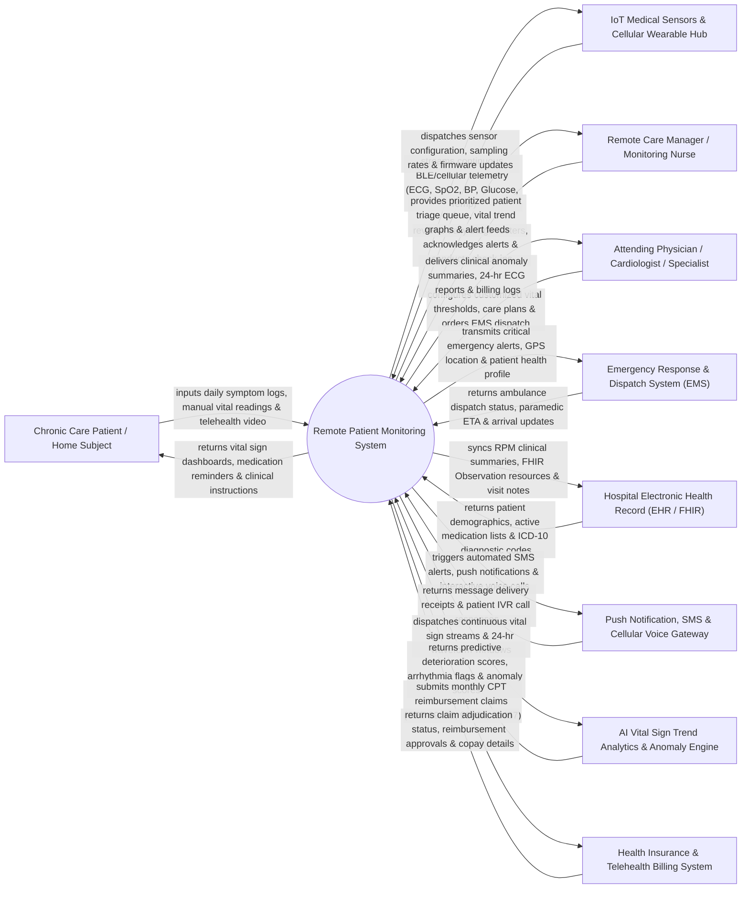

# Context Diagram — Remote Patient Monitoring System

## Mermaid Code

## Actor & Interaction Table | Bảng Actor & Tương tác

| # | Actor | Actor Type | Data Sent TO System | Data Received FROM System | Notes |
|---|-------|------------|---------------------|---------------------------|-------|
| 1 | Chronic Care Patient / Home Subject | Primary | Daily self-report symptom logs, manual vital measurements (glucose, weight), video check-in streams, survey responses. | Personalized vital sign dashboards, medication schedule reminders, educational guidelines, virtual consultation links. | Patients with chronic conditions (hypertension, CHF, COPD, diabetes) monitored at home using wearable IoT kits. |
| 2 | Remote Care Manager / Monitoring Nurse | Primary | Alert acknowledgments, clinical triage notes, patient check-in outcome logs, threshold adjustment requests. | Prioritized patient risk rosters, real-time alert notifications, historical vital trend charts, triage task queues. | Clinical nurses monitoring centralized RPM dashboards, conducting daily patient outreach, and managing alert queues. |
| 3 | Attending Physician / Specialist | Primary | Custom vital threshold parameters, care plan orders, medication adjustments, emergency escalation approvals, clinical sign-offs. | Aggregated 24-hour vital summaries, AI arrhythmia detection reports, FHIR clinical summaries, monthly billing logs. | Treating physicians or cardiologists overseeing patient care plans, reviewing critical alerts, and signing off on care plans. |
| 4 | IoT Medical Sensors & Wearable Hub | Supporting System | Continuous BLE/cellular sensor telemetry (ECG waveforms, SpO2, blood pressure, blood glucose, body temperature, fall events). | Device pairing handshake, sensor sampling rate commands, over-the-air (OTA) firmware updates, battery level queries. | Medical-grade wearable devices (patch ECG, smart BP cuffs, pulse oximeters, continuous glucose monitors) and cellular hubs. |
| 5 | Emergency Response & Dispatch System (EMS) | Supporting System | Ambulance dispatch confirmation, paramedic ETA updates, emergency incident status, field transport logs. | High-priority emergency trigger payloads, patient GPS location, vital sign baseline, medical history snapshot. | Local 911 or private ambulance dispatch services triggered during life-threatening vital sign anomalies. |
| 6 | Hospital Electronic Health Record (EHR / FHIR) | Supporting System | Patient demographics, EMR medical history, active medication lists, baseline lab values, ICD-10 diagnostic codes. | FHIR Observation resources, RPM clinical summaries, vital sign trend data, virtual visit SOAP notes. | Central hospital EHR (Epic, Cerner) integrating RPM patient data using HL7 FHIR R4 standard interfaces. |
| 7 | Push Notification & Voice Gateway | Supporting System | Delivery status receipts, patient SMS responses, IVR voice call response tokens. | High-severity push notifications, SMS medication reminders, automated IVR emergency escalation calls. | External communication gateways (Twilio, Firebase Cloud Messaging) delivering automated patient and provider alerts. |
| 8 | AI Clinical Analytics & Anomaly Engine | Supporting System | Early deterioration risk scores, arrhythmia classification tokens (AFib, PVC), predictive vital trend anomaly alerts. | High-frequency vital sign data streams, 24-hour continuous ECG waveforms, historical baseline statistics. | AI/ML microservice analyzing continuous vital streams to detect early clinical deterioration before critical alerts. |
| 9 | Health Insurance & Telehealth Billing System | Supporting System | Claim adjudication status, CPT code reimbursement approvals, patient copay details. | Monthly RPM CPT reimbursement claims (CPT 99453 setup, 99454 transmission, 99457/99458 clinical time). | Health insurance payers and billing platforms processing RPM telehealth and remote monitoring reimbursement claims. |

## System Boundary Description | Mô tả Phạm vi Hệ thống

The **Remote Patient Monitoring System (RPMS)** is an enterprise IoT-enabled medical monitoring, continuous telemetry processing, clinical decision support, and virtual care management platform. Operating between patient homes, remote nursing care centers, specialist clinics, and hospital emergency networks, it ingests continuous vital sign streams from cellular/Bluetooth medical wearables (ECG, SpO2, blood pressure, glucose, temperature), processes AI-driven clinical deterioration algorithms, triggers multi-tier clinical alert escalations, facilitates telehealth check-ins, and automates monthly CPT reimbursement reporting.

**Inside System Scope:**
- Ingestion and real-time processing of continuous and intermittent IoT vital sign telemetry.
- Configuration of personalized patient vital thresholds, alert rules, and multi-level notification escalation pathways.
- Real-time clinical triage dashboard displaying prioritized patient risk queues and vital trend graphs.
- AI-assisted anomaly detection (arrhythmia identification, rapid blood pressure spikes, oxygen desaturation).
- Conduct virtual telehealth check-ins, asynchronous patient messaging, and medication adherence tracking.
- Emergency escalation protocol workflow triggering automated 911/EMS dispatch payloads with GPS data.
- Two-way HL7 FHIR R4 integration with enterprise hospital EHRs for clinical summary synchronization.
- Automated tracking of monthly RPM transmission days and clinical monitoring minutes for CPT 99453/99454/99457 billing.

**Outside System Scope:**
- Physical manufacturing, hardware repairs, and logistics delivery of IoT wearable sensor hardware.
- Primary diagnostic medical decisions made independently by attending physicians outside care plan guidelines.
- General non-RPM hospital bed management and inpatient operating room scheduling.
