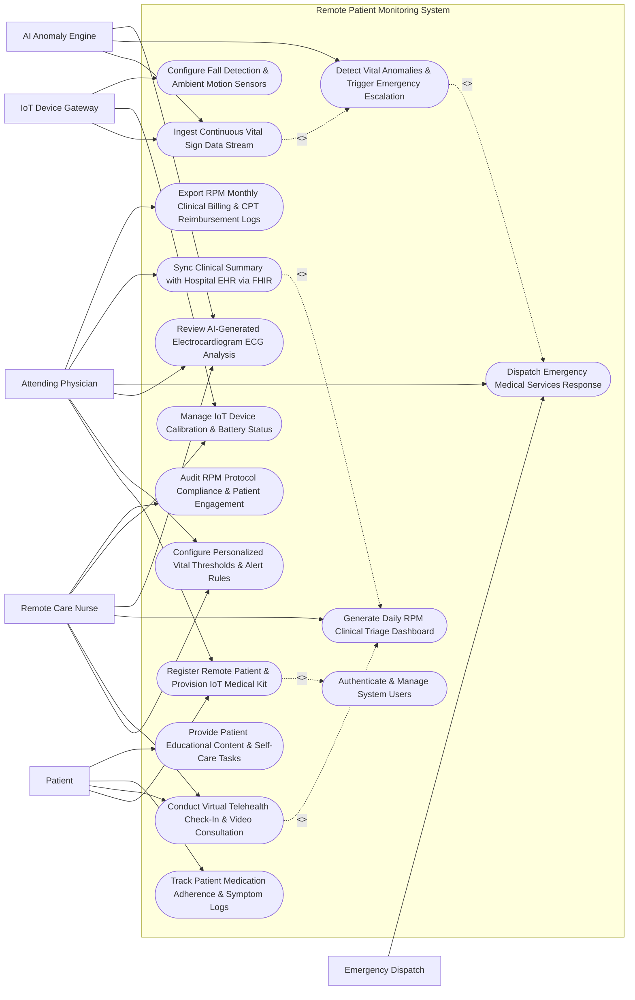

# Use Case Diagram — Remote Patient Monitoring System

## Mermaid Code

## Actor Table | Bảng Actor

| # | Actor | Actor Type | Role Description | Related Use Cases |
|---|-------|------------|------------------|-------------------|
| 1 | Patient | Primary | Chronic care patient using assigned IoT medical wearables at home, completing daily symptom logs, and participating in virtual visits. | UC01, UC05, UC06, UC14 |
| 2 | Remote Care Nurse | Primary | Clinical care manager monitoring patient dashboards, reviewing daily vital alerts, conducting video check-ins, and managing device issues. | UC03, UC05, UC07, UC08, UC11, UC15 |
| 3 | Attending Physician | Primary | Specialist or primary care physician setting clinical care plans, defining customized vital thresholds, reviewing severe alerts, and signing billing logs. | UC01, UC03, UC08, UC09, UC10, UC12 |
| 4 | IoT Device Gateway | Secondary / System | Hardware/cellular hub ingesting continuous Bluetooth/cellular vital streams from wearables and reporting sensor status. | UC02, UC11, UC13 |
| 5 | AI Anomaly Engine | Secondary / System | Machine learning service analyzing continuous vital streams for early deterioration trends, arrhythmia detection, and noise filtering. | UC02, UC04, UC08 |
| 6 | Emergency Dispatch | Secondary / System | External 911 or emergency medical response network receiving automated high-priority panic or vital crash dispatch payloads. | UC09 |

## Use Case Table | Bảng Use Case

| # | UC ID | Use Case Name | Primary Actor | Secondary Actor | Description | Priority |
|---|-------|---------------|---------------|-----------------|-------------|----------|
| 1 | UC01 | Register Remote Patient & Provision IoT Medical Kit | Attending Physician | Patient | Enroll chronic care patient into RPM program, link medical diagnosis (ICD-10), and pair cellular IoT medical wearables (BP, ECG, SpO2). | High |
| 2 | UC02 | Ingest Continuous Vital Sign Data Stream | IoT Device Gateway | AI Anomaly Engine | Process real-time vital sign telemetry streams, validate data payloads, filter sensor noise, and store time-series observations. | High |
| 3 | UC03 | Configure Personalized Vital Thresholds & Alert Rules | Remote Care Nurse | Attending Physician | Set custom patient-specific upper and lower physiological thresholds (e.g., HR > 110 bpm, SpO2 < 90%) and alert escalation pathways. | High |
| 4 | UC04 | Detect Vital Anomalies & Trigger Emergency Escalation | AI Anomaly Engine | Remote Care Nurse | Analyze incoming vital streams against configured thresholds, flag critical physiological anomalies, and dispatch multi-channel alerts. | High |
| 5 | UC05 | Conduct Virtual Telehealth Check-In & Video Consultation | Remote Care Nurse | Patient | Facilitate scheduled or alert-triggered HD video consultations, review real-time vitals, and log clinical SOAP progress notes. | High |
| 6 | UC06 | Track Patient Medication Adherence & Symptom Logs | Patient | None | Prompt patient to record daily medication doses, log subjective symptoms (shortness of breath, chest pain), and log adherence rates. | Medium |
| 7 | UC07 | Generate Daily RPM Clinical Triage Dashboard | Remote Care Nurse | None | Aggregate patient population vital data into a prioritized risk-stratified triage roster based on severity scores and unhandled alerts. | High |
| 8 | UC08 | Review AI-Generated Electrocardiogram ECG Analysis | Attending Physician | AI Anomaly Engine | Evaluate continuous 1-lead or 12-lead ECG waveforms, review AI arrhythmia classifications (AFib, PVC, VTach), and confirm diagnosis. | High |
| 9 | UC09 | Dispatch Emergency Medical Services Response | Attending Physician | Emergency Dispatch | Initiate emergency escalation protocol during life-threatening vital crashes, sending patient GPS location and health summary to EMS. | High |
| 10 | UC10 | Sync Clinical Summary with Hospital EHR via FHIR | Attending Physician | None | Export validated RPM clinical summaries, vital trends, and telehealth encounter notes to hospital EHR via HL7 FHIR R4 API. | High |
| 11 | UC11 | Manage IoT Device Calibration & Battery Status | Remote Care Nurse | IoT Device Gateway | Monitor wearable sensor battery levels, track cellular connectivity, detect sensor disconnects, and issue device replacement requests. | Medium |
| 12 | UC12 | Export RPM Monthly Clinical Billing & CPT Reimbursement Logs | Attending Physician | None | Track monthly RPM transmission days (>= 16 days) and clinical review minutes (>= 20 mins) to generate CPT 99453/99454/99457 billing claims. | High |
| 13 | UC13 | Configure Fall Detection & Ambient Motion Sensors | IoT Device Gateway | None | Process accelerometer and ambient motion data to detect patient fall incidents, triggering immediate emergency alert protocols. | Medium |
| 14 | UC14 | Provide Patient Educational Content & Self-Care Tasks | Patient | None | Deliver disease-specific self-management guidelines, dietary advice, and interactive educational modules based on chronic condition. | Low |
| 15 | UC15 | Audit RPM Protocol Compliance & Patient Engagement | Remote Care Nurse | None | Track patient device transmission compliance %, missed measurement rates, and generate monthly engagement reports. | Medium |
| 16 | UC16 | Authenticate & Manage System Users | All Users | None | Enforce multi-factor authentication (MFA), role-based access control (Nurse, Physician, Patient), and cryptographic HIPAA audit logs. | High |

## Use Case Specification | Đặc tả Use Case

---

### UC01 — Register Remote Patient & Provision IoT Medical Kit

| Field | Detail |
|-------|--------|
| **UC ID** | UC01 |
| **Use Case Name** | Register Remote Patient & Provision IoT Medical Kit |
| **Actor(s)** | Primary: Attending Physician   Secondary: Patient |
| **Description** | Enrolls a chronic disease patient into the Remote Patient Monitoring (RPM) program, assigns an RPM clinical care plan based on ICD-10 diagnosis (e.g., Congestive Heart Failure, Severe Hypertension), provisions a cellular-enabled IoT Medical Wearable Kit (ECG patch, smart BP cuff, pulse oximeter, weight scale), and pairs devices with the patient's account. |
| **Precondition** | 1. The Attending Physician is authenticated in RPMS with active clinical credentials.   2. Patient demographics and EMR ID are synchronized from the hospital EHR system. |
| **Main Flow** | 1. The Attending Physician selects "Enroll New RPM Patient" in the RPMS portal.   2. The Physician enters Patient EMR ID `PAT-2026-88912` (Patient: *John Doe*, Age: 67, Diagnosis: *ICD-10 I50.9 Congestive Heart Failure*).   3. The Physician assigns the **CHF Remote Care Protocol v2.1**:   &nbsp;&nbsp;&nbsp;&nbsp;- Monitoring Duration: 90 Days   &nbsp;&nbsp;&nbsp;&nbsp;- Required Daily Measurement Schedule: Weight (Morning), BP (Twice daily), SpO2 (Twice daily), ECG (Continuous 24/7).   4. The System provisions the **IoT Medical Wearable Kit `KIT-CHF-0991`**:   &nbsp;&nbsp;&nbsp;&nbsp;- Cellular Smart Hub ID: `HUB-CELL-77821`   &nbsp;&nbsp;&nbsp;&nbsp;- Smart BP Cuff Serial: `BP-BLE-99182`   &nbsp;&nbsp;&nbsp;&nbsp;- Pulse Oximeter Serial: `SPO2-BLE-44120`   &nbsp;&nbsp;&nbsp;&nbsp;- Wearable ECG Patch MAC: `ECG-BLE-33109`.   5. The System executes a cryptographic pairing handshake with the Cellular Smart Hub, verifying all 4 sensors are online and transmitting test signals.   6. The System sends an automated SMS welcome invitation and activation PIN `992817` to the Patient's mobile phone.   7. The System sets Patient RPM enrollment status to "Active - Baseline Monitoring Phase". |
| **Alternative Flow** | **AF1** — Cellular Gateway Auto-Provisioning: Patient does not have home Wi-Fi; System provisions a pre-configured 5G/LTE cellular hub that connects automatically upon plugging into home power outlet.   **AF2** — Caregiver Account Proxy Linkage: Patient is elderly and requires family caregiver assistance; Physician links caregiver account (*Mary Doe*) with full notification proxy access. |
| **Exception Flow** | **EX1** — IoT Sensor Hardware Pairing Failure: ECG patch fails BLE handshake during setup; System flags "Device Pairing Failed — Sensor Battery or Firmware Error", prompting technician replacement.   **EX2** — Patient Ineligible / Duplicate Enrollment Warning: Patient is already active in a competing RPM study protocol; System displays error "Patient Active in Existing RPM Program — Protocol Conflict". |
| **Postcondition** | Patient John Doe is enrolled in CHF RPM Protocol v2.1, IoT Kit `KIT-CHF-0991` is paired and active, cellular transmission is verified, and baseline vital monitoring commences. |
| **Business Rule** | **BR1**: All IoT medical devices provisioned for remote patient monitoring MUST be FDA 510(k) cleared or CE-marked medical-grade sensors with encrypted BLE/cellular telemetry.   **BR2**: Patient enrollment in RPM protocols MUST have an explicit physician order referencing valid ICD-10 chronic disease diagnostic codes. |

---

### UC02 — Ingest Continuous Vital Sign Data Stream

| Field | Detail |
|-------|--------|
| **UC ID** | UC02 |
| **Use Case Name** | Ingest Continuous Vital Sign Data Stream |
| **Actor(s)** | Primary: IoT Device Gateway   Secondary: AI Anomaly Engine |
| **Description** | Continuously ingests, validates, decrypts, and processes real-time vital sign telemetry data streams (ECG waveforms, SpO2, blood pressure, glucose, temperature) transmitted from patient IoT devices via cellular/MQTT protocol, executing noise filtering and storing time-series measurements. |
| **Precondition** | 1. Patient IoT Medical Kit (UC01) is powered on and paired.   2. The RPMS IoT Data Ingestion Engine is operational with MQTT/TLS endpoints active. |
| **Main Flow** | 1. The IoT Device Gateway receives encrypted telemetry data packets from Cellular Hub `HUB-CELL-77821` over secure MQTT (TLS 1.3).   2. The System validates the telemetry payload structure:   &nbsp;&nbsp;&nbsp;&nbsp;- Device MAC: `ECG-BLE-33109` & `BP-BLE-99182`   &nbsp;&nbsp;&nbsp;&nbsp;- Patient ID: `PAT-2026-88912`   &nbsp;&nbsp;&nbsp;&nbsp;- Timestamp: `2026-07-24T16:15:00Z`   &nbsp;&nbsp;&nbsp;&nbsp;- Raw Payload: *Heart Rate = 118 bpm, Systolic BP = 168 mmHg, Diastolic BP = 102 mmHg, SpO2 = 88%, ECG Waveform Chunk = 250 Hz sample*.   3. The System applies **Signal Quality & Noise Filtering Algorithm**:   &nbsp;&nbsp;&nbsp;&nbsp;- Filters out motion artifacts and sensor displacement noise   &nbsp;&nbsp;&nbsp;&nbsp;- Confirms Signal Quality Index (SQI > 0.85).   4. The System writes validated time-series records to the **RPM Time-Series Telemetry Database**.   5. The System routes the clean vital stream to the **AI Anomaly Engine** (UC04) for real-time threshold evaluation.   6. The System updates the Patient's live vital display on the Remote Nurse Triage Dashboard (UC07). |
| **Alternative Flow** | **AF1** — Offline Store-and-Forward Sync: Cellular connection is temporarily lost; Cellular Hub buffers 4 hours of vital telemetry locally and flushes batch payloads upon network restoration.   **AF2** — Manual Vital Reading Ingestion: Patient manually inputs blood glucose reading ($14.2\text{ mmol/L}$) via the RPM mobile app; System validates manual input range and flags for nurse review. |
| **Exception Flow** | **EX1** — Out-of-Range Sensor Malfunction Data: Sensor transmits corrupted data (e.g., Heart Rate = 350 bpm, SpO2 = 12%); System flags "Sensor Artifact Error — Telemetry Discarded", prompting sensor check alert.   **EX2** — Unauthenticated Gateway Packet Drop: Packet sent with invalid device encryption token; System drops packet and logs security audit alert. |
| **Postcondition** | Telemetry payload is validated, noise-filtered, stored in time-series database, updated on nurse dashboard, and evaluated by AI anomaly engine. |
| **Business Rule** | **BR1**: Continuous vital sign data streams MUST be encrypted end-to-end using TLS 1.3 in transit and AES-256 at rest to protect Protected Health Information (PHI).   **BR2**: High-frequency ECG telemetry (250 Hz) MUST be processed with motion artifact filtering to prevent false alarm fatigue in clinical triage centers. |

---

### UC03 — Configure Personalized Vital Thresholds & Alert Rules

| Field | Detail |
|-------|--------|
| **UC ID** | UC03 |
| **Use Case Name** | Configure Personalized Vital Thresholds & Alert Rules |
| **Actor(s)** | Primary: Remote Care Nurse   Secondary: Attending Physician |
| **Description** | Configures patient-specific upper and lower physiological thresholds (Heart Rate, Systolic/Diastolic BP, SpO2, Glucose, Weight Gain) and defines multi-tier alert escalation pathways (Yellow Warning, Orange Urgent, Red Emergency) based on individual clinical risk profiles. |
| **Precondition** | 1. Patient `PAT-2026-88912` is enrolled in RPMS (UC01).   2. The Remote Care Nurse or Attending Physician has privilege to edit threshold profiles. |
| **Main Flow** | 1. The Remote Care Nurse opens "Vital Threshold Configuration" for Patient *John Doe* (`PAT-2026-88912`).   2. The Nurse reviews baseline physiological data and Physician care plan orders.   3. The Nurse sets **Tiered Vital Sign Threshold Rules**:   &nbsp;&nbsp;&nbsp;&nbsp;- **Heart Rate**: Normal range $60-90\text{ bpm}$. Yellow Alert: $> 100\text{ bpm}$. Red Critical: $> 120\text{ bpm}$ or $< 45\text{ bpm}$.   &nbsp;&nbsp;&nbsp;&nbsp;- **Systolic Blood Pressure**: Normal range $110-135\text{ mmHg}$. Orange Alert: $> 150\text{ mmHg}$. Red Critical: $> 175\text{ mmHg}$.   &nbsp;&nbsp;&nbsp;&nbsp;- **Oxygen Saturation (SpO2)**: Normal $\ge 95\%$. Yellow Alert: $90-93\%$. Red Critical: $< 89\%$.   &nbsp;&nbsp;&nbsp;&nbsp;- **Weight Gain (CHF Rule)**: Red Alert: Weight gain $> 1.5\text{ kg}$ in 24 hours or $> 2.5\text{ kg}$ in 7 days.   4. The Nurse configures **Alert Escalation Protocol**:   &nbsp;&nbsp;&nbsp;&nbsp;- *Yellow Alert*: Add to Nurse Dashboard Triage Queue (SLA: Review within 2 hours).   &nbsp;&nbsp;&nbsp;&nbsp;- *Orange Alert*: Push Notification & SMS to Duty Nurse (SLA: Review within 15 mins).   &nbsp;&nbsp;&nbsp;&nbsp;- *Red Critical Alert*: Immediate Automated Phone Call to On-Call Physician & Nurse + Automated EMS Dispatch readiness.   5. The System validates threshold ranges (ensuring Min < Max).   6. The System saves threshold configuration `RULE-PAT-88912-V3` and deploys active rules to the real-time AI Anomaly Engine (UC04). |
| **Alternative Flow** | **AF1** — Standard Disease Protocol Template Import: Nurse loads pre-set "Severe COPD Threshold Template", populating standard SpO2 (88-92%) target ranges automatically.   **AF2** — Time-Based Dynamic Thresholds: Nurse configures nocturnal thresholds (allowing lower HR during sleeping hours 23:00-06:00 to reduce false nighttime alarms). |
| **Exception Flow** | **EX1** — Illogical Threshold Configuration Error: Nurse enters Systolic BP Min ($160\text{ mmHg}$) higher than Max ($140\text{ mmHg}$); System blocks save with error "Invalid Threshold Range — Min Value Must Be Less Than Max Value".   **EX2** — Unauthorized Threshold Revision Attempt: Non-clinical staff attempts to modify critical alert limits; System blocks edit with error "Access Denied — Clinical License Required". |
| **Postcondition** | Threshold rule `RULE-PAT-88912-V3` is activated, multi-tier escalation SLAs are configured, and real-time anomaly engine is updated. |
| **Business Rule** | **BR1**: Patient vital sign threshold configurations MUST be customized according to baseline clinical conditions and approved by a licensed healthcare professional.   **BR2**: Changes to vital threshold rules MUST be logged in the HIPAA audit trail with user ID, timestamp, and clinical rationale. |

---

### UC04 — Detect Vital Anomalies & Trigger Emergency Escalation

| Field | Detail |
|-------|--------|
| **UC ID** | UC04 |
| **Use Case Name** | Detect Vital Anomalies & Trigger Emergency Escalation |
| **Actor(s)** | Primary: AI Anomaly Engine   Secondary: Remote Care Nurse |
| **Description** | Continuously evaluates incoming vital sign telemetry against active threshold rules (UC03), detects acute physiological deterioration or life-threatening arrhythmias (e.g., SpO2 drop to 84%, VTach), triggers automated multi-channel alerts (SMS, Push, IVR Call), and escalates to emergency response protocols. |
| **Precondition** | 1. Ingested vital sign telemetry stream (UC02) is active.   2. Personalized threshold rules `RULE-PAT-88912-V3` (UC03) are active. |
| **Main Flow** | 1. The AI Anomaly Engine evaluates incoming telemetry for Patient *John Doe*:   &nbsp;&nbsp;&nbsp;&nbsp;- Measured SpO2: **$86\%$** (Threshold Red Critical: $< 89\%$)   &nbsp;&nbsp;&nbsp;&nbsp;- Measured Heart Rate: **$132\text{ bpm}$** (Threshold Red Critical: $> 120\text{ bpm}$)   &nbsp;&nbsp;&nbsp;&nbsp;- ECG Analysis: **Ventricular Tachycardia (VTach)** detected by AI classifier.   2. The System classifies event severity as **RED CRITICAL EMERGENCY** (`ALERT-CRIT-2026-9912`).   3. The System triggers **Immediate Escalation Protocol**:   &nbsp;&nbsp;&nbsp;&nbsp;- Flashes Red Siren Alert on Nurse Triage Dashboard (UC07) with audible alarm   &nbsp;&nbsp;&nbsp;&nbsp;- Dispatches High-Priority Push Notification & SMS to On-Call Nurse & Physician   &nbsp;&nbsp;&nbsp;&nbsp;- Initiates Automated IVR Voice Call to Patient's cellular phone with interactive voice check-in ("Press 1 if conscious").   4. The System monitors IVR call response: Patient presses `1` but speech is weak ("Severe chest pain, can't breathe").   5. The Remote Care Nurse acknowledges alert `ALERT-CRIT-2026-9912` within 45 seconds on the Triage Dashboard.   6. The Nurse launches an immediate Emergency Video Check-In (UC05) and prepares Emergency Dispatch Payload for EMS (UC09). |
| **Alternative Flow** | **AF1** — Unresponsive Patient Automated EMS Escalation: IVR call to patient goes unanswered after 30 seconds AND SpO2 < 85%; System automatically escalates alert to Red Level 2, prompting direct 911 EMS dispatch approval prompt for nurse.   **AF2** — Transient Artifact Self-Resolution: SpO2 drops to 88% for 3 seconds then returns to 96% (motion artifact); System suppresses alert and logs "Transient Artifact — Resolved". |
| **Exception Flow** | **EX1** — Primary Nurse No-Acknowledgment Escalation Timeout: Duty Nurse fails to acknowledge Red Alert within 2 minutes SLA; System automatically escalates alert to Backup Physician and Clinical Director.   **EX2** — Cellular Push Gateway Timeout: SMS gateway fails; System automatically falls back to direct voice telephony trunk line. |
| **Postcondition** | Red Critical Alert `ALERT-CRIT-2026-9912` is generated, multi-channel notifications dispatched, nurse acknowledgment logged in 45s, and emergency workflow initialized. |
| **Business Rule** | **BR1**: Red Critical Alerts MUST trigger immediate multi-channel escalation with a strict 2-minute clinical acknowledgment SLA.   **BR2**: Life-threatening vital anomalies combined with patient unresponsiveness MUST provide automated single-click Emergency Medical Services (EMS) dispatch escalation. |

---

### UC05 — Conduct Virtual Telehealth Check-In & Video Consultation

| Field | Detail |
|-------|--------|
| **UC ID** | UC05 |
| **Use Case Name** | Conduct Virtual Telehealth Check-In & Video Consultation |
| **Actor(s)** | Primary: Remote Care Nurse   Secondary: Patient |
| **Description** | Initiates and conducts an encrypted WebRTC HD video consultation between the Remote Care Nurse/Physician and the patient, displaying real-time vital sign telemetry overlays during the call, assessing clinical status, and documenting SOAP encounter notes. |
| **Precondition** | 1. Critical alert (UC04) or routine scheduled RPM check-in is pending.   2. Patient and Nurse devices have active Internet connection and camera/microphone access. |
| **Main Flow** | 1. The Remote Care Nurse clicks "Launch Virtual Check-In" on Patient *John Doe*'s triage dashboard card.   2. The System generates an encrypted WebRTC Video Session `ROOM-RPM-88912` and pushes an instant "Join Nurse Video Call" notification to the Patient's mobile app.   3. The Patient taps the notification and joins the video call.   4. The Nurse views the **Clinical Telehealth Workspace**:   &nbsp;&nbsp;&nbsp;&nbsp;- HD Video Stream of Patient   &nbsp;&nbsp;&nbsp;&nbsp;- **Real-Time Overlay**: Live Heart Rate ($118\text{ bpm}$), SpO2 ($91\%$), Blood Pressure ($158/98\text{ mmHg}$), Live ECG Waveform   &nbsp;&nbsp;&nbsp;&nbsp;- Active Medication List & Recent Symptom Logs.   5. The Nurse performs visual clinical assessment (checking for pedal edema, respiratory distress, facial pallor).   6. The Nurse provides clinical instructions: "Take 1 additional dose of prescribed oral diuretic (Furosemide 40mg), rest in elevated position, and re-check SpO2 in 30 minutes."   7. The Nurse completes the **Telehealth SOAP Encounter Note**:   &nbsp;&nbsp;&nbsp;&nbsp;- *Subjective*: Patient reports mild dyspnea upon exertion.   &nbsp;&nbsp;&nbsp;&nbsp;- *Objective*: SpO2 91%, HR 118 bpm, no severe peripheral edema.   &nbsp;&nbsp;&nbsp;&nbsp;- *Assessment*: Acute CHF exacerbation — Controlled.   &nbsp;&nbsp;&nbsp;&nbsp;- *Plan*: Oral diuretic adjustment, repeat SpO2 check in 30 mins.   8. The Nurse ends the video call; the System logs encounter duration (14 minutes) for CPT billing tracking (UC12). |
| **Alternative Flow** | **AF1** — Multi-Party Specialist Consultation Join: Nurse invites Attending Cardiologist into active video call for immediate specialist opinion; Cardiologist joins WebRTC room seamlessly.   **AF2** — Low Bandwidth Audio-Only Fallback: Patient cellular connection drops to 3G; System automatically degrades video to high-definition voice call with continuous vital data overlay. |
| **Exception Flow** | **EX1** — Patient Video Connection Disconnect: Video call drops unexpectedly after 2 minutes; System automatically re-initiates connection and sends fallback SMS call link.   **EX2** — Camera/Microphone Permission Denied: Patient app blocks camera access; System displays step-by-step visual prompt: "Please Enable Camera Permissions in Phone Settings". |
| **Postcondition** | Encrypted video consultation (14 mins) is completed, live vitals evaluated, SOAP note documented, patient instructions delivered, and encounter time logged for billing. |
| **Business Rule** | **BR1**: Virtual telehealth video consultations MUST be end-to-end encrypted conforming to HIPAA security standards.   **BR2**: Clinical encounter duration and SOAP notes MUST be logged immediately post-call to qualify for RPM telehealth clinical review time tracking (CPT 99457). |
