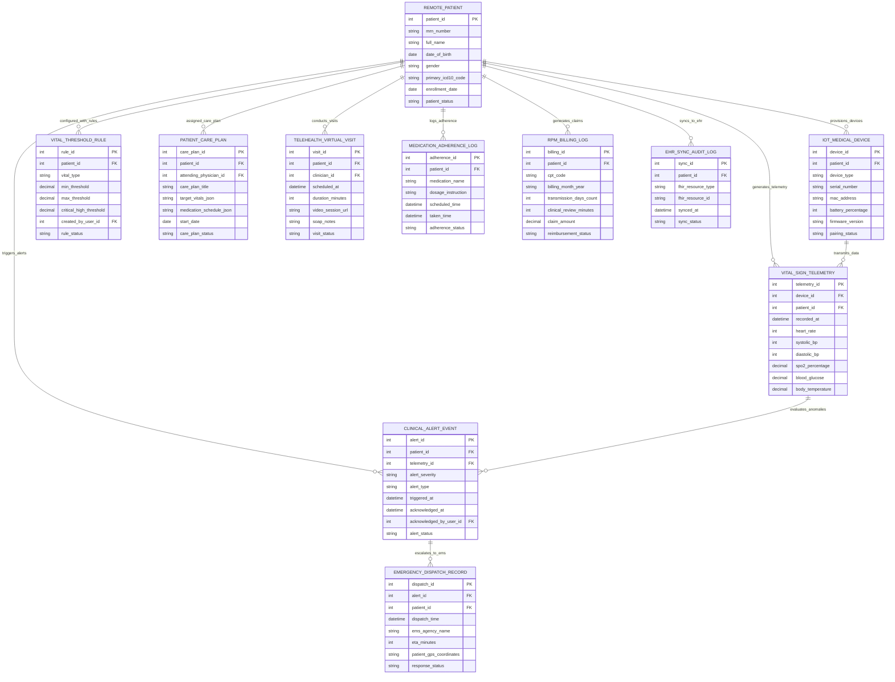

# Conceptual ERD — Remote Patient Monitoring System

## Mermaid Code

## Entity Description Table | Bảng mô tả Entity

| # | Entity Name | Vietnamese Name | Description | Key Attributes | Main Relationships |
|---|-------------|-----------------|-------------|----------------|-------------------|
| 1 | REMOTE_PATIENT | Bệnh nhân Theo dõi Từ xa | Master record of chronic care patient enrolled in RPM storing MRN, demographics, ICD-10 diagnosis, and enrollment status. | patient_id, mrn_number, full_name, date_of_birth, gender, primary_icd10_code, enrollment_date, patient_status | Has IOT_MEDICAL_DEVICE, TELEMETRY, THRESHOLD_RULE, ALERT, CARE_PLAN, VISIT, BILLING. |
| 2 | IOT_MEDICAL_DEVICE | Thiết bị Y tế IoT Wearable | Medical IoT sensor hardware (BP cuff, ECG patch, pulse oximeter) paired with patient account storing MAC, battery level, and pairing status. | device_id, patient_id, device_type, serial_number, mac_address, battery_percentage, pairing_status | Belongs to REMOTE_PATIENT; Generates VITAL_SIGN_TELEMETRY. |
| 3 | VITAL_SIGN_TELEMETRY | Dữ liệu Sinh hiệu Telemetry | Real-time time-series vital sign readings (HR, BP, SpO2, glucose, temp) transmitted from IoT medical devices. | telemetry_id, device_id, patient_id, recorded_at, heart_rate, systolic_bp, diastolic_bp, spo2_percentage, blood_glucose | Belongs to REMOTE_PATIENT and IOT_MEDICAL_DEVICE; Evaluated by CLINICAL_ALERT_EVENT. |
| 4 | VITAL_THRESHOLD_RULE | Quy tắc Ngưỡng Sinh hiệu | Patient-customized physiological threshold parameters defining minimum, maximum, and critical alert limits. | rule_id, patient_id, vital_type, min_threshold, max_threshold, critical_high_threshold, rule_status | Belongs to REMOTE_PATIENT. |
| 5 | CLINICAL_ALERT_EVENT | Cảnh báo Lâm sàng RPM | Alert event record generated when vital telemetry breaches configured thresholds storing alert severity, status, and nurse acknowledgment. | alert_id, patient_id, telemetry_id, alert_severity, alert_type, triggered_at, acknowledged_at, alert_status | Belongs to REMOTE_PATIENT and VITAL_SIGN_TELEMETRY; Escalates to EMERGENCY_DISPATCH_RECORD. |
| 6 | PATIENT_CARE_PLAN | Kế hoạch Chăm sóc Lâm sàng | Comprehensive RPM care plan order defining clinical diagnosis, target vital ranges, medication schedule, and physician sign-off. | care_plan_id, patient_id, attending_physician_id, care_plan_title, target_vitals_json, start_date, care_plan_status | Belongs to REMOTE_PATIENT. |
| 7 | TELEHEALTH_VIRTUAL_VISIT | Buổi Khám Bệnh từ xa WebRTC | Encrypted WebRTC virtual telehealth consultation record storing scheduled time, video room URL, duration, and clinical SOAP notes. | visit_id, patient_id, clinician_id, scheduled_at, duration_minutes, video_session_url, soap_notes, visit_status | Belongs to REMOTE_PATIENT. |
| 8 | MEDICATION_ADHERENCE_LOG | Nhật ký Tuân thủ Dùng thuốc | Patient daily medication adherence log tracking scheduled dose time, actual taken time, and missed dose flags. | adherence_id, patient_id, medication_name, dosage_instruction, scheduled_time, taken_time, adherence_status | Belongs to REMOTE_PATIENT. |
| 9 | EMERGENCY_DISPATCH_RECORD | Hồ sơ Điều phối Cấp cứu EMS | Emergency dispatch escalation record linking critical alert events to 911/EMS agency dispatch, patient GPS, and paramedic status. | dispatch_id, alert_id, patient_id, dispatch_time, ems_agency_name, eta_minutes, patient_gps_coordinates, response_status | Belongs to CLINICAL_ALERT_EVENT and REMOTE_PATIENT. |
| 10 | RPM_BILLING_LOG | Nhật ký Thanh toán CPT RPM | Monthly RPM reimbursement claim tracking monthly data transmission days (CPT 99454) and clinician monitoring minutes (CPT 99457). | billing_id, patient_id, cpt_code, billing_month_year, transmission_days_count, clinical_review_minutes, reimbursement_status | Belongs to REMOTE_PATIENT. |
| 11 | EHR_SYNC_AUDIT_LOG | Nhật ký Đồng bộ EHR FHIR | Integration audit log tracking HL7 FHIR R4 resource syncs (Observation, DiagnosticReport, Encounter) between RPMS and hospital EHR. | sync_id, patient_id, fhir_resource_type, fhir_resource_id, synced_at, sync_status | Belongs to REMOTE_PATIENT. |

## Relationship Description | Mô tả Quan hệ

| # | From Entity | Cardinality | To Entity | Relationship Label | Business Explanation |
|---|-------------|-------------|-----------|-------------------|----------------------|
| 1 | REMOTE_PATIENT | one-to-many | IOT_MEDICAL_DEVICE | provisions_devices | One remote patient is provisioned multiple paired IoT medical wearable devices. |
| 2 | REMOTE_PATIENT | one-to-many | VITAL_SIGN_TELEMETRY | generates_telemetry | One remote patient generates continuous time-series vital sign telemetry readings. |
| 3 | REMOTE_PATIENT | one-to-many | VITAL_THRESHOLD_RULE | configured_with_rules | One remote patient is configured with personalized physiological threshold rules. |
| 4 | REMOTE_PATIENT | one-to-many | CLINICAL_ALERT_EVENT | triggers_alerts | One remote patient triggers clinical vital anomaly alert events over time. |
| 5 | REMOTE_PATIENT | one-to-many | PATIENT_CARE_PLAN | assigned_care_plan | One remote patient is assigned RPM clinical care plans ordered by attending physicians. |
| 6 | REMOTE_PATIENT | one-to-many | TELEHEALTH_VIRTUAL_VISIT | conducts_visits | One remote patient conducts WebRTC virtual telehealth check-in consultations. |
| 7 | REMOTE_PATIENT | one-to-many | MEDICATION_ADHERENCE_LOG | logs_adherence | One remote patient logs daily medication dose adherence records. |
| 8 | REMOTE_PATIENT | one-to-many | RPM_BILLING_LOG | generates_claims | One remote patient generates monthly RPM CPT reimbursement billing logs. |
| 9 | REMOTE_PATIENT | one-to-many | EHR_SYNC_AUDIT_LOG | syncs_to_ehr | One remote patient syncs vital observations and encounter summaries to hospital EHR. |
| 10 | IOT_MEDICAL_DEVICE | one-to-many | VITAL_SIGN_TELEMETRY | transmits_data | One IoT medical wearable device transmits telemetry data readings to the system. |
| 11 | VITAL_SIGN_TELEMETRY | one-to-many | CLINICAL_ALERT_EVENT | evaluates_anomalies | Vital sign telemetry readings trigger clinical alert events when breaching thresholds. |
| 12 | CLINICAL_ALERT_EVENT | one-to-many | EMERGENCY_DISPATCH_RECORD | escalates_to_ems | Severe life-threatening clinical alert events escalate to emergency EMS dispatch records. |
