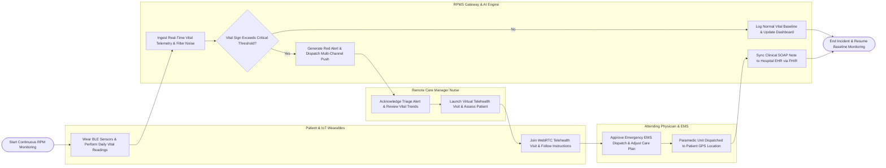

# Swimlane Diagram — Remote Patient Monitoring System

## Mermaid Code

## Flow Description | Mô tả luồng

| Lane | Actor / Subsystem | Role in Flow |
|------|-------------------|--------------|
| 1 | Patient & IoT Wearables | Wears cellular/BLE medical sensors, performs daily vital sign measurements (BP, SpO2, weight), receives alert notifications, and participates in virtual telehealth calls. |
| 2 | RPMS Gateway & AI Engine | Continuously ingests vital sign telemetry streams, applies noise filtering, checks values against personalized thresholds, generates multi-channel alerts, and syncs FHIR summaries to EHR. |
| 3 | Remote Care Manager Nurse | Monitors real-time clinical triage dashboard, acknowledges vital alerts within SLA, launches emergency WebRTC telehealth video visits, and logs SOAP progress notes. |
| 4 | Attending Physician & EMS | Reviews critical arrhythmia/deterioration alerts, approves emergency EMS dispatch payloads, adjusts clinical care plan orders, and signs off on monthly billing logs. |
