# Action Tree — Remote Patient Monitoring System

## Mermaid Code

```mermaid
graph TD
    Root["Remote Patient Monitoring System"]

    Root --> M1["Patient Enrollment & IoT Kit Provisioning"]
    Root --> M2["Continuous Telemetry & Data Ingestion"]
    Root --> M3["Threshold Configuration & Alert Engine"]
    Root --> M4["Clinical Triage & Telehealth Studio"]
    Root --> M5["AI Clinical Analytics & ECG Diagnosis"]
    Root --> M6["Emergency Response & EMS Dispatch"]
    Root --> M7["EHR Integration & FHIR Sync"]
    Root --> M8["CPT Reimbursement & Compliance Audit"]

    M1 --> A11["Enroll Chronic Care Patients in RPM Program"]
    M1 --> A12["Assign ICD-10 Chronic Care Protocols"]
    M1 --> A13["Pair BLE Cellular IoT Medical Wearables"]
    M1 --> A14["Verify Cellular Gateway Transmission Test"]

    M2 --> A21["Ingest Real-Time MQTT Telemetry Streams"]
    M2 --> A22["Filter Sensor Motion Artifact Noise"]
    M2 --> A23["Store Time-Series Vital Measurements"]
    M2 --> A24["Buffer Offline Store-and-Forward Payloads"]

    M3 --> A31["Configure Personalized Vital Threshold Rules"]
    M3 --> A32["Set Multi-Tier Alert Escalation Pathways"]
    M3 --> A33["Detect Acute Physiological Deterioration"]
    M3 --> A34["Dispatch Multi-Channel Push SMS Notifications"]

    M4 --> A41["Generate Risk-Prioritized Triage Dashboard"]
    M4 --> A42["Launch Encrypted WebRTC Video Consultation"]
    M4 --> A43["Overlay Real-Time Live Vitals on Video Call"]
    M4 --> A44["Document Telehealth Clinical SOAP Notes"]

    M5 --> A51["Analyze Continuous 24-Hour ECG Waveforms"]
    M5 --> A52["Classify AI Arrhythmia Events AFib VTach"]
    M5 --> A53["Calculate Early Warning Deterioration Scores"]
    M5 --> A54["Generate Physician Arrhythmia Summary Report"]

    M6 --> A61["Trigger Automated Emergency IVR Voice Call"]
    M6 --> A62["Verify Patient Consciousness & Responsiveness"]
    M6 --> A63["Transmit GPS Location & Profile to EMS"]
    M6 --> A64["Track Ambulance Dispatch & Paramedic ETA"]

    M7 --> A71["Sync RPM Vitals via HL7 FHIR Observation"]
    M7 --> A72["Import Patient Demographics & EMR History"]
    M7 --> A73["Export Telehealth Encounter Notes to EHR"]
    M7 --> A74["Audit Integration Logs & FHIR Telemetry"]

    M8 --> A81["Track Monthly RPM Transmission Days CPT 99454"]
    M8 --> A82["Accumulate Clinician Review Minutes CPT 99457"]
    M8 --> A83["Generate Monthly CPT Reimbursement Claim"]
    M8 --> A84["Audit Patient Device Engagement & Compliance"]
```

## Module Description | Mô tả Module

| # | Module | Description | Actions |
|---|--------|-------------|---------|
| 1 | Patient Enrollment & IoT Kit Provisioning | Enrolls chronic disease patients into RPM protocols, pairs cellular IoT medical wearables, and verifies gateway connectivity. | Enroll Chronic Care Patients in RPM Program, Assign ICD-10 Chronic Care Protocols, Pair BLE Cellular IoT Medical Wearables, Verify Cellular Gateway Transmission Test |
| 2 | Continuous Telemetry & Data Ingestion | Ingests real-time MQTT telemetry streams, filters sensor motion artifacts, stores time-series vital measurements, and buffers offline packets. | Ingest Real-Time MQTT Telemetry Streams, Filter Sensor Motion Artifact Noise, Store Time-Series Vital Measurements, Buffer Offline Store-and-Forward Payloads |
| 3 | Threshold Configuration & Alert Engine | Configures personalized physiological thresholds, sets multi-tier alert escalation pathways, detects acute anomalies, and dispatches notifications. | Configure Personalized Vital Threshold Rules, Set Multi-Tier Alert Escalation Pathways, Detect Acute Physiological Deterioration, Dispatch Multi-Channel Push SMS Notifications |
| 4 | Clinical Triage & Telehealth Studio | Generates risk-prioritized triage rosters, launches WebRTC video check-ins with live vital overlays, and documents clinical SOAP notes. | Generate Risk-Prioritized Triage Dashboard, Launch Encrypted WebRTC Video Consultation, Overlay Real-Time Live Vitals on Video Call, Document Telehealth Clinical SOAP Notes |
| 5 | AI Clinical Analytics & ECG Diagnosis | Analyzes 24-hour ECG waveforms, classifies AI arrhythmia events (AFib, VTach), calculates deterioration scores, and generates physician reports. | Analyze Continuous 24-Hour ECG Waveforms, Classify AI Arrhythmia Events AFib VTach, Calculate Early Warning Deterioration Scores, Generate Physician Arrhythmia Summary Report |
| 6 | Emergency Response & EMS Dispatch | Triggers automated IVR voice calls, checks patient responsiveness, transmits GPS location to 911/EMS, and tracks ambulance dispatch status. | Trigger Automated Emergency IVR Voice Call, Verify Patient Consciousness & Responsiveness, Transmit GPS Location & Profile to EMS, Track Ambulance Dispatch & Paramedic ETA |
| 7 | EHR Integration & FHIR Sync | Synchronizes RPM vital observations to hospital EHRs using HL7 FHIR R4 interfaces, imports patient EMR history, and exports encounter SOAP notes. | Sync RPM Vitals via HL7 FHIR Observation, Import Patient Demographics & EMR History, Export Telehealth Encounter Notes to EHR, Audit Integration Logs & FHIR Telemetry |
| 8 | CPT Reimbursement & Compliance Audit | Tracks monthly transmission days (CPT 99454) and clinician review minutes (CPT 99457/99458), generates billing claims, and audits compliance. | Track Monthly RPM Transmission Days CPT 99454, Accumulate Clinician Review Minutes CPT 99457, Generate Monthly CPT Reimbursement Claim, Audit Patient Device Engagement & Compliance |
