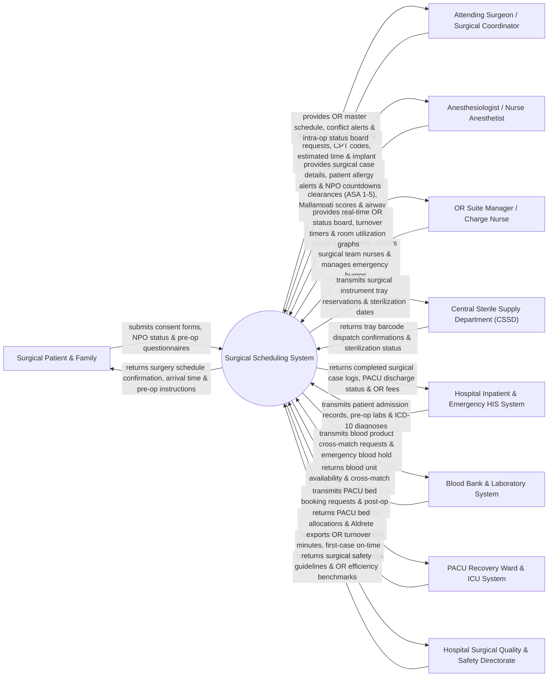

# Context Diagram — Surgical Scheduling System

## Mermaid Code

## Actor & Interaction Table | Bảng Actor & Tương tác

| # | Actor | Actor Type | Data Sent TO System | Data Received FROM System | Notes |
|---|-------|------------|---------------------|---------------------------|-------|
| 1 | Surgical Patient & Family | Primary | Surgical consent forms, NPO (fasting) status verification, pre-op health questionnaire answers. | Confirmed surgery date/time, arrival instructions, post-op PACU recovery status updates. | Patient undergoing elective or emergency surgical procedures and family representatives. |
| 2 | Attending Surgeon / Surgical Coordinator | Primary | Surgical booking requests, CPT procedure codes, estimated surgery duration, required equipment/implants. | Operating room master schedule, conflict alerts, real-time intra-operative status tracking. | Specialist surgeon or surgical coordinator booking procedures and performing operations. |
| 3 | Anesthesiologist / Nurse Anesthetist | Primary | Pre-operative anesthesia evaluation, ASA Physical Status classification (ASA 1-5), airway clearance, NPO verification. | Surgical booking roster, patient allergy warnings, lab blood work, NPO time countdowns. | Medical specialist evaluating patient anesthesia fitness and administering intra-op anesthesia. |
| 4 | OR Suite Manager / Charge Nurse | Primary | Room assignments (OR 1-12), nurse staffing rosters (Scrub & Circulating nurses), emergency case bumps. | Real-time OR status board, OR turnover timers, first-case on-time start metrics, utilization graphs. | Head nurse overseeing daily operating room suite operations, room turnovers, and emergency cases. |
| 5 | Central Sterile Supply Department (CSSD) | Supporting System | Instrument tray barcode dispatch confirmations, sterilization cycle validation, tray availability status. | Surgical instrument tray reservations, special surgical tool requirements, case setup times. | Hospital department sterilizing, packing, and delivering surgical instrument trays to OR suites. |
| 6 | Hospital Inpatient & Emergency HIS System | Supporting System | Patient admission demographic records, pre-op lab chemistry, pathology reports, primary ICD-10 diagnosis. | Completed surgical case logs, surgical CPT codes, PACU transfer notes, itemized OR billing feeds. | Enterprise hospital information system managing inpatient admissions and emergency referrals. |
| 7 | Blood Bank & Laboratory System | Supporting System | Blood unit cross-match availability (Packed Red Blood Cells - PRBC), coagulation lab panels (PT/INR, PTT). | Pre-op blood cross-match hold requests, emergency blood product dispatch orders. | Hospital laboratory and blood bank ensuring blood product availability prior to surgery. |
| 8 | PACU Recovery Ward & ICU System | Supporting System | PACU bed availability, Aldrete recovery score clearances, post-op ICU bed reservations. | Expected PACU patient arrivals, post-op recovery parameter handovers, surgical case completions. | Post-Anesthesia Care Unit (PACU) and Intensive Care Unit (ICU) managing post-operative recovery. |
| 9 | Surgical Quality & Safety Directorate | Regulatory | Surgical WHO Safety Checklist compliance rules, target OR turnover time limits, safety standards. | First-case on-time start %, OR cancellation rate reports, Surgical Site Infection (SSI) audit feeds. | Hospital administrative body monitoring surgical safety, WHO checklist compliance, and OR efficiency. |

## System Boundary Description | Mô tả Phạm vi Hệ thống

The **Surgical Scheduling System (SSS)** is an enterprise clinical workflow platform designed for hospital Operating Room (OR) suites, ambulatory surgery centers, and surgical departments. It manages master OR block time scheduling, resolves equipment/staffing scheduling conflicts, processes pre-operative anesthesia clearance (ASA 1-5), coordinates Central Sterile Supply Department (CSSD) instrument tray setup, tracks real-time intra-operative milestones (Pre-op, Cut time, Out-to-PACU), handles emergency surgical bumps, and manages Post-Anesthesia Care Unit (PACU) recovery bed allocations.

**Inside System Scope:**
- Master OR block time allocation and surgical room reservation (Elective vs Emergency slots).
- Pre-operative anesthesia evaluation, ASA Physical Status classification, and NPO compliance tracking.
- Automated scheduling conflict detection for Surgeons, Anesthesiologists, Scrub Nurses, and Equipment.
- CSSD surgical instrument tray reservation, barcode tracking, and special implant requisition.
- Real-time intra-operative status display board (Patient In-Room, Anesthesia Start, Surgical Cut, Dressing, PACU Transfer).
- Emergency surgical case insertion and elective case bump/rescheduling workflows.
- Post-Anesthesia Care Unit (PACU) bed reservation and Aldrete recovery score tracking.
- OR efficiency analytics (First-case on-time start %, room turnover minutes, block utilization %).

**Outside System Scope:**
- Physical execution of surgical incisions or suturing (performed by surgeons in OR).
- Physical autoclaving and steam sterilization of instrument trays inside CSSD (handled by CSSD hardware).
- Post-discharge long-term outpatient rehabilitation (handled by Physiotherapy System).
- General hospital financial general ledger accounting (handled by enterprise ERP).
