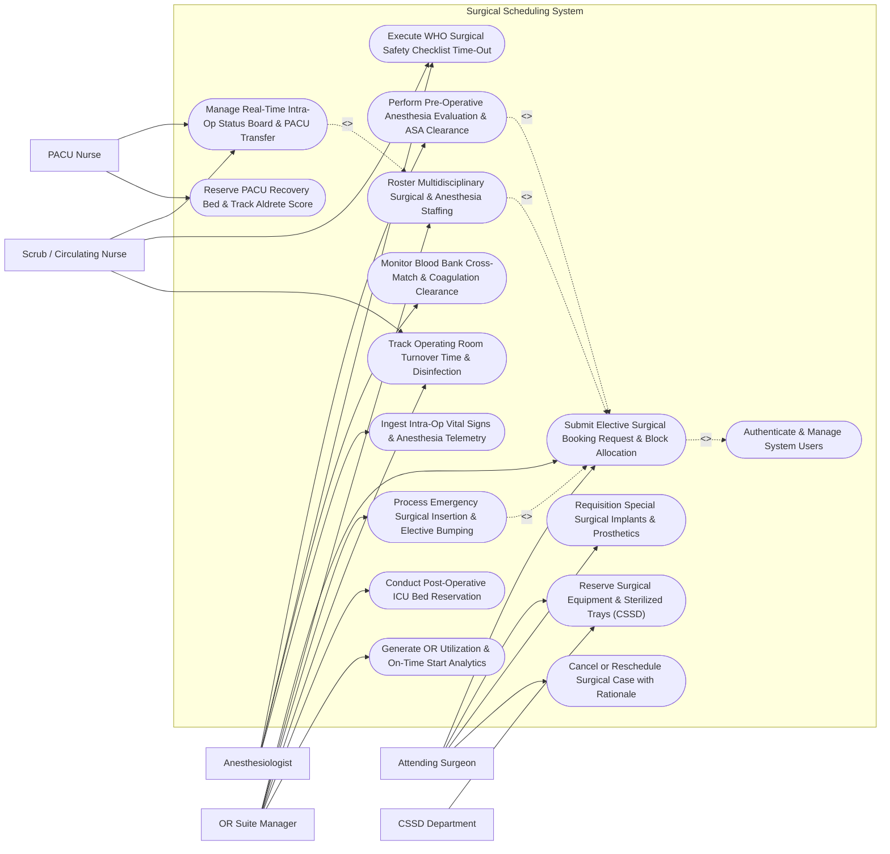

# Use Case Diagram — Surgical Scheduling System

## Mermaid Code

## Actor Table | Bảng Actor

| # | Actor | Actor Type | Role Description | Related Use Cases |
|---|-------|------------|------------------|-------------------|
| 1 | Attending Surgeon | Primary | Specialist physician booking surgical cases, selecting CPT procedure codes, requisitioning implants, and operating. | UC01, UC03, UC11, UC12 |
| 2 | Anesthesiologist | Primary | Specialist physician evaluating pre-op anesthesia fitness, assigning ASA physical status (1-5), and managing intra-op anesthesia. | UC02, UC07, UC09, UC14 |
| 3 | OR Suite Manager | Primary | Charge nurse/manager allocating OR rooms, managing master block schedules, staffing teams, and handling emergency bumps. | UC01, UC04, UC06, UC10, UC13, UC15 |
| 4 | Scrub / Circulating Nurse | Primary | OR nurse verifying WHO safety checklists, logging intra-op milestones (Cut time, Count), and tracking room turnover. | UC05, UC07, UC10 |
| 5 | CSSD Department | Secondary / System | Central Sterile Supply Department verifying instrument tray sterilization, barcode scanning, and delivering trays to OR suites. | UC03 |
| 6 | PACU Nurse | Secondary / System | Post-Anesthesia Care Unit nurse receiving post-op patients, monitoring Aldrete recovery scores, and authorizing discharge. | UC05, UC08 |

## Use Case Table | Bảng Use Case

| # | UC ID | Use Case Name | Primary Actor | Secondary Actor | Description | Priority |
|---|-------|---------------|---------------|-----------------|-------------|----------|
| 1 | UC01 | Submit Elective Surgical Booking Request & Block Allocation | Attending Surgeon | OR Suite Manager | Submit surgical case details (CPT codes, estimated duration), reserve OR room time block, and verify room availability. | High |
| 2 | UC02 | Perform Pre-Operative Anesthesia Evaluation & ASA Clearance | Anesthesiologist | None | Evaluate patient airway, Mallampati score, NPO status, lab results, and assign ASA Physical Status Classification (ASA 1-5). | High |
| 3 | UC03 | Reserve Surgical Equipment & Sterilized Trays (CSSD) | Attending Surgeon | CSSD Department | Book specialized equipment (Laparoscopic towers, C-Arm, Da Vinci Robot) and reserve sterilized CSSD instrument trays by barcode. | High |
| 4 | UC04 | Roster Multidisciplinary Surgical & Anesthesia Staffing | OR Suite Manager | None | Assign primary/assistant surgeons, anesthesiologist, scrub nurse, and circulating nurse, checking for credentialing conflicts. | High |
| 5 | UC05 | Manage Real-Time Intra-Op Status Board & PACU Transfer | Scrub / Circulating Nurse | PACU Nurse | Update real-time OR status (In-Room, Anesthesia Start, Surgical Cut, Dressing, PACU Transfer) and alert PACU recovery. | High |
| 6 | UC06 | Process Emergency Surgical Insertion & Elective Bumping | OR Suite Manager | None | Insert emergency STAT surgery into active schedule, auto-bumping elective cases and notifying affected surgical teams. | High |
| 7 | UC07 | Execute WHO Surgical Safety Checklist Time-Out | Anesthesiologist | Scrub / Circulating Nurse | Perform 3-phase WHO Surgical Safety Checklist (Sign-In before anesthesia, Time-Out before incision, Sign-Out before room exit). | High |
| 8 | UC08 | Reserve PACU Recovery Bed & Track Aldrete Score | PACU Nurse | None | Reserve PACU bed prior to surgery completion and track Aldrete recovery score (respiration, O2 saturation, BP, consciousness). | High |
| 9 | UC09 | Monitor Blood Bank Cross-Match & Coagulation Clearance | Anesthesiologist | None | Verify pre-op blood product reservation (Packed Red Blood Cells) and check coagulation panels (PT/INR) prior to incision. | High |
| 10 | UC10 | Track Operating Room Turnover Time & Disinfection | Scrub / Circulating Nurse | OR Suite Manager | Track room turnover duration (Wheels-Out to Wheels-In), log terminal cleaning disinfection, and issue room clean clearance. | Medium |
| 11 | UC11 | Requisition Special Surgical Implants & Prosthetics | Attending Surgeon | None | Order specialized orthopedic joint implants, vascular stents, or mesh, logging manufacturer lot numbers and size specs. | Medium |
| 12 | UC12 | Cancel or Reschedule Surgical Case with Rationale | Attending Surgeon | None | Cancel or reschedule a booked surgery due to patient acute illness, NPO violation, or emergency bump, logging rationale. | Medium |
| 13 | UC13 | Conduct Post-Operative ICU Bed Reservation | OR Suite Manager | None | Reserve post-op ICU bed for high-risk patients (ASA 4/5 or major cardiac/neuro cases) prior to surgical incision. | High |
| 14 | UC14 | Ingest Intra-Op Vital Signs & Anesthesia Telemetry | Anesthesiologist | None | Stream automated anesthesia machine telemetry (SpO2, End-Tidal CO2, Invasive BP, Sevoflurane gas conc) into the surgical record. | Medium |
| 15 | UC15 | Generate OR Utilization & On-Time Start Analytics | OR Suite Manager | None | Render OR performance analytics: First-Case On-Time Start %, room turnover minutes, block utilization %, and cancellation rates. | Medium |
| 16 | UC16 | Authenticate & Manage System Users | All Users | None | Enforce multi-factor authentication, role-based access control (Surgeon, Anesthesiologist, Nurse), and HIPAA audit logs. | High |

## Use Case Specification | Đặc tả Use Case

---

### UC01 — Submit Elective Surgical Booking Request & Block Allocation

| Field | Detail |
|-------|--------|
| **UC ID** | UC01 |
| **Use Case Name** | Submit Elective Surgical Booking Request & Block Allocation |
| **Actor(s)** | Primary: Attending Surgeon   Secondary: OR Suite Manager |
| **Description** | Submits an elective surgical booking request, entering procedure details, primary/secondary CPT codes, estimated surgery duration (minutes), required patient position, special equipment requirements, and reserving an OR room within the department’s allocated block time. |
| **Precondition** | 1. The patient has an inpatient or outpatient admission record.   2. The Surgeon is authenticated in SSS with active surgical privileges for requested CPT codes. |
| **Main Flow** | 1. The Surgeon opens "New Surgical Case Booking" in SSS.   2. The Surgeon enters Patient ID (PAT-2026-08192) and Primary Diagnosis: `ICD-10 M17.11 (Osteoarthritis Right Knee)`.   3. The Surgeon selects Primary Procedure: **Total Knee Arthroplasty (CPT 27447)** and Secondary Procedure: *Synovectomy (CPT 27403)*.   4. The Surgeon inputs Estimated Surgery Duration: 120 Minutes (plus 30-min setup/cleanup = Total Block Time 150 Mins).   5. The System checks **Master OR Block Schedule**:   &nbsp;&nbsp;&nbsp;&nbsp;- Department Block: Orthopedic Block (OR Suite #04)   &nbsp;&nbsp;&nbsp;&nbsp;- Date: October 14, 2026   &nbsp;&nbsp;&nbsp;&nbsp;- Slot: 08:00 AM - 10:30 AM (First Case of Day).   6. The System runs **Automated Scheduling Conflict Detection**: Checks Surgeon availability, Anesthesiologist availability, and OR 04 room availability -> No Conflicts Found.   7. The Surgeon attaches required Equipment Reservations (UC03): C-Arm Fluoroscopy, Orthopedic Power Drill Set.   8. The Surgeon submits booking, and the System updates status to "Booked - Pending Anesthesia Clearance" (UC02). |
| **Alternative Flow** | **AF1** — Out-of-Block Open Scheduling Request: The Surgeon requests a surgery time outside their department's block; the System routes the request to the OR Suite Manager for open-table authorization.   **AF2** — Bilateral / Multi-Surgeon Procedure: For complex spine reconstruction involving Orthopedics and Neurosurgery, the System rosters two co-surgeons and locks 6 hours of block time across two consecutive slots. |
| **Exception Flow** | **EX1** — Double-Booking Conflict Detected: If the selected Surgeon is already booked in OR 02 during the same time slot, the System blocks submission and flashes "Surgeon Schedule Conflict in OR 02".   **EX2** — Unaccredited CPT Procedure Code: If the Surgeon attempts to book a Robotic Surgery (CPT 57198) without robotic credentialing certification, the System blocks booking. |
| **Postcondition** | Surgical case is created with unique Case ID (e.g., CASE-2026-09182), OR room block time is reserved, conflict checks pass, and case is queued for anesthesia clearance. |
| **Business Rule** | **BR1**: Elective surgical booking requests MUST be submitted at least 48 hours prior to scheduled surgical date to allow CSSD tray preparation and anesthesia evaluation.   **BR2**: Surgeons shall not be double-booked across multiple operating rooms simultaneously unless an assistant surgeon is officially assigned. |

---

### UC02 — Perform Pre-Operative Anesthesia Evaluation & ASA Clearance

| Field | Detail |
|-------|--------|
| **UC ID** | UC02 |
| **Use Case Name** | Perform Pre-Operative Anesthesia Evaluation & ASA Clearance |
| **Actor(s)** | Primary: Anesthesiologist |
| **Description** | Evaluates the patient's pre-operative anesthesia fitness, assessing airway risk (Mallampati Score I-IV), NPO (fasting) compliance, pre-op lab/ECG results, assigning ASA Physical Status Classification (ASA 1 to 5, plus E flag for Emergency), and issuing an Anesthesia Clearance Certificate. |
| **Precondition** | 1. A surgical case is booked (UC01).   2. Pre-op lab results (CBC, Coagulation PT/INR) and ECG are loaded from EHR. |
| **Main Flow** | 1. The Anesthesiologist opens "Pre-Op Anesthesia Evaluation" for Case CASE-2026-09182.   2. The Anesthesiologist reviews Pre-Op Diagnostic Results: Hemoglobin 13.2 g/dL, PT/INR 1.0 (Normal), Normal 12-Lead ECG.   3. The Anesthesiologist performs **Airway Assessment**:   &nbsp;&nbsp;&nbsp;&nbsp;- **Mallampati Score**: Class II (Soft palate, fauces, uvula visible)   &nbsp;&nbsp;&nbsp;&nbsp;- Thyromental Distance > 6 cm   &nbsp;&nbsp;&nbsp;&nbsp;- Cervical Spine Mobility: Full range.   4. The Anesthesiologist verifies **NPO (Fasting) Compliance**: Solid food stopped 8 hours prior; clear liquids stopped 2 hours prior -> NPO Verified.   5. The Anesthesiologist assigns **ASA Physical Status Classification**:   &nbsp;&nbsp;&nbsp;&nbsp;- **ASA 1**: Normal Healthy Patient   &nbsp;&nbsp;&nbsp;&nbsp;- **ASA 2**: Patient with Mild Systemic Disease (Controlled Hypertension) -> Selected: **ASA 2**   &nbsp;&nbsp;&nbsp;&nbsp;- **ASA 3**: Severe Systemic Disease   &nbsp;&nbsp;&nbsp;&nbsp;- **ASA 4**: Severe Systemic Disease constant threat to life   &nbsp;&nbsp;&nbsp;&nbsp;- **ASA 5**: Moribund patient not expected to survive without operation.   6. The Anesthesiologist selects Anesthesia Plan: General Endotracheal Anesthesia (GETA) + Lumbar Epidural Analgesia.   7. The Anesthesiologist signs the evaluation, and the System updates case status to "Anesthesia Cleared - Ready for OR". |
| **Alternative Flow** | **AF1** — High Risk ASA 4 / ICU Bed Reservation Required: If patient is ASA 4 (Severe Heart Failure), the System mandates automated Post-Op ICU Bed Reservation (UC13) before clearance sign-off.   **AF2** — Pre-Op Blood Cross-Match Requirement: For high-blood-loss surgeries (Total Hip), the Anesthesiologist orders 2 Units Packed Red Blood Cells (PRBC) cross-matched at Blood Bank (UC09). |
| **Exception Flow** | **EX1** — NPO Fasting Violation (Recent Solid Intake): Patient ate breakfast 3 hours ago; the Anesthesiologist flags "NPO Violation", delaying surgery start time by 5 hours.   **EX2** — Uncontrolled Coagulopathy (INR > 2.5): If pre-op INR is 2.8, the Anesthesiologist rejects clearance, issuing "Anesthesia Hold - Reverse Warfarin / Administer Vitamin K". |
| **Postcondition** | Anesthesia evaluation is documented, ASA class is assigned, NPO status is verified, and Anesthesia Clearance Certificate is attached to the surgical record. |
| **Business Rule** | **BR1**: Elective surgeries MUST NOT proceed to incision without an Anesthesia Clearance Certificate signed by a licensed Anesthesiologist.   **BR2**: Solid food fasting NPO guidelines (minimum 6 hours for light meal, 8 hours for heavy meal) must be verified prior to general anesthesia induction. |

---

### UC03 — Reserve Surgical Equipment & Sterilized Instrument Trays (CSSD)

| Field | Detail |
|-------|--------|
| **UC ID** | UC03 |
| **Use Case Name** | Reserve Surgical Equipment & Sterilized Instrument Trays (CSSD) |
| **Actor(s)** | Primary: Attending Surgeon   Secondary: CSSD Department |
| **Description** | Reserves specialized surgical equipment (Laparoscopic towers, C-Arm Fluoroscopy, Surgical Robots) and sterilized CSSD instrument trays (Major Bone Set, Vascular Set) for a scheduled case, verifying tray sterilization expiration dates and barcode dispatch to the OR. |
| **Precondition** | 1. A surgical case is booked (UC01).   2. CSSD inventory and hospital medical equipment registries are active. |
| **Main Flow** | 1. The Surgeon or Surgical Coordinator opens "Equipment & Instrument Reservation" for Case CASE-2026-09182.   2. The System loads standard preference card requirements for *Total Knee Arthroplasty (CPT 27447)*.   3. The Surgeon confirms **Major Equipment Reservations**:   &nbsp;&nbsp;&nbsp;&nbsp;- Mobile C-Arm Fluoroscopy X-Ray Unit (EQ-CARM-02)   &nbsp;&nbsp;&nbsp;&nbsp;- Pneumatic Tourniquet System (EQ-TOURN-01)   &nbsp;&nbsp;&nbsp;&nbsp;- Orthopedic Power Saw & Drill System.   4. The System queries CSSD Inventory for **Sterilized Instrument Trays**:   &nbsp;&nbsp;&nbsp;&nbsp;- **Tray 1**: Major Joint Instrument Set (Barcode: `CSSD-TR-99182`, Sterilized: Oct 12, Exp: Oct 26 -> Active)   &nbsp;&nbsp;&nbsp;&nbsp;- **Tray 2**: Knee Reaming Instrument Set (Barcode: `CSSD-TR-99183`).   5. The System checks for equipment scheduling conflicts across all OR suites during the 08:00 AM - 10:30 AM window -> All Equipment Available.   6. The System locks equipment reservations and dispatches an electronic **CSSD Pick Ticket** to the sterile warehouse.   7. CSSD staff scan the pick ticket barcodes, assemble the case cart, and deliver the sterile cart to OR Suite 04 at 07:15 AM (45 mins prior to case). |
| **Alternative Flow** | **AF1** — Special Custom Implant Requisition: For a custom joint replacement, the Surgeon attaches an order for manufacturer specialized implants (UC11); the System alerts the Implant Vendor for 24-hour advance delivery.   **AF2** — Robotic Surgical Suite Allocation: For Da Vinci Xi Robotic Prostatectomy, the System reserves OR Suite 01 (Robotic Suite) and locks the Da Vinci Console and Arm Cart. |
| **Exception Flow** | **EX1** — C-Arm Fluoroscopy Conflict Error: If C-Arm #02 is already reserved in OR 06 at 08:30 AM, the System alerts "Equipment Conflict" and prompts selection of C-Arm #03.   **EX2** — Expired CSSD Sterilization Cycle: If the assigned tray's sterilization expiration date is past, the CSSD System blocks dispatch and flags "Sterilization Cycle Expired — Re-Autoclave Required". |
| **Postcondition** | Medical equipment and CSSD instrument trays are reserved, pick tickets are sent to CSSD, barcode dispatch is confirmed, and equipment is delivered to OR. |
| **Business Rule** | **BR1**: High-demand shared surgical equipment (C-Arm, Lap Towers, Robots) MUST NOT be double-booked across overlapping OR time slots.   **BR2**: CSSD instrument trays with expired sterilization dates (> 14 days post-autoclave without barrier wrap) MUST be re-sterilized before OR delivery. |

---

### UC04 — Roster Multidisciplinary Surgical & Anesthesia Team Staffing

| Field | Detail |
|-------|--------|
| **UC ID** | UC04 |
| **Use Case Name** | Roster Multidisciplinary Surgical & Anesthesia Team Staffing |
| **Actor(s)** | Primary: OR Suite Manager |
| **Description** | Rosters and assigns the complete multidisciplinary clinical team for a scheduled surgical case, assigning Primary Surgeon, Assistant Surgeon, Attending Anesthesiologist, Certified Registered Nurse Anesthetist (CRNA), Scrub Nurse, and Circulating Nurse, verifying clinical credentials and shift availability. |
| **Precondition** | 1. A surgical case is booked (UC01) and cleared (UC02).   2. Clinical staff shift rosters and credentialing records are active. |
| **Main Flow** | 1. The OR Suite Manager opens "Daily OR Staffing Roster" for Date: October 14, 2026.   2. The Manager selects Case CASE-2026-09182 (Total Knee Arthroplasty, OR Suite 04, 08:00 AM).   3. The Manager assigns Team Members across required roles:   &nbsp;&nbsp;&nbsp;&nbsp;- **Primary Surgeon**: Dr. Pham Van Duc (Orthopedic Specialist)   &nbsp;&nbsp;&nbsp;&nbsp;- **Assistant Surgeon**: Dr. Le Hoang Nam (Resident)   &nbsp;&nbsp;&nbsp;&nbsp;- **Attending Anesthesiologist**: Dr. Nguyen Thi Mai   &nbsp;&nbsp;&nbsp;&nbsp;- **Scrub Nurse**: Nurse Tran Thu Ha (Certified Orthopedic Scrub)   &nbsp;&nbsp;&nbsp;&nbsp;- **Circulating Nurse**: Nurse Vo Van Minh.   4. The System verifies **Credentialing & Shift Rules**:   &nbsp;&nbsp;&nbsp;&nbsp;- Verifies Dr. Duc's active Orthopedic Surgery privileges -> PASS   &nbsp;&nbsp;&nbsp;&nbsp;- Checks Nurse Ha's shift hours (Shift: 07:00 AM - 03:00 PM, No Overtime Breach) -> PASS   &nbsp;&nbsp;&nbsp;&nbsp;- Checks for overlapping assignments across all OR suites -> PASS.   5. The Manager publishes the roster.   6. The System dispatches push notifications and schedule updates to all 5 team members' mobile devices. |
| **Alternative Flow** | **AF1** — On-Call Emergency Staff Roster: For a 02:00 AM emergency trauma case, the Manager activates the "On-Call Emergency Surgical Roster", auto-dialing duty surgeons and nurses.   **AF2** — Resident Training Supervisory Assignment: The Manager assigns a surgical resident as primary operator under direct 1-to-1 supervision of the attending faculty surgeon. |
| **Exception Flow** | **EX1** — Staff Overtime / Fatigue Rest Violation: If Nurse Minh has worked 16 consecutive hours, the System blocks assignment with error "Fatigue Mandatory Rest Period Violation (Min 8 Hours Rest Required)".   **EX2** — Lapsed Specialty License Alert: If the Anesthesiologist's medical license is unverified, the System blocks roster confirmation. |
| **Postcondition** | Complete 5-member surgical team is rostered, credentialing and shift rules are verified, and mobile schedule notifications are dispatched. |
| **Business Rule** | **BR1**: Every operating room case MUST have a minimum of 4 assigned staff: Primary Surgeon, Anesthesiologist, Scrub Nurse, and Circulating Nurse.   **BR2**: Clinical staff shall not be scheduled for OR duties if duty hours exceed 12 consecutive hours without a mandatory 8-hour rest period. |

---

### UC05 — Manage Real-Time Intra-Operative Status Board & PACU Transfer

| Field | Detail |
|-------|--------|
| **UC ID** | UC05 |
| **Use Case Name** | Manage Real-Time Intra-Operative Status Board & PACU Transfer |
| **Actor(s)** | Primary: Scrub / Circulating Nurse   Secondary: PACU Nurse |
| **Description** | Tracks and updates real-time intra-operative clinical milestones (Patient In-Room, Anesthesia Induction, Surgical Cut, Procedure End, Patient Out-to-PACU) on hospital status displays, coordinates WHO Time-Out checks, and executes PACU recovery bed transfer. |
| **Precondition** | 1. The surgical team and patient are present in the OR suite.   2. The OR touch-screen terminal is active. |
| **Main Flow** | 1. The Circulating Nurse logs into the OR 04 Touch-Screen Terminal for Case CASE-2026-09182.   2. As the case progresses, the Nurse taps timestamp buttons to record **Milestone Timestamps**:   &nbsp;&nbsp;&nbsp;&nbsp;- `07:45 AM`: **Patient In-Room** (Status Board changes to *In-Room (Blue)*)   &nbsp;&nbsp;&nbsp;&nbsp;- `08:00 AM`: **Anesthesia Induction Start** (*Anesthesia (Yellow)*)   &nbsp;&nbsp;&nbsp;&nbsp;- `08:20 AM`: **WHO Time-Out Completed** (UC07)   &nbsp;&nbsp;&nbsp;&nbsp;- `08:25 AM`: **Surgical Incision / Cut Time** (*In-Surgery (Red)*)   &nbsp;&nbsp;&nbsp;&nbsp;- `10:15 AM`: **Surgical Closure / Dressing Complete** (*Closing (Orange)*)   &nbsp;&nbsp;&nbsp;&nbsp;- `10:25 AM`: **Anesthesia Emergence / Extubation**.   3. The System auto-updates the **Family Waiting Room Display Board** (showing anonymized Case ID CASE-09182: *Surgery Complete - Transferring to PACU*).   4. At 10:15 AM, the System dispatches an automated **PACU Arrival Alert** to PACU Recovery Bed 04 (UC08).   5. The Circulating Nurse taps `10:30 AM`: **Patient Out-of-Room to PACU**.   6. The System changes OR Suite 04 status to "Room Turnover / Disinfection Required" (UC10) and starts the **Room Turnover Timer** (Target <= 25 mins). |
| **Alternative Flow** | **AF1** — Intra-Op Surgical Extension (> 60 Mins Over Estimate): Surgery takes 60 minutes longer than estimated (180 mins total); the Nurse updates "Extended Duration", and the System auto-adjusts downstream OR 04 case start times.   **AF2** — Intra-Op Frozen Section Pathology Request: Surgeon requests intra-op frozen tissue biopsy; the Nurse logs "Pathology Specimen Sent", tracking 20-minute lab turnaround time. |
| **Exception Flow** | **EX1** — Intra-Op Cardiac Arrest / Emergency Code Blue: Patient suffers intra-op cardiac arrest; the Nurse taps "CODE BLUE EMERGENCY", auto-alerting ICU intensivist and resuscitation team.   **EX2** — PACU Bed Unavailable Hold: If PACU is 100% full when surgery completes, the System alerts "PACU Hold", keeping patient in OR under anesthesia care until PACU bed clears. |
| **Postcondition** | Intra-operative milestone timestamps are logged, status displays are updated in real time, PACU handover is triggered, and OR turnover timer is started. |
| **Business Rule** | **BR1**: Intra-operative milestone timestamps (In-Room, Anesthesia, Cut, Closure, Out-of-Room) MUST be logged in real-time within 5 minutes of occurrence.   **BR2**: Patient out-of-room transfer to PACU MUST NOT occur without a confirmed PACU bed reservation and receiving PACU nurse sign-off. |
