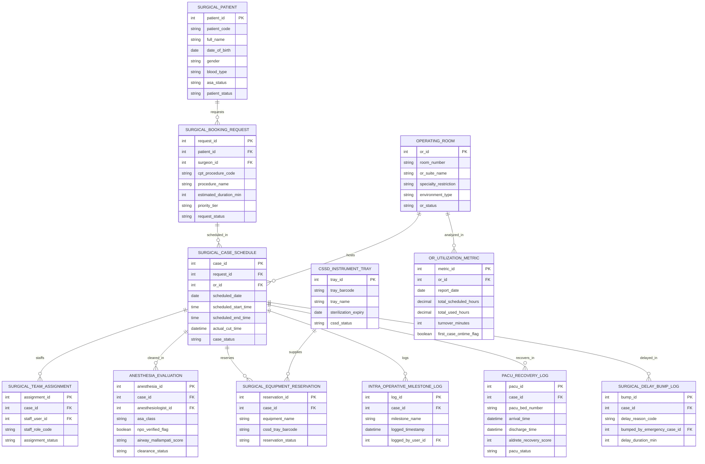

# Conceptual ERD — Surgical Scheduling System

## Mermaid Code

## Entity Description Table | Bảng mô tả Entity

| # | Entity Name | Vietnamese Name | Description | Key Attributes | Main Relationships |
|---|-------------|-----------------|-------------|----------------|-------------------|
| 1 | SURGICAL_PATIENT | Bệnh nhân Phẫu thuật Master | Master surgical patient record storing patient code, full name, DOB, gender, blood type, ASA status, and patient status. | patient_id, patient_code, full_name, dob, gender, blood_type, asa_status, patient_status | Has many SURGICAL_BOOKING_REQUEST entities. |
| 2 | OPERATING_ROOM | Phòng Phẫu thuật (OR Room) | Operating room suite master record tracking room number, suite name, specialty restriction (Orthopedics, Neuro), environment type, and OR status. | or_id, room_number, or_suite_name, specialty_restriction, environment_type, or_status | Has SURGICAL_CASE_SCHEDULE and OR_UTILIZATION_METRIC entities. |
| 3 | SURGICAL_BOOKING_REQUEST | Yêu cầu Đặt lịch Phẫu thuật | Surgical case booking request submitted by surgeon tracking CPT procedure code, procedure name, estimated duration min, priority tier, and status. | request_id, patient_id, surgeon_id, cpt_procedure_code, procedure_name, estimated_duration_min, request_status | Belongs to SURGICAL_PATIENT; Has SURGICAL_CASE_SCHEDULE. |
| 4 | SURGICAL_CASE_SCHEDULE | Lịch Phẫu thuật Chi tiết | Detailed surgical case schedule tracking case ID, OR room ID, scheduled date, scheduled start/end times, actual cut time, and status. | case_id, request_id, or_id, scheduled_date, scheduled_start_time, scheduled_end_time, actual_cut_time, case_status | Belongs to SURGICAL_BOOKING_REQUEST and OPERATING_ROOM; Has TEAM_ASSIGNMENT, ANESTHESIA_EVAL, MILESTONES, PACU, etc. |
| 5 | SURGICAL_TEAM_ASSIGNMENT | Phân công Ê-kíp Phẫu thuật | Surgical team assignment log recording staff user ID, staff role code (Surgeon, Anesthesiologist, Scrub Nurse, Circulating Nurse), and status. | assignment_id, case_id, staff_user_id, staff_role_code, assignment_status | Belongs to SURGICAL_CASE_SCHEDULE. |
| 6 | ANESTHESIA_EVALUATION | Đánh giá Gây mê Tiền phẫu | Pre-operative anesthesia evaluation record tracking anesthesiologist ID, ASA physical status (1-5), NPO verified flag, Mallampati score, and status. | anesthesia_id, case_id, anesthesiologist_id, asa_class, npo_verified_flag, airway_mallampati_score, clearance_status | Belongs to SURGICAL_CASE_SCHEDULE. |
| 7 | SURGICAL_EQUIPMENT_RESERVATION | Đặt Thùng Dụng cụ & Thiết bị | Reservation record for specialized equipment (C-Arm, Robot) and CSSD instrument trays (barcode ID, equipment name). | reservation_id, case_id, equipment_name, cssd_tray_barcode, reservation_status | Belongs to SURGICAL_CASE_SCHEDULE and CSSD_INSTRUMENT_TRAY. |
| 8 | INTRA_OPERATIVE_MILESTONE_LOG | Nhật ký Mốc Thời gian Ca mổ | Real-time intra-operative milestone log recording milestone name (In-Room, Anesthesia Start, Cut, Dressing, Out-to-PACU), timestamp, and nurse ID. | log_id, case_id, milestone_name, logged_timestamp, logged_by_user_id | Belongs to SURGICAL_CASE_SCHEDULE. |
| 9 | PACU_RECOVERY_LOG | Nhật ký Hồi tỉnh (PACU Log) | Post-Anesthesia Care Unit (PACU) recovery record tracking bed number, arrival time, discharge time, Aldrete recovery score, and status. | pacu_id, case_id, pacu_bed_number, arrival_time, discharge_time, aldrete_recovery_score, pacu_status | Belongs to SURGICAL_CASE_SCHEDULE. |
| 10 | SURGICAL_DELAY_BUMP_LOG | Nhật ký Hoãn / Trì hoãn Ca mổ | Surgical delay and emergency bump log recording delay reason code, bumping emergency case ID, delay duration minutes, and impact. | bump_id, case_id, delay_reason_code, bumped_by_emergency_case_id, delay_duration_min | Belongs to SURGICAL_CASE_SCHEDULE. |
| 11 | CSSD_INSTRUMENT_TRAY | Bộ Dụng cụ Tiệt trùng CSSD | Central Sterile Supply Department instrument tray record storing tray barcode, tray name, sterilization expiration date, and CSSD status. | tray_id, tray_barcode, tray_name, sterilization_expiry, cssd_status | Has SURGICAL_EQUIPMENT_RESERVATION entities. |
| 12 | OR_UTILIZATION_METRIC | Báo cáo Hiệu suất Phòng mổ | Operating room utilization metric recording report date, scheduled hours, actual used hours, turnover minutes, and first-case on-time flag. | metric_id, or_id, report_date, total_scheduled_hours, total_used_hours, turnover_minutes, first_case_ontime_flag | Belongs to OPERATING_ROOM. |

## Relationship Description | Mô tả Quan hệ

| # | From Entity | Cardinality | To Entity | Relationship Label | Business Explanation |
|---|-------------|-------------|-----------|-------------------|----------------------|
| 1 | SURGICAL_PATIENT | one-to-many | SURGICAL_BOOKING_REQUEST | requests | One surgical patient requests one or more surgical booking procedures over time. |
| 2 | SURGICAL_BOOKING_REQUEST | one-to-one | SURGICAL_CASE_SCHEDULE | scheduled_in | One approved booking request is scheduled in exactly one surgical case time slot. |
| 3 | OPERATING_ROOM | one-to-many | SURGICAL_CASE_SCHEDULE | hosts | One operating room suite hosts multiple surgical case schedules daily. |
| 4 | OPERATING_ROOM | one-to-many | OR_UTILIZATION_METRIC | analyzed_in | One operating room suite is analyzed for daily utilization performance metrics. |
| 5 | SURGICAL_CASE_SCHEDULE | one-to-many | SURGICAL_TEAM_ASSIGNMENT | staffs | One surgical case schedule staffs a multidisciplinary team (Surgeon, Anesthesiologist, Nurses). |
| 6 | SURGICAL_CASE_SCHEDULE | one-to-one | ANESTHESIA_EVALUATION | cleared_in | One surgical case schedule is cleared in an ASA pre-operative anesthesia evaluation. |
| 7 | SURGICAL_CASE_SCHEDULE | one-to-many | SURGICAL_EQUIPMENT_RESERVATION | reserves | One surgical case schedule reserves specialized equipment and CSSD instrument trays. |
| 8 | SURGICAL_CASE_SCHEDULE | one-to-many | INTRA_OPERATIVE_MILESTONE_LOG | logs | One surgical case schedule logs real-time intra-operative milestone timestamps. |
| 9 | SURGICAL_CASE_SCHEDULE | one-to-one | PACU_RECOVERY_LOG | recovers_in | One surgical case schedule recovers in a Post-Anesthesia Care Unit (PACU) bed. |
| 10 | SURGICAL_CASE_SCHEDULE | one-to-many | SURGICAL_DELAY_BUMP_LOG | delayed_in | One surgical case schedule can be delayed or bumped by emergency STAT cases. |
| 11 | CSSD_INSTRUMENT_TRAY | one-to-many | SURGICAL_EQUIPMENT_RESERVATION | supplies | One CSSD sterilized instrument tray supplies equipment reservations for surgical cases. |
