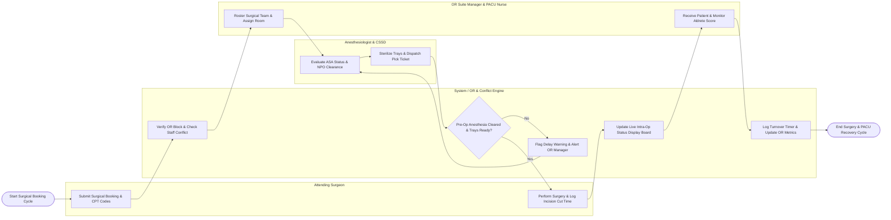

# Swimlane Diagram — Surgical Scheduling System

## Mermaid Code

## Flow Description | Mô tả luồng

| Lane | Actor / Subsystem | Role in Flow |
|------|-------------------|--------------|
| 1 | Attending Surgeon | Submits surgical case booking requests with CPT procedure codes and estimated duration, performs surgery in OR room, and logs incision cut time. |
| 2 | Anesthesiologist & CSSD | Evaluates pre-op anesthesia fitness (ASA 1-5 classification), verifies NPO fasting status, sterilizes instrument trays, and dispatches case cart pick tickets to OR. |
| 3 | System / OR & Conflict Engine | Checks master OR block schedules for room/staff conflicts, evaluates anesthesia clearance tokens, updates real-time status display boards, and tracks room turnover timers. |
| 4 | OR Suite Manager & PACU Nurse | Rosters surgical team members (surgeons, anesthesiologist, scrub nurses), manages emergency bumps, receives post-op patients in PACU, and monitors Aldrete recovery scores. |
