# Action Tree — Surgical Scheduling System

## Mermaid Code

```mermaid
graph TD
    Root["Surgical Scheduling System"]

    Root --> M1["Surgical Case Booking & Block Allocation"]
    Root --> M2["Pre-Op Anesthesia & ASA Evaluation"]
    Root --> M3["CSSD Instrument & Equipment Reservation"]
    Root --> M4["Surgical Team Staffing & Rostering"]
    Root --> M5["Intra-Op Milestones & Status Board"]
    Root --> M6["Emergency Insertion & Case Bumping"]
    Root --> M7["PACU Recovery & Aldrete Scoring"]
    Root --> M8["OR Utilization & Turnover Analytics"]

    M1 --> A11["Submit Surgical Case Booking Request"]
    M1 --> A12["Allocate Specialty Block Time Slot"]
    M1 --> A13["Detect Surgeon & OR Room Schedule Conflicts"]
    M1 --> A14["Attach Primary CPT Procedure Codes"]

    M2 --> A21["Evaluate Patient Airway & Mallampati Score"]
    M2 --> A22["Assign ASA Physical Status Class 1 to 5"]
    M2 --> A23["Verify NPO Fasting Duration Compliance"]
    M2 --> A24["Issue Electronic Anesthesia Clearance Cert"]

    M3 --> A31["Reserve C-Arm Lap-Tower Surgical Hardware"]
    M3 --> A32["Query CSSD Sterilized Instrument Inventory"]
    M3 --> A33["Dispatch Barcode Pick Ticket to CSSD"]
    M3 --> A34["Requisition Special Implants & Prosthetics"]

    M4 --> A41["Assign Primary & Assistant Surgeons"]
    M4 --> A42["Roster Attending Anesthesiologist & CRNA"]
    M4 --> A43["Assign Scrub & Circulating Nurse Team"]
    M4 --> A44["Verify Staff Credentialing & Overtime Rules"]

    M5 --> A51["Log Patient In-Room & Induction Timestamps"]
    M5 --> A52["Execute WHO Surgical Safety Time-Out"]
    M5 --> A53["Log Surgical Incision Cut & Closure Time"]
    M5 --> A54["Update Family Display Board in Real-Time"]

    M6 --> A61["Process STAT Emergency Surgical Insertion"]
    M6 --> A62["Auto-Bump Elective Surgery Time Slots"]
    M6 --> A63["Dispatch Cancellation Alerts to Teams"]
    M6 --> A64["Reschedule Bumped Cases to Next Open Block"]

    M7 --> A71["Reserve PACU Recovery Bed Destination"]
    M7 --> A72["Log PACU Arrival & Vitals Telemetry"]
    M7 --> A73["Score Aldrete Post-Anesthesia Recovery"]
    M7 --> A74["Authorize PACU Discharge to Inpatient Ward"]

    M8 --> A81["Calculate First-Case On-Time Start %"]
    M8 --> A82["Measure Room Turnover Time Minutes"]
    M8 --> A83["Audit Specialty Block Utilization Rates"]
    M8 --> A84["Export Surgical Case Cancellation Reports"]
```

## Module Description | Mô tả Module

| # | Module | Description | Actions |
|---|--------|-------------|---------|
| 1 | Surgical Case Booking & Block Allocation | Submits surgical case booking requests with CPT codes, allocates specialty block time slots, and detects room/surgeon schedule conflicts. | Submit Surgical Case Booking Request, Allocate Specialty Block Time Slot, Detect Surgeon & OR Room Schedule Conflicts, Attach Primary CPT Procedure Codes |
| 2 | Pre-Op Anesthesia & ASA Evaluation | Evaluates airway Mallampati scores, assigns ASA Physical Status (1-5), verifies NPO fasting compliance, and issues electronic anesthesia clearances. | Evaluate Patient Airway & Mallampati Score, Assign ASA Physical Status Class 1 to 5, Verify NPO Fasting Duration Compliance, Issue Electronic Anesthesia Clearance Cert |
| 3 | CSSD Instrument & Equipment Reservation | Reserves hardware (C-Arm, Lap-Towers), queries CSSD sterilized instrument tray barcodes, dispatches pick tickets, and orders special implants. | Reserve C-Arm Lap-Tower Surgical Hardware, Query CSSD Sterilized Instrument Inventory, Dispatch Barcode Pick Ticket to CSSD, Requisition Special Implants & Prosthetics |
| 4 | Surgical Team Staffing & Rostering | Rosters primary/assistant surgeons, anesthesiologists, scrub nurses, and circulating nurses while verifying staff credentials and fatigue rules. | Assign Primary & Assistant Surgeons, Roster Attending Anesthesiologist & CRNA, Assign Scrub & Circulating Nurse Team, Verify Staff Credentialing & Overtime Rules |
| 5 | Intra-Op Milestones & Status Board | Logs milestone timestamps (In-Room, Anesthesia, Cut, Closure), executes WHO safety time-outs, and updates real-time family status display boards. | Log Patient In-Room & Induction Timestamps, Execute WHO Surgical Safety Time-Out, Log Surgical Incision Cut & Closure Time, Update Family Display Board in Real-Time |
| 6 | Emergency Insertion & Case Bumping | Inserts STAT emergency surgical cases into active schedules, auto-bumps elective cases, alerts surgical teams, and reschedules bumped cases. | Process STAT Emergency Surgical Insertion, Auto-Bump Elective Surgery Time Slots, Dispatch Cancellation Alerts to Teams, Reschedule Bumped Cases to Next Open Block |
| 7 | PACU Recovery & Aldrete Scoring | Reserves PACU recovery beds, logs PACU arrival vitals telemetry, evaluates Aldrete recovery scores, and authorizes ward discharge clearance. | Reserve PACU Recovery Bed Destination, Log PACU Arrival & Vitals Telemetry, Score Aldrete Post-Anesthesia Recovery, Authorize PACU Discharge to Inpatient Ward |
| 8 | OR Utilization & Turnover Analytics | Calculates first-case on-time start percentages, measures room turnover minutes, audits specialty block utilization, and exports cancellation reports. | Calculate First-Case On-Time Start %, Measure Room Turnover Time Minutes, Audit Specialty Block Utilization Rates, Export Surgical Case Cancellation Reports |
