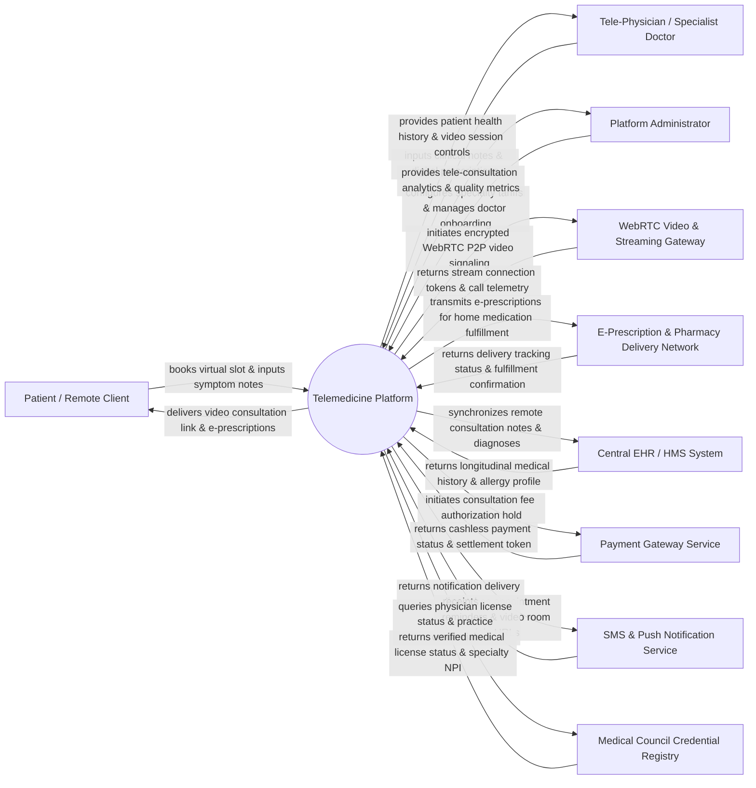

# Context Diagram — Telemedicine Platform

## Mermaid Code

## Actor & Interaction Table | Bảng Actor & Tương tác

| # | Actor | Actor Type | Data Sent TO System | Data Received FROM System | Notes |
|---|-------|------------|---------------------|---------------------------|-------|
| 1 | Patient / Remote Client | Primary | Appointment booking requests, pre-consultation symptom photos, vital sign readings, payment tenders. | High-definition video call link, e-prescriptions, consultation summaries, home medication tracking. | End-user receiving virtual medical consultation services via mobile or web portal. |
| 2 | Tele-Physician / Specialist Doctor | Primary | Doctor availability schedules, clinical consultation notes, ICD-10 diagnostic codes, electronic prescriptions. | Scheduled patient queue, past EHR medical records, pre-consultation symptom attachments, WebRTC call controls. | Licensed medical practitioner conducting remote video consultations and issuing treatment plans. |
| 3 | Platform Administrator | Primary | Doctor verification approvals, specialty tariff rates, platform service fees, user role assignments. | Tele-consultation volume analytics, doctor rating summaries, WebRTC quality metrics, financial reports. | System administrator managing provider credentialing, platform policies, and service operations. |
| 4 | WebRTC Video & Streaming Gateway | Supporting | Stream connection tokens, video resolution metrics, network latency alerts, call duration logs. | Encrypted P2P signaling payloads, room session tokens, media relay instructions (STUN/TURN). | External media streaming infrastructure handling real-time audio/video transmission. |
| 5 | E-Prescription & Pharmacy Delivery Network | Supporting | Home delivery tracking status, courier dispatch updates, drug stock availability notifications. | Validated digital prescriptions (e-Rx), patient delivery address, drug dosage instructions. | Network of partner retail pharmacies and logistics couriers delivering prescribed medicines. |
| 6 | Central EHR / HMS System | Supporting | Patient longitudinal medical records, past hospital discharge summaries, active drug allergy lists. | Remote consultation notes, tele-diagnosis codes (ICD-10), digital e-prescription references. | Main hospital information system storing permanent patient medical records across facilities. |
| 7 | Payment Gateway Service | Supporting | Credit/debit card tokens, e-wallet authorization codes, escrow hold releases, payout confirmations. | Payment authorization requests, consultation fee amounts, doctor payout instructions. | Financial service processing patient consultation payments and doctor payout escrows. |
| 8 | SMS & Push Notification Service | Supporting | Message delivery receipts, push status codes, notification bounce alerts. | Appointment reminder payloads, video room join links, OTP verification codes. | Messaging engine sending automated SMS, WhatsApp, and push alerts to patients and doctors. |
| 9 | Medical Council Credential Registry | Supporting | Verified medical license numbers, specialty practice certifications, disciplinary history status. | Doctor license verification requests, National Provider Identifier (NPI) lookup codes. | Governmental or medical licensing authority validating physician identity and practice credentials. |

## System Boundary Description | Mô tả Phạm vi Hệ thống

The **Telemedicine Platform** is an end-to-end digital health software solution enabling secure, HIPAA-compliant virtual medical consultations, real-time WebRTC audio/video sessions, asynchronous tele-triage, digital prescription issuance, home diagnostic ordering, and automated pharmacy delivery integration.

**Inside System Scope:**
- Virtual doctor search, availability schedule management, and online consultation slot booking.
- Real-time WebRTC video/audio streaming, encrypted in-call chat, and screen-sharing of diagnostic images.
- Pre-consultation symptom intake (photo attachments, wearable vitals data, chief complaints).
- Electronic prescription (e-Rx) generation with drug interaction checks and digital signature validation.
- Payment escrow processing, consultation fee collection, and doctor revenue payout settlement.
- Interoperable HL7 FHIR synchronization of consultation records with hospital EHR systems.

**Outside System Scope:**
- Physical emergency medical resuscitation and hands-on surgical procedures (requires in-person ER).
- Direct physical courier transit of medications (handled by external partner logistics providers).
- Low-level network WebRTC media relay server hardware operation (delegated to cloud WebRTC gateways).
- Final legal medical licensing determination (delegated to Medical Council Registries).
