# Use Case Diagram — Telemedicine Platform

## Mermaid Code

```mermaid
flowchart LR
    actor_Patient["Patient / Client"]
    actor_Doctor["Tele-Physician / Specialist"]
    actor_Admin["Platform Administrator"]
    actor_Pharmacy["Partner Pharmacy Network"]

    subgraph SystemBoundary["Telemedicine Platform"]
        UC01(["Search & Filter Tele-Consultants"])
        UC02(["Book Virtual Consultation Slot"])
        UC03(["Upload Symptom Images & Pre-Vitals"])
        UC04(["Conduct High-Definition Video Consultation"])
        UC05(["Review Patient E-Health History"])
        UC06(["Issue Remote Digital Prescription"])
        UC07(["Order Home Lab Sample Collection"])
        UC08(["Process Virtual Consultation Fee Payment"])
        UC09(["Rate & Review Doctor Consultation"])
        UC10(["Conduct Multi-Specialty Tele-Conference"])
        UC11(["Sync Consultation Notes to Central EHR"])
        UC12(["Verify Doctor Credentials & Licensing"])
        UC13(["Track Home Medication Delivery Status"])
        UC14(["Manage Doctor Availability Schedules"])
    end

    actor_Patient --> UC01
    actor_Patient --> UC02
    actor_Patient --> UC03
    actor_Patient --> UC04
    actor_Patient --> UC08
    actor_Patient --> UC09
    actor_Patient --> UC13

    actor_Doctor --> UC04
    actor_Doctor --> UC05
    actor_Doctor --> UC06
    actor_Doctor --> UC07
    actor_Doctor --> UC10
    actor_Doctor --> UC11
    actor_Doctor --> UC14

    UC02 -.->|"<<include>>"| UC08
    UC04 -.->|"<<include>>"| UC02
    UC04 -.->|"<<include>>"| UC05
    UC06 -.->|"<<include>>"| UC04
    UC07 -.->|"<<extend>>"| UC04
    UC11 -.->|"<<include>>"| UC04

    actor_Pharmacy --> UC13

    actor_Admin --> UC12
    actor_Admin --> UC14
```

## Actor Table | Bảng Actor

| # | Actor | Actor Type | Role Description | Related Use Cases |
|---|-------|------------|------------------|-------------------|
| 1 | Patient / Client | Primary | Remote healthcare recipient searching for specialists, booking appointments, uploading pre-consultation vitals, attending video calls, paying fees, and reviewing doctors. | UC01, UC02, UC03, UC04, UC08, UC09, UC13 |
| 2 | Tele-Physician / Specialist | Primary | Licensed medical practitioner managing availability schedules, reviewing patient history, conducting WebRTC video consultations, prescribing e-Rx, and referring home lab draws. | UC04, UC05, UC06, UC07, UC10, UC11, UC14 |
| 3 | Platform Administrator | Primary | Operations manager verifying doctor licensing credentials, configuring specialty tariff fees, and overseeing platform service availability. | UC12, UC14 |
| 4 | Partner Pharmacy Network | Secondary | External fulfillment partner receiving electronic prescription orders and providing home delivery tracking updates. | UC13 |

## Use Case Table | Bảng Use Case

| # | UC ID | Use Case Name | Primary Actor | Secondary Actor | Description | Priority |
|---|-------|---------------|---------------|-----------------|-------------|----------|
| 1 | UC01 | Search & Filter Tele-Consultants | Patient / Client | System Engine | Enables patients to search for specialist doctors by medical discipline, sub-specialty, consultation fee, rating, and available time slots. | High |
| 2 | UC02 | Book Virtual Consultation Slot | Patient / Client | Payment Gateway | Allows patients to select a doctor's open appointment slot, confirm consultation type (Video/Audio/Chat), and lock booking. | High |
| 3 | UC03 | Upload Symptom Images & Pre-Vitals | Patient / Client | System Engine | Allows patients to upload high-resolution symptom photos (e.g., skin rash), current medications, and wearable device vital signs before call. | Medium |
| 4 | UC04 | Conduct High-Definition Video Consultation | Patient / Client | Tele-Physician | Facilitates encrypted, real-time WebRTC audio/video sessions featuring in-call chat, screen sharing of diagnostic files, and time tracking. | High |
| 5 | UC05 | Review Patient E-Health History | Tele-Physician | EHR System | Enables the doctor to access patient past consultation notes, active problem lists, chronic conditions, and allergy history before or during the call. | High |
| 6 | UC06 | Issue Remote Digital Prescription | Tele-Physician | Pharmacy Network | Enables the doctor to create a digitally signed electronic prescription (e-Rx) with dosage rules, automatically dispatched for home fulfillment. | High |
| 7 | UC07 | Order Home Lab Sample Collection | Tele-Physician | Clinical Lab System | Allows the doctor to request a home phlebotomy visit for blood/urine collection, routing order details to partner diagnostic labs. | Medium |
| 8 | UC08 | Process Virtual Consultation Fee Payment | Patient / Client | Payment Gateway | Handles cashless credit card, e-wallet, or bank transfer payments, placing funds in escrow until successful consultation completion. | High |
| 9 | UC09 | Rate & Review Doctor Consultation | Patient / Client | System Engine | Enables patients to provide 1-to-5 star ratings and written reviews evaluating doctor communication, punctuality, and overall care. | Medium |
| 10 | UC10 | Conduct Multi-Specialty Tele-Conference | Tele-Physician | External Specialist | Allows a primary tele-physician to invite external medical specialists into a multi-party video call for complex case consultations. | Medium |
| 11 | UC11 | Sync Consultation Notes to Central EHR | Tele-Physician | EHR System | Automatically packages consultation SOAP notes, ICD-10 diagnoses, and e-prescriptions into FHIR bundles for central hospital EHR sync. | High |
| 12 | UC12 | Verify Doctor Credentials & Licensing | Platform Administrator | Medical Council | Verifies physician state medical license numbers, NPI records, board certifications, and identity documents before platform activation. | High |
| 13 | UC13 | Track Home Medication Delivery Status | Patient / Client | Partner Pharmacy Network | Provides real-time GPS tracking and courier status updates for home-delivered prescription medications. | Medium |
| 14 | UC14 | Manage Doctor Availability Schedules | Tele-Physician | Platform Administrator | Allows doctors to define working hours, recurring consultation slots, consultation buffer times, and instant on-call status. | High |

## Use Case Specification | Đặc tả Use Case

---

### UC02 — Book Virtual Consultation Slot

| Field | Detail |
|-------|--------|
| **UC ID** | UC02 |
| **Use Case Name** | Book Virtual Consultation Slot |
| **Actor(s)** | Primary: Patient / Client   Secondary: Payment Gateway |
| **Description** | Patient selects a doctor, chooses an available virtual appointment time slot, specifies chief complaints, and completes payment hold authorization to finalize the booking. |
| **Precondition** | 1. Patient is logged into the Telemedicine app/portal.   2. Selected doctor has active available time slots (UC14). |
| **Main Flow** | 1. Patient views Doctor Profile page and selects "Book Appointment".   2. System presents interactive calendar displaying open 15-minute / 30-minute consultation slots.   3. Patient selects target date and time slot.   4. Patient selects consultation format (Video Call, Audio Call, or Text Consultation).   5. Patient enters chief symptom description and emergency contact info.   6. System routes patient to payment checkout (UC08) to authorize consultation fee.   7. Upon payment hold confirmation, System locks the time slot, generates a unique WebRTC video room URL, and sends confirmation notifications to patient and doctor. |
| **Alternative Flow** | **AF1** — Instant "On-Call Now" Booking: Patient selects "Consult Doctor Immediately"; System matches patient with next available on-call general practitioner for an instant video call.   **AF2** — Follow-Up Appointment Discount: System detects patient is booking a follow-up within 7 days of previous visit and applies automatic 50% consultation fee discount. |
| **Exception Flow** | **EX1** — Slot Simultaneously Selected: If another patient completes payment for the same slot milliseconds earlier, System alerts "Slot No Longer Available" and prompts user to pick adjacent time.   **EX2** — Payment Authorization Failure: If payment fails (UC08), System holds slot for 5 minutes; if unpaid, slot is released back to open calendar. |
| **Postcondition** | Appointment is booked, calendar slot is locked, payment escrow is authorized, and video room tokens are generated. |
| **Business Rule** | **BR1**: Patients may cancel or reschedule free of charge up to 2 hours prior to the scheduled consultation time. |

---

### UC04 — Conduct High-Definition Video Consultation

| Field | Detail |
|-------|--------|
| **UC ID** | UC04 |
| **Use Case Name** | Conduct High-Definition Video Consultation |
| **Actor(s)** | Primary: Patient / Client   Secondary: Tele-Physician |
| **Description** | Patient and Doctor join an encrypted WebRTC video conference room at the scheduled time, conducting a live virtual consultation with integrated chat and document sharing. |
| **Precondition** | 1. Appointment is booked (UC02) and scheduled time is reached.   2. WebRTC video room tokens are active. |
| **Main Flow** | 1. Doctor and Patient click "Join Video Room" from their respective app dashboards.   2. System performs browser/app hardware check (camera, microphone, speaker test).   3. System establishes encrypted peer-to-peer WebRTC video stream (DTLS-SRTP encryption).   4. Doctor views patient profile, uploaded pre-vitals (UC03), and EHR medical history (UC05) side-by-side on split screen.   5. Doctor conducts clinical examination via video, asking diagnostic questions and observing physical signs.   6. Doctor or patient uses in-call chat or screen-sharing to view attached lab reports or symptom photos.   7. Doctor clicks "End Consultation" when clinical evaluation is finished.   8. System records total call duration, releases media stream, and prompts doctor to complete SOAP notes and e-prescription (UC06). |
| **Alternative Flow** | **AF1** — Network Bandwidth Fallback: If network connection drops below 250 kbps, System automatically downgrades video resolution or switches seamlessly to HD Audio-Only mode with active reconnect banner. |
| **Exception Flow** | **EX1** — Doctor No-Show: If doctor fails to join within 10 minutes of scheduled time, System alerts admin, offers patient immediate reassignment to another doctor or issues 100% automated refund.   **EX2** — Emergency Referral Required: If doctor observes critical emergency symptoms (e.g., stroke, severe respiratory distress), doctor clicks "Trigger Emergency Escalation", displaying local 911/ambulance dispatch numbers to patient. |
| **Postcondition** | Virtual video consultation is completed, call metrics are logged, and post-consultation workflow is unlocked. |
| **Business Rule** | **BR1**: All WebRTC video and audio streams must be end-to-end encrypted; raw video recording is strictly prohibited unless explicit written consent is granted by both parties. |

---

### UC06 — Issue Remote Digital Prescription (e-Rx)

| Field | Detail |
|-------|--------|
| **UC ID** | UC06 |
| **Use Case Name** | Issue Remote Digital Prescription (e-Rx) |
| **Actor(s)** | Primary: Tele-Physician   Secondary: Partner Pharmacy Network |
| **Description** | Tele-physician selects prescribed medications from master drug catalog, inputs dosage instructions, applies digital signature, and routes e-Rx for home delivery or pharmacy pickup. |
| **Precondition** | 1. Active or recently completed video consultation session (UC04) exists.   2. Doctor has verified digital signature credentials. |
| **Main Flow** | 1. Doctor opens "Create Prescription" screen post-consultation.   2. Doctor searches master drug catalog by brand or generic active ingredient.   3. Doctor sets dosage form, strength, daily frequency, and duration (days).   4. System automatically runs drug interaction and patient allergy check (UC05).   5. System displays "No Interaction Conflicts Detected".   6. Doctor selects fulfillment preference: "Home Delivery via Partner Pharmacy" or "Self-Pickup at Local Pharmacy".   7. Doctor signs e-prescription with PKI digital certificate / 2FA token.   8. System generates cryptographically signed PDF e-Rx payload, updates patient app portal, and dispatches electronic order to partner pharmacy network. |
| **Alternative Flow** | **AF1** — Non-Prescription OTC Recommendation: Doctor recommends over-the-counter vitamins or home care items without formal digital signature requirement. |
| **Exception Flow** | **EX1** — Restricted Drug Restriction: If doctor attempts to prescribe controlled narcotics (Schedule II drugs), System blocks issuance, displaying "Telemedicine Restriction: Controlled substances cannot be prescribed via virtual consultation". |
| **Postcondition** | Digitally signed e-prescription is published to patient portal and transmitted to pharmacy network for fulfillment. |
| **Business Rule** | **BR1**: Tele-physicians are legally restricted from prescribing controlled narcotics, habit-forming psychotropics, or experimental drugs via virtual consultation. |

---

### UC07 — Order Home Lab Sample Collection

| Field | Detail |
|-------|--------|
| **UC ID** | UC07 |
| **Use Case Name** | Order Home Lab Sample Collection |
| **Actor(s)** | Primary: Tele-Physician   Secondary: Clinical Lab System |
| **Description** | Tele-physician requests home phlebotomy service for blood/urine sample collection when remote physical diagnosis requires laboratory verification. |
| **Precondition** | 1. Active or recently completed video consultation (UC04) exists. |
| **Main Flow** | 1. Doctor determines lab testing is necessary (e.g., Lipid Panel, HbA1c, CBC).   2. Doctor selects "Order Home Lab Collection".   3. Doctor selects required lab test panels and inputs clinical indications.   4. System checks patient home address coverage against partner clinical diagnostic laboratories.   5. System schedules phlebotomist home visit appointment based on patient preferred morning time slot.   6. System dispatches electronic lab requisition to partner lab dispatch system.   7. Patient receives notification with home phlebotomist visit confirmation and fasting preparation guidelines. |
| **Alternative Flow** | **AF1** — Direct Lab Center Walk-In: Doctor issues electronic lab referral voucher allowing patient to walk into any participating partner lab center for sample collection. |
| **Exception Flow** | **EX1** — Out-of-Service Area: If patient home address is outside home phlebotomy service radius, System notifies doctor and automatically converts order to Walk-In Lab Voucher. |
| **Postcondition** | Home lab collection order is scheduled, phlebotomist dispatch is triggered, and patient receives pre-test instructions. |
| **Business Rule** | **BR1**: Home phlebotomy collection orders must include mandatory fasting and preparation guidelines sent to patient at least 12 hours prior to visit. |

---

### UC08 — Process Virtual Consultation Fee Payment

| Field | Detail |
|-------|--------|
| **UC ID** | UC08 |
| **Use Case Name** | Process Virtual Consultation Fee Payment |
| **Actor(s)** | Primary: Patient / Client   Secondary: Payment Gateway |
| **Description** | Manages cashless consultation fee payment processing, authorizing an escrow hold upon booking and releasing payout to the doctor upon successful consultation completion. |
| **Precondition** | 1. Patient selects appointment booking slot (UC02). |
| **Main Flow** | 1. System displays itemized fee breakdown: Doctor Consultation Fee + Platform Service Fee - Promotional Voucher = Net Total.   2. Patient selects payment method (Credit/Debit Card, Apple Pay/Google Pay, E-Wallet, or Direct Bank Transfer).   3. System transmits payment authorization request to Payment Gateway.   4. Payment Gateway places an authorization hold (escrow) on the patient's payment card.   5. System receives hold confirmation token and confirms appointment booking (UC02).   6. Following successful completion of the video consultation (UC04), System converts authorization hold to settled payment.   7. System deducts platform commission fee and credits net doctor fee to the doctor's payout wallet balance. |
| **Alternative Flow** | **AF1** — Health Insurance Co-Pay Coverage: If patient has connected active tele-health insurance coverage, System submits real-time insurance verification, waiving fee or collecting reduced co-pay amount. |
| **Exception Flow** | **EX1** — Consultation Cancellation / Refund: If patient cancels > 2 hours prior or doctor fails to join call, System releases authorization hold, issuing 100% full refund to patient card. |
| **Postcondition** | Payment hold is captured, funds are settled post-consultation, and doctor payout ledger is updated. |
| **Business Rule** | **BR1**: Consultation fee holds are held in secure escrow and only settled to doctor wallet after doctor submits signed consultation notes or e-Rx. |
