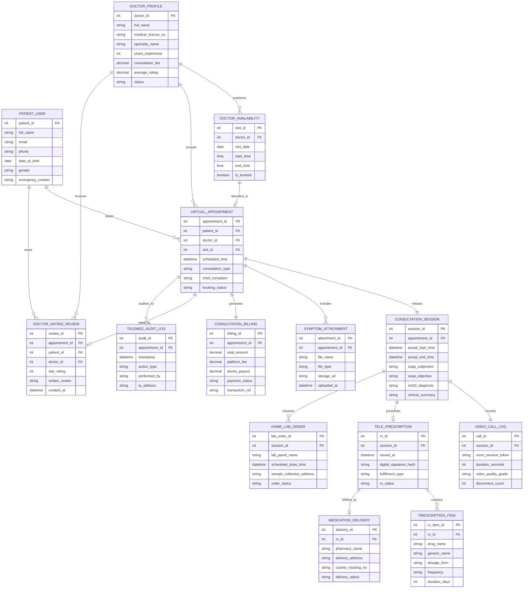

# Conceptual ERD — Telemedicine Platform

## Mermaid Code

## Entity Description Table | Bảng mô tả Entity

| # | Entity Name | Vietnamese Name | Description | Key Attributes | Main Relationships |
|---|-------------|-----------------|-------------|----------------|-------------------|
| 1 | PATIENT_USER | Bệnh nhân / Người dùng | Registered patient account holding contact info, demographic data, and emergency contact details. | patient_id, full_name, email, phone | Books Appointments, writes Reviews. |
| 2 | DOCTOR_PROFILE | Bác sĩ Tư vấn | Verified tele-physician profile storing medical license numbers, specialty, experience years, consultation fees, and rating scores. | doctor_id, full_name, medical_license_no, consultation_fee, average_rating | Publishes Availability, accepts Appointments, receives Reviews. |
| 3 | DOCTOR_AVAILABILITY | Lịch Rảnh Bác sĩ | Granular time slots published by doctors specifying open consultation windows. | slot_id, slot_date, start_time, end_time, is_booked | Belongs to Doctor Profile, allocated to Appointment. |
| 4 | VIRTUAL_APPOINTMENT | Lịch hẹn Kham từ xa | Core appointment booking record binding patient, doctor, scheduled time slot, and booking status. | appointment_id, scheduled_time, consultation_type, booking_status | Booked by Patient, initiates Consultation Session, generates Billing. |
| 5 | CONSULTATION_SESSION | Phiên Khám từ xa | Active clinical encounter session capturing actual call start/end times, SOAP notes, and ICD-10 diagnoses. | session_id, actual_start_time, soap_subjective, icd10_diagnosis | Initiated by Appointment, records Video Call Log, prescribes E-Rx. |
| 6 | VIDEO_CALL_LOG | Nhật ký Cuộc gọi Video | Technical WebRTC telemetry record capturing room tokens, call duration, video resolution grades, and connection drops. | call_id, room_session_token, duration_seconds, video_quality_grade | Linked to Consultation Session. |
| 7 | SYMPTOM_ATTACHMENT | Ảnh / File Triệu chứng | Pre-consultation symptom photos, diagnostic lab PDFs, or wearable vital sign images uploaded by the patient. | attachment_id, file_name, file_type, storage_url | Included in Virtual Appointment. |
| 8 | TELE_PRESCRIPTION | Đơn thuốc Điện tử (e-Rx) | Digitally signed electronic prescription issued during a tele-consultation session. | rx_id, issued_at, digital_signature_hash, fulfillment_type | Prescribed in Consultation Session, contains Items, fulfilled by Delivery. |
| 9 | PRESCRIPTION_ITEM | Chi tiết Đơn thuốc | Line items in an e-prescription detailing drug name, generic compound, dosage form, and treatment duration. | rx_item_id, drug_name, dosage_form, frequency, duration_days | Belongs to Tele-Prescription. |
| 10 | HOME_LAB_ORDER | Đơn Xét nghiệm Tai nhà | Requisition order for home phlebotomy blood/urine collection requested during consultation. | lab_order_id, lab_panel_name, scheduled_draw_time, order_status | Requested in Consultation Session. |
| 11 | CONSULTATION_BILLING | Thanh toán Phí Khám | Financial billing record tracking consultation fees, platform commissions, doctor payouts, and payment escrow statuses. | billing_id, total_amount, platform_fee, doctor_payout, payment_status | Generated by Virtual Appointment. |
| 12 | DOCTOR_RATING_REVIEW | Đánh giá & Bình luận | Post-consultation patient review storing 1-5 star ratings and feedback notes for the doctor. | review_id, star_rating, written_review, created_at | Written by Patient, rates Appointment and Doctor Profile. |
| 13 | MEDICATION_DELIVERY | Giao thuốc Tận nhà | Delivery tracking record for home-delivered prescription medications processed by partner pharmacies. | delivery_id, pharmacy_name, delivery_address, courier_tracking_no | Fulfills Tele-Prescription. |
| 14 | TELEMED_AUDIT_LOG | Nhật ký Thao tác Hệ thống | Immutable security log tracking video room access, consent acknowledgments, e-Rx signatures, and file views. | audit_id, timestamp, action_type, performed_by | Audits Virtual Appointment lifecycle. |

## Relationship Description | Mô tả Quan hệ

| # | From Entity | Cardinality | To Entity | Relationship Label | Business Explanation |
|---|-------------|-------------|-----------|-------------------|----------------------|
| 1 | PATIENT_USER | one-to-many | VIRTUAL_APPOINTMENT | books | A patient can book multiple virtual appointments over time. |
| 2 | PATIENT_USER | one-to-many | DOCTOR_RATING_REVIEW | writes | A patient can write reviews for completed doctor consultation appointments. |
| 3 | DOCTOR_PROFILE | one-to-many | DOCTOR_AVAILABILITY | publishes | A doctor publishes multiple open time slots on their availability calendar. |
| 4 | DOCTOR_PROFILE | one-to-many | VIRTUAL_APPOINTMENT | accepts | A doctor accepts and conducts multiple virtual patient appointments. |
| 5 | DOCTOR_PROFILE | one-to-many | DOCTOR_RATING_REVIEW | receives | A doctor receives patient star ratings and feedback reviews. |
| 6 | DOCTOR_AVAILABILITY | one-to-one | VIRTUAL_APPOINTMENT | allocated_to | An availability time slot is allocated to at most one confirmed appointment booking. |
| 7 | VIRTUAL_APPOINTMENT | one-to-one | CONSULTATION_SESSION | initiates | A confirmed appointment initiates exactly one live clinical consultation session. |
| 8 | VIRTUAL_APPOINTMENT | one-to-many | SYMPTOM_ATTACHMENT | includes | An appointment can include multiple uploaded pre-consultation symptom photos or files. |
| 9 | VIRTUAL_APPOINTMENT | one-to-one | CONSULTATION_BILLING | generates | An appointment generates exactly one financial consultation billing record. |
| 10 | VIRTUAL_APPOINTMENT | one-to-one | DOCTOR_RATING_REVIEW | rated_by | A completed appointment can be rated by one patient review. |
| 11 | VIRTUAL_APPOINTMENT | one-to-many | TELEMED_AUDIT_LOG | audited_by | An appointment lifecycle maintains an immutable security audit trail. |
| 12 | CONSULTATION_SESSION | one-to-one | VIDEO_CALL_LOG | records | A consultation session records technical telemetry for one WebRTC video call session. |
| 13 | CONSULTATION_SESSION | one-to-one | TELE_PRESCRIPTION | prescribes | A consultation session can result in one digitally signed e-prescription. |
| 14 | CONSULTATION_SESSION | one-to-many | HOME_LAB_ORDER | requests | A consultation session can request one or more home laboratory collection orders. |
| 15 | TELE_PRESCRIPTION | one-to-many | PRESCRIPTION_ITEM | contains | An e-prescription contains one or more prescribed medication line items. |
| 16 | TELE_PRESCRIPTION | one-to-one | MEDICATION_DELIVERY | fulfilled_by | An e-prescription designated for home delivery is fulfilled by one medication delivery tracker. |
