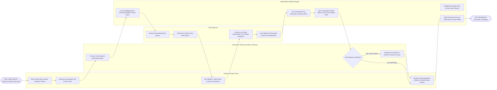

# Swimlane Diagram — Telemedicine Platform

## Mermaid Code

## Flow Description | Mô tả luồng

| Lane | Actor | Role in Flow |
|------|-------|-------------|
| 1 | Patient / Remote Client | Selects tele-physician and slot, submits pre-consultation symptom photos, authorizes payment escrow hold, joins WebRTC video room for consultation, receives home medication delivery, and submits post-consultation doctor reviews. |
| 2 | Tele-Physician | Accepts appointment queue, reviews pre-consultation vitals and historical EHR records, conducts live WebRTC video consultation, formulates clinical diagnosis (ICD-10), issues digitally signed e-prescriptions, and orders home lab collections. |
| 3 | Telemedicine Platform Engine | Locks schedule slots, generates WebRTC room tokens, orchestrates encrypted P2P video streaming, executes drug interaction checks, synchronizes clinical SOAP notes with central hospital EHRs, and settles payment escrows into doctor payout wallets. |
| 4 | Payment & Pharmacy Delivery Gateway | Authorizes payment card holds in escrow, verifies pharmacy drug inventory, dispatches home prescription deliveries via logistics couriers, and provides real-time shipment tracking. |
