# Action Tree — Telemedicine Platform

## Mermaid Code

```mermaid
graph TD
    Root["Telemedicine Platform"]

    Root --> M1["1. Doctor Search & Schedule Management"]
    Root --> M2["2. Virtual Booking & Pre-Consultation Triage"]
    Root --> M3["3. WebRTC Audio/Video Engine"]
    Root --> M4["4. Clinical Documentation & E-Prescribing"]
    Root --> M5["5. Home Diagnostics & Pharmacy Delivery"]
    Root --> M6["6. Escrow Payment & Financial Settlement"]
    Root --> M7["7. Interoperability & Central EHR Integration"]
    Root --> M8["8. Platform Governance & Doctor Credentialing"]

    M1 --> A11["Filter Doctors by Specialty & Tariff"]
    M1 --> A12["Publish Doctor Availability Calendar"]
    M1 --> A13["Set Consultation Slot Buffer Times"]
    M1 --> A14["Toggle Instant On-Call Availability Status"]

    M2 --> A21["Select Virtual Slot & Consultation Type"]
    M2 --> A22["Upload Pre-Consultation Symptom Photos"]
    M2 --> A23["Capture Wearable Vitals & Chief Complaint"]
    M2 --> A24["Send Automated Video Room Access Links"]

    M3 --> A31["Establish Encrypted WebRTC P2P Video Session"]
    M3 --> A32["Provide In-Call Screen Sharing & Chat"]
    M3 --> A33["Monitor Stream Latency & Auto-Downgrade"]
    M3 --> A34["Trigger Emergency 911 Ambulance Referral"]

    M4 --> A41["Document SOAP Consultation Notes"]
    M4 --> A42["Assign Standard ICD-10 Diagnosis Codes"]
    M4 --> A43["Generate Digitally Signed E-Prescription"]
    M4 --> A44["Enforce Telemedicine Controlled Drug Blocks"]

    M5 --> A51["Order Home Phlebotomy Blood Collection"]
    M5 --> A52["Route E-Rx to Partner Pharmacy Network"]
    M5 --> A53["Track Real-Time Courier Delivery Status"]
    M5 --> A54["Issue Walk-In Diagnostic Test Vouchers"]

    M6 --> A61["Authorize Card Payment Escrow Hold"]
    M6 --> A62["Settle Escrow Payout to Doctor Wallet"]
    M6 --> A63["Process Automated Patient Refunds for Cancellation"]
    M6 --> A64["Deduct Platform Service Commission"]

    M7 --> A71["Package Consultation SOAP Notes into FHIR"]
    M7 --> A72["Fetch Longitudinal EHR Record Timeline"]
    M7 --> A73["Check Patient Central Drug Allergy Profile"]
    M7 --> A74["Sync Tele-Diagnosis to Hospital Database"]

    M8 --> A81["Verify Doctor Medical License Credentials"]
    M8 --> A82["Audit WebRTC HIPAA & GDPR Compliance Logs"]
    M8 --> A83["Monitor Patient Rating & Review Moderation"]
    M8 --> A84["Track Platform Turnaround & Service Quality"]
```

## Module Description | Mô tả Module

| # | Module | Description | Actions |
|---|--------|-------------|---------|
| 1 | Doctor Search & Schedule Management | Enables patients to search specialists by sub-discipline and fee, while allowing doctors to publish availability calendars and toggle instant on-call status. | Filter Doctors by Specialty & Tariff, Publish Doctor Availability Calendar, Set Consultation Slot Buffer Times, Toggle Instant On-Call Availability Status. |
| 2 | Virtual Booking & Pre-Consultation Triage | Manages virtual slot selection, pre-consultation symptom photo uploads, wearable vital sign capture, and automated video room link dispatch. | Select Virtual Slot & Consultation Type, Upload Pre-Consultation Symptom Photos, Capture Wearable Vitals & Chief Complaint, Send Automated Video Room Access Links. |
| 3 | WebRTC Audio/Video Engine | Handles encrypted peer-to-peer WebRTC video streaming, in-call screen sharing, dynamic bandwidth fallback, and emergency ambulance dispatch triggers. | Establish Encrypted WebRTC P2P Video Session, Provide In-Call Screen Sharing & Chat, Monitor Stream Latency & Auto-Downgrade, Trigger Emergency 911 Ambulance Referral. |
| 4 | Clinical Documentation & E-Prescribing | Captures clinical SOAP notes, ICD-10 diagnoses, generates digitally signed e-prescriptions, and enforces statutory telemedicine drug restriction blocks. | Document SOAP Consultation Notes, Assign Standard ICD-10 Diagnosis Codes, Generate Digitally Signed E-Prescription, Enforce Telemedicine Controlled Drug Blocks. |
| 5 | Home Diagnostics & Pharmacy Delivery | Orders home phlebotomy lab collections, dispatches e-prescriptions to partner pharmacy networks, tracks courier deliveries, and issues lab vouchers. | Order Home Phlebotomy Blood Collection, Route E-Rx to Partner Pharmacy Network, Track Real-Time Courier Delivery Status, Issue Walk-In Diagnostic Test Vouchers. |
| 6 | Escrow Payment & Financial Settlement | Manages payment card authorization holds, releases settled payouts into doctor wallets upon completion, processes cancellations/refunds, and collects platform fees. | Authorize Card Payment Escrow Hold, Settle Escrow Payout to Doctor Wallet, Process Automated Patient Refunds for Cancellation, Deduct Platform Service Commission. |
| 7 | Interoperability & Central EHR Integration | Packages tele-encounter summaries into HL7 FHIR bundles, fetches longitudinal EHR medical timelines, checks allergy profiles, and syncs diagnoses with hospital databases. | Package Consultation SOAP Notes into FHIR, Fetch Longitudinal EHR Record Timeline, Check Patient Central Drug Allergy Profile, Sync Tele-Diagnosis to Hospital Database. |
| 8 | Platform Governance & Doctor Credentialing | Verifies physician state medical licenses, audits HIPAA/GDPR video privacy logs, moderates patient star ratings, and tracks tele-consultation service quality. | Verify Doctor Medical License Credentials, Audit WebRTC HIPAA & GDPR Compliance Logs, Monitor Patient Rating & Review Moderation, Track Platform Turnaround & Service Quality. |
