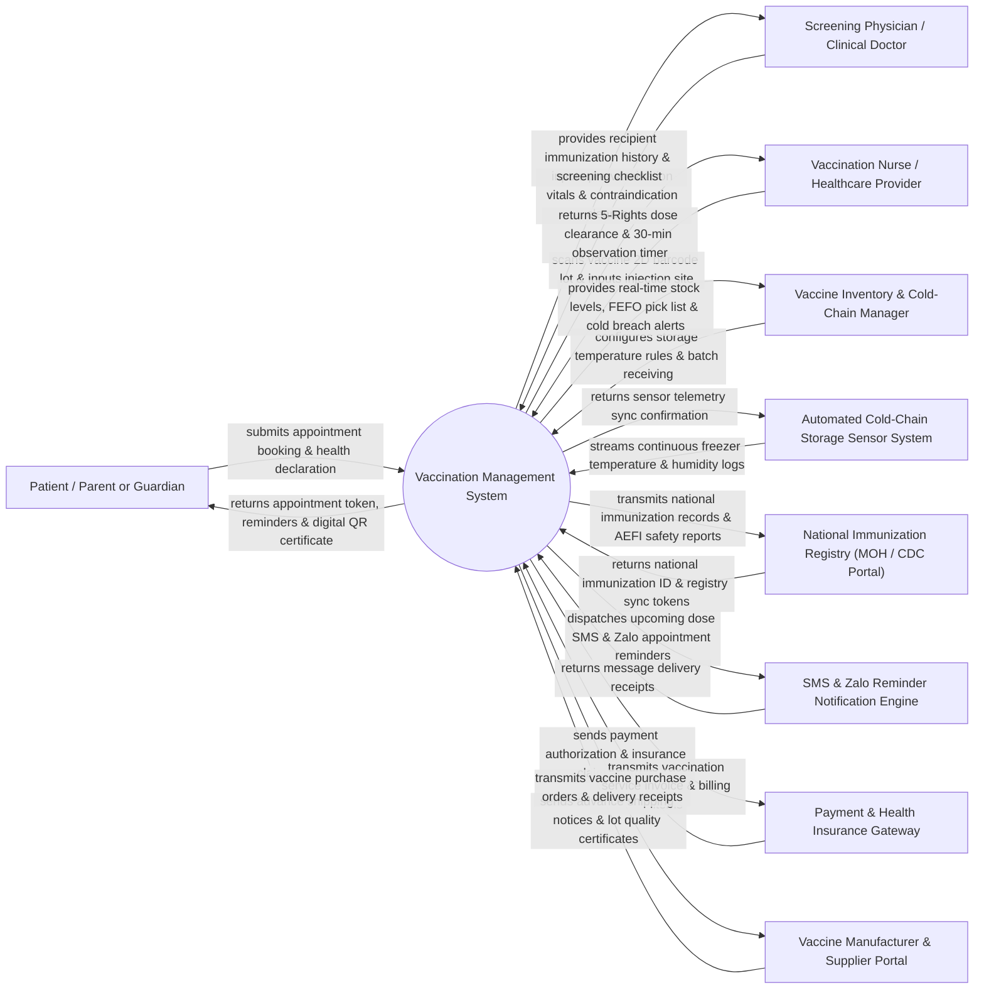

# Context Diagram — Vaccination Management System

## Mermaid Code

## Actor & Interaction Table | Bảng Actor & Tương tác

| # | Actor | Actor Type | Data Sent TO System | Data Received FROM System | Notes |
|---|-------|------------|---------------------|---------------------------|-------|
| 1 | Patient / Parent or Guardian | Primary | Vaccination appointment booking, personal demographics, pre-screening health declaration, consent forms. | Appointment QR confirmation code, scheduled dose reminders, post-care instructions, digital QR vaccine certificate. | Individual receiving vaccines (child, adult, traveler) or parent/guardian registering infants. |
| 2 | Screening Physician / Clinical Doctor | Primary | Pre-vaccination vitals (temp, HR, BP), contraindication screening clearance, allergy evaluation notes. | Recipient lifetime immunization history, vaccine product indications, contraindication warnings. | Medical doctor performing pre-injection health examination and clearing patients for vaccination. |
| 3 | Vaccination Nurse / Healthcare Provider | Primary | GTIN 2D barcode scan of vaccine vial, dose number, injection route/site, post-vaccination AEFI observation notes. | 5-Rights dose clearance, vaccine lot expiration status, automated 30-minute observation timer. | Certified nurse administering vaccines and monitoring patients in the post-injection observation room. |
| 4 | Vaccine Inventory & Cold-Chain Manager | Primary | Batch lot numbers, expiration dates, freezer bin assignments, stock adjustments, temperature threshold settings. | Cold-chain excursion alerts, FEFO picking lists, stock reorder warnings, inventory valuation reports. | Warehouse supervisor managing vaccine storage refrigerators (2°C–8°C or -80°C ultra-cold freezers). |
| 5 | National Immunization Registry (MOH / CDC) | Regulatory | National immunization schedules, regulatory vaccine approvals, emergency authorization directives. | Real-time national vaccination coverage stats, mandatory AEFI reports, digital QR passport hashes. | Governmental health authority managing national immunization programs (e.g., Vietnam MOH E-Health Portal, CDC IZ Gateway). |
| 6 | Automated Cold-Chain Storage Sensor System | Supporting System | Continuous temperature (°C) and humidity (%) telemetry data from IoT storage sensors. | Temperature sampling frequency rules, sensor calibration tokens. | IoT hardware monitoring vaccine refrigerators and ultra-cold freezers continuously. |
| 7 | SMS & Zalo Reminder Notification Engine | Supporting System | Delivery status receipts, SMS transmission logs, Zalo Official Account message statuses. | Upcoming vaccination due reminders, second dose follow-up alerts, AEFI follow-up survey links. | Multi-channel messaging gateway sending automated reminders to patients and parents. |
| 8 | Payment & Health Insurance Gateway | Supporting System | Payment clearance receipts, credit card transaction tokens, health insurance claim approval codes. | Vaccination package pricing, co-pay invoice details, insurance billable item entries. | Financial payment processor and national health insurance system handling service payments. |
| 9 | Vaccine Manufacturer & Supplier Portal | Supporting System | Advance Shipping Notices (ASN), vaccine lot quality release certificates, GTIN barcode payloads. | Transmitted vaccine purchase orders, delivery receipt acknowledgments, stock return notices. | Pharmaceutical suppliers (e.g., Sanofi, GSK, Pfizer, AstraZeneca, VNVC) delivering vaccine lots. |

## System Boundary Description | Mô tả Phạm vi Hệ thống

The **Vaccination Management System (VMS)** is a comprehensive public health and clinical software platform designed to manage the end-to-end lifecycle of immunization services for infants, children, adults, international travelers, and mass epidemic vaccination campaigns. It handles appointment scheduling, digital pre-vaccination health screening, strict 2°C–8°C cold-chain inventory management using First-Expired, First-Out (FEFO) logic, barcode-verified administration, post-vaccination 30-minute observation room tracking, Adverse Event Following Immunization (AEFI) reporting, automated multi-dose SMS/Zalo reminders, and digital QR code immunization passports.

**Inside System Scope:**
- Patient/child registration, national immunization schedule tracking, and appointment booking.
- Digital pre-vaccination clinical screening, temperature check, and contraindication validation.
- Cold-chain inventory control, 2D barcode scanning (GTIN, Lot, Expiration), and temperature excursion logging.
- 5-Rights administration verification, injection site recording, and multi-dose series tracking.
- Post-vaccination 30-minute observation room timer management and immediate reaction logging.
- Mandatory Adverse Event Following Immunization (AEFI) reporting integrated with national health registries.
- Issuance of cryptographically signed digital immunization certificates (QR code passports).

**Outside System Scope:**
- Physical manufacturing and biochemical synthesis of vaccines (handled by pharmaceutical manufacturers).
- Physical maintenance and mechanical repair of refrigerator compressors (handled by HVAC/biomedical engineers).
- Long-term central hospital financial accounting (delegated to Hospital ERP / HIS).
- Physical logistics transport in temperature-controlled cooler trucks (handled by logistics carriers).
