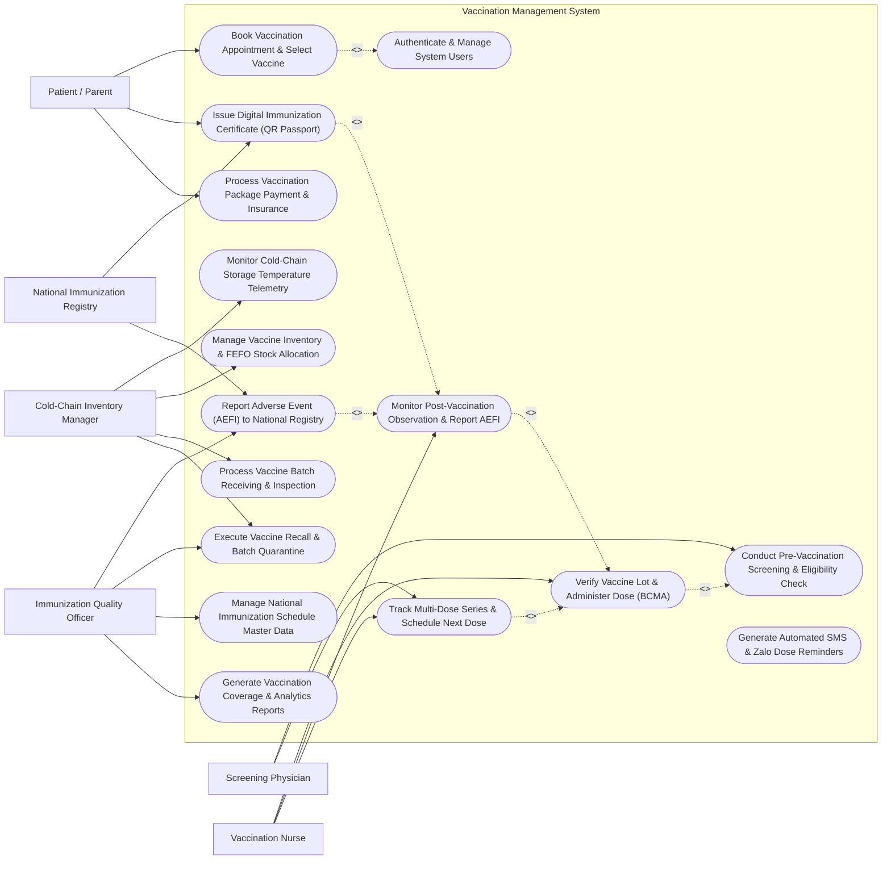

# Use Case Diagram — Vaccination Management System

## Mermaid Code

## Actor Table | Bảng Actor

| # | Actor | Actor Type | Role Description | Related Use Cases |
|---|-------|------------|------------------|-------------------|
| 1 | Patient / Parent | Primary | Recipient or parent registering for immunization, choosing vaccine packages, booking time slots, and viewing QR certificates. | UC01, UC05, UC14 |
| 2 | Screening Physician | Primary | Medical doctor conducting pre-vaccination clinical exams, evaluating health declarations, checking allergies, and approving dose clearance. | UC02, UC10 |
| 3 | Vaccination Nurse | Primary | Registered nurse scanning vaccine vial 2D barcodes, executing injections, logging administration sites, and monitoring 30-minute observation. | UC03, UC04, UC10 |
| 4 | Cold-Chain Inventory Manager | Primary | Warehouse manager overseeing vaccine receiving, freezer storage temperatures, FEFO batch allocations, and recall quarantines. | UC06, UC07, UC09, UC12 |
| 5 | Immunization Quality Officer | Primary | Public health specialist auditing AEFI incidence rates, cold-chain compliance, national schedule updates, and coverage reports. | UC11, UC12, UC13, UC15 |
| 6 | National Immunization Registry | Secondary / System | Governmental portal (MOH / CDC) validating national immunization certificates and receiving mandatory AEFI incident reports. | UC05, UC11 |

## Use Case Table | Bảng Use Case

| # | UC ID | Use Case Name | Primary Actor | Secondary Actor | Description | Priority |
|---|-------|---------------|---------------|-----------------|-------------|----------|
| 1 | UC01 | Book Vaccination Appointment & Select Vaccine | Patient / Parent | None | Register recipient details, select vaccine products or combos, pick clinic location, and reserve time slots. | High |
| 2 | UC02 | Conduct Pre-Vaccination Screening & Eligibility Check | Screening Physician | None | Perform physical exam, measure vitals/temperature, evaluate contraindications/allergies, and issue clinical clearance. | High |
| 3 | UC03 | Verify Vaccine Lot & Administer Dose (BCMA) | Vaccination Nurse | None | Scan vaccine GTIN/Lot 2D barcode, verify FEFO status, inject vaccine at designated anatomical site, and record dose details. | High |
| 4 | UC04 | Monitor Post-Vaccination Observation & Report AEFI | Vaccination Nurse | None | Initiate 30-minute observation room countdown timer, check for immediate adverse reactions (anaphylaxis), and log status. | High |
| 5 | UC05 | Issue Digital Immunization Certificate (QR Passport) | Patient / Parent | National Immunization Registry | Generate cryptographically signed digital QR code vaccine certificate synced with national health registries. | High |
| 6 | UC06 | Monitor Cold-Chain Storage Temperature Telemetry | Cold-Chain Inventory Manager | None | Stream continuous temperature logs from IoT freezer sensors (2°C–8°C) and alert cold-chain thermal excursions. | High |
| 7 | UC07 | Manage Vaccine Inventory & FEFO Stock Allocation | Cold-Chain Inventory Manager | None | Track vaccine stock by lot/expiration date, enforce First-Expired, First-Out picking, and manage safety reorder points. | High |
| 8 | UC08 | Generate Automated SMS & Zalo Dose Reminders | System Engine | None | Automatically dispatch multi-channel appointment and booster dose reminders to patients/parents. | High |
| 9 | UC09 | Process Vaccine Batch Receiving & Inspection | Cold-Chain Inventory Manager | None | Inspect incoming vaccine shipments, verify cold-chain temperature logger compliance, and register batch lots. | High |
| 10 | UC10 | Track Multi-Dose Series & Schedule Next Dose | Vaccination Nurse | Screening Physician | Calculate recommended interval for multi-dose series (e.g., Dose 1 to Dose 2) and auto-schedule follow-up appointments. | High |
| 11 | UC11 | Report Adverse Event (AEFI) to National Registry | Immunization Quality Officer | National Immunization Registry | File mandatory adverse reaction reports (AEFI/VAERS) to Ministry of Health / CDC for safety investigation. | High |
| 12 | UC12 | Execute Vaccine Recall & Batch Quarantine | Immunization Quality Officer | Cold-Chain Inventory Manager | Lock specific vaccine batch lots following safety recalls and physically/digitally isolate quarantined stock. | High |
| 13 | UC13 | Manage National Immunization Schedule Master Data | Immunization Quality Officer | None | Maintain master schedules for expanded program on immunization (EPI), age milestones, and booster rules. | Medium |
| 14 | UC14 | Process Vaccination Package Payment & Insurance | Patient / Parent | None | Calculate vaccine pricing, process digital wallet/card payments, and generate health insurance claims. | Medium |
| 15 | UC15 | Generate Vaccination Coverage & Analytics Reports | Immunization Quality Officer | None | Produce population vaccination coverage rates, dropout rates, vaccine wastage metrics, and clinic throughput. | Medium |
| 16 | UC16 | Authenticate & Manage System Users | All Users | None | Authenticate user credentials, enforce role permissions, and maintain electronic signature audit logs. | High |

## Use Case Specification | Đặc tả Use Case

---

### UC01 — Book Vaccination Appointment & Select Vaccine

| Field | Detail |
|-------|--------|
| **UC ID** | UC01 |
| **Use Case Name** | Book Vaccination Appointment & Select Vaccine |
| **Actor(s)** | Primary: Patient / Parent |
| **Description** | Enables a patient or parent to register recipient demographics, select desired single vaccines or combo package options (e.g., Hexaxim 6-in-1, Rotarix, Pneumococcal), choose a convenient clinic facility, and reserve a specific date and time slot. |
| **Precondition** | 1. The VMS portal/app is accessible to the user.   2. Vaccine availability schedules are configured by clinic facilities. |
| **Main Flow** | 1. The User accesses the "Book Vaccination" feature on the web portal or mobile app.   2. The User selects the recipient profile (Self or Child) or registers a new child recipient (Name, Date of Birth, Gender, National ID / Citizen ID / Birth Certificate number).   3. The System evaluates the recipient's age against the National Immunization Schedule and displays recommended age-appropriate vaccines.   4. The User selects desired vaccine products (e.g., Infanrix Hexa 6-in-1) or a full "Infant 0-12 Month Package".   5. The System checks real-time vaccine stock availability at selected vaccination centers.   6. The User selects a vaccination center location, date, and preferred 30-minute time slot.   7. The User completes a digital pre-screening health questionnaire (Active fever, known allergies, recent illness) and clicks "Confirm Booking".   8. The System reserves the vaccine stock lot, generates a unique Booking QR Code (e.g., VAX-2026-8812), and sends SMS/Zalo confirmation to the user. |
| **Alternative Flow** | **AF1** — Package Pre-Payment Discount: The User opts to pre-pay for a 1-year infant vaccine package, and the System routes to the Payment Gateway (UC14), locking vaccine reservations for all future doses.   **AF2** — Walk-In Kiosk Registration: For walk-in clinic arrivals, the receptionist registers the patient directly at the clinic intake kiosk, printing a queue token with a barcode. |
| **Exception Flow** | **EX1** — Vaccine Product Out of Stock: If the selected vaccine is out of stock at the chosen clinic, the System displays an alert, suggests nearby sister clinic locations with active stock, or allows joining a restock waiting list.   **EX2** — Age Ineligibility Flag: If a parent attempts to book a vaccine not approved for the child's exact age (e.g., MMR before 9 months), the System blocks selection and displays age guideline rules. |
| **Postcondition** | Vaccination appointment is booked, stock reservation is placed, Booking QR Code is generated, and SMS confirmation is dispatched. |
| **Business Rule** | **BR1**: Appointment bookings reserve vaccine stock for up to 2 hours past the scheduled time slot, after which unfulfilled reservations are released back to general inventory.   **BR2**: Age verification against approved product license indications is mandatory for all pediatric vaccine bookings. |

---

### UC02 — Conduct Pre-Vaccination Screening & Eligibility Check

| Field | Detail |
|-------|--------|
| **UC ID** | UC02 |
| **Use Case Name** | Conduct Pre-Vaccination Screening & Eligibility Check |
| **Actor(s)** | Primary: Screening Physician |
| **Description** | Handles the mandatory clinical health examination prior to injection, measuring vital signs (temperature, heart rate, blood pressure), evaluating medical history, checking contraindications (fever, acute illness, severe allergies), and issuing formal digital clearance. |
| **Precondition** | 1. The recipient has checked in at the clinic with a valid appointment token.   2. The Screening Physician is authenticated in VMS with medical exam privileges. |
| **Main Flow** | 1. The Physician scans the recipient's Booking QR Code or searches by name/phone.   2. The System displays the recipient's lifetime immunization history, pre-booked vaccine product, and self-reported health declaration.   3. The Physician measures and inputs clinical vitals: Body Temperature (°C), Heart Rate (bpm), Respiration Rate, and Blood Pressure.   4. The Physician completes the standardized Pre-Vaccination Screening Checklist: Current acute fever (>= 37.5°C), History of severe anaphylaxis to previous vaccine dose, Immunodeficiency or immunosuppressive therapy, Recent blood transfusion / immunoglobulin in last 3 months, Pregnancy status (for live attenuated vaccines).   5. The System cross-checks measured vitals and screening answers against the specific vaccine's contraindication database.   6. If no contraindications exist, the Physician selects "Cleared for Vaccination", selects the approved vaccine product, and signs the electronic screening form.   7. The System updates status to "Cleared - Ready for Injection" and automatically routes the recipient to the assigned Vaccination Injection Room queue. |
| **Alternative Flow** | **AF1** — Temporary Deferral: If the recipient has a fever of 38.0°C, the Physician selects "Temporarily Deferred", specifies a 7-day re-assessment date, and the System automatically reschedules the appointment.   **AF2** — Specialist Referral / Hospital Clearance Required: For high-risk allergy or cardiac patients, the Physician marks "Specialist Clearance Required" and generates a referral document to a tertiary hospital. |
| **Exception Flow** | **EX1** — Absolute Contraindication Identified: If the recipient had a prior Grade 4 anaphylactic reaction to the same vaccine, the System hard-blocks clearance, displays a red warning banner, and logs permanent vaccine contraindication on the profile.   **EX2** — Live Vaccine Timing Conflict: If a live attenuated vaccine (e.g., Varicella) is scheduled less than 28 days after another live vaccine (e.g., MMR), the System flags a timing conflict and blocks clearance. |
| **Postcondition** | Clinical pre-screening parameters are saved, contraindication checks are passed, digital physician signature is applied, and recipient is queued for administration. |
| **Business Rule** | **BR1**: Pre-vaccination temperature measurement is mandatory for 100% of recipients; no injection can be administered without a documented temperature < 37.5°C.   **BR2**: Clinical clearance is valid only for the calendar day of examination. |

---

### UC03 — Verify Vaccine Lot & Administer Dose (BCMA)

| Field | Detail |
|-------|--------|
| **UC ID** | UC03 |
| **Use Case Name** | Verify Vaccine Lot & Administer Dose (BCMA) |
| **Actor(s)** | Primary: Vaccination Nurse |
| **Description** | Implements Barcode Medication Administration (BCMA) at the injection station by scanning the vaccine vial's GS1 2D DataMatrix barcode to verify the 5 Rights (Right Patient, Vaccine, Dose, Route, Expiration), injecting the vaccine, and recording administration details. |
| **Precondition** | 1. The recipient has a status of "Cleared for Vaccination" from the Screening Physician.   2. The Nurse is equipped with a 2D barcode scanner connected to VMS. |
| **Main Flow** | 1. The Nurse calls the recipient into the injection room and scans the recipient's Screening Clearance Barcode.   2. The System displays the physician-cleared vaccine name, target dose number (e.g., Dose 2 of 3), and recommended anatomical site.   3. The Nurse retrieves the cold-stored vaccine vial/syringe from the active cooling tray and scans the 2D DataMatrix barcode printed on the vaccine packaging.   4. The System parses the GS1 barcode payload extracting GTIN, Batch Lot Number, and Expiration Date.   5. The System validates the 5 Rights: Right Recipient (matches screening clearance), Right Vaccine (matches approved product), Right Lot (active, unexpired, non-recalled batch), Right Expiration (valid date), Right Cold-Chain (verifies batch cold storage status).   6. If all checks pass, the System displays a green "Clearance Valid - Administer Dose" screen.   7. The Nurse cleans the injection site, administers the vaccine, selects the anatomical site (e.g., Left Anterolateral Thigh for infant, Right Deltoid for adult), and clicks "Confirm Injection".   8. The System decrements the batch inventory balance by 1 dose, records administration timestamp and nurse User ID, updates the recipient's immunization record, and automatically starts the 30-minute Post-Vaccination Observation Timer (UC04). |
| **Alternative Flow** | **AF1** — Multi-Dose Vial Extraction Tracking: For multi-dose vials (e.g., 10-dose vial), the Nurse scans the main vial once and enters the draw count (e.g., Dose 4 of 10), with the System tracking open-vial expiration time limit (e.g., discard after 6 hours).   **AF2** — Combined Multi-Vaccine Co-Administration: If the recipient is cleared for 2 vaccines in 1 visit (e.g., Flu + Pneumococcal), the System guides sequential barcode verification and enforces different anatomical injection sites (e.g., Left Deltoid and Right Deltoid). |
| **Exception Flow** | **EX1** — Expired or Recalled Vaccine Scan: If the scanned vial lot is expired or flagged under a recall quarantine, the System sounds a red audible alert "EXPIRED/RECALLED BATCH - DO NOT INJECT" and locks injection recording.   **EX2** — Mismatched Vaccine Product: If the Nurse scans a different vaccine brand than physician-cleared, the System displays a red "PRODUCT MISMATCH" error and prevents administration confirmation. |
| **Postcondition** | Vaccine administration is recorded with batch lot traceability, inventory is decremented, immunization history is updated, and 30-minute observation timer is initiated. |
| **Business Rule** | **BR1**: Physical 2D barcode scanning of every individual vaccine packaging vial prior to injection is mandatory; manual typing of lot numbers is disabled.   **BR2**: Co-administered injectable vaccines given during the same visit must be injected at separate anatomical sites at least 2.5cm apart. |

---

### UC04 — Monitor Post-Vaccination Observation & Report AEFI

| Field | Detail |
|-------|--------|
| **UC ID** | UC04 |
| **Use Case Name** | Monitor Post-Vaccination Observation & Report AEFI |
| **Actor(s)** | Primary: Vaccination Nurse |
| **Description** | Manages the mandatory 30-minute post-injection observation room period, tracks countdown timers for all administered recipients, monitors for immediate adverse reactions (anaphylaxis, syncope, rash), and logs Adverse Events Following Immunization (AEFI). |
| **Precondition** | 1. The recipient has completed vaccine injection and entered the observation room.   2. The Observation Nurse has access to the active observation dashboard screen. |
| **Main Flow** | 1. The recipient enters the observation room, and the Nurse scans the recipient's token to check into the observation zone.   2. The System starts a 30-minute automated countdown timer (displayed on central observation monitors and mobile apps).   3. The Nurse conducts periodic visual monitoring for signs of immediate reaction (breathing difficulty, facial swelling, dizziness, hives, pale skin).   4. When the 30-minute timer reaches 00:00 without incident, the System changes status to "Observation Complete - Ready for Checkout".   5. The Nurse performs a brief final check, clicks "Check-Out Recipient", and the System generates post-care home guidelines and releases the Digital Immunization Certificate (UC05). |
| **Alternative Flow** | **AF1** — Immediate Anaphylactic Emergency Response: If the recipient exhibits acute anaphylaxis, the Nurse clicks "EMERGENCY ANAPHYLAXIS ALERT", triggering an immediate emergency code call to the clinic resuscitation team, and logs Epinephrine administration (dose, time).   **AF2** — Minor Vasovagal Syncope Log: If a patient faints from needle anxiety, the Nurse logs "Vasovagal Syncope", places the patient supine with legs elevated, records recovery vitals, and extends observation by 15 minutes. |
| **Exception Flow** | **EX1** — Early Departure Attempt: If a recipient attempts to check out before the 30-minute timer expires, the System displays a warning "Observation Period Incomplete (12 mins remaining)" and requires nurse override signature.   **EX2** — Severe AEFI Incident Recording: For Grade 3 or 4 adverse reactions, the System opens the detailed AEFI Incident Form, auto-populates vaccine lot/batch data, and triggers mandatory national registry reporting (UC11). |
| **Postcondition** | 30-minute observation compliance is documented, immediate reactions or AEFI events are recorded, recipient is checked out, and digital certificates are unlocked. |
| **Business Rule** | **BR1**: 100% of vaccinated recipients must complete a minimum 30-minute post-injection observation period before physical clinic release.   **BR2**: Any post-vaccination anaphylaxis event requires mandatory Epinephrine administration logging and immediate reporting to public health authorities within 24 hours. |

---

### UC05 — Issue Digital Immunization Certificate (QR Passport)

| Field | Detail |
|-------|--------|
| **UC ID** | UC05 |
| **Use Case Name** | Issue Digital Immunization Certificate (QR Passport) |
| **Actor(s)** | Primary: Patient / Parent   Secondary: National Immunization Registry |
| **Description** | Generates, signs, and issues a standardized digital QR code immunization certificate (compliant with Vietnam MOH E-Health Portal and WHO Smart Vaccination Certificate guidelines) following successful completion of a vaccine dose or full series. |
| **Precondition** | 1. The recipient has completed vaccination administration and 30-minute post-observation check-out.   2. Digital cryptographic signing keys are active in VMS. |
| **Main Flow** | 1. Upon observation check-out, the System automatically compiles the official vaccination event data: Recipient Full Name, Date of Birth, National ID / Passport, Vaccine Product Name, Manufacturer, Batch Lot Number, Dose Number, Date of Administration, Vaccinating Facility Name.   2. The System generates a standardized JSON Web Signature (JWS) payload encoding the vaccination payload.   3. The System applies the facility's cryptographic private key to sign the digital payload, generating a secure 2D QR Code.   4. The System pushes the digital certificate to the Patient / Parent's mobile app account (e.g., Vietnam Electronic Health Wallet / VNeID) and transmits the record to the National Immunization Registry.   5. The Patient / Parent opens their mobile app to view the official green "Vaccinated" digital certificate with verifiable QR Code.   6. External verifiers (airports, schools, employers) can scan the QR Code using a public verification scanner to validate digital authenticity without internet access. |
| **Alternative Flow** | **AF1** — Physical Paper Certificate Printing: For patients without smartphones, the clinic receptionist prints a physical paper Immunization Certificate featuring the official clinic stamp and printed QR Code.   **AF2** — Multi-Dose Series Progress Certificate: If the recipient completes Dose 1 of a 2-dose series, the System issues a "Partially Vaccinated (Dose 1/2)" yellow certificate, indicating the upcoming due date for Dose 2. |
| **Exception Flow** | **EX1** — National Registry Sync Failure: If the network connection to the National Immunization Registry is down, the System queues the registry sync payload and issues a locally signed temporary certificate.   **EX2** — Recipient Demographic Discrepancy: If the recipient's National ID on record does not match national population database records, the System flags "Identity Verification Pending" on the certificate banner. |
| **Postcondition** | Cryptographically signed digital QR immunization certificate is generated, stored on patient mobile app, printed if needed, and synced with the National Immunization Registry. |
| **Business Rule** | **BR1**: Digital QR vaccination certificates must comply with national e-health signature standards and allow offline cryptographic verification.   **BR2**: Certificates are automatically updated to "Fully Vaccinated" status only when all required doses in a vaccine series are completed. |
