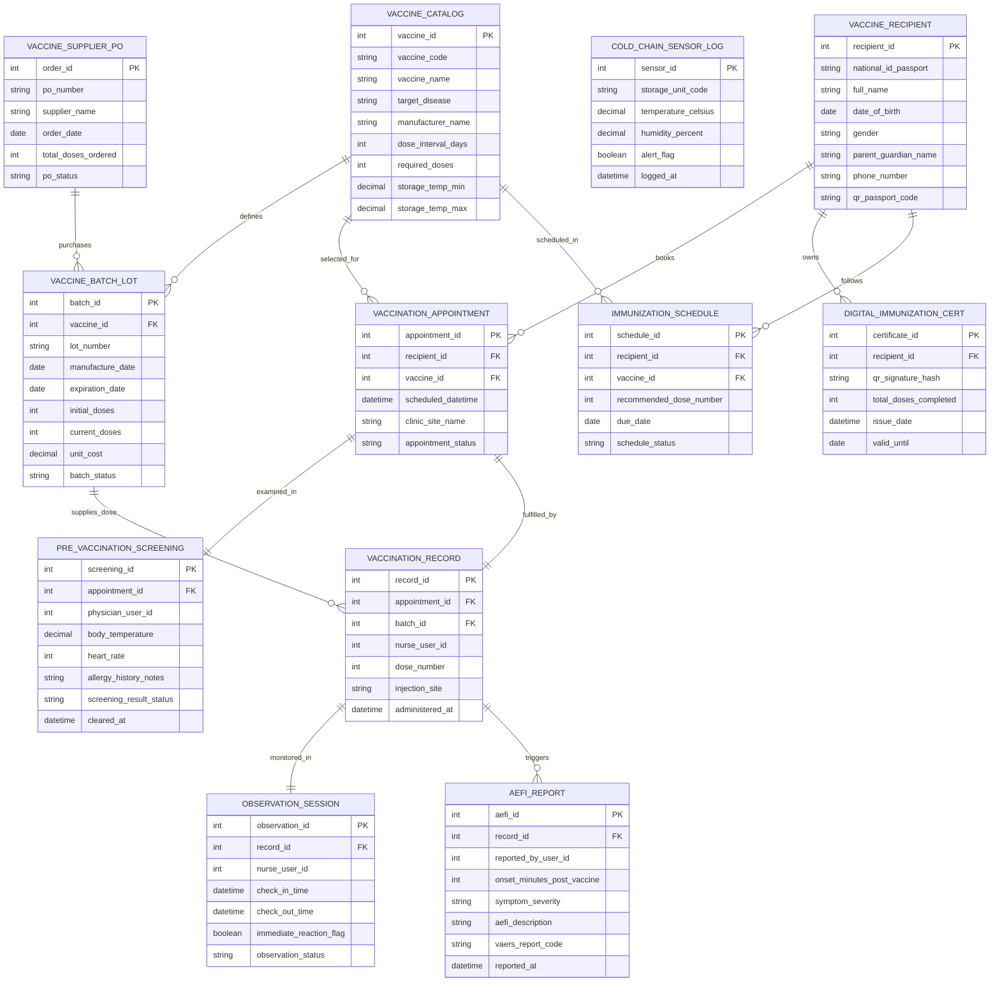

# Conceptual ERD — Vaccination Management System

## Mermaid Code

## Entity Description Table | Bảng mô tả Entity

| # | Entity Name | Vietnamese Name | Description | Key Attributes | Main Relationships |
|---|-------------|-----------------|-------------|----------------|-------------------|
| 1 | VACCINE_RECIPIENT | Người Tiêm chủng | Master recipient profile storing National ID/Passport, demographics, parent info, and digital QR code passport ID. | recipient_id, national_id_passport, full_name, dob, parent_guardian_name, phone_number | Has many VACCINATION_APPOINTMENT, DIGITAL_IMMUNIZATION_CERT, IMMUNIZATION_SCHEDULE. |
| 2 | VACCINE_CATALOG | Danh mục Vắc-xin | Master catalog of vaccine products defining target disease, manufacturer, dose intervals, and cold storage temperature ranges. | vaccine_id, vaccine_code, vaccine_name, target_disease, required_doses, storage_temp_min/max | Has many VACCINE_BATCH_LOT, VACCINATION_APPOINTMENT, and IMMUNIZATION_SCHEDULE entities. |
| 3 | VACCINE_BATCH_LOT | Lô Vắc-xin & Hạn dùng | Specific vaccine inventory lot record tracking batch number, manufacture date, expiration date, initial/current doses, and status. | batch_id, vaccine_id, lot_number, expiration_date, current_doses, batch_status | Belongs to VACCINE_CATALOG and VACCINE_SUPPLIER_PO; Has many VACCINATION_RECORD entities. |
| 4 | COLD_CHAIN_SENSOR_LOG | Nhật ký Cảm biến Chuỗi Lạnh | Telemetry log capturing continuous temperature (°C) and humidity (%) data from IoT refrigerator/freezer sensors. | sensor_id, storage_unit_code, temperature_celsius, humidity_percent, alert_flag, logged_at | Standalone sensor telemetry entity monitoring storage units. |
| 5 | VACCINATION_APPOINTMENT | Lịch hẹn Tiêm chủng | Booking record reserving a vaccine product, recipient, clinic location, date, and 30-minute time slot. | appointment_id, recipient_id, vaccine_id, scheduled_datetime, clinic_site_name, appointment_status | Belongs to VACCINE_RECIPIENT and VACCINE_CATALOG; Has one PRE_VACCINATION_SCREENING and VACCINATION_RECORD. |
| 6 | PRE_VACCINATION_SCREENING | Khám Sàng lọc Trước Tiêm | Clinical pre-vaccination examination record capturing body temperature, vitals, allergy screening, and physician clearance. | screening_id, appointment_id, physician_user_id, body_temperature, screening_result_status, cleared_at | Belongs to VACCINATION_APPOINTMENT. |
| 7 | VACCINATION_RECORD | Hồ sơ Tiêm chủng | Injection administration record capturing scanned vaccine lot, dose number, injection route/site, timestamp, and nurse ID. | record_id, appointment_id, batch_id, nurse_user_id, dose_number, injection_site, administered_at | Belongs to VACCINATION_APPOINTMENT and VACCINE_BATCH_LOT; Has one OBSERVATION_SESSION; Has many AEFI_REPORT. |
| 8 | OBSERVATION_SESSION | Theo dõi Sau Tiêm | Post-vaccination 30-minute observation room tracking record logging check-in/out times and immediate reaction status. | observation_id, record_id, nurse_user_id, check_in_time, check_out_time, immediate_reaction_flag | Belongs to VACCINATION_RECORD. |
| 9 | AEFI_REPORT | Báo cáo Phản ứng Sau Tiêm | Mandatory Adverse Event Following Immunization (AEFI) report tracking onset time, symptom severity, and VAERS codes. | aefi_id, record_id, reported_by_user_id, onset_minutes_post_vaccine, symptom_severity, vaers_report_code | Belongs to VACCINATION_RECORD. |
| 10 | DIGITAL_IMMUNIZATION_CERT | Chứng nhận Tiêm số (QR) | Cryptographically signed digital immunization passport containing QR signature hash, total doses completed, and validity. | certificate_id, recipient_id, qr_signature_hash, total_doses_completed, issue_date, valid_until | Belongs to VACCINE_RECIPIENT. |
| 11 | IMMUNIZATION_SCHEDULE | Lịch Tiem Mới/Mở rộng (EPI) | Recipient's personalized immunization schedule tracking recommended vaccine doses, target due dates, and fulfillment status. | schedule_id, recipient_id, vaccine_id, recommended_dose_number, due_date, schedule_status | Belongs to VACCINE_RECIPIENT and VACCINE_CATALOG. |
| 12 | VACCINE_SUPPLIER_PO | Đơn Mua Vắc-xin | Commercial purchase order issued to pharmaceutical suppliers for vaccine batch lot procurement. | order_id, po_number, supplier_name, order_date, total_doses_ordered, po_status | Has many VACCINE_BATCH_LOT entities. |

## Relationship Description | Mô tả Quan hệ

| # | From Entity | Cardinality | To Entity | Relationship Label | Business Explanation |
|---|-------------|-------------|-----------|-------------------|----------------------|
| 1 | VACCINE_RECIPIENT | one-to-many | VACCINATION_APPOINTMENT | books | One vaccine recipient can book multiple vaccination appointments over time. |
| 2 | VACCINE_RECIPIENT | one-to-many | DIGITAL_IMMUNIZATION_CERT | owns | One recipient owns digital QR immunization certificates. |
| 3 | VACCINE_RECIPIENT | one-to-many | IMMUNIZATION_SCHEDULE | follows | One recipient follows a personalized immunization schedule containing multiple due doses. |
| 4 | VACCINE_CATALOG | one-to-many | VACCINE_BATCH_LOT | defines | One master vaccine product defines multiple incoming batch lots. |
| 5 | VACCINE_CATALOG | one-to-many | VACCINATION_APPOINTMENT | selected_for | One vaccine catalog item is selected across multiple patient appointments. |
| 6 | VACCINE_CATALOG | one-to-many | IMMUNIZATION_SCHEDULE | scheduled_in | One vaccine product is scheduled in multiple recipient immunization milestones. |
| 7 | VACCINE_BATCH_LOT | one-to-many | VACCINATION_RECORD | supplies_dose | One vaccine batch lot supplies doses for multiple vaccination administration records. |
| 8 | VACCINATION_APPOINTMENT | one-to-one | PRE_VACCINATION_SCREENING | examined_in | One appointment undergoes exactly one pre-vaccination clinical screening examination. |
| 9 | VACCINATION_APPOINTMENT | one-to-one | VACCINATION_RECORD | fulfilled_by | One cleared appointment is fulfilled by exactly one vaccination injection record. |
| 10 | VACCINATION_RECORD | one-to-one | OBSERVATION_SESSION | monitored_in | One administered vaccination record is monitored in exactly one 30-minute observation session. |
| 11 | VACCINATION_RECORD | one-to-many | AEFI_REPORT | triggers | One vaccination record can trigger one or more adverse event (AEFI) safety reports if reactions occur. |
| 12 | VACCINE_SUPPLIER_PO | one-to-many | VACCINE_BATCH_LOT | purchases | One supplier purchase order purchases multiple incoming vaccine batch lots. |
